## CAN与CANopen的概念

CAN和CANopen不是同一层级的协议：

- CAN定义报文怎样在线路上传输。
- CANopen定义设备数据怎样组织、设备怎样启动、参数怎样读写以及节点怎样协同工作。

一句话概括：

> CAN提供可靠的数据运输能力，CANopen在CAN之上规定统一的设备通信规则。

## 1. CAN协议

CAN全称 **Controller Area Network**，即控制器局域网。

它是一种多主、广播式、差分串行总线，主要定义：

- CAN_H、CAN_L差分传输；
- 报文帧格式；
- 11位或29位标识符；
- 总线仲裁；
- CRC和ACK；
- 错误检测；
- 自动重发；
- 故障节点隔离。

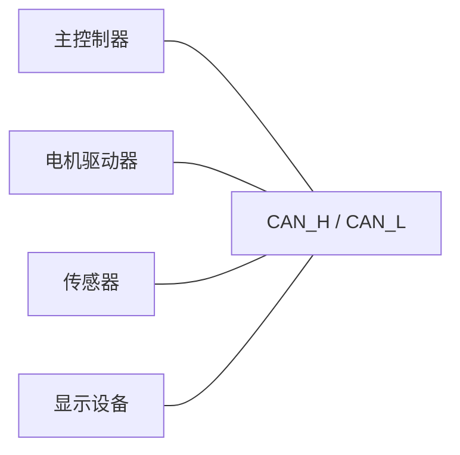

CAN只知道一帧报文包含：

- 一个CAN ID；
- 若干数据字节；
- 控制和校验信息。

CAN本身并不规定某个CAN ID代表电机转速、温度还是控制命令，这些含义需要由上层协议定义。

## 2. CANopen协议

CANopen是建立在CAN总线之上的应用层协议，主要由CiA（CAN in Automation）组织制定。

CANopen的核心标准是：

- CiA 301：CANopen应用层和通信规范；
- CiA 302：CANopen管理和可编程设备相关规范；
- CiA 305：LSS层设置服务；
- CiA 402：驱动器与运动控制设备规范。

CANopen规定了：

- 节点编号；
- 对象字典；
- 通信对象；
- 设备状态机；
- 参数访问方式；
- 实时过程数据传输；
- 网络管理；
- 故障和在线状态监控；
- 不同类型设备的标准功能模型。

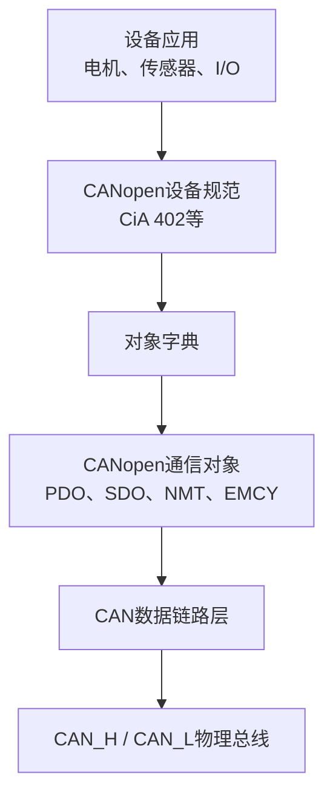

## 3. CAN与CANopen的关系

可以把两者理解为“运输系统”和“业务规则”的关系：

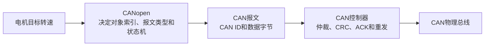

| 层级 | CAN | CANopen |
|---|---|---|
| 物理层 | 定义 | 使用CAN物理层 |
| 数据链路层 | 定义 | 使用CAN报文 |
| 应用层 | 不定义数据语义 | 定义数据和设备行为 |
| 设备模型 | 无 | 对象字典 |
| 网络管理 | 无统一标准 | NMT |
| 实时过程数据 | 由用户自行定义 | PDO |
| 参数读写 | 由用户自行定义 | SDO |
| 故障上报 | 只有CAN控制器错误 | EMCY |
| 在线监控 | 由用户自行设计 | Heartbeat |
| 设备互操作性 | 较低 | 通过CiA规范提高 |

## 4. CANopen网络结构

CANopen网络通常由一个NMT管理节点和多个普通节点组成。

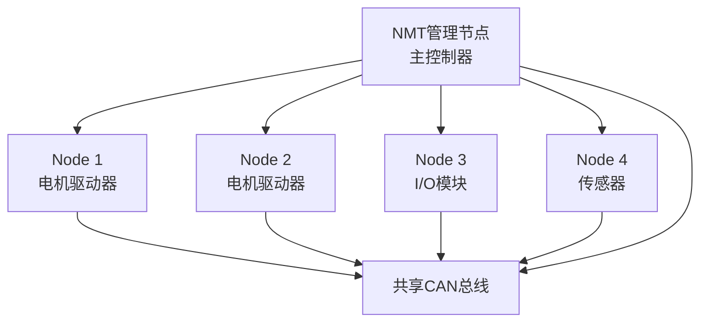

需要注意：

- CAN本身是多主总线；
- CANopen通信也允许多个节点主动发送PDO、Heartbeat和EMCY；
- “NMT主节点”主要负责网络状态管理，并不意味着所有业务报文都必须经过它转发。

## 5. Node-ID

CANopen节点通常具有一个 `Node-ID`，常用范围为：

```text
1～127
```

Node-ID用于：

- 区分网络节点；
- 生成部分通信对象的默认CAN ID；
- 定位SDO服务器；
- 区分Heartbeat发送者；
- 生成默认PDO标识符。

`Node-ID = 0`通常用于NMT广播等特殊用途，不作为普通设备节点地址。

## 6. 对象字典

对象字典（Object Dictionary，OD）是CANopen最核心的数据模型。

设备中的参数和状态都通过“索引+子索引”访问：

```text
Index + Sub-index
```

例如：

| 索引 | 子索引 | 示例含义 |
|---:|---:|---|
| `0x1000` | `0x00` | 设备类型 |
| `0x1001` | `0x00` | 错误寄存器 |
| `0x1017` | `0x00` | Heartbeat周期 |
| `0x1600` | 多个 | RPDO映射参数 |
| `0x1A00` | 多个 | TPDO映射参数 |
| `0x6040` | `0x00` | CiA 402控制字 |
| `0x6041` | `0x00` | CiA 402状态字 |
| `0x606C` | `0x00` | 实际速度 |

对象字典结构：

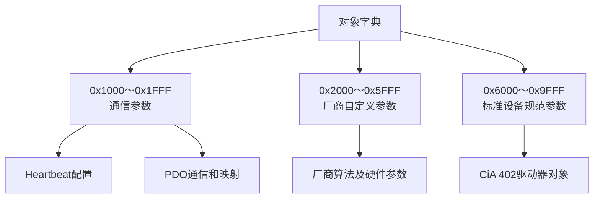

对象字典使不同厂商设备能够使用统一方式访问参数。

## 7. CANopen主要通信对象

CANopen主要包含以下通信机制：

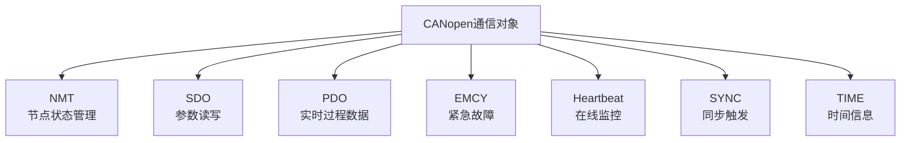

## 8. NMT网络管理

NMT全称 **Network Management**，用于控制节点运行状态。

典型CANopen节点状态包括：

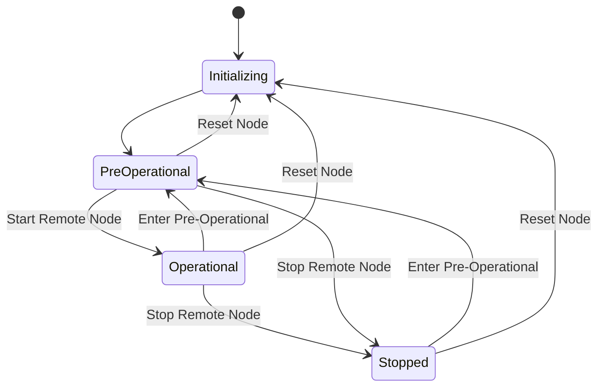

各状态的典型行为：

| 状态 | SDO | PDO | Heartbeat |
|---|---:|---:|---:|
| Initializing | 通常不可用 | 不可用 | 启动完成后发送Boot-up |
| Pre-operational | 可用 | 通常不传输 | 可用 |
| Operational | 可用 | 可用 | 可用 |
| Stopped | 通常受限 | 不可用 | 可用 |

常见初始化过程是：

1. 节点上电；
2. 初始化硬件和协议栈；
3. 发送Boot-up报文；
4. 进入Pre-operational；
5. 管理节点通过SDO配置参数和PDO；
6. 发送NMT启动命令；
7. 节点进入Operational；
8. 开始PDO实时通信。

## 9. SDO参数访问

SDO全称 **Service Data Object**，用于读写对象字典。

它适合传输：

- 设备配置；
- 控制参数；
- 标定数据；
- 设备信息；
- PDO映射配置；
- 非周期性数据。

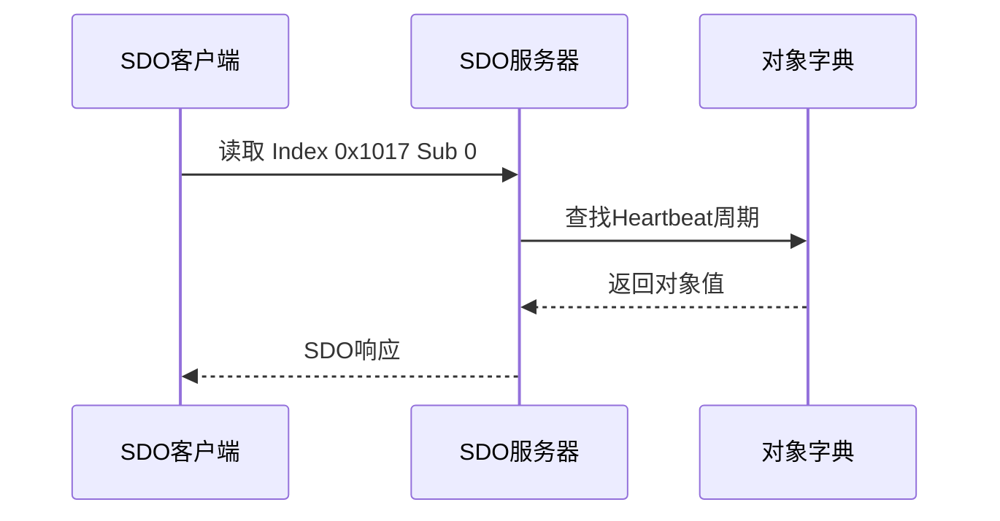

通常控制器作为SDO客户端，设备作为SDO服务器。

SDO是确认式通信，具有请求和响应，因此可靠但额外开销较大，不适合高频实时数据。

## 10. PDO过程数据

PDO全称 **Process Data Object**，用于快速传输实时过程数据。

PDO分为：

- TPDO：设备发送的PDO；
- RPDO：设备接收的PDO。

这里的“T”和“R”以当前节点视角定义：

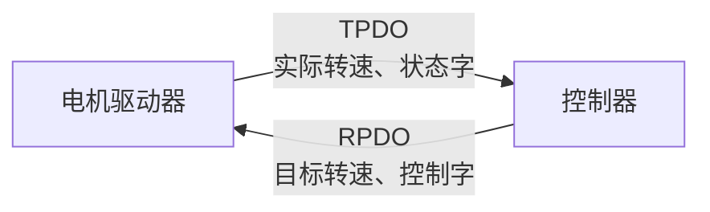

PDO特点：

- 通常不需要请求与响应；
- 数据直接放入CAN数据字段；
- 通信开销小；
- 适合周期性或事件触发数据；
- 数据内容可通过PDO映射配置；
- 经典CAN中一个PDO最多携带8字节数据。

## 11. PDO映射

PDO映射决定对象字典中的哪些对象被装入PDO。

例如一个8字节TPDO可以映射：

| 对象 | 长度 |
|---|---:|
| 状态字 `0x6041` | 16 bit |
| 实际速度 `0x606C` | 32 bit |
| 工作模式显示 | 8 bit |
| 温度 | 8 bit |

总长度：

\[
16+32+8+8=64\ bit=8\ Byte
\]

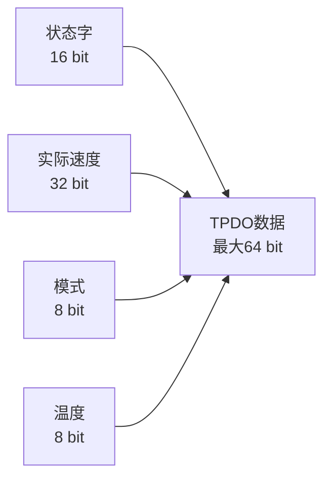

PDO映射使应用数据与CAN帧之间建立明确、可配置的对应关系。

## 12. PDO触发方式

PDO可以采用多种传输方式：

- 同步周期传输；
- 同步非周期传输；
- 异步事件触发；
- 定时周期传输；
-远程请求方式，实际工程中较少使用。

### 同步PDO

由SYNC报文建立通信节拍：

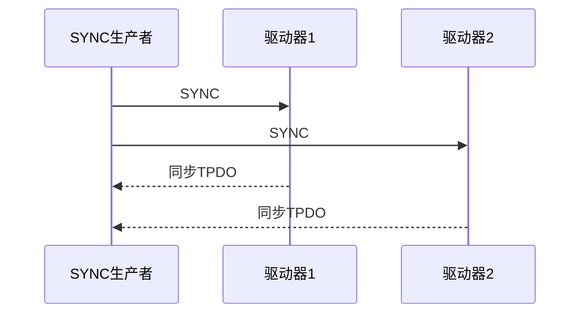

### 事件触发PDO

当数据变化或事件发生时发送，同时可以使用：

- Event Timer：事件周期；
- Inhibit Time：禁止重复发送时间。

`Inhibit Time`可以防止某个节点因数据频繁变化而过度占用总线。

## 13. Heartbeat在线监控

Heartbeat用于检测节点是否在线以及当前处于什么NMT状态。

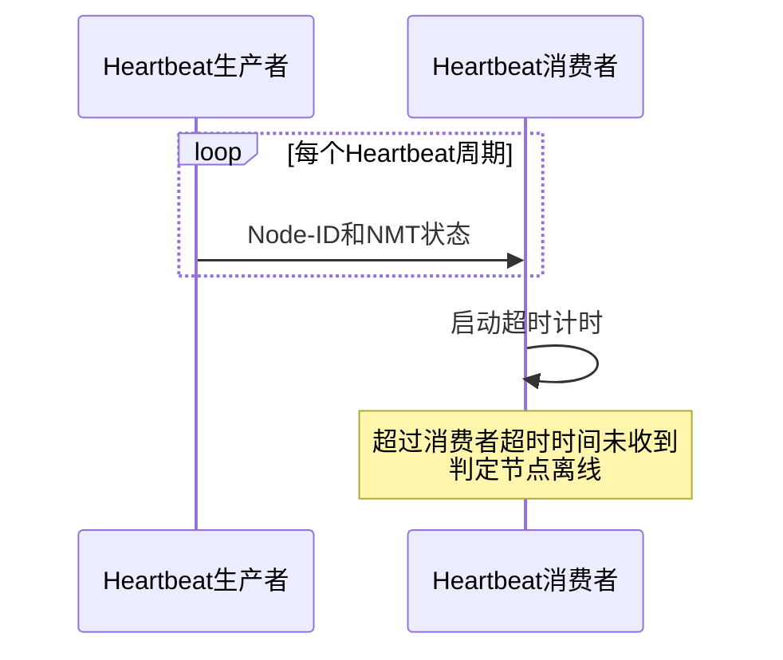

相关角色：

- Heartbeat Producer：周期发送状态；
- Heartbeat Consumer：监控其他节点；
- Consumer Timeout：接收超时时间。

通常消费者超时时间应大于生产者周期，并留出总线延迟和调度裕量。

## 14. EMCY紧急报文

EMCY全称 **Emergency Object**，用于设备发生故障时快速上报。

典型故障包括：

- 过流；
- 过压；
- 欠压；
- 过温；
- 编码器异常；
- 通信错误；
- 驱动器内部故障。

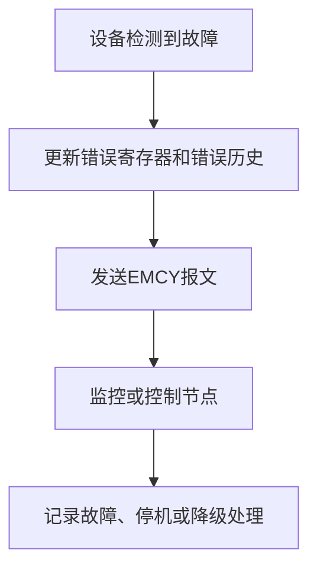

EMCY用于事件通知，不应代替持续状态监控。故障的详细状态通常还需要通过对象字典、SDO或状态PDO读取。

## 15. SYNC同步对象

SYNC用于为多个CANopen节点提供统一的通信节拍。

它可以协调：

- 多轴电机控制；
- 同步采样；
- 同步PDO发送；
- 同步控制周期。

SYNC不等同于高精度时钟同步，其同步精度受到：

- CAN总线仲裁；
- 节点中断响应；
- 软件调度；
- 控制器时钟误差；
- 总线负载影响。

## 16. CANopen默认COB-ID

COB-ID用于确定CANopen通信对象使用的CAN标识符。

经典预定义连接集中的常见默认值如下：

| 通信对象 | 默认COB-ID |
|---|---:|
| NMT | `0x000` |
| SYNC | `0x080` |
| EMCY | `0x080 + Node-ID` |
| TPDO1 | `0x180 + Node-ID` |
| RPDO1 | `0x200 + Node-ID` |
| TPDO2 | `0x280 + Node-ID` |
| RPDO2 | `0x300 + Node-ID` |
| TPDO3 | `0x380 + Node-ID` |
| RPDO3 | `0x400 + Node-ID` |
| TPDO4 | `0x480 + Node-ID` |
| RPDO4 | `0x500 + Node-ID` |
| SDO响应 | `0x580 + Node-ID` |
| SDO请求 | `0x600 + Node-ID` |
| Heartbeat/Boot-up | `0x700 + Node-ID` |

由于CAN ID越小优先级越高，因此NMT、SYNC和EMCY通常具有较高总线优先级。

## 17. CANopen设备启动流程

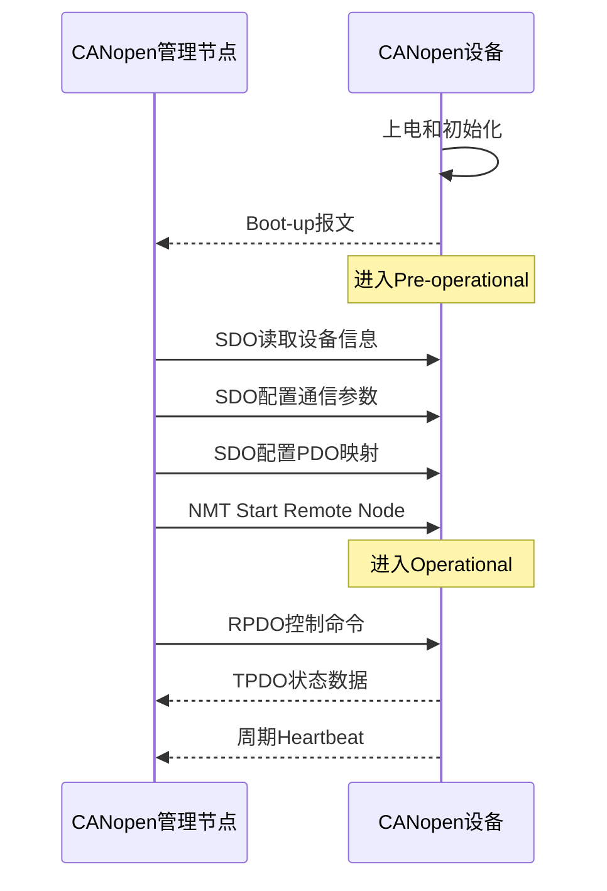

## 18. CiA 402电机驱动规范

CiA 402是CANopen中常见的驱动器和运动控制设备规范，适用于：

- 伺服驱动器；
- 变频器；
- 电机控制器；
- 位置执行机构。

它定义了标准对象，例如：

| 索引 | 对象 |
|---:|---|
| `0x6040` | Controlword控制字 |
| `0x6041` | Statusword状态字 |
| `0x6060` | Modes of operation工作模式 |
| `0x6061` | Modes of operation display |
| `0x6064` | Position actual value |
| `0x606C` | Velocity actual value |
| `0x607A` | Target position |
| `0x60FF` | Target velocity |

CiA 402还定义了驱动器状态机：

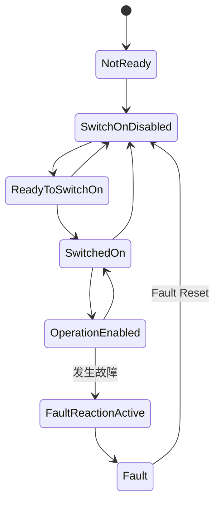

应用通过控制字发出状态转换命令，通过状态字确认驱动器当前状态。

## 19. CANopen与自定义CAN协议对比

| 对比项 | 自定义CAN协议 | CANopen |
|---|---|---|
| 开发难度 | 初期较低 | 初期较高 |
| CAN ID分配 | 自行定义 | 有标准通信对象 |
| 参数访问 | 自行设计 | SDO和对象字典 |
| 实时数据 | 自行设计 | PDO |
| 节点管理 | 自行设计 | NMT |
| 在线监控 | 自行设计 | Heartbeat |
| 故障上报 | 自行设计 | EMCY |
| 设备互操作性 | 较低 | 较高 |
| 文档和工具 | 依赖项目 | 有EDS及CANopen工具 |
| 适用场景 | 小型封闭系统 | 标准化、多厂商系统 |

## 20. EDS设备描述文件

EDS全称 **Electronic Data Sheet**，用于描述CANopen设备。

EDS通常包含：

- 厂商和产品信息；
- 支持的对象字典；
- 对象数据类型；
- 默认值和取值范围；
- 访问权限；
- PDO映射能力；
- 通信参数。

CANopen配置工具读取EDS后，可以用图形界面显示和配置设备对象。

设备当前配置也可以保存为DCF（Device Configuration File）。

## 21. CANopen典型数据路径

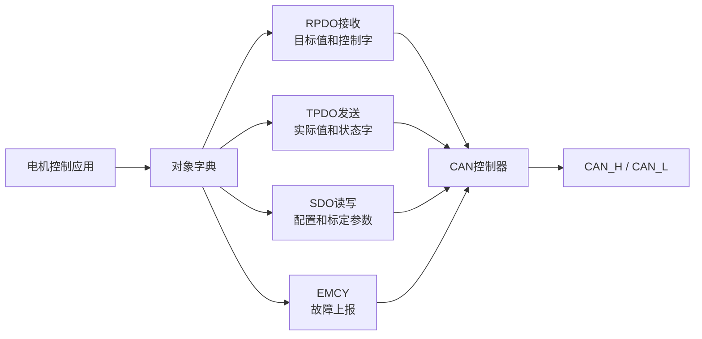

## 22. 使用CANopen时的注意事项

- 正确规划每个节点的Node-ID；
- 控制总线负载，避免PDO发送过于频繁；
- 为重要报文分配较高优先级的COB-ID；
- 正确配置Heartbeat生产者和消费者超时；
- 修改PDO映射时遵循“先禁用、再修改、最后启用”的流程；
- 区分TPDO与RPDO的节点视角；
- SDO适合配置，不适合高频实时控制；
- EMCY只负责故障通知，详细故障仍需读取对象字典；
- 明确定义字节序、数据类型、缩放比例和单位；
- CANopen经典网络通常使用11位CAN ID；
- CANopen FD是独立扩展体系，不能直接假设经典CANopen设备支持CAN FD。

## 23. 总结

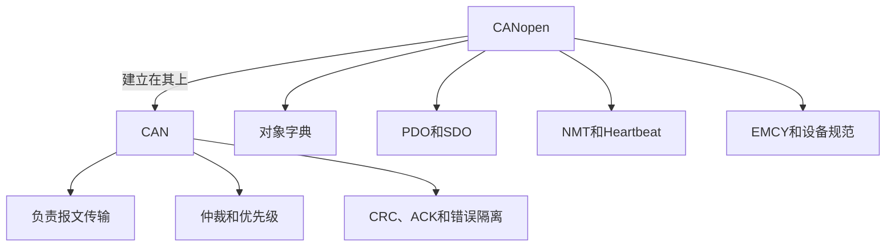

核心区别是：

> CAN解决“数据怎样可靠地通过总线”。

> CANopen解决“数据表示什么、设备怎样配置、节点怎样启动以及故障怎样上报”。