## CAN与ARINC 429总线协议的概念

CAN和ARINC 429都属于串行通信总线，但设计目标明显不同：

- CAN：面向汽车、工业和嵌入式控制的多节点共享总线。
- ARINC 429：面向航空电子设备的单向、确定性点到多点数据总线。

## 1. CAN总线

CAN全称 **Controller Area Network**，即控制器局域网。

它是一种多主、广播式、差分串行通信总线。多个节点共享同一对通信线，任何节点在总线空闲时都可以发送数据。

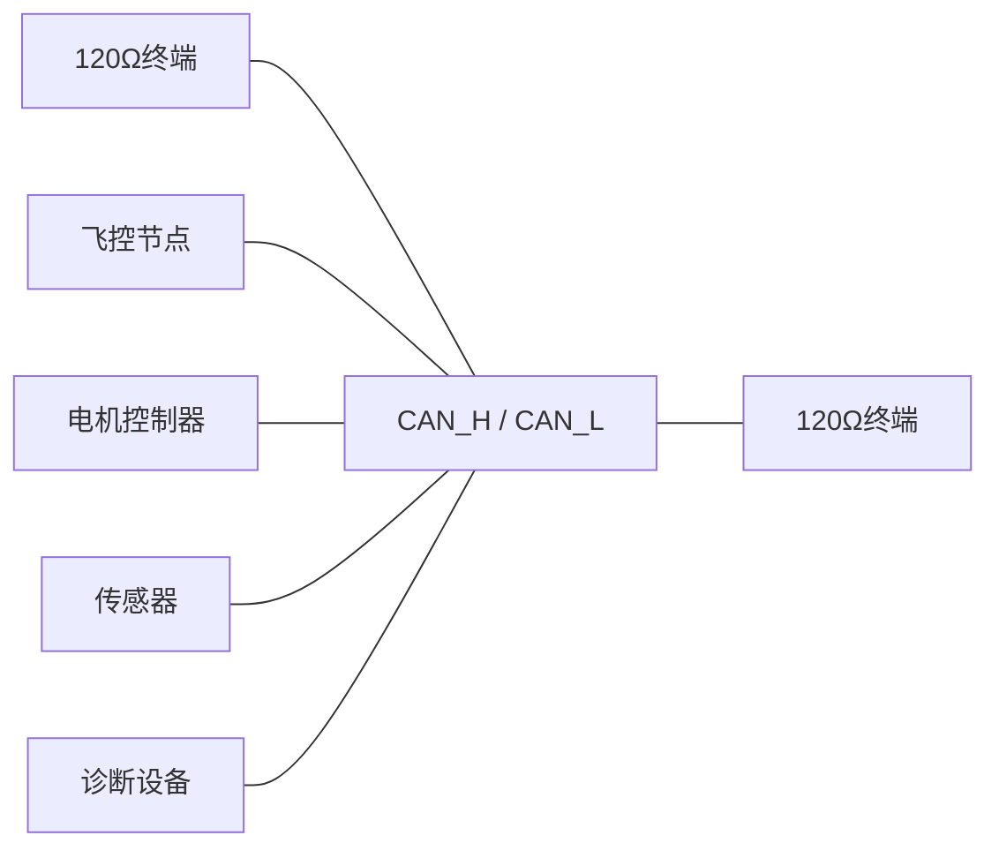

### 1.1 CAN的主要特点

- 多主通信；
- 所有节点共享总线；
- 基于消息标识符通信，不使用固定设备地址；
- 使用差分信号，抗干扰能力较强；
- 通过逐位仲裁解决多个节点同时发送的问题；
- 支持错误检测、自动重发和故障节点隔离；
- 报文长度较短，适合实时控制和状态数据；
- 总线长度与通信速率相互制约。

### 1.2 基于消息的通信

CAN报文的标识符描述的是“数据含义和优先级”，而不是接收设备地址。

例如：

| CAN ID | 数据含义 |
|---:|---|
| `0x100` | 电机转速 |
| `0x101` | 电机电流 |
| `0x110` | 母线电压 |
| `0x200` | 控制命令 |
| `0x300` | 故障状态 |

所有节点都能看到报文，由接收过滤器决定是否接收。

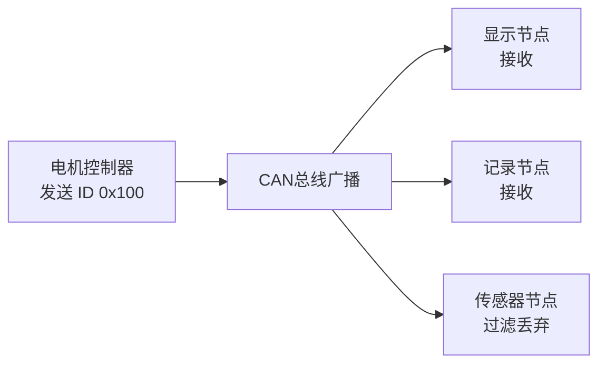

这种机制支持一个发送者、多个接收者。

## 2. CAN总线仲裁

当多个节点同时发送报文时，CAN使用标识符进行非破坏性逐位仲裁。

CAN总线上：

- 显性位通常表示逻辑0；
- 隐性位通常表示逻辑1；
- 显性位会覆盖隐性位；
- 标识符数值越小，优先级越高。

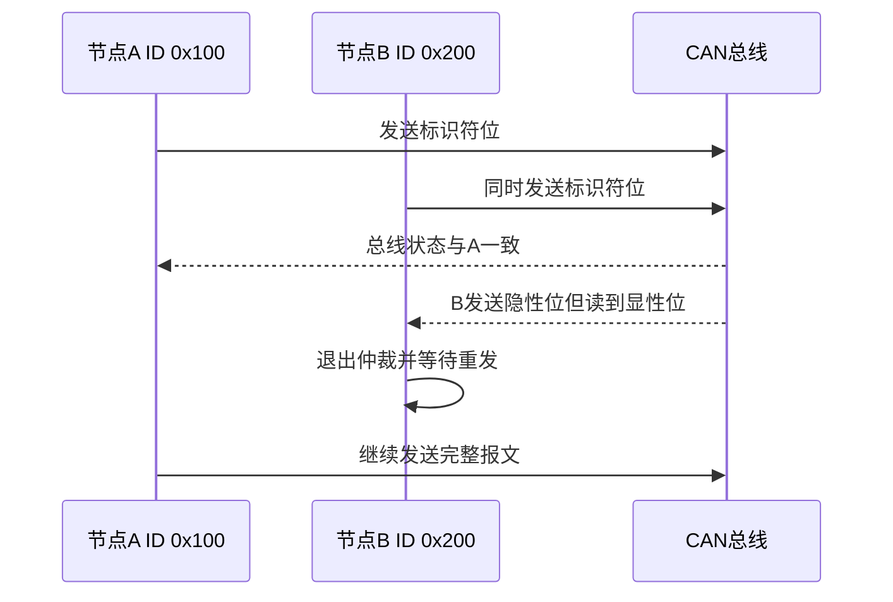

仲裁失败的节点不会破坏获胜节点的报文，之后会等待总线空闲再次尝试。

## 3. CAN报文类型

经典CAN主要包括：

- Data Frame：数据帧；
- Remote Frame：远程请求帧；
- Error Frame：错误帧；
- Overload Frame：过载帧。

经典CAN数据帧概念结构如下：

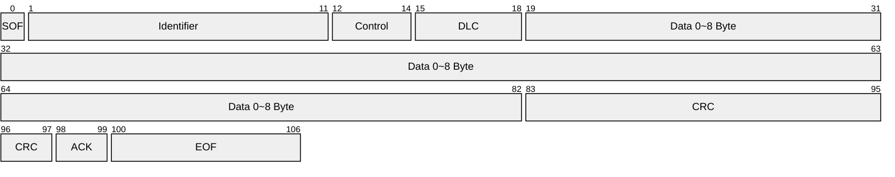

CAN支持两种标识符格式：

- 标准帧：11位标识符；
- 扩展帧：29位标识符。

## 4. 经典CAN与CAN FD

| 特性 | 经典CAN | CAN FD |
|---|---:|---:|
| 单帧最大数据长度 | 8 Byte | 64 Byte |
| 仲裁段和数据段速率 | 相同 | 数据段可以加速 |
| CRC | 经典CAN CRC | 更强的CRC机制 |
| 远程帧 | 支持 | 不支持传统远程帧 |
| 典型用途 | 控制和状态报文 | 固件升级、大数据量通信 |

CAN FD的仲裁阶段仍采用较低标称速率，仲裁结束后可切换到更高的数据阶段速率。

## 5. CAN物理层

高速CAN通常使用：

- `CAN_H`；
- `CAN_L`；
- 双绞线；
- 总线两端各一个120Ω终端电阻。

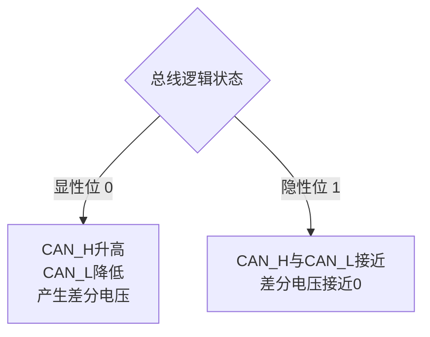

终端电阻用于抑制信号反射。高速CAN通常要求线型拓扑，分支线应尽量短。

## 6. CAN错误处理

CAN控制器可以检测：

- 位错误；
- 填充错误；
- CRC错误；
- 格式错误；
- ACK错误。

每个节点维护发送和接收错误计数器，并可能处于以下状态：

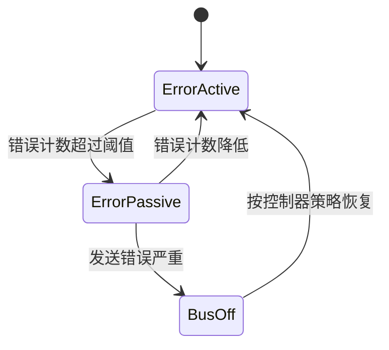

`Bus-Off`机制能够隔离持续干扰总线的故障节点。

---

## 7. ARINC 429总线

ARINC 429是航空电子设备之间使用的数字数据总线标准。

它采用：

- 单发送器；
- 单向传输；
- 一个发送器连接一个或多个接收器；
- 屏蔽双绞线；
- 双极性归零信号；
- 固定速率；
- 32位数据字。

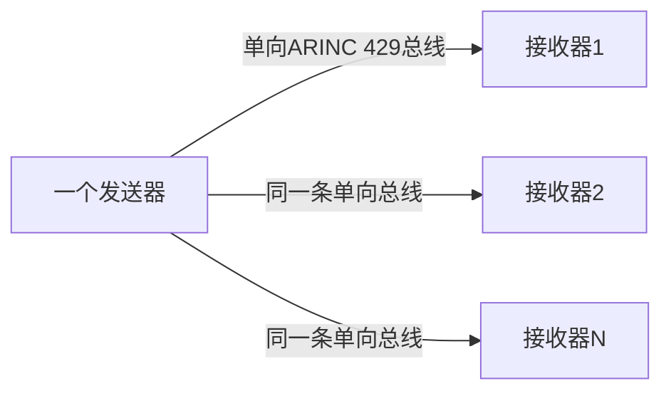

一条ARINC 429总线只能有一个发送器，通常最多连接20个接收器。

如果两个设备需要双向通信，通常需要两条相反方向的总线：

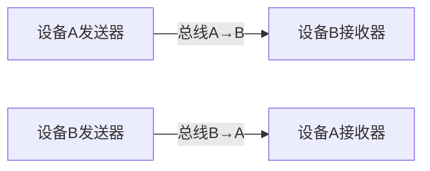

## 8. ARINC 429传输速率

ARINC 429常见两种速率：

- 低速：12.5 kbit/s；
- 高速：100 kbit/s。

同一条总线上的发送器和所有接收器必须使用相同速率。

ARINC 429没有CAN那样的总线仲裁，因为每条总线只有一个合法发送器，不会发生多个节点竞争总线的问题。

## 9. ARINC 429数据字格式

ARINC 429每个数据字固定为32位：

| 位号 | 字段 | 含义 |
|---:|---|---|
| 1～8 | Label | 标签，标识数据类型 |
| 9～10 | SDI | 源/目的标识或数据扩展 |
| 11～29 | Data | 数据字段 |
| 30～31 | SSM | 符号、状态或数据有效性 |
| 32 | Parity | 奇校验位 |

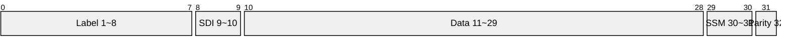

### Label

Label用于表示数据含义，例如：

- 空速；
- 高度；
- 航向；
- 经纬度；
- 发动机状态；
- 设备离散状态。

Label通常使用八进制表示，例如 `203`、`310`。需要特别注意，Label字段在线路传输和软件显示时存在特殊的位序处理，不能简单当作普通8位整数直接解释。

### SDI

SDI全称 Source/Destination Identifier，可用于：

- 区分数据来源；
- 指定目标设备；
- 扩展数据字段；
- 作为数据编码的一部分。

其具体含义取决于对应Label的接口控制文件。

### Data

数据字段占19位，常见编码方式包括：

- BNR：二进制数值；
- BCD：二进制编码十进制；
- Discrete：离散状态位；
- 字符或维护数据。

### SSM

SSM全称 Sign/Status Matrix，其含义取决于数据编码类型，通常表示：

- 正负号；
- 正常工作；
- 无计算数据；
- 功能测试；
- 故障告警。

不能脱离Label和数据格式单独解释SSM。

### Parity

第32位通常采用奇校验，使整个32位数据字中“1”的总数为奇数。

它可以检测部分传输错误，但不像CAN那样提供CRC、自动重发和故障计数机制。

## 10. ARINC 429物理信号

ARINC 429采用双极性归零调制，常称为BPRZ。

逻辑状态包括：

- `HI`：正差分电压；
- `NULL`：接近零电压；
- `LO`：负差分电压。

每一位发送后都会回到NULL状态：

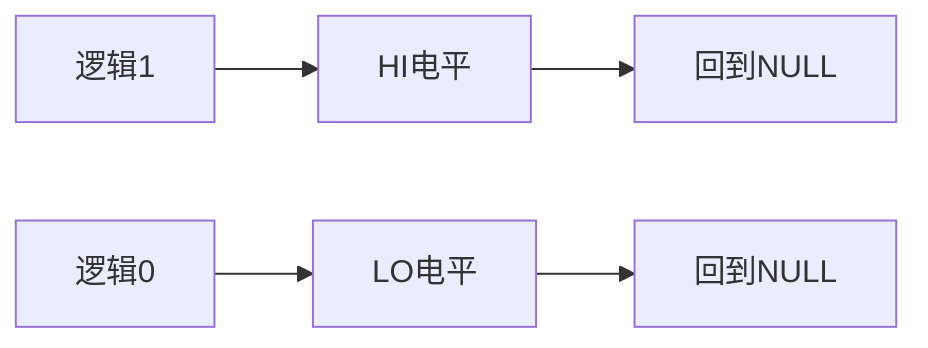

这种编码有利于时钟恢复、信号检测和航空环境下的抗干扰。

## 11. ARINC 429数据发送流程

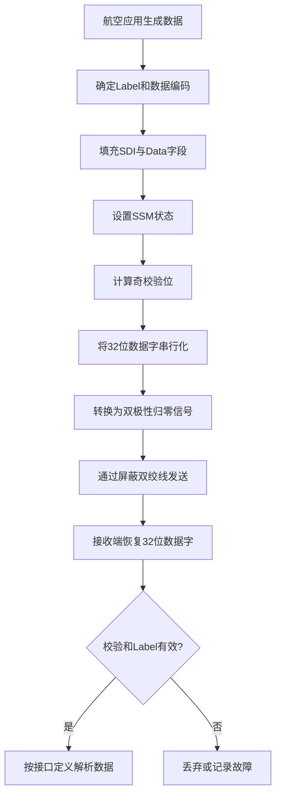

多个数据字可以周期性发送，数据更新率通常由接口控制文件规定。

## 12. CAN与ARINC 429对比

| 对比项 | CAN | ARINC 429 |
|---|---|---|
| 主要应用 | 汽车、工业、嵌入式控制 | 航空电子 |
| 网络结构 | 多主共享总线 | 单发送器、单向总线 |
| 传输方向 | 同一总线双向共享 | 每条总线单向 |
| 节点竞争 | 使用逐位仲裁 | 不存在竞争 |
| 数据标识 | 11位或29位CAN ID | 8位Label |
| 数据长度 | 经典CAN最大8字节 | 固定32位数据字 |
| 通信速率 | 常见最高1 Mbit/s | 12.5或100 kbit/s |
| 错误检测 | CRC、位检查、ACK等 | 主要为奇校验 |
| 自动重发 | 支持 | 通常不支持 |
| 故障隔离 | 错误计数和Bus-Off | 依赖设备和系统设计 |
| 接线数量 | 一条总线连接多个收发节点 | 每个发送方向需要独立线对 |
| 确定性 | 基于优先级仲裁 | 单发送器，时序较直接 |
| 接收方式 | 报文广播和ID过滤 | Label过滤 |
| 硬件成本 | 较低 | 航空专用接口成本较高 |

## 13. 两种总线的数据流差异

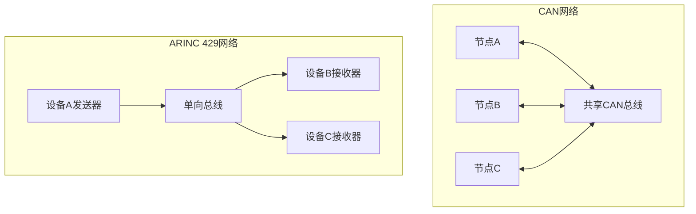

CAN节点通常同时具备发送和接收能力；ARINC 429发送器和接收器在逻辑及硬件上具有明确方向。

## 14. 在航空系统中的使用

CAN及其航空扩展协议可用于：

- 作动器控制；
- 电机控制器通信；
- 起落架或舱门控制；
- 航空辅助设备；
- 机内分布式传感器；
- 维护和诊断网络。

ARINC 429常用于：

- 飞行管理计算机；
- 惯性导航设备；
- 大气数据计算机；
- 雷达高度表；
- 自动驾驶系统；
- 驾驶舱显示设备；
- 发动机控制和状态传输。

两种总线也可以通过网关转换：

网关需要完成：

- CAN ID与ARINC 429 Label映射；
- 数据长度和编码转换；
- BNR、BCD或离散量转换；
- 数据更新周期调整；
- 超时和数据有效性处理；
- CAN故障状态到SSM状态的映射。

## 15. 核心区别

可以用两句话理解：

> CAN让多个控制节点在同一条总线上按优先级竞争发送数据。

> ARINC 429为一个航空发送设备提供一条固定方向、固定速率、无竞争的数据通道。

CAN更灵活、布线较少、错误处理能力强；ARINC 429结构简单、通信方向明确、时序易于分析，但带宽较低，双向通信和设备互联需要更多线缆。