## RS-485、RS-422与ARINC 429的区别

首先需要澄清：工程中没有常见的“RS-429总线”标准。结合前文语境，你说的应该是 **ARINC 429**。

如果你实际想问的是RS-232，请再说明。下面按照RS-485、RS-422和ARINC 429进行比较。

## 1. 核心区别

- RS-422：一个发送器向一个或多个接收器发送差分信号。
- RS-485：多个节点可以共享差分总线，并轮流发送。
- ARINC 429：一个航空电子发送器通过单向总线向多个接收器周期发送固定32位数据字。

| 对比项 | RS-422 | RS-485 | ARINC 429 |
|---|---|---|---|
| 标准类型 | 电气物理层 | 电气物理层 | 航空数据总线标准 |
| 信号方式 | 差分 | 差分 | 双极性归零差分信号 |
| 通信方向 | 单向或四线全双工 | 两线半双工或四线全双工 | 单向 |
| 发送器数量 | 每条线通常1个 | 支持多个收发器共享总线 | 每条总线严格1个发送器 |
| 接收器数量 | 标准上通常最多10个 | 传统为32个单位负载 | 通常最多20个 |
| 典型速率 | 最高约10 Mbit/s，受距离限制 | 最高可达数十Mbit/s，受器件和距离限制 | 12.5或100 kbit/s |
| 数据帧 | 不规定 | 不规定 | 固定32位数据字 |
| 总线仲裁 | 不规定 | 不规定 | 不需要仲裁 |
| 典型用途 | 编码器、工业串口、设备互联 | 工业现场总线、仪表、控制器 | 航空电子设备 |
| 常见协议 | 自定义、Modbus RTU等 | Modbus RTU、BACnet MS/TP等 | ARINC 429 Label和数据字 |

## 2. RS-422

RS-422是一种差分串行通信电气标准。

它规定：

- 驱动器和接收器的电气特性；
- 差分电压范围；
- 共模电压容限；
- 负载能力；
- 传输距离和速率之间的关系。

它不规定：

- 字节格式；
- 设备地址；
- 数据帧；
- CRC；
- 主从关系；
- 应用数据含义。

### 典型结构

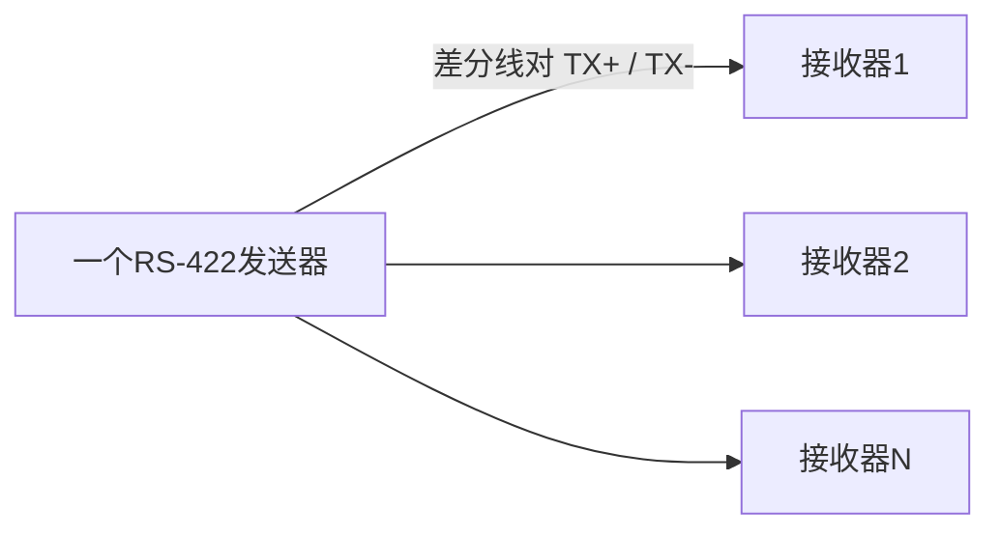

RS-422允许一个发送器连接多个接收器，但同一线对通常不能由多个发送器轮流驱动。

### RS-422全双工

使用两对差分线可以实现点对点全双工：

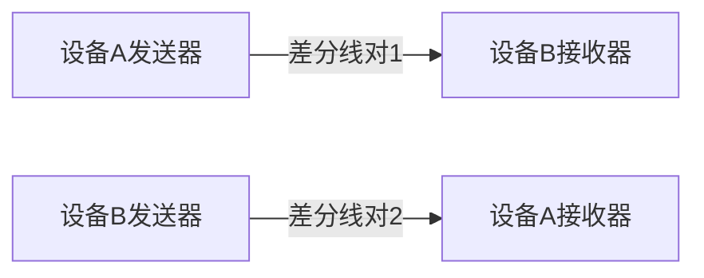

常见线缆包括：

- TX+、TX−；
- RX+、RX−；
- 信号参考地；
- 屏蔽层。

RS-422适合：

- 编码器数据；
- 工业控制器通信；
- 较长距离串行通信；
- 一个发送端向多个设备广播；
- 需要同时发送和接收的点对点通信。

## 3. RS-485

RS-485也是差分串行通信电气标准，但它允许多个收发器共享同一总线。

### 两线半双工结构

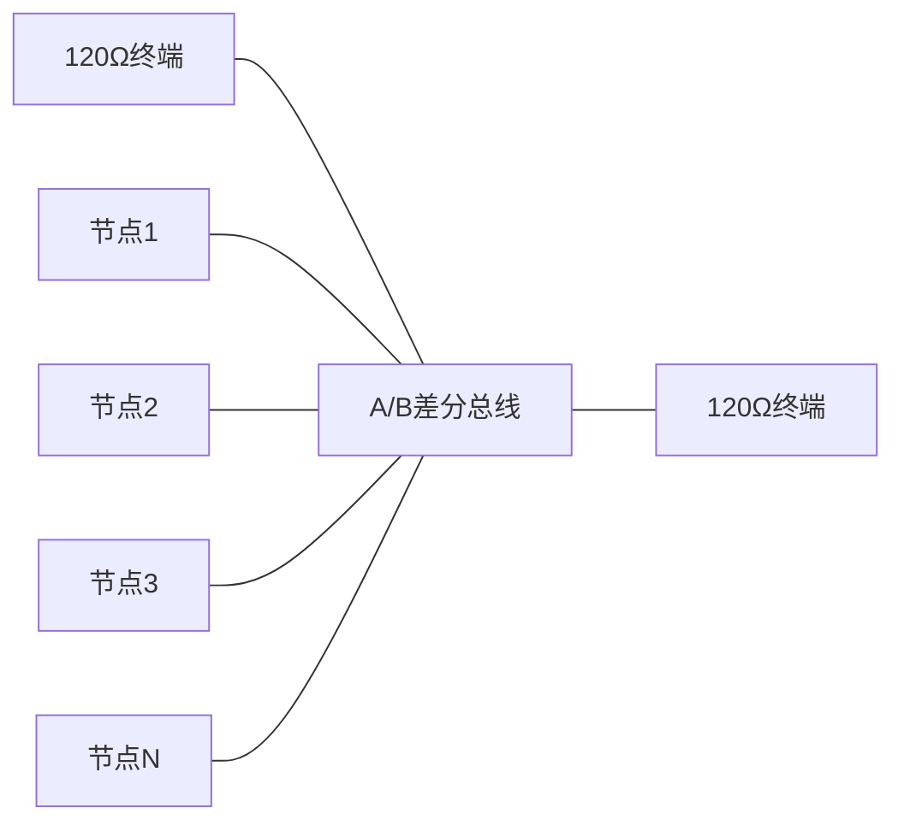

所有节点连接到同一对差分线，但任一时刻通常只能有一个节点使能发送器。

节点发送完成后必须及时关闭驱动输出，使其他节点能够发送。

### 多节点发送控制

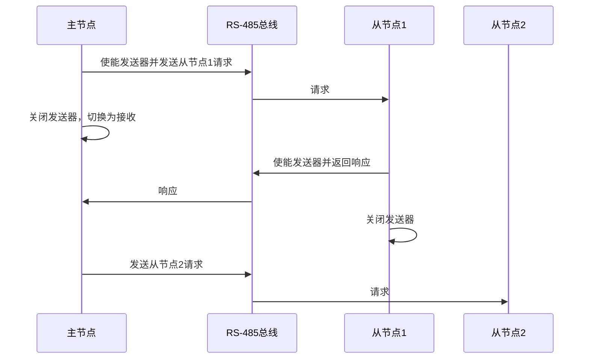

RS-485本身不负责仲裁，因此必须由上层协议保证两个节点不会同时发送。

### 四线全双工结构

四线RS-485通常采用一个主站发送线对和一个从站返回线对：

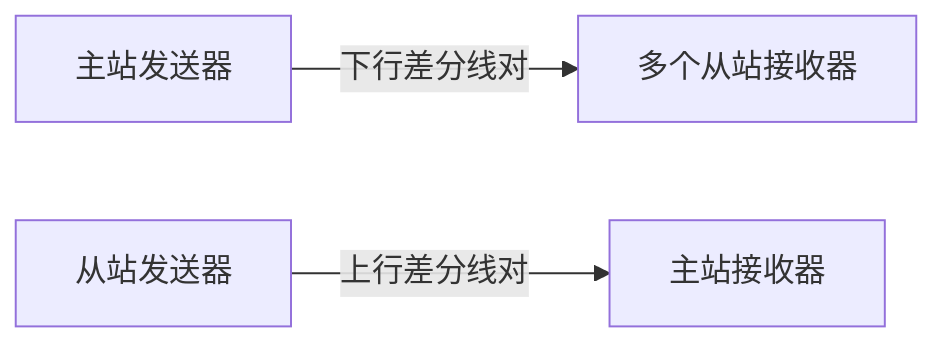

即使使用四线结构，从站之间通常仍需要协议调度，避免多个从站同时驱动上行线对。

## 4. RS-422与RS-485的主要区别

| 对比项 | RS-422 | RS-485 |
|---|---|---|
| 发送器数量 | 一条线对通常只有一个 | 一条总线可连接多个可控发送器 |
| 驱动器输出 | 通常长期有效 | 支持三态输出 |
| 典型结构 | 一发多收 | 多点共享 |
| 半双工 | 不适合作为多发送器半双工总线 | 两线半双工是典型方式 |
| 全双工 | 两对线点对点或一发多收 | 可使用四线结构 |
| 节点管理 | 相对简单 | 需要控制发送使能和总线访问 |
| 典型应用 | 编码器、显示器、固定发送端 | Modbus RTU、工业仪表、分布式节点 |

两者的差分电气特性相近，有些现代收发器也兼容RS-422和RS-485，但系统拓扑和驱动方式仍应按具体器件数据手册设计。

## 5. ARINC 429

ARINC 429是航空电子数字数据总线标准。它不仅规定电气信号，还规定固定的32位数据字。

### 网络结构

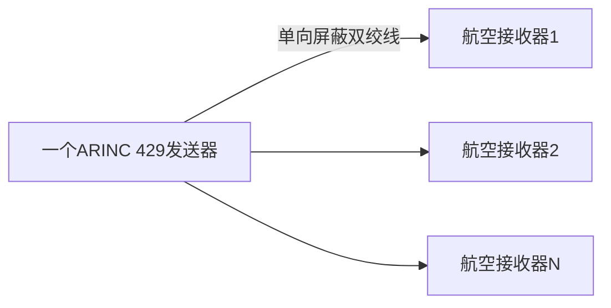

一条ARINC 429总线只能有一个发送器。

需要双向通信时，应使用两条相反方向的总线：

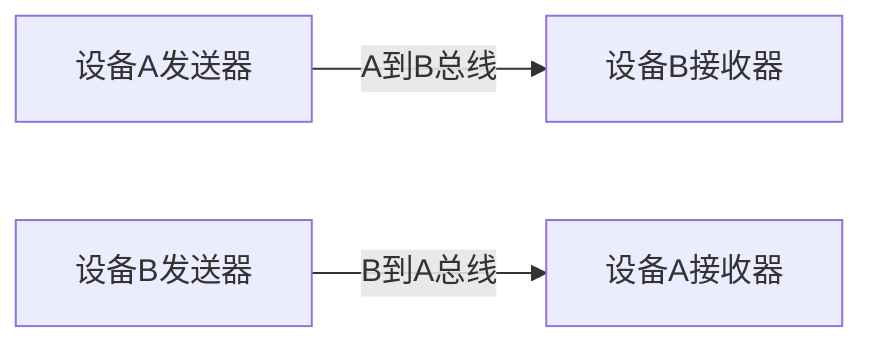

### 32位数据字

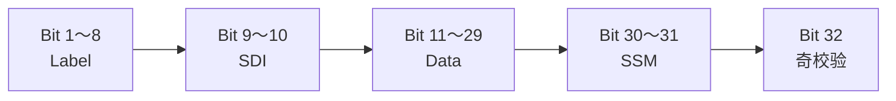

字段含义：

- Label：表示高度、航向、空速等数据类型；
- SDI：源或目的标识，也可作为数据扩展；
- Data：BNR、BCD或离散量数据；
- SSM：符号、状态或数据有效性；
- Parity：奇校验。

## 6. 电气信号区别

### RS-422和RS-485

RS-422和RS-485使用差分电平：

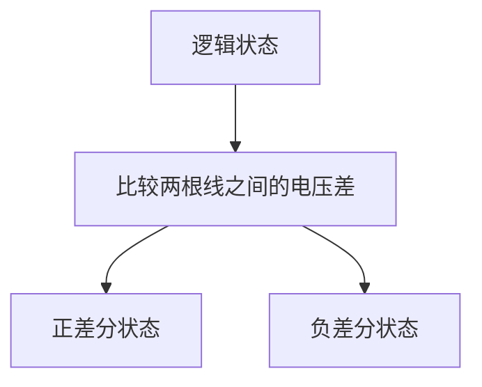

具体哪一种差分极性表示逻辑1，可能受到标准命名、芯片引脚命名和协议UART极性的影响，因此工程中应依据收发器数据手册和实测波形确认。

### ARINC 429

ARINC 429采用双极性归零编码：

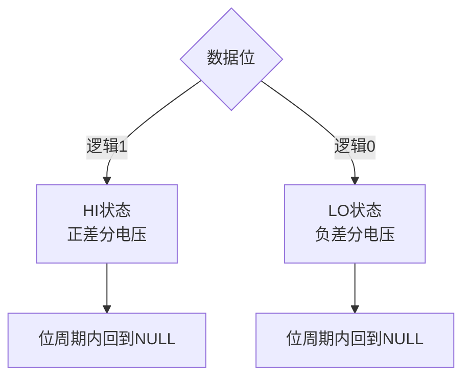

ARINC 429每一位都包含回到NULL状态的过程，而RS-422/RS-485一般保持对应差分状态，不要求每位归零。

## 7. 终端匹配区别

### RS-485

RS-485线型总线通常在物理总线两端分别放置终端电阻：

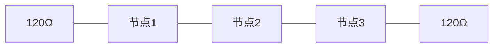

终端电阻应位于主干线两端，而不是每个节点都安装。

两线RS-485还可能需要：

- 偏置电阻；
- Fail-safe接收器；
- 发送使能控制；
- 浪涌和ESD保护；
- 隔离电源和数字隔离器。

### RS-422

点对点或一发多收的RS-422通常在接收链路末端匹配，具体阻值依据线缆特性阻抗和收发器要求确定。

### ARINC 429

ARINC 429不能直接套用“两端各120Ω”的RS-485终端方式。其发送器、接收器输入阻抗、线缆和耦合方式应按照ARINC 429接口规范及设备设计要求实现。

## 8. 数据协议区别

RS-422和RS-485只规定物理层，因此上层报文可以自行设计：

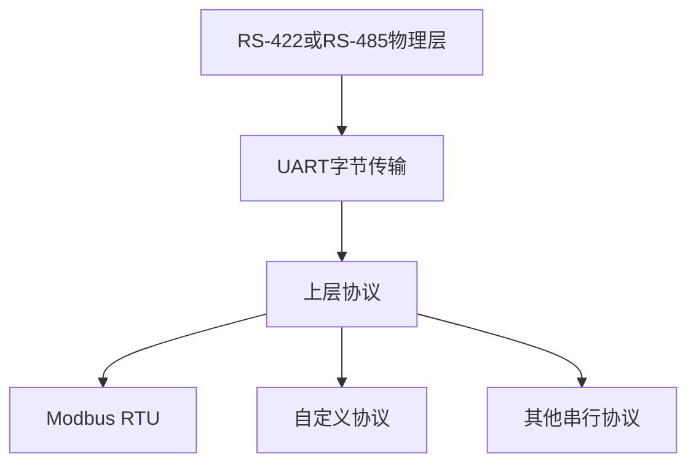

ARINC 429则已经定义数据字结构：

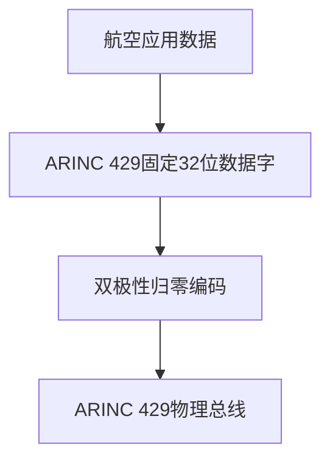

因此不能只通过更换收发器，把普通RS-422数据直接变成ARINC 429。

## 9. 三者是否可以直接连接

不能直接连接。

| 转换方向 | 是否可直接连接 | 原因 |
|---|---:|---|
| RS-422 ↔ RS-485 | 通常不能简单直连 | 拓扑、发送使能和电气要求不同 |
| RS-422 ↔ ARINC 429 | 不能 | 电平、编码和帧结构不同 |
| RS-485 ↔ ARINC 429 | 不能 | 电平、编码、拓扑和协议不同 |

需要专用网关或转换电路：

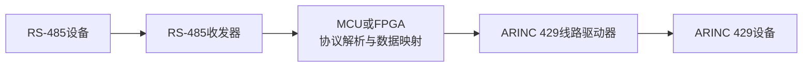

网关需要完成：

- 电气隔离；
- 串行数据接收；
- 数据帧解析；
- 数据单位和比例转换；
- ARINC 429 Label映射；
- BNR、BCD或离散量编码；
- SSM状态生成；
- 奇校验生成；
- 周期和超时管理。

## 10. 典型应用选择

### 适合RS-422

- 一个编码器向控制器发送位置；
- 一个设备向多个显示器发送数据；
- 点对点全双工串行通信；
- 固定发送端的长距离通信。

### 适合RS-485

- 多个传感器共享一条总线；
- Modbus RTU网络；
- 分布式工业I/O；
- 多台电机驱动器组网；
- 仪表抄表和楼宇控制。

### 适合ARINC 429

- 惯性导航数据；
- 飞行高度和空速；
- 飞行管理计算机接口；
- 发动机状态；
- 驾驶舱显示数据；
- 传统航空电子设备互联。

## 11. 总结

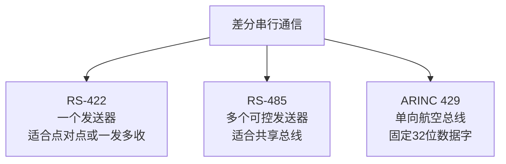

核心区别：

> RS-422解决固定发送端的差分串行通信。

> RS-485解决多个节点共享差分总线的问题。

> ARINC 429解决航空电子设备之间单向、固定格式的数据传输问题。