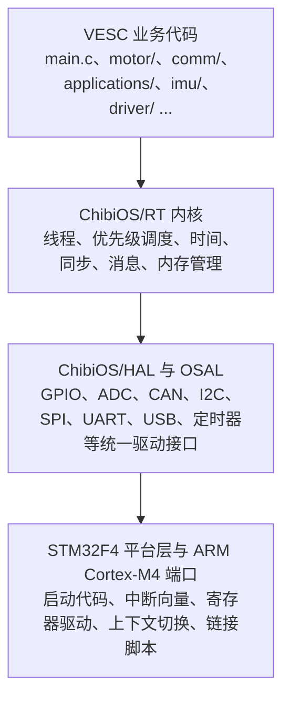
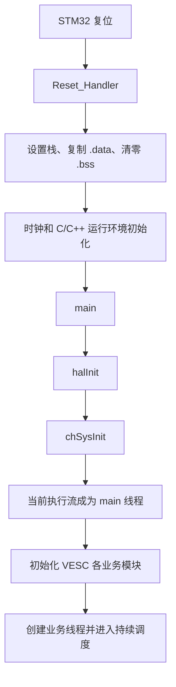
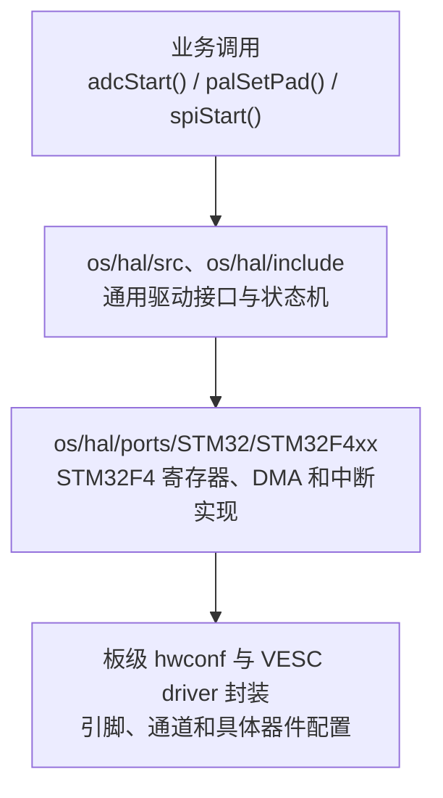
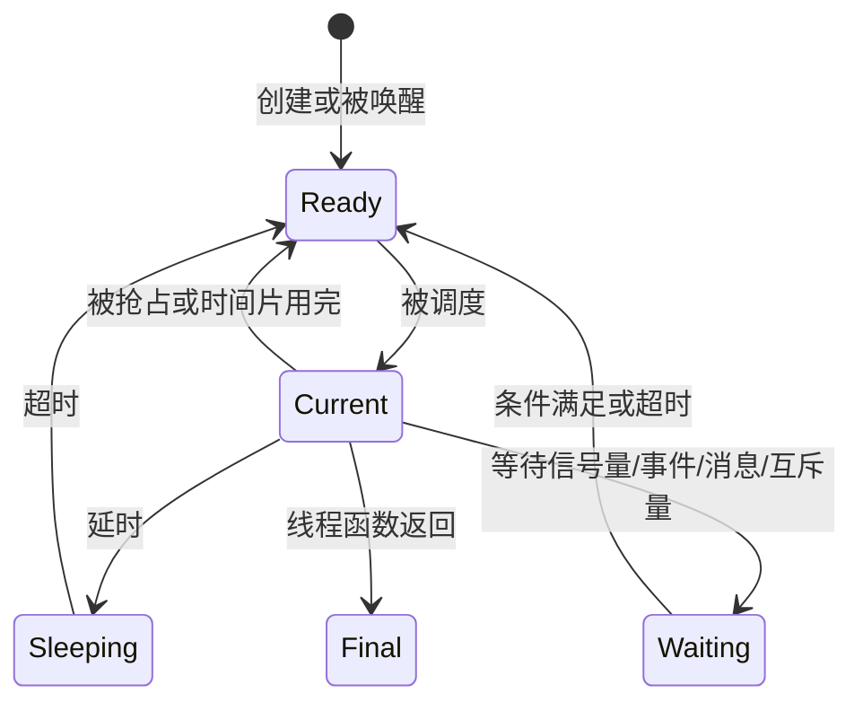
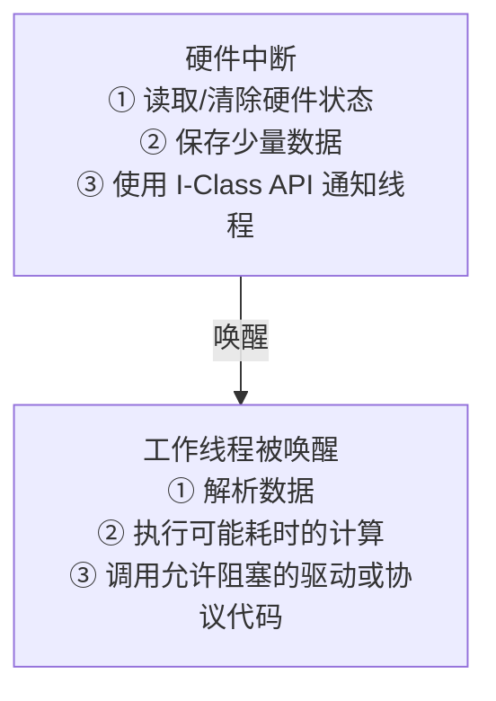
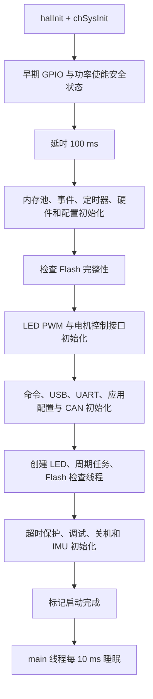
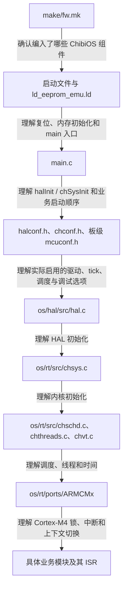

# ChibiOS 3.0.5 系统运行机制简介

本文结合当前 `bldc` 固件工程，介绍 `ChibiOS_3.0.5` 从芯片复位到多线程运行的基本机制。重点是建立阅读源码时所需的整体认识，而不是逐项罗列 API。

> 本工程实际使用 **ChibiOS/RT** 内核，而不是同一源码包中的 ChibiOS/NIL。判断依据是 `make/fw.mk` 包含了 `os/rt/rt.mk` 和 ARM Cortex-M4 的 `port_v7m.mk`。

## 1. ChibiOS 在工程中的位置

ChibiOS 在本工程中主要分为四层：



`make/fw.mk` 将这些部分加入固件：

- `startup_stm32f4xx.mk`：复位入口和 C 运行环境启动代码；
- `hal.mk`、`platform.mk`：通用 HAL 和 STM32F4 底层驱动；
- `osal/rt/osal.mk`：HAL 到 RT 内核的适配层；
- `rt.mk`：ChibiOS/RT 内核；
- `port_v7m.mk`：ARMv7-M（Cortex-M3/M4）上下文切换端口。

源码目录名是 `ChibiOS_3.0.5`，其中 `os/rt/include/ch.h` 报告的内核版本字符串为 `3.0.4`。分析问题时应以仓库内实际源码为准。

## 2. 从复位到 main

系统启动主链路如下：



STM32 从中断向量表取得初始栈顶和 `Reset_Handler` 地址。ChibiOS 的 GCC 启动代码完成 RAM 数据区初始化后调用 `main()`。相关入口可从以下文件追踪：

```text
ChibiOS_3.0.5/os/common/ports/ARMCMx/compilers/GCC/
ChibiOS_3.0.5/os/common/ports/ARM/compilers/GCC/
ld_eeprom_emu.ld
main.c
```

本工程 `main.c` 的开头是：

```c
int main(void) {
    halInit();
    chSysInit();
    /* VESC 初始化代码 */
}
```

两者顺序不可随意交换。`halInit()` 建立硬件抽象层，`chSysInit()` 才正式建立 RTOS 内核环境。

## 3. halInit：建立硬件抽象层

`halInit()` 位于 `os/hal/src/hal.c`，其工作可概括为：

1. `osalInit()` 初始化 HAL 使用的 OS 抽象接口；
2. `hal_lld_init()` 执行 STM32F4 平台级底层初始化；
3. 按 `halconf.h` 的开关初始化 PAL、ADC、CAN、I2C、SPI、UART、USB 等驱动对象；
4. 调用板级初始化，使 GPIO 等硬件进入预设状态。

这里的“初始化驱动”通常是初始化驱动对象和底层公共资源，并不等于每个外设已经开始工作。例如业务代码仍需调用 `canStart()`、`spiStart()` 或相应模块封装函数来配置并启动设备。

HAL 的典型分层为：



## 4. chSysInit：把普通程序变成多线程系统

`chSysInit()` 位于 `os/rt/src/chsys.c`。它依次初始化：

- ARM 端口和上下文切换环境；
- 调度器及就绪队列；
- 虚拟定时器；
- 线程运行时间测量（本工程启用）；
- 内核内存区、堆等已启用子系统；
- 主线程和空闲线程。

一个容易忽略的事实是：`chSysInit()` 不会另行创建一个线程再调用 `main()`。它把**当前正在执行 `main()` 的控制流直接登记为主线程**，优先级为 `NORMALPRIO`，随后打开中断。由于本工程没有设置 `CH_CFG_NO_IDLE_THREAD`，内核还会创建最低优先级的 `idle` 线程。

因此，`chSysInit()` 返回后：

- `main()` 已经处于线程上下文，可以睡眠、等待信号量和创建线程；
- 更高优先级线程一旦就绪，可以抢占 `main` 线程；
- 没有其他线程可运行时，调度器执行 `idle` 线程；
- `main()` 不应该返回。本工程末尾用无限循环每 10 ms 睡眠一次。

## 5. 线程、栈和生命周期

### 5.1 静态线程

本工程大量使用 `chThdCreateStatic()`：

```c
static THD_WORKING_AREA(led_thread_wa, 512);

chThdCreateStatic(led_thread_wa,
                  sizeof(led_thread_wa),
                  NORMALPRIO,
                  led_thread,
                  NULL);
```

工作区同时容纳线程控制信息和线程栈，存储期必须覆盖线程的整个生命周期。因此工作区通常定义为文件级 `static`，不能使用创建函数返回后失效的普通局部数组。

静态创建具有内存固定、启动时可预测、无堆碎片等优点，适合长期运行的嵌入式控制线程。

### 5.2 动态线程

由于 `chconf.h` 启用了 heap、mempool 和 dynamic，系统也支持从堆或内存池创建线程。动态线程退出后还涉及回收或等待退出，使用前应确认所有权和生命周期。固定业务线程优先采用静态创建。

### 5.3 线程状态

线程不是一直占用 CPU，常见状态可简化为：



等待不是忙循环。线程会从就绪队列移出，让 CPU 执行其他线程；条件满足后再进入就绪队列。

## 6. 优先级调度与时间片

ChibiOS/RT 采用基于优先级的抢占式调度：

1. 调度器总是选择最高优先级的就绪线程；
2. 数值更大的线程优先级更高；
3. 高优先级线程就绪后，可抢占低优先级线程；
4. 同优先级线程可通过时间片轮转。

本工程 `chconf.h` 配置 `CH_CFG_TIME_QUANTUM = 4`，表示同优先级线程的基本时间片为 4 个系统节拍。高优先级线程不需要等低优先级线程的时间片结束。

线程优先级常用宏包括 `LOWPRIO`、`NORMALPRIO`、`HIGHPRIO`，也常写成 `NORMALPRIO + n`。优先级设计应依据截止时间和阻塞关系，而不是简单地把“重要”线程全部设为最高。

### 优先级反转

低优先级线程持有资源、高优先级线程等待该资源时，可能发生优先级反转。需要互斥保护并涉及不同优先级线程时，应优先使用 ChibiOS mutex；其优先级继承机制能降低反转风险。普通 binary semaphore 主要表达事件或资源计数，不等价于带所有者语义的 mutex。

## 7. 系统节拍和虚拟定时器

本工程的关键时间配置为：

```c
#define CH_CFG_ST_RESOLUTION  32
#define CH_CFG_ST_FREQUENCY   10000
#define CH_CFG_ST_TIMEDELTA   0
```

含义如下：

- 系统时间计数器宽度为 32 位；
- 系统节拍为 10 kHz，即一个 tick 为 100 微秒；
- `TIMEDELTA = 0` 表示采用周期节拍模式，而非 tickless 模式。

系统定时器中断推进内核时间并处理到期的虚拟定时器。`chThdSleepMilliseconds(10)` 等便利宏会把时间转换为 tick，使当前线程睡眠，到期后由内核重新放入就绪队列。

需要注意：

- sleep 表示“至少等待到指定时间后重新具备运行资格”，不保证在该时刻精确执行；
- 唤醒后还需等待所有更高优先级线程让出 CPU；
- RTOS tick 适合线程级毫秒/亚毫秒调度，不应替代电机 PWM、ADC 同步采样等硬件定时事件；
- 电机控制的硬实时环节通常由 TIM/ADC/DMA 中断驱动，线程负责较慢的状态管理和通信。

32 位计数器在 10 kHz 下约 4.97 天回绕一次。ChibiOS 的时间比较宏按模运算处理回绕；业务代码不应直接用简单的 `now > deadline` 实现跨回绕超时判断。

## 8. 上下文切换如何发生

线程切换需要保存旧线程的 CPU 上下文，并恢复新线程的上下文。Cortex-M4 端口利用硬件异常机制完成这一过程：

- 异常入口由硬件自动保存部分寄存器；
- 端口汇编保存其余需保留寄存器和线程栈指针；
- 调度器改变当前线程指针；
- 恢复新线程寄存器并从异常返回；
- 如果线程使用浮点运算，还需考虑 FPU 上下文。

触发重新调度的常见场景包括：

- 当前线程睡眠或等待同步对象；
- 创建或唤醒了更高优先级线程；
- 系统 tick 使睡眠线程到期；
- 同优先级线程时间片耗尽；
- 中断结束时发现需要切换线程。

端口层主要位于 `os/rt/ports/ARMCMx`。应用代码通常不直接操作上下文，而是通过线程和同步 API 间接触发调度。

## 9. 中断与线程的协作

中断上下文具有低延迟，但受到严格限制。推荐模式是：



ChibiOS API 名称后缀表达调用上下文：

| 后缀 | 典型调用环境 | 要点 |
|---|---|---|
| 无后缀 | 普通线程上下文 | 可能触发调度，部分 API 可以阻塞 |
| `I` / `I-Class` | 中断或已锁定的系统上下文 | 不可阻塞，调用者必须满足锁定条件 |
| `S` / `S-Class` | 系统已锁定的线程上下文 | 调用者负责正确加锁和解锁 |
| `X` | 可在特定多种上下文使用 | 以函数注释的前置条件为准 |

典型 ISR 结构为：

```c
OSAL_IRQ_HANDLER(Some_IRQHandler) {
    OSAL_IRQ_PROLOGUE();

    chSysLockFromISR();
    /* 调用 ch...I()，更新状态或唤醒线程 */
    chSysUnlockFromISR();

    OSAL_IRQ_EPILOGUE();
}
```

实际驱动可能由宏封装细节。最重要的规则是：ISR 中不能调用会睡眠或等待的普通线程 API，不能进行无界循环、长时间计算或阻塞式 I/O。

本工程设置了 `CORTEX_SIMPLIFIED_PRIORITY = TRUE`。这使内核临界区采用更直接的 Cortex-M 中断屏蔽方式。新增中断时仍必须沿用 ChibiOS/OSAL 的中断声明、优先级和加锁规则，不能仅凭 NVIC 数值自行判断某个内核 API 是否安全。

## 10. 临界区、同步和通信

### 10.1 内核锁与临界区

`chSysLock()`/`chSysUnlock()` 用于短小的内核级临界区。锁定期间调度或部分中断受到抑制，临界区必须短，不能在其中 sleep，也不要做日志打印、Flash 擦写或复杂计算。

保护线程间共享业务数据通常应选择更高层同步原语：

- mutex：保护具有所有者的共享资源；
- semaphore：资源计数或线程唤醒；
- event：一对多或位标志式事件通知；
- mailbox/message：在线程间传递消息或指针；
- queue：驱动字节流缓冲。

### 10.2 volatile 不是线程同步

`volatile` 只约束编译器对访问的优化，不能保证复合操作原子性，也不能替代互斥、内存顺序和线程唤醒。一个变量同时被 ISR 和线程访问时，要依据数据宽度、读写模式和时序需求选择原子访问、临界区或 ChibiOS 同步对象。

## 11. 本工程 main 线程的运行轨迹

`main.c` 中系统启动后的主要阶段为：



主线程在初始化过程中多次调用 `chThdSleepMilliseconds()`。因为此时 RTOS 已经启动，sleep 期间已经创建的其他线程可以运行。各模块的 `*_init()` 也可能创建自己的线程、启用外设中断或启动 DMA，所以系统的并发运行并不是等到 `main()` 最后一个循环才开始。

最终无限循环的作用是保持主线程存活。它大部分时间处于睡眠态，不会通过空转持续占用 CPU。

## 12. 空闲线程和 CPU 使用率

当所有普通线程都在等待时，调度器运行 `idle` 线程。当前 Cortex-M 端口默认未必启用 `WFI` 低功耗等待，因此“进入 idle”不一定意味着 CPU 已进入睡眠模式。

本工程启用了：

```text
CH_CFG_USE_TM = TRUE
CH_CFG_USE_REGISTRY = TRUE
CH_DBG_ENABLE_STACK_CHECK = TRUE
CH_DBG_FILL_THREADS = TRUE
CH_DBG_THREADS_PROFILING = TRUE
```

这些配置便于线程登记、运行时间分析和栈问题排查。与此同时，断言、系统状态检查和 trace 当前关闭，因此发布版本遇到错误时未必能给出丰富诊断。定位并发问题时，可在可控的调试构建中评估开启检查项的成本。

## 13. 实时性应如何理解

“实时”不是运行速度快，而是最坏情况下仍能在截止时间前响应。当前系统的响应延迟主要由以下部分组成：

```text
硬件事件到中断入口延迟
+ 更高优先级中断执行时间
+ 中断屏蔽/内核临界区时间
+ ISR 自身处理时间
+ 更高优先级线程占用时间
+ 上下文切换时间
= 目标任务的最坏响应时间
```

改善实时性的重点包括：

- ISR 只做有界且必要的工作；
- 避免长时间关中断或持有内核锁；
- 为线程分配与截止时间相匹配的优先级；
- 避免高优先级线程执行阻塞式日志或慢速外设操作；
- 使用 DMA 和硬件定时器处理稳定、高频的数据搬运与采样；
- 测量最坏执行时间，而不只观察平均 CPU 占用率。

在 VESC 中，PWM 更新、ADC 采样和电流环等高频控制依赖硬件定时器及中断；通信协议、配置、状态上报和较慢控制逻辑更适合放在线程中。这是理解工程结构的关键边界。

## 14. 常见问题与排查方向

### 线程不再运行

检查：

1. 是否在等待永远不会被释放的 mutex/semaphore/event；
2. 是否被持续就绪的高优先级线程饿死；
3. 栈是否溢出；
4. ISR 是否漏清中断标志而反复进入；
5. 是否在持锁状态调用了阻塞 API。

### 定时任务抖动

检查高优先级线程和中断的最长执行时间、临界区长度、同优先级时间片竞争，以及任务使用的是相对 sleep 还是基于绝对时刻的周期调度。需要稳定周期时，应避免简单地把“执行时间 + sleep 时间”累积为周期。

### 莫名 HardFault

优先检查线程栈、ISR 栈、非法指针、DMA 缓冲区生命周期和对齐、FPU 使用、错误的中断优先级/API 上下文，以及工作区大小是否包含实际函数调用深度。

### CPU 占用异常升高

检查线程是否缺少 sleep/事件等待、外设中断是否异常频繁、超时是否被配置为极短周期，以及性能统计本身的采样和解释是否正确。

## 15. 推荐源码阅读顺序

建议按一条完整运行链路阅读：



板级 `mcuconf.h` 由具体硬件配置目录通过编译包含路径选入，并不一定存在于 `bldc` 根目录。分析某块板时，应先从构建目标确定实际使用的 `hwconf/.../mcuconf.h`。

## 16. 小结

当前固件的运行核心可以归纳为：

1. 启动代码把 STM32F4 从复位状态带到 `main()`；
2. `halInit()` 建立 ChibiOS HAL 和 STM32F4 外设驱动基础；
3. `chSysInit()` 初始化 RT 内核，并把 `main()` 当前执行流变成主线程；
4. 内核按照优先级从就绪线程中选择运行者，以 10 kHz 系统节拍管理线程延时和虚拟定时器；
5. 硬件中断处理高频、低延迟事件，并通过 I-Class API 与线程协作；
6. VESC 各模块在初始化时逐步创建线程、启动中断和 DMA，最终形成电机控制、通信、配置和监控并行运行的系统。

掌握“复位与启动—HAL—内核初始化—线程状态—调度—中断协作”这条主线后，再阅读某个驱动或业务线程，就能判断它在什么上下文运行、何时被唤醒、会不会阻塞，以及它对系统实时性的影响。
