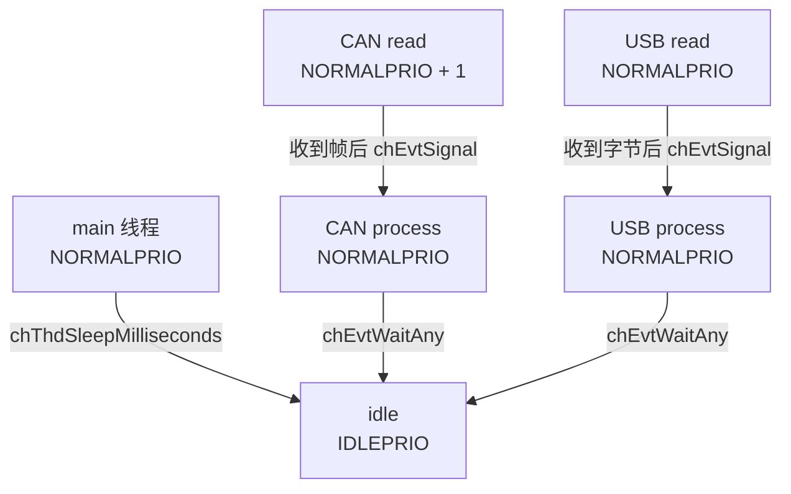
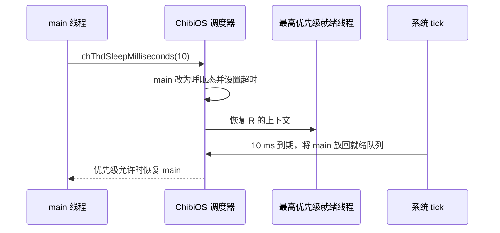
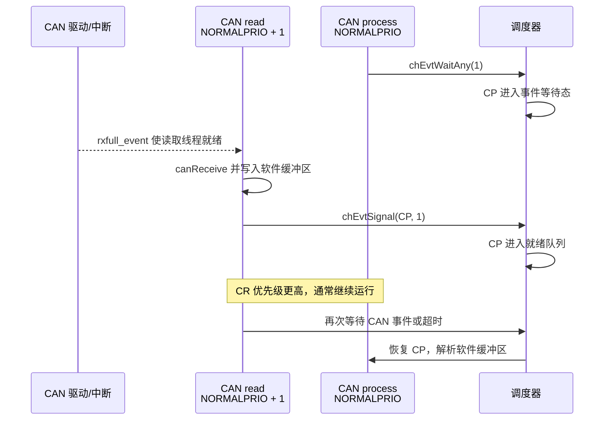
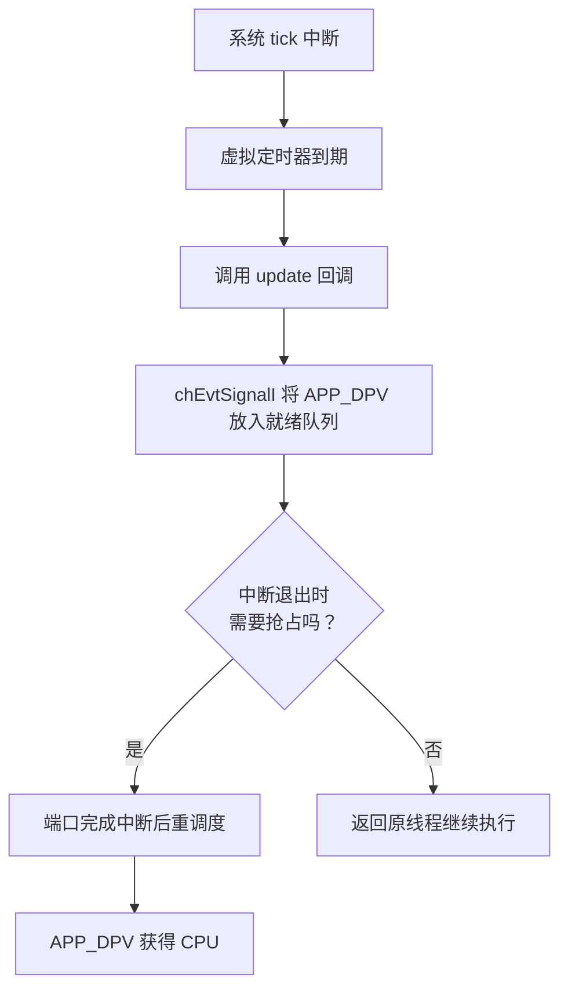
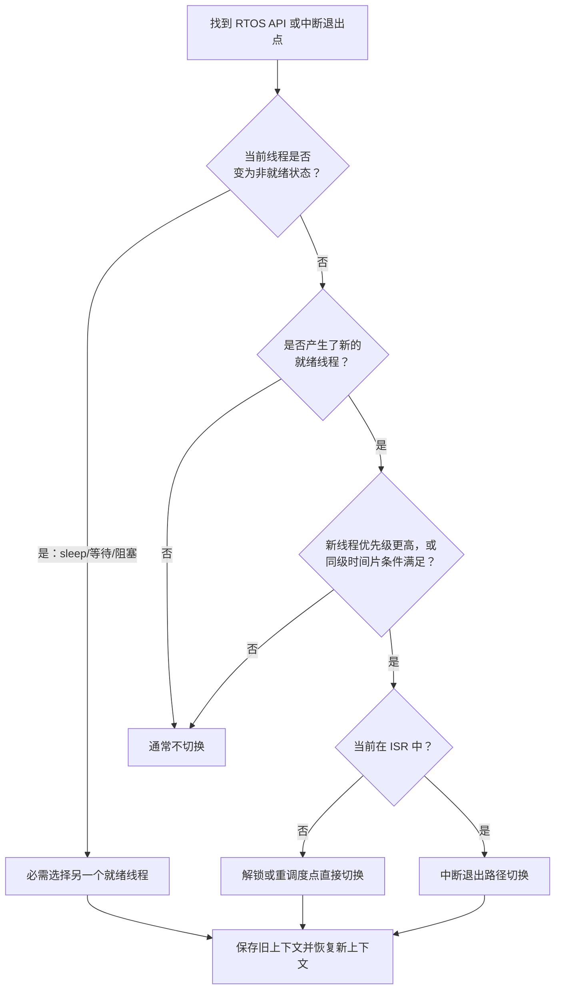

# ChibiOS 上下文切换在本项目中的应用

本文是《ChibiOS 3.0.5 系统运行机制简介》第 8 节的项目化展开。重点不是重复解释 RTOS 概念，而是沿着本工程的实际代码说明：哪个线程为什么停止运行，哪个线程被放入就绪队列，以及何时真正发生 Cortex-M4 上下文切换。

## 1. 本工程的调度条件

本工程在 `chconf.h` 中配置：

```c
#define CH_CFG_ST_FREQUENCY 10000
#define CH_CFG_ST_TIMEDELTA 0
#define CH_CFG_TIME_QUANTUM 4
#define CORTEX_SIMPLIFIED_PRIORITY TRUE
```

系统采用 10 kHz 周期 tick，即一个 tick 为 100 μs。同优先级线程的基本时间片为 4 tick，约 400 μs。ChibiOS/RT 使用基于优先级的抢占调度：

- 更高优先级就绪线程可以抢占当前线程；
- 当前线程睡眠或等待事件时，调度器选择就绪队列中优先级最高的线程；
- 同优先级线程在时间片耗尽后轮转；
- 内核锁定期间只更新调度状态，真正的切换推迟到允许重新调度时；
- 没有普通线程可运行时，切换到 `idle` 线程。

这里的时间片不是任务周期。线程调用 sleep 或等待事件时会提前放弃 CPU，不会占满 400 μs 才切换。

## 2. 项目中的线程关系

`main.c` 创建 LED、周期任务和 Flash 完整性检查线程；CAN、USB、电机控制、IMU 等模块还会创建自己的线程。以下是几个能清楚展示切换机制的执行流：



图中的箭头表达调度关系，不保证一定直接切到箭头终点。实际目标始终由当时就绪队列中的优先级决定。

## 3. 场景一：main 主线程主动睡眠

系统初始化结束后，`main.c` 让主线程永久保持睡眠循环：

```c
for (;;) {
    chThdSleepMilliseconds(10);
}
```

这条语句会把当前线程从 `CURRENT` 状态改为睡眠状态，并为 10 ms 后的唤醒设置超时。内核随后从就绪队列中取出最高优先级线程运行。



对应的内核主路径是：

```text
chThdSleepMilliseconds()
  -> chThdSleep()
  -> chThdSleepS()
  -> chSchGoSleepTimeoutS()
  -> chSchGoSleepS()
  -> chSysSwitch()
  -> port_switch() / _port_switch()
```

因此，sleep 不是 CPU 忙等待。旧线程的栈指针和寄存器上下文被保存后，CPU 继续执行另一个线程；到期只表示 main 重新具备运行资格，不代表它必定在到期瞬间执行。

## 4. 场景二：CAN 接收线程唤醒处理线程

`comm/comm_can.c` 把“接收”和“解析处理”拆成两个线程：

- `cancom_read_thread` 的优先级为 `NORMALPRIO + 1`；
- `cancom_process_thread` 的优先级为 `NORMALPRIO`；
- 处理线程在 `chEvtWaitAny(1)` 上阻塞；
- 读取线程把帧写入软件缓冲区后调用 `chEvtSignal(process_tp, 1)`。



这个例子说明“唤醒”和“立即切换”是两件事。`chEvtSignal()` 使处理线程就绪，但当前 CAN read 线程优先级更高，所以处理线程通常要等 read 线程再次阻塞后才能获得 CPU。

`cancom_read_thread` 自身调用 `chEvtWaitAnyTimeout(ALL_EVENTS, MS2ST(10))`。没有 CAN 帧时它会阻塞；CAN 驱动广播 `rxfull_event` 或 10 ms 超时时，它重新进入就绪队列。

## 5. 场景三：USB 读取与协议处理之间切换

`comm/comm_usb.c` 使用相同的生产者/消费者模式：

```c
// USB read 线程
chEvtSignal(process_tp, (eventmask_t)1);

// USB process 线程
chEvtWaitAny((eventmask_t)1);
```

两个线程都是 `NORMALPRIO`。USB read 线程的 `chSequentialStreamRead()` 在没有数据时可以阻塞；收到数据后，它写入环形缓冲区并唤醒 USB process 线程。由于二者同优先级，是否立刻轮到 process 线程与以下因素有关：

- read 线程是否在下一次流读取中阻塞；
- 当前线程剩余时间片；
- 同优先级就绪队列中的其他线程；
- 信号发生时系统是否处于锁定状态。

这种结构使字节搬运与协议解析解耦，避免在底层读取路径中执行较长的 `packet_process_byte()` 处理。

## 6. 场景四：虚拟定时器从中断侧唤醒线程

`applications/app_dpv.c` 展示了中断侧唤醒路径。虚拟定时器回调 `update()` 重新装载定时器并通知 `APP_DPV` 线程：

```c
static void update(void *p) {
    if (!is_running) {
        return;
    }

    chSysLockFromISR();
    chVTSetI(&dpv_vt, MS2ST(2), update, p);
    chEvtSignalI(dpv_tp, (eventmask_t)1);
    chSysUnlockFromISR();
}
```

`dpv_thread` 则在事件上等待：

```c
for (;;) {
    chEvtWaitAny((eventmask_t)1);
    // 执行业务处理
}
```



`I-Class` API 在已锁定的中断上下文中修改内核对象，只负责建立“线程已就绪”的事实。ChibiOS 不会在 ISR 中间跳进普通线程，而是在中断尾部检查是否需要重调度。只有被唤醒线程的优先级高于当前线程，或者满足同优先级时间片条件时，才会在退出中断的过程中切换。

## 7. 场景五：创建线程可能引起抢占

`main.c` 中有：

```c
chThdCreateStatic(led_thread_wa, sizeof(led_thread_wa),
                  NORMALPRIO, led_thread, NULL);
chThdCreateStatic(periodic_thread_wa, sizeof(periodic_thread_wa),
                  NORMALPRIO, periodic_thread, NULL);
chThdCreateStatic(flash_integrity_check_thread_wa,
                  sizeof(flash_integrity_check_thread_wa),
                  LOWPRIO, flash_integrity_check_thread, NULL);
```

`chThdCreateStatic()` 初始化线程控制块和栈，把新线程加入就绪队列，并调用调度检查。若新线程优先级高于创建者，它可以在创建调用返回前抢占创建者；若优先级相同或更低，则通常先进入就绪队列等待。

这里 main 和前两个线程都是 `NORMALPRIO`，Flash 检查线程是 `LOWPRIO`。因此不能仅看到创建调用就断言马上执行了哪个线程，仍需结合时间片和当时的就绪队列判断。

## 8. 场景六：互斥量造成阻塞与优先级继承

本工程在 CAN、命令处理、SPI 和 I2C 等模块大量使用 `chMtxLock()`，例如 `comm/comm_can.c` 用 `can_rx_mtx` 保护接收环形缓冲区。

若互斥量空闲，调用者直接取得锁，不发生切换。若锁已被其他线程持有：

1. 当前线程进入互斥量等待队列并放弃 CPU；
2. ChibiOS 的互斥量机制可提升持锁线程的有效优先级，减少优先级反转；
3. 持锁线程调用 `chMtxUnlock()` 后，等待者被置为就绪；
4. 若等待者优先级更高，解锁路径会触发重新调度。

临界区应只覆盖环形缓冲区索引和数据复制等必要操作。若在持锁期间 sleep，可能把一次普通的线程切换扩大为长时间阻塞其他线程。

## 9. 时间片耗尽时的同优先级轮转

`CH_CFG_TIME_QUANTUM = 4` 使同优先级线程具备轮转机会。系统 tick 递减当前线程的 `p_preempt`；时间片耗尽且就绪队列中存在同优先级线程时，`chSchIsPreemptionRequired()` 允许重新调度。

内核在 `chSchDoRescheduleBehind()` 中把旧线程重新插入同优先级线程之后、重置其时间片，再切换到队首线程。若没有同优先级就绪线程，即使时间片归零，也不会为了“轮转”而切到低优先级线程。

在本项目中，多个 `NORMALPRIO` 线程构成同优先级组。但多数线程频繁调用 sleep、事件等待或阻塞式驱动 API，实际切换往往由阻塞触发，而不是等时间片耗尽。

## 10. Cortex-M4 端口实际保存了什么

最终切换落到 `ChibiOS_3.0.5/os/rt/ports/ARMCMx`：

- 调度器更新 `currp`，选出新线程；
- `chSysSwitch()` 调用 `port_switch()`；
- GCC 端口的 `_port_switch()` 位于 `compilers/GCC/chcoreasm_v7m.s`；
- 汇编保存旧线程需要保留的寄存器和栈位置，载入新线程的栈位置及寄存器；
- 异常入口/退出时，Cortex-M4 硬件自动压栈和恢复异常帧中的寄存器；
- 使用 FPU 的线程还涉及浮点上下文处理，具体取决于端口配置与异常返回状态。

当前工程设置 `CORTEX_SIMPLIFIED_PRIORITY = TRUE`。在线程上下文主动睡眠或阻塞时，可以沿 `chSchGoSleepS() -> chSysSwitch() -> _port_switch()` 直接追踪；在 ISR 唤醒线程时，调度决策推迟到中断退出路径，由端口的 PendSV/异常退出机制进入 `_port_switch_from_isr()`。不要把所有切换都简单理解为“调用一次 PendSV”。

## 11. 一次切换的完整判断方法

阅读任意一段业务代码时，可以按以下顺序判断是否发生上下文切换：



还要特别区分三个时间点：

- **事件发生**：例如 CAN 硬件收到一帧；
- **线程就绪**：驱动或其他线程把目标线程放入就绪队列；
- **线程真正运行**：调度条件满足并完成上下文恢复。

三者可能非常接近，也可能被更高优先级 ISR、内核锁或其他高优先级线程隔开。

## 12. 调试与观测建议

本工程启用了线程注册、栈填充和线程性能统计。分析调度问题时建议：

1. 使用 `chRegSetThreadName()` 给新增线程命名，便于调试器识别；
2. 记录线程优先级、等待对象及唤醒源，不要只记录函数入口时间；
3. 用 GPIO 翻转或硬件 trace 测量关键 ISR 到线程开始处理的延迟；
4. 将“唤醒延迟”与“业务执行时间”分开统计；
5. 检查长临界区、长时间持锁、未阻塞的无限循环和异常高频中断；
6. 不要在 ISR、系统锁定区或调度器关键路径中加入阻塞式日志。

若观察到线程被唤醒却迟迟不运行，优先检查它与当前线程的优先级、内核是否仍锁定，以及是否有更高优先级线程持续处于就绪状态。

## 13. 相关源码索引

| 主题 | 本项目源码 |
|---|---|
| 主线程睡眠与业务线程创建 | `main.c` |
| CAN 接收、事件通知和处理线程 | `comm/comm_can.c` |
| USB 生产者/消费者线程 | `comm/comm_usb.c` |
| 虚拟定时器中断侧唤醒 | `applications/app_dpv.c` |
| 线程创建与睡眠 API | `ChibiOS_3.0.5/os/rt/src/chthreads.c` |
| 就绪队列、阻塞和重新调度 | `ChibiOS_3.0.5/os/rt/src/chschd.c` |
| Cortex-M4 端口定义 | `ChibiOS_3.0.5/os/rt/ports/ARMCMx/chcore_v7m.h` |
| Cortex-M4 中断切换入口 | `ChibiOS_3.0.5/os/rt/ports/ARMCMx/chcore_v7m.c` |
| GCC 上下文切换汇编 | `ChibiOS_3.0.5/os/rt/ports/ARMCMx/compilers/GCC/chcoreasm_v7m.s` |

## 14. 小结

本项目中的上下文切换主要不是由业务代码直接请求“换线程”，而是业务代码通过 sleep、事件、互斥量、阻塞式驱动和线程创建改变线程状态。ChibiOS 调度器依据优先级和时间片选择下一线程，再由 Cortex-M4 端口保存旧上下文并恢复新上下文。

理解具体执行顺序时，最重要的是同时回答三个问题：当前线程为何让出 CPU、哪些线程已经就绪、它们的有效优先级分别是多少。只看 `chEvtSignal()` 或 tick 到期，不能单独确定下一条执行的业务代码。
