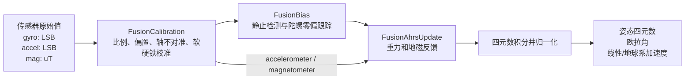
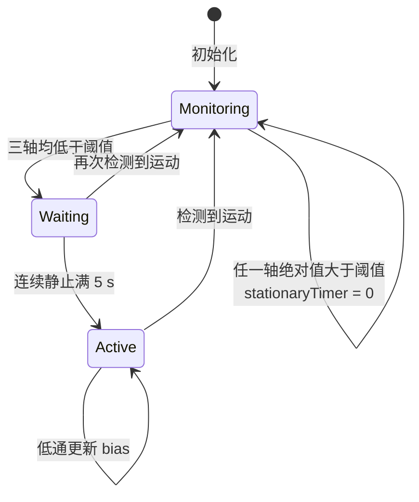
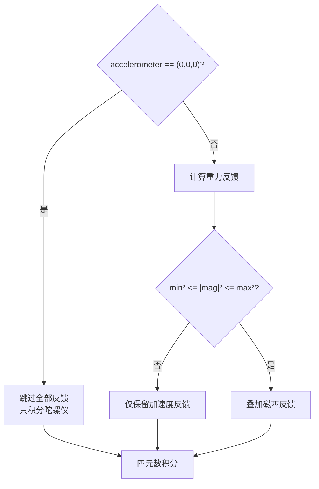
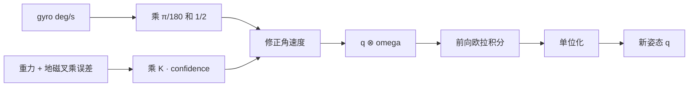
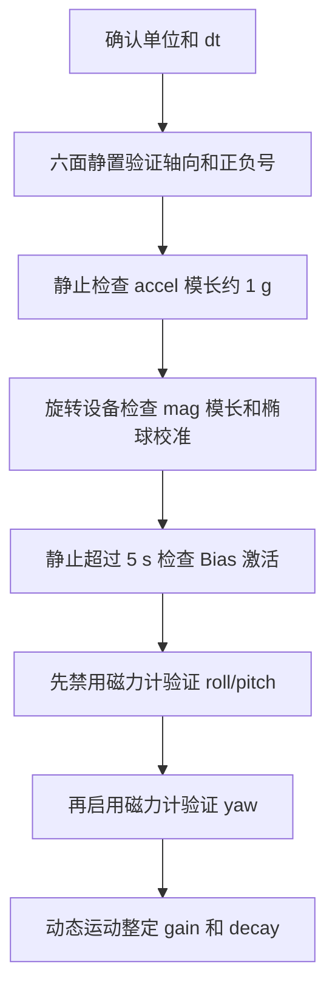

# Fusion `ExampleAhrs.c` 及相关模块详细说明

## 1. 文档范围

本文以 `imu/Fusion/Examples/ExampleAhrs.c` 为入口，说明一次九轴姿态更新所经过的模块、数据单位、坐标系、核心公式和源码实现。相关文件如下。

| 文件 | 职责 |
|---|---|
| `Examples/ExampleAhrs.c` | 传感器读取、校准、零偏更新、AHRS 更新和欧拉角输出示例 |
| `FusionCalibration.h` | 陀螺仪、加速度计和磁力计的静态校准模型 |
| `FusionBias.c/.h` | 静止检测和运行时陀螺仪零偏估计 |
| `FusionAhrs.c/.h` | 重力/地磁反馈、四元数积分和线性加速度计算 |
| `FusionTypes.h` | 向量、矩阵、四元数及欧拉角转换 |
| `FusionCompass.c/.h` | 独立的倾斜补偿磁罗盘；示例 AHRS 不直接调用它 |
| `Fusion.h` | 上述公开头文件的聚合入口 |

本文描述的是本仓库当前源码，而不是其他版本的 Fusion 库。当前分支修改过 AHRS 和 Bias 接口，详见第 15 节。

## 2. 总体数据流



一次循环的严格顺序是：

1. 读取三种传感器；
2. 将原始值转换到统一机体坐标系和物理单位；
3. 扣除在线估计的陀螺仪零偏；
4. 用加速度计约束俯仰和横滚，用磁力计约束航向；
5. 将修正后的角速度积分为单位四元数；
6. 按需转换为欧拉角或加速度输出。

## 3. 坐标系、方向和单位

### 3.1 NWU 地球坐标系

库注释规定采用 NWU（North-West-Up）：

- 地球系 $X_E$：磁北；
- 地球系 $Y_E$：西；
- 地球系 $Z_E$：上；
- 三轴满足右手系 $X_E \times Y_E = Z_E$。

传入 AHRS 的三个向量必须已经处于同一个传感器/机体坐标系。安装方向不同不能只修改显示端，必须在校准矩阵中统一，否则叉乘反馈方向会错误。

### 3.2 单位约定

| 量 | AHRS 接口要求 |
|---|---|
| 陀螺仪 | deg/s |
| 加速度计 | g；静止时模长约为 1 |
| 磁力计 | uT |
| `samplePeriod` / `dt` | s |
| 四元数 | 无量纲，顺序为 $(w,x,y,z)$ |
| 欧拉角 | degree，ZYX 航空序列 |

磁力计在计算方向时会归一化，因此方向反馈本身与单位无关；但 `FusionAhrsSetMagneticField(20, 70)` 按 uT 检查模长，故输入单位仍必须是 uT。

### 3.3 内部四元数和公开四元数

`FusionAhrs.quaternion` 表示“地球坐标轴在传感器坐标系中的姿态”，可记作 $q_{SE}$。`FusionAhrsGetQuaternion()` 返回其共轭：

$$
q_{ES}=q_{SE}^{*}=(w,-x,-y,-z)
$$

对单位四元数，共轭就是逆。因此公开结果描述“传感器相对地球的姿态”。区分这两个方向可以解释源码为何先用内部四元数计算传感器系重力，再在 getter 中取共轭。

## 4. `ExampleAhrs.c` 逐段说明

### 4.1 全局状态和采样周期

`FusionBias fusionBias` 保存静止计时器和陀螺零偏；`FusionAhrs fusionAhrs` 保存增益、磁场门限、内部四元数和线性加速度。示例的 `samplePeriod = 0.01 s` 对应 100 Hz。

实际工程应使用相邻样本的真实时间差：

$$
\Delta t_k=t_k-t_{k-1}
$$

固定周期与实际调度周期不一致，会让积分角度 $\omega\Delta t$ 成比例地偏大或偏小。

### 4.2 灵敏度

`gyroscopeSensitivity` 的单位为 deg/s/LSB，`accelerometerSensitivity` 的单位为 g/LSB。三个轴可以不同。例如量程为 $\pm2000$ deg/s、16 位有符号输出时，理想灵敏度约为：

$$
s_g=\frac{4000}{65536}=0.061035\ \text{deg/s/LSB}
$$

应优先使用数据手册给出的标称值或实测标定值，而不是机械套用上述理想值。

### 4.3 初始化

- `FusionBiasInitialise` 设置静止阈值、低通更新系数并清零零偏；
- `FusionAhrsInitialise` 设置反馈增益、加速度置信度衰减参数和单位四元数；
- `FusionAhrsSetMagneticField` 将有效地磁模长限定在 20～70 uT。

### 4.4 循环体

示例的 `do ... while (false)` 只运行一次，用于展示单个样本的处理方式。嵌入式应用应在每个新样本到达时调用相同处理链，不能在没有新数据时高速空转重复积分。

最终语句先取得公开四元数 $q_{ES}$，再转换为 roll、pitch、yaw 并打印。

## 5. 惯性传感器校准模型

`FusionCalibrationInertial` 的源码等价于：

$$
\mathbf y=\mathbf M\left[\left(\mathbf x-\mathbf b\right)\odot\mathbf s\right]
$$

其中：

- $\mathbf x$ 是三轴原始读数；
- $\mathbf b$ 是以 LSB 表示的零偏；
- $\mathbf s$ 是逐轴灵敏度；
- $\odot$ 是 Hadamard 逐元素乘法；
- $\mathbf M$ 是轴不对准/安装变换矩阵；
- $\mathbf y$ 是校准后的 deg/s 或 g。

逐轴缩放结果为：

$$
\mathbf u=
\begin{bmatrix}
(x_x-b_x)s_x\\
(x_y-b_y)s_y\\
(x_z-b_z)s_z
\end{bmatrix}
$$

再左乘矩阵：

$$
\mathbf y=
\begin{bmatrix}
m_{11}u_x+m_{12}u_y+m_{13}u_z\\
m_{21}u_x+m_{22}u_y+m_{23}u_z\\
m_{31}u_x+m_{32}u_y+m_{33}u_z
\end{bmatrix}
$$

示例传入单位矩阵和零偏，故退化为简单逐轴比例换算 $\mathbf y=\mathbf x\odot\mathbf s$。

## 6. 磁力计校准模型

`FusionCalibrationMagnetic` 实现：

$$
\mathbf m_c=\mathbf S\mathbf m_u-\mathbf b_h
$$

$\mathbf S$ 是软铁校正矩阵，$\mathbf b_h$ 是硬铁偏置。需注意本实现的运算顺序是“先矩阵、后减偏置”。有些标定工具输出的是

$$
\mathbf m_c=\mathbf S(\mathbf m_u-\mathbf b)
$$

若工具采用后一模型，则不能直接把 $\mathbf b$ 传给当前 API。展开可得：

$$
\mathbf S(\mathbf m_u-\mathbf b)=\mathbf S\mathbf m_u-\mathbf S\mathbf b
$$

因此 API 所需的 `hardIronBias` 应为 $\mathbf b_h=\mathbf S\mathbf b$，或者修改调用侧使模型一致。

## 7. `FusionBias` 在线陀螺零偏估计

### 7.1 状态机



每次首先扣除当前估计值：

$$
\boldsymbol\omega_c=\boldsymbol\omega_m-\hat{\mathbf b}_g
$$

仅当三个分量均满足

$$
|\omega_{c,x}|\le T,\quad |\omega_{c,y}|\le T,\quad |\omega_{c,z}|\le T
$$

才认为可能静止。连续 5 s 后更新零偏：

$$
\hat{\mathbf b}_{g,k+1}=\hat{\mathbf b}_{g,k}+\alpha\boldsymbol\omega_{c,k}
$$

代入 $\boldsymbol\omega_c=\boldsymbol\omega_m-\hat{\mathbf b}_g$：

$$
\hat{\mathbf b}_{g,k+1}=(1-\alpha)\hat{\mathbf b}_{g,k}+\alpha\boldsymbol\omega_{m,k}
$$

这就是对静止陀螺读数的一阶低通估计。初始化给出的系数为：

$$
\alpha=2\pi f_c\Delta t_{nom},\qquad f_c=0.02\ \text{Hz}
$$

100 Hz 时 $\alpha\approx0.001257$。注意当前实现只在初始化时用名义周期计算 $\alpha$，更新函数的 `dt` 仅用于静止计时。

## 8. AHRS 反馈误差的几何来源

### 8.1 为什么使用叉乘

设测量到的单位方向为 $\hat{\mathbf v}_m$，当前姿态预测方向为 $\hat{\mathbf v}_p$。两者叉乘：

$$
\mathbf e=\hat{\mathbf v}_m\times\hat{\mathbf v}_p
$$

其方向是把测量方向旋向预测方向的误差旋转轴，模长为：

$$
\|\mathbf e\|=\sin\theta
$$

当误差角很小时，$\sin\theta\approx\theta$，所以叉乘可以直接作为比例反馈误差。它避免计算反三角函数，适合每采样周期运行。

### 8.2 由四元数得到预测重力

令内部单位四元数为 $q=(w,x,y,z)$。地球系向上单位向量 $\mathbf e_z=(0,0,1)^T$ 旋转到传感器系后，是旋转矩阵的第三列：

$$
\mathbf g_p=
\begin{bmatrix}
2(xz-wy)\\
2(wx+yz)\\
2(w^2+z^2)-1
\end{bmatrix}
$$

利用单位约束 $w^2+x^2+y^2+z^2=1$，第三项也可写成：

$$
2(w^2+z^2)-1=2(w^2-\tfrac12+z^2)
$$

源码使用一半的向量以减少乘法：

$$
\tfrac12\mathbf g_p=
\begin{bmatrix}
xz-wy\\ wx+yz\\ w^2-\tfrac12+z^2
\end{bmatrix}
$$

加速度反馈为：

$$
\tfrac12\mathbf e_a=\hat{\mathbf a}\times\tfrac12\mathbf g_p
$$

这里默认加速度计静止时指向“上”，即示例静止值为 $(0,0,1)$ g。如果底层驱动采用相反的比力符号，必须先统一。

### 8.3 磁西方向与航向约束

加速度方向近似竖直，磁场包含水平和竖直分量。叉乘

$$
\mathbf w_m=\mathbf a\times\mathbf m
$$

会同时垂直于竖直方向和磁场方向，因此给出水平的磁西方向；归一化后得到 $\hat{\mathbf w}_m$。

内部四元数预测的地球西轴是旋转矩阵第二列：

$$
\mathbf w_p=
\begin{bmatrix}
2(xy+wz)\\
2(w^2+y^2)-1\\
2(yz-wx)
\end{bmatrix}
$$

磁力计反馈为：

$$
\tfrac12\mathbf e_m=\hat{\mathbf w}_m\times\tfrac12\mathbf w_p
$$

总反馈误差：

$$
\tfrac12\mathbf e=\tfrac12\mathbf e_a+\tfrac12\mathbf e_m
$$

使用磁西而不是直接对齐三维磁场，能够避免当地磁倾角被误当成姿态倾斜。

### 8.4 有效性门控



检查平方模长避免一次平方根。磁场无效时仍保留加速度反馈，所以 roll/pitch 仍有绝对参考，yaw 则退化为陀螺积分。

## 9. 加速度置信度衰减

本仓库在原有反馈上增加了动态加速度抑制。先计算模长：

$$
r_k=\|\mathbf a_k\|=\sqrt{a_x^2+a_y^2+a_z^2}
$$

再进行固定系数平滑：

$$
\bar r_k=0.9\bar r_{k-1}+0.1r_k
$$

置信度为：

$$
c_k=\operatorname{clip}\left(1-d\sqrt{|\bar r_k-1|},0,1\right)
$$

有效反馈增益：

$$
K_k=Kc_k
$$

当加速度模长偏离 1 g 时，车辆加减速或冲击很可能污染重力观测，因而降低修正强度。参数 $d$ 越大，衰减越激进；$d=0$ 表示不衰减。

当前实现有两个值得注意的细节：

- `accMagP` 在 `FusionAhrsInitialise` 和 `FusionAhrsReinitialise` 中没有显式清零；静态全局对象因 C 语言零初始化通常不会出错，但栈上对象可能带入未定义初值；
- 同一个 $c_k$ 同时缩放加速度反馈和磁力反馈，而不仅是加速度反馈。强线性加速度期间航向修正也会减弱。

## 10. 四元数运动学与离散积分

角速度从 deg/s 转为 rad/s，并乘以 $1/2$：

$$
\tfrac12\boldsymbol\omega_r=\tfrac12\frac{\pi}{180}\boldsymbol\omega_d
$$

再叠加反馈：

$$
\tfrac12\boldsymbol\omega_{corr}
=\tfrac12\boldsymbol\omega_r+K_k\tfrac12\mathbf e
$$

纯向量 $\mathbf v$ 可视为纯四元数 $(0,v_x,v_y,v_z)$。当前内部四元数的微分方程是：

$$
\dot q=q\otimes(0,\tfrac12\boldsymbol\omega_{corr})
$$

四元数乘法展开为：

$$
q\otimes(0,v_x,v_y,v_z)=
\begin{bmatrix}
-xv_x-yv_y-zv_z\\
wv_x+yv_z-zv_y\\
wv_y-xv_z+zv_x\\
wv_z+xv_y-yv_x
\end{bmatrix}
$$

源码采用前向欧拉积分：

$$
q_{k+1}'=q_k+\dot q_k\Delta t
$$

数值积分会破坏单位模约束，所以每次再执行：

$$
q_{k+1}=\frac{q_{k+1}'}{\|q_{k+1}'\|}
$$



## 11. 线性加速度和地球系加速度

更新四元数后，源码重新计算传感器系预测重力 $\mathbf g_p$，并从加速度计读数中扣除：

$$
\mathbf a_{lin,S}=\mathbf a_S-\mathbf g_{p,S}
$$

静止且姿态正确时，二者相同，故线性加速度接近零。输出仍以 g 为单位；转换到 $m/s^2$ 时乘标准重力加速度：

$$
\mathbf a[m/s^2]=9.80665\mathbf a[g]
$$

`FusionAhrsGetEarthAcceleration` 再用旋转矩阵转入地球系：

$$
\mathbf a_{lin,E}=\mathbf R_{ES}\mathbf a_{lin,S}
$$

源码注释称其为内部四元数旋转矩阵的转置，这与 $q_{ES}=q_{SE}^{*}$ 一致。

## 12. 四元数到欧拉角

公开四元数 $q_{ES}=(w,x,y,z)$ 按 ZYX 航空序列转换。源码利用单位四元数恒等式，将标准式中的分子、分母同时缩放，不改变 `atan2` 结果。对应实现为：

$$
\phi=\operatorname{atan2}\left(yz-wx,\ w^2-\tfrac12+z^2\right)
$$

$$
\theta=-\arcsin\left(2(xz+wy)\right)
$$

$$
\psi=\operatorname{atan2}\left(xy-wz,\ w^2-\tfrac12+x^2\right)
$$

最后乘 $180/\pi$ 输出 degree。这里 $\phi$、$\theta$、$\psi$ 分别对应 roll、pitch、yaw。接近 $\theta=\pm90^\circ$ 时欧拉角存在万向节锁，内部控制和坐标变换应优先使用四元数。

## 13. `FusionCompass` 与 AHRS 的关系

`FusionCompassCalculateHeading` 是独立的一次性倾斜补偿罗盘，并不保存状态：

$$
\hat{\mathbf w}=\operatorname{norm}(\mathbf a\times\mathbf m)
$$

$$
\hat{\mathbf n}=\operatorname{norm}(\hat{\mathbf w}\times\mathbf a)
$$

$$
heading=\operatorname{atan2}(w_x,n_x)
$$

AHRS 内部使用相同的“磁西”几何思想，但将方向误差反馈给四元数积分器，具备时间连续性和陀螺仪短时动态响应。`FusionCompass` 适合独立检查磁力计符号和倾斜补偿结果，不应与 AHRS 输出再次相加。

## 14. 参数选择与调试

### 14.1 `gain`

- 大：更快追随重力/地磁参考，但更容易受车辆线性加速度和磁干扰影响；
- 小：动态更平滑，但陀螺零偏造成的漂移修正更慢；
- 零：完全退化为陀螺仪积分。

### 14.2 `acc_conf_decay`

- 大：加速度模长稍微偏离 1 g 就明显降低反馈；
- 小：更信任加速度计；
- 应用车辆、飞行器和手持设备时应分别通过原始数据回放整定。

### 14.3 推荐验证顺序



常见现象与原因：

| 现象 | 优先检查 |
|---|---|
| 静止 roll/pitch 反向 | 加速度符号、安装矩阵、左右手系 |
| yaw 旋转方向反向 | 磁力计轴映射、NWU 约定 |
| yaw 缓慢漂移 | 磁场被门控、未使用磁力计、陀螺零偏 |
| 车辆加速时俯仰误判 | `gain` 过大或置信度衰减不足 |
| 姿态变化速度不对 | deg/s 与 rad/s 混用，或 `dt` 错误 |
| 偶发 NaN | 零向量归一化、异常采样、四元数输入损坏 |

## 15. 当前仓库示例与接口的不一致

当前 `ExampleAhrs.c` 来自较早接口形态，不能原样通过本分支编译：

| 示例调用 | 当前声明 | 应采用的调用形式 |
|---|---|---|
| `FusionAhrsInitialise(&fusionAhrs, 0.5f)` | 需要 `gain, acc_conf_decay` | `FusionAhrsInitialise(&fusionAhrs, 0.5f, 1.0f)`，衰减值需按应用整定 |
| `FusionBiasUpdate(&fusionBias, gyro)` | 需要额外 `dt` | `FusionBiasUpdate(&fusionBias, gyro, samplePeriod)` |

此外还存在以下源码一致性问题：

1. `FusionAhrs.h` 声明了 `FusionAhrsIsInitialising`，当前 `FusionAhrs.c` 没有对应实现；
2. `INITIALISATION_PERIOD` 宏仍保留在 `FusionAhrs.c`，但当前更新路径未使用它；
3. `FusionAhrsInitialise` 没有初始化 `accMagP`；
4. `FusionAhrsReinitialise` 也没有重置 `accMagP`；
5. `FusionBiasInitialise` 用名义 `samplePeriod` 固定滤波系数，而 `FusionBiasUpdate` 的实际 `dt` 仅影响静止计时。

因此该文件目前更适合作为处理顺序示意。若用于可编译示例，应先按上表同步接口，并显式初始化所有状态。

## 16. 工程主链路与示例的差异

本工程 `imu/imu.c` 当前调用：

```text
FusionAhrsInitialise(&m_fusionAhrs, 10.0, 1.0)
FusionAhrsUpdateWithoutMagnetometer(...)
```

即工程主链路使用本库的六轴模式，没有把磁力计送入 `FusionAhrsUpdate`。因此：

- `ExampleAhrs.c` 说明的是库具备的九轴用法；
- 当前固件主链路的 roll/pitch 由陀螺仪和加速度计融合；
- 当前固件主链路的 yaw 没有地磁绝对约束，长期漂移属于预期行为；
- 要启用九轴模式，除替换 API 外还必须验证电机、电流、铁磁材料对磁场的干扰。

## 17. 可编译调用骨架

下面仅展示与当前接口一致的关键调用，原始传感器获取和错误处理仍由平台实现：

```c
const float dt = get_actual_sample_period_seconds();

FusionBiasInitialise(&fusionBias, 0.5f, dt);
FusionAhrsInitialise(&fusionAhrs, 0.5f, 1.0f);
fusionAhrs.accMagP = 1.0f; /* 当前实现未在 Initialise 中设置 */
FusionAhrsSetMagneticField(&fusionAhrs, 20.0f, 70.0f);

/* 每个新样本执行 */
FusionVector3 gyro = FusionCalibrationInertial(
    rawGyro, gyroMisalignment, gyroSensitivity, gyroBias);
FusionVector3 accel = FusionCalibrationInertial(
    rawAccel, accelMisalignment, accelSensitivity, accelBias);
FusionVector3 mag = FusionCalibrationMagnetic(
    rawMag, softIronMatrix, hardIronBias);

gyro = FusionBiasUpdate(&fusionBias, gyro, dt);
FusionAhrsUpdate(&fusionAhrs, gyro, accel, mag, dt);

FusionQuaternion q = FusionAhrsGetQuaternion(&fusionAhrs);
FusionEulerAngles rpy = FusionQuaternionToEulerAngles(q);
```

实际实现还应限制异常大的 `dt`、拒绝非有限数值，并在传感器重连或量程切换后重新初始化滤波状态。

## 18. 总结

该算法本质上是一个带方向观测比例反馈的四元数积分器：陀螺仪提供短时姿态变化，加速度计提供重力方向，磁力计提供水平磁北方向。方向叉乘形成小角度误差，误差修正角速度后进行四元数积分和归一化。校准、单位、轴向和时间步长中的任一错误都会直接进入积分器，因此它们通常比调整 `gain` 更应优先验证。
