# Makefile 解析

本文档解析 `bldc/Makefile` 的职责、变量、目标生成方式、工具链安装逻辑、固件构建链路、打包链路和单元测试链路。主 Makefile 的核心作用不是直接编译 C 文件，而是发现板卡目标、展开规则模板，然后把真正的固件编译交给 `make/fw.mk`。

## 总览

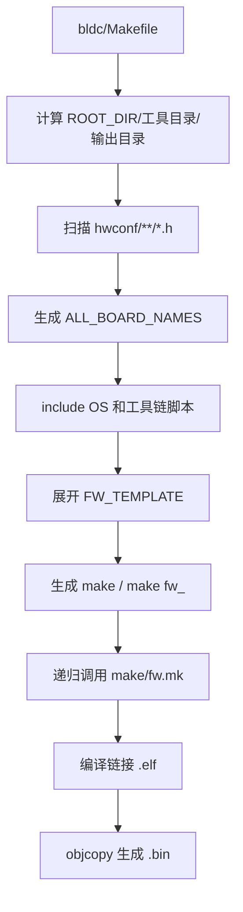

主 Makefile 的模块分区：

```text
基础变量和板卡扫描
OS 识别和平台命令引入
工具安装目标
环境变量清理
help 帮助目标
固件构建和烧录目标
固件打包目标
单元测试目标
```

## 文件关系

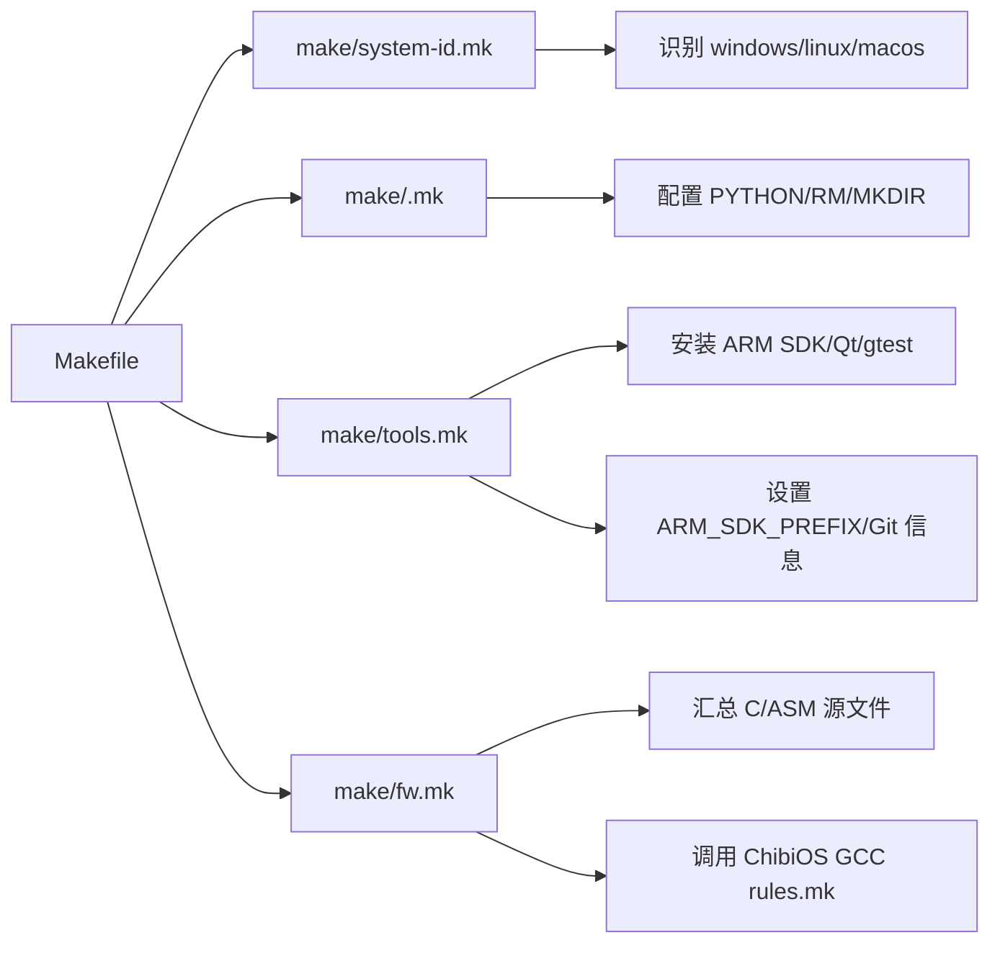

注意：`make/fw.mk` 不是在主 Makefile 顶层直接 `include`，而是在每个板卡目标中通过递归 `$(MAKE) -f $(MAKE_DIR)/fw.mk ...` 调用。

## 基础变量

主 Makefile 开头先确定工程根目录：

```makefile
WHEREAMI := $(dir $(lastword $(MAKEFILE_LIST)))
ROOT_DIR := $(realpath $(WHEREAMI)/ )
```

然后定义递归通配函数：

```makefile
rwildcard=$(foreach d,$(wildcard $(1:=/*)),$(call rwildcard,$d,$2) $(filter $(subst *,%,$2),$d))
```

主要目录变量：

```text
TOOLS_DIR = $(ROOT_DIR)/tools
MAKE_DIR  = $(ROOT_DIR)/make
BUILD_DIR = $(ROOT_DIR)/build
DL_DIR    = $(ROOT_DIR)/downloads
```

这些变量决定了：

```text
工具链安装到 bldc/tools
下载缓存放到 bldc/downloads
固件输出放到 bldc/build/<board>
构建子脚本来自 bldc/make
```

## 板卡目标生成

Makefile 通过 `hwconf` 下的头文件自动生成板卡目标。

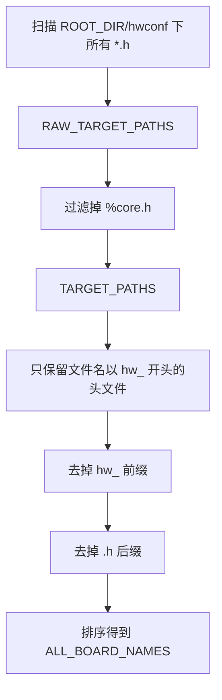

对应 Makefile 变量：

```makefile
RAW_TARGET_PATHS := $(call rwildcard,$(ROOT_DIR)/hwconf,*.h)
TARGET_PATHS := $(strip $(filter-out %core.h,$(RAW_TARGET_PATHS)))
ALL_BOARD_NAMES := $(sort $(subst .h,,$(subst hw_,,$(filter hw_%, $(notdir $(TARGET_PATHS))))))
```

示例：

```text
hwconf/trampa/100_250/hw_100_250.h
```

会生成目标：

```text
100_250
fw_100_250
100_250_flash
fw_100_250_flash
100_250_clean
fw_100_250_clean
```

## OS 识别与平台命令

主 Makefile 引入：

```makefile
include $(ROOT_DIR)/make/system-id.mk
include $(ROOT_DIR)/make/$(OSFAMILY).mk
include $(ROOT_DIR)/make/tools.mk
```

`system-id.mk` 根据系统设置：

```text
OSFAMILY = windows / linux / macos
WINDOWS / LINUX / MACOS 标志
OSFLAG 架构标志
```

`windows.mk`、`linux.mk`、`macos.mk` 负责：

```text
查找 Python
设置 PYTHON
设置 RM
设置 MKDIR
```

平台命令差异：

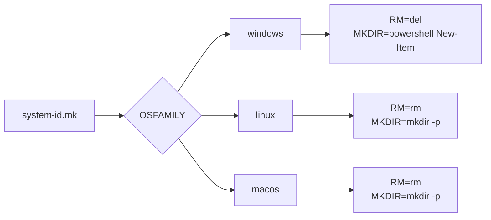

## 工具安装逻辑

工具安装目标来自 `make/tools.mk`。主 Makefile 的 `help` 中展示这些目标，但实际规则定义在 `tools.mk`。

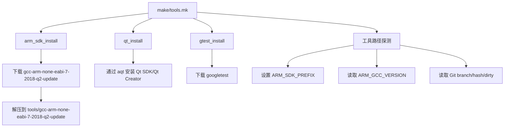

ARM 工具链路径：

```text
bldc/tools/gcc-arm-none-eabi-7-2018-q2-update
```

如果该目录存在：

```makefile
ARM_SDK_PREFIX := $(ARM_SDK_DIR)/bin/arm-none-eabi-
```

否则退回：

```makefile
ARM_SDK_PREFIX ?= arm-none-eabi-
```

并提示需要执行：

```powershell
make arm_sdk_install
```

## 环境变量清理

主 Makefile 使用 `SANITIZE_VAR` 清理可能影响 GCC 的环境变量：

```makefile
SANITIZE_GCC_VARS := TMPDIR GCC_EXEC_PREFIX COMPILER_PATH LIBRARY_PATH
SANITIZE_GCC_VARS += CFLAGS CPATH C_INCLUDE_PATH CPLUS_INCLUDE_PATH OBJC_INCLUDE_PATH DEPENDENCIES_OUTPUT
SANITIZE_GCC_VARS += ARCHFLAGS
```

作用：

```text
避免用户 shell 环境中的 CFLAGS、CPATH、LIBRARY_PATH 等污染交叉编译。
如果变量来自环境或命令行，Makefile 会清空并 unexport。
```

这对嵌入式固件很重要，因为外部 include path 或编译参数可能导致难以排查的编译差异。

## 输出详细程度

Makefile 使用 `V` 参数控制命令回显：

```text
默认：V1 = @，多数命令不显示
V=0：V0/V1 都隐藏
V=1：不设置 @，显示更完整命令
```

常用调试命令：

```powershell
make 100_250 V=1
```

## 固件目标模板 FW_TEMPLATE

`FW_TEMPLATE` 是主 Makefile 最核心的宏。它根据板卡名生成构建、烧录、清理规则。

```mermaid
flowchart TD
    A[FW_TEMPLATE(board, builddir, project, git_branch, git_hash, gcc_ver)] --> B[生成 board 和 fw_board 目标]
    B --> C[查找硬件目录和 hw_<board>.h]
    C --> D[FIND_TARGET_C_CODE 查找硬件 C 文件]
    D --> E[生成 BUILD_MACROS]
    E --> F[fw_<board>_vescfw]
    F --> G[mkdir build/<board>]
    G --> H[递归调用 make/fw.mk]
    H --> I[生成 .elf 和 .bin]
    B --> J[生成 flash 目标]
    B --> K[生成 clean 目标]
```

模板生成的别名：

```makefile
$(1): fw_$(1)_vescfw
fw_$(1): fw_$(1)_vescfw
```

因此：

```powershell
make 100_250
make fw_100_250
```

两者都会进入：

```text
fw_100_250_vescfw
```

## 硬件 C 文件查找

`FIND_TARGET_C_CODE` 决定 `HW_SOURCE` 指向哪个 C 文件。

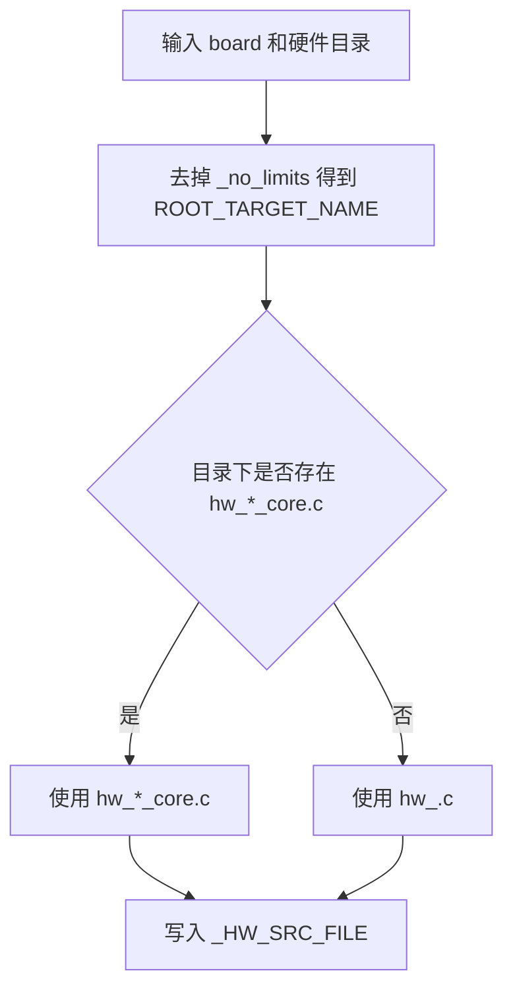

示例：

```text
board = 100_250_no_limits
ROOT_TARGET_NAME = 100_250
优先找 hw_*_core.c
否则找 hw_100_250.c
```

这样可以让 `*_no_limits` 这类头文件复用同一个硬件 C 文件。

## 构建宏 BUILD_MACROS

每个板卡目标会传入一组编译宏：

```text
HW_SOURCE
HW_HEADER
GIT_BRANCH_NAME
GIT_COMMIT_HASH
ARM_GCC_VERSION
USER_GIT_COMMIT_HASH 可选
USER_GIT_BRANCH_NAME 可选
```

这些宏最终进入 `make/fw.mk` 的 `build_args`：

```makefile
build_args='$$($(1)_BUILD_MACROS)'
```

递归调用形态：

```makefile
$(MAKE) -f $(MAKE_DIR)/fw.mk \
  TCHAIN_PREFIX="$(ARM_SDK_PREFIX)" \
  BUILDDIR="$(2)" \
  PROJECT="$(3)" \
  build_args='...' USE_VERBOSE_COMPILE=no
```

关键点：

```text
主 Makefile 负责决定板卡和硬件配置。
make/fw.mk 负责用这些宏编译实际固件。
hwconf/hw.c 会通过 HW_SOURCE/HW_HEADER 包含具体板卡文件。
```

## make/fw.mk 的承接关系

`make/fw.mk` 接收主 Makefile 传入的变量：

```text
TCHAIN_PREFIX：交叉编译器前缀，如 arm-none-eabi-
PROJECT：固件名和输出目录名
BUILDDIR：构建目录
build_args：板卡和 Git 信息宏
```

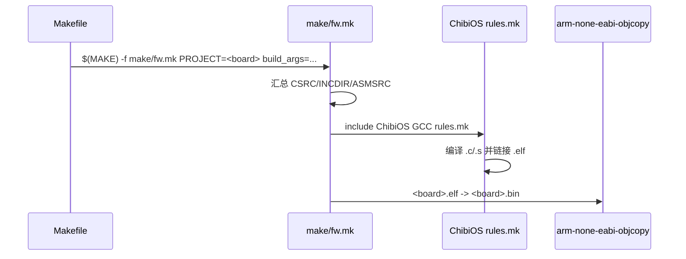

`fw.mk` 最后定义：

```makefile
build/$(PROJECT)/$(PROJECT).bin: build/$(PROJECT)/$(PROJECT).elf
	$(BIN) build/$(PROJECT)/$(PROJECT).elf build/$(PROJECT)/$(PROJECT).bin --gap-fill 0xFF
```

## 批量构建

主 Makefile 根据 `ALL_BOARD_NAMES` 生成批量目标：

```makefile
FW_TARGETS := $(addprefix fw_, $(ALL_BOARD_NAMES))
all_fw:        $(addsuffix _vescfw, $(FW_TARGETS))
all_fw_clean:  $(addsuffix _clean,  $(FW_TARGETS))
```

展开后类似：

```text
all_fw -> fw_100_250_vescfw fw_100_250_no_limits_vescfw ...
```

批量构建关系：

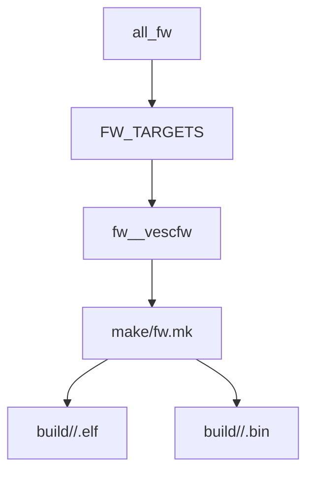

## 自定义硬件构建

`fw_custom` 用于不依赖 `hwconf` 自动扫描结果，手动指定硬件源文件和头文件。

```makefile
make fw_custom HW_SRC=<硬件源文件路径> HW_HEADER=<硬件头文件路径>
```

Makefile 会检查：

```text
没有 HW_SRC：报错
没有 HW_HEADER：报错
```

然后调用：

```makefile
FW_TEMPLATE(custom, $(BUILD_DIR)/custom, custom, ..., $(HW_SRC), $(HW_HEADER))
```

输出目录：

```text
bldc/build/custom/
```

## 烧录相关目标

每个板卡模板会生成：

```text
<board>_flash
fw_<board>_flash
<board>_flash_only
fw_<board>_flash_only
```

关系：

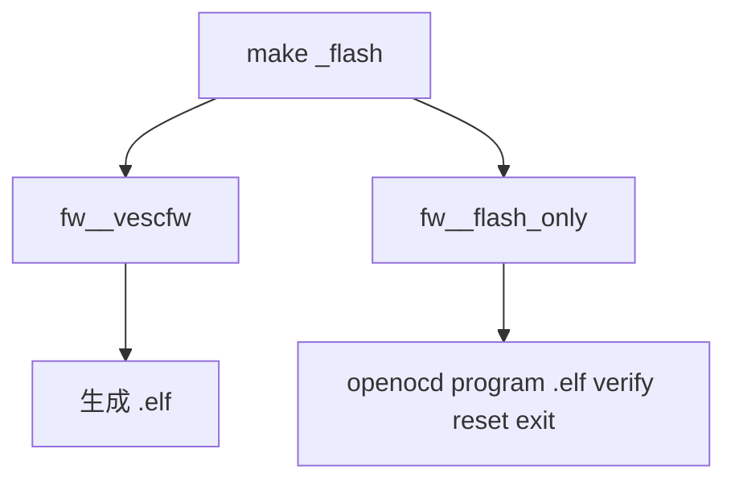

其他 OpenOCD 辅助目标：

```text
clear_option_bytes
erase_flash
upload-olimex
upload-pi
upload-pi-remote
debug-start
read_lbm_image
read_lbm_code
erase_lbm_image
erase_lbm_code
read_qml
erase_qml
```

这些目标直接调用 OpenOCD 或远程上传脚本，通常用于调试、恢复或读取特定 flash 区域。

## 打包目标

`all_fw_package` 会先编译全部固件，再清理 package 目录，然后执行 Python 打包脚本。

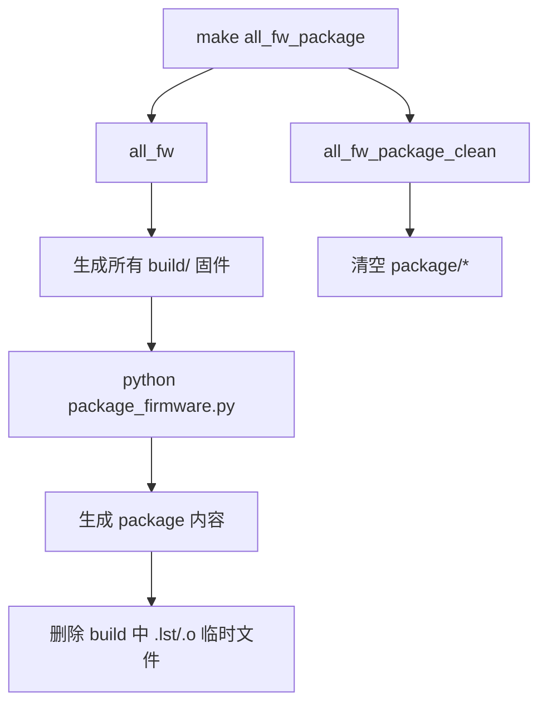

对应命令：

```powershell
make all_fw_package
```

注意：这是全量动作，耗时和磁盘占用都明显高于单板卡编译。

## 单元测试目标

当前主 Makefile 定义：

```makefile
ALL_UNITTESTS := utils_math
UT_OUT_DIR := $(BUILD_DIR)/unit_tests
```

单元测试目标：

```text
all_ut：构建所有单元测试
all_ut_xml：运行并输出 XML
all_ut_run：运行并输出到控制台
all_ut_gcov：生成覆盖率
all_ut_clean：清理单元测试输出
```

单元测试模板 `UT_TEMPLATE` 会进入：

```text
bldc/tests/<test_name>
```

并调用该目录自己的 Makefile。

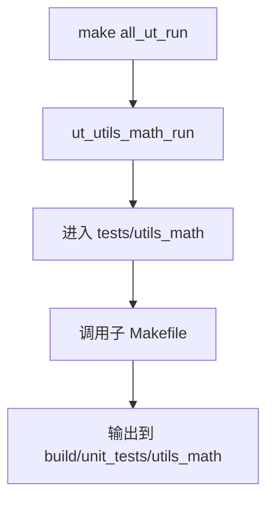

当目标包含 `all_ut_run` 时，Makefile 使用：

```makefile
.NOTPARALLEL:
```

防止测试输出互相交错。

## help 中需要注意的点

`help` 中列出：

```text
fw   - Build firmware for default target
PROJECT=<target> fw  - Build firmware for <target>
```

但按当前主 `Makefile` 可见规则，稳定的板卡编译入口是：

```powershell
make <board>
make fw_<board>
```

例如：

```powershell
make 100_250
make fw_100_250
```

如果后续要使用 `PROJECT=<target> fw`，需要确认当前分支是否另有规则定义 `fw`，或在命令行实际验证。就当前文件结构而言，建议优先使用 `<board>` 目标。

## 常用命令速查

```powershell
make
```

显示帮助和支持的板卡列表。

```powershell
make arm_sdk_install
```

安装 GNU ARM 工具链。

```powershell
make 100_250
```

编译指定板卡。

```powershell
make 100_250 V=1
```

显示详细命令。

```powershell
make 100_250_clean
```

清理指定板卡。

```powershell
make 100_250_flash
```

编译并通过 OpenOCD 烧录。

```powershell
make all_fw
```

编译全部板卡。

```powershell
make all_fw_package
```

编译全部板卡并打包。

```powershell
make fw_custom HW_SRC=<path> HW_HEADER=<path>
```

使用自定义硬件源文件和头文件构建。

## Makefile 数据流

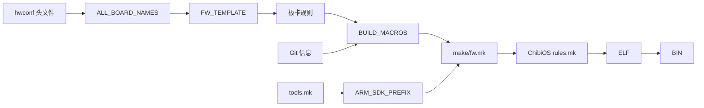

## 修改建议

修改 Makefile 时建议按以下边界操作：

```text
新增板卡：优先新增 hwconf 下的 hw_<board>.h，而不是手写 Makefile 目标。
新增构建模块：优先修改对应模块目录的 *.mk，再确认 make/fw.mk 是否 include。
新增工具安装目标：放到 make/tools.mk。
修改平台命令：放到 make/windows.mk、make/linux.mk 或 make/macos.mk。
修改固件规则模板：才改 FW_TEMPLATE。
修改单元测试：扩展 ALL_UNITTESTS 或 tests/<name>/Makefile。
```

风险点：

```text
ALL_BOARD_NAMES 完全由文件名生成，文件命名不规范会导致目标名异常。
*_no_limits 会去掉 _no_limits 后查找 C 文件，命名不匹配会找不到硬件源文件。
build_args 中 HW_SOURCE/HW_HEADER 的引号转义很关键，修改时容易破坏递归 make 传参。
Windows 分支大量调用 powershell 命令，路径中空格或特殊字符可能需要额外转义。
all_fw_package 会清理 package 并删除 build 下 .lst/.o，需要确认当前构建产物是否还要保留。
```

