# Project 目录用户指南

本文是 `bldc/Project` 目录的用户操作手册，主要介绍如何生成和使用 Qt Creator 固件工程配置、选择板卡、编译固件以及处理常见问题。

`Project` 目录不是另一套固件构建系统。它为 Qt Creator 提供项目浏览和 Build/Clean 前端，真正的编译仍由根 `Makefile`、`make/fw.mk` 和各业务模块 `.mk` 完成。

## 1. 适用范围

本指南适用于以下需求：

- 使用 Qt Creator 浏览 VESC 固件源码；
- 在 IDE 中切换不同硬件目标；
- 从 Qt Creator 调用根 Makefile 编译或清理固件；
- 重新生成板卡 Build Configuration；
- 修改 Qt Creator 显示的源码列表；
- 排查 `vesc.pro.shared`、Kit、路径和 Make 目标问题。

如果只需要命令行编译，可以不使用 `Project` 目录，直接在 `bldc` 根目录运行 `make fw_<board>` 或 `make <board>`。

## 2. 目录结构

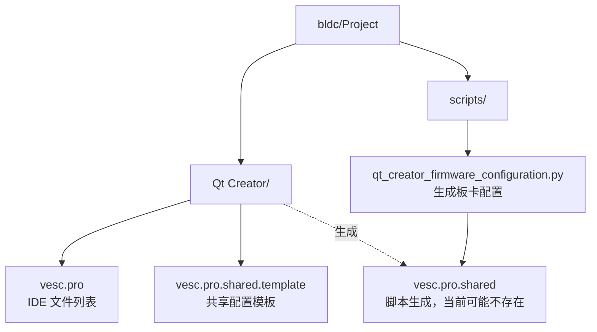

当前仓库包含三个源文件：

| 文件 | 用途 | 是否手工维护 |
|---|---|---|
| `Project/Qt Creator/vesc.pro` | 告诉 Qt Creator 在项目树中显示哪些源码、头文件和辅助文件 | 是 |
| `Project/Qt Creator/vesc.pro.shared.template` | 保存 Kit、构建步骤和占位符模板 | 是，谨慎修改 |
| `Project/scripts/qt_creator_firmware_configuration.py` | 根据目标列表生成 `vesc.pro.shared` | 是 |

`vesc.pro.shared` 是运行脚本后生成的机器相关文件，包含仓库绝对路径和构建目录。当前工作区未生成该文件属于正常现象。

## 3. Project 与固件构建系统的关系

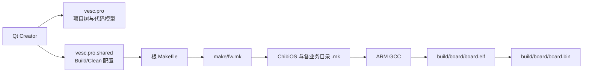

必须区分以下三件事：

1. `vesc.pro` 中出现某个文件，只表示 Qt Creator 展示和索引它；
2. `vesc.pro.shared` 中的 Build Step 只负责运行 `make <target>`；
3. 文件是否真正编译进固件，由 `make/fw.mk` 及它包含的模块 `.mk` 决定。

因此，不应通过向 `vesc.pro` 添加文件来代替修改真实 Makefile。

## 4. 首次使用前的准备

### 4.1 基础工具

需要：

- Git；
- GNU Make；
- Python 3；
- `pip`；
- ARM GCC 工具链；
- Qt Creator（Qt SDK 主要用于建立 Qt Creator Kit，本固件本身不是 Qt 应用）。

建议先确认命令：

```text
python --version
make --version
git --version
```

Windows 下应在普通 PowerShell 中运行，不建议用管理员身份安装和生成用户级 Qt Creator 配置。

### 4.2 安装 aqtinstall

项目的 Qt 安装目标使用 Python `aqt`：

```text
python -m pip install aqtinstall
```

如果系统使用 `python3`：

```text
python3 -m pip install aqtinstall
```


```bash
lee@DESKTOP-QG45PR9:~/bldc/documentation$ python3 -m pip install aqtinstall
Defaulting to user installation because normal site-packages is not writeable
Collecting aqtinstall
  Downloading aqtinstall-3.3.0-py3-none-any.whl (71 kB)
     ━━━━━━━━━━━━━━━━━━━━━━━━━━━━━━━━━━━━━━━━ 71.8/71.8 KB 476.6 kB/s eta 0:00:00
Collecting patch-ng
  Downloading patch_ng-1.19.1-py3-none-any.whl (17 kB)
Collecting py7zr>=0.22.0
  Downloading py7zr-1.1.3-py3-none-any.whl (72 kB)
     ━━━━━━━━━━━━━━━━━━━━━━━━━━━━━━━━━━━━━━━━ 72.2/72.2 KB 2.0 MB/s eta 0:00:00
Collecting defusedxml
  Downloading defusedxml-0.7.1-py2.py3-none-any.whl (25 kB)
Collecting semantic-version
  Downloading semantic_version-2.10.0-py2.py3-none-any.whl (15 kB)
Collecting bs4
  Downloading bs4-0.0.2-py2.py3-none-any.whl (1.2 kB)
Collecting humanize
  Downloading humanize-4.16.0-py3-none-any.whl (137 kB)
     ━━━━━━━━━━━━━━━━━━━━━━━━━━━━━━━━━━━━━━━━ 137.2/137.2 KB 2.8 MB/s eta 0:00:00
Collecting texttable
  Downloading texttable-1.7.0-py2.py3-none-any.whl (10 kB)
Collecting requests>=2.31.0
  Downloading requests-2.34.2-py3-none-any.whl (73 kB)
     ━━━━━━━━━━━━━━━━━━━━━━━━━━━━━━━━━━━━━━━━ 73.1/73.1 KB 4.0 MB/s eta 0:00:00
Collecting backports.zstd>=1.0.0
  Downloading backports_zstd-1.6.0-cp310-cp310-manylinux2014_x86_64.manylinux_2_17_x86_64.manylinux_2_28_x86_64.whl (492 kB)
     ━━━━━━━━━━━━━━━━━━━━━━━━━━━━━━━━━━━━━━━━ 492.5/492.5 KB 3.4 MB/s eta 0:00:00
Collecting pybcj>=1.0.6
  Downloading pybcj-1.0.7-cp310-cp310-manylinux2014_x86_64.manylinux_2_17_x86_64.manylinux_2_28_x86_64.whl (49 kB)
     ━━━━━━━━━━━━━━━━━━━━━━━━━━━━━━━━━━━━━━━━ 49.5/49.5 KB 6.5 MB/s eta 0:00:00
Collecting multivolumefile>=0.2.3
  Downloading multivolumefile-0.2.3-py3-none-any.whl (17 kB)
Collecting pyppmd>=1.3.1
  Downloading pyppmd-1.3.1-cp310-cp310-manylinux2014_x86_64.manylinux_2_17_x86_64.manylinux_2_28_x86_64.whl (140 kB)
     ━━━━━━━━━━━━━━━━━━━━━━━━━━━━━━━━━━━━━━━━ 141.0/141.0 KB 10.3 MB/s eta 0:00:00
Collecting inflate64>=1.0.4
  Downloading inflate64-1.0.4-cp310-cp310-manylinux2014_x86_64.manylinux_2_17_x86_64.manylinux_2_28_x86_64.whl (96 kB)
     ━━━━━━━━━━━━━━━━━━━━━━━━━━━━━━━━━━━━━━━━ 96.6/96.6 KB 10.3 MB/s eta 0:00:00
Collecting pycryptodomex>=3.20.0
  Downloading pycryptodomex-3.23.0-cp37-abi3-manylinux_2_17_x86_64.manylinux2014_x86_64.whl (2.3 MB)
     ━━━━━━━━━━━━━━━━━━━━━━━━━━━━━━━━━━━━━━━━ 2.3/2.3 MB 12.2 MB/s eta 0:00:00
Collecting brotli>=1.2.0
  Downloading brotli-1.2.0-cp310-cp310-manylinux2014_x86_64.manylinux_2_17_x86_64.whl (1.4 MB)
     ━━━━━━━━━━━━━━━━━━━━━━━━━━━━━━━━━━━━━━━━ 1.4/1.4 MB 37.8 MB/s eta 0:00:00
Requirement already satisfied: psutil in /home/lee/.local/lib/python3.10/site-packages (from py7zr>=0.22.0->aqtinstall) (7.0.0)
Requirement already satisfied: urllib3<3,>=1.26 in /usr/lib/python3/dist-packages (from requests>=2.31.0->aqtinstall) (1.26.5)
Requirement already satisfied: idna<4,>=2.5 in /usr/lib/python3/dist-packages (from requests>=2.31.0->aqtinstall) (3.3)
Collecting charset_normalizer<4,>=2
  Downloading charset_normalizer-3.4.9-cp310-cp310-manylinux2014_x86_64.manylinux_2_17_x86_64.manylinux_2_28_x86_64.whl (223 kB)
     ━━━━━━━━━━━━━━━━━━━━━━━━━━━━━━━━━━━━━━━━ 223.8/223.8 KB 32.6 MB/s eta 0:00:00
Collecting certifi>=2023.5.7
  Downloading certifi-2026.6.17-py3-none-any.whl (133 kB)
     ━━━━━━━━━━━━━━━━━━━━━━━━━━━━━━━━━━━━━━━━ 133.3/133.3 KB 22.9 MB/s eta 0:00:00
Requirement already satisfied: beautifulsoup4 in /usr/lib/python3/dist-packages (from bs4->aqtinstall) (4.10.0)
Installing collected packages: texttable, brotli, semantic-version, pyppmd, pycryptodomex, pybcj, patch-ng, multivolumefile, inflate64, humanize, defusedxml, charset_normalizer, certifi, bs4, backports.zstd, requests, py7zr, aqtinstall
Successfully installed aqtinstall-3.3.0 backports.zstd-1.6.0 brotli-1.2.0 bs4-0.0.2 certifi-2026.6.17 charset_normalizer-3.4.9 defusedxml-0.7.1 humanize-4.16.0 inflate64-1.0.4 multivolumefile-0.2.3 patch-ng-1.19.1 py7zr-1.1.3 pybcj-1.0.7 pycryptodomex-3.23.0 pyppmd-1.3.1 requests-2.34.2 semantic-version-2.10.0 texttable-1.7.0
```

### 4.3 安装 ARM 工具链

在 `bldc` 根目录运行：

```text
make arm_sdk_install
```

`arm_sdk_install` 已成功完成。下一步先验证工具链，再选择硬件型号编译固件。

```bash
cd ~/bldc

# 验证工具链
./tools/gcc-arm-none-eabi-7-2018-q2-update/bin/arm-none-eabi-gcc --version

# 查看支持的板卡型号
make
```

从输出中找到实际 VESC 硬件目标，例如 `100_250`，然后编译：

```bash
make 100_250
```

需要查看完整编译命令时：

```bash
make 100_250 V=1
```

成功后固件通常位于：

```text
build/100_250/100_250.elf
build/100_250/100_250.bin
```

如果下一步要使用 Qt Creator：

```bash
python3 -m pip install --user aqtinstall
make qt_install
```

然后打开：

```text
Project/Qt Creator/vesc.pro
```

注意：必须选择与实际控制器完全一致的板卡型号，不要直接照用示例 `100_250`。


它会将工具链安装到 `bldc/tools/gcc-arm-none-eabi-7-2018-q2-update`。如果该目录不存在，构建系统会尝试使用 PATH 中的 `arm-none-eabi-*` 工具。

``` bash
lee@DESKTOP-QG45PR9:~/bldc$ make arm_sdk_install
# download the source only if it's newer than what we already have
--2026-07-16 11:33:51--  https://developer.arm.com/-/media/Files/downloads/gnu-rm/7-2018q2/gcc-arm-none-eabi-7-2018-q2-update-linux.tar.bz2
Resolving developer.arm.com (developer.arm.com)... 2.16.27.81, 2.16.27.89, 2600:140b:ac00::174d:d990, ...
Connecting to developer.arm.com (developer.arm.com)|2.16.27.81|:443... connected.
HTTP request sent, awaiting response... 302 Moved Temporarily
Location: https://armkeil.blob.core.windows.net/developer/Files/downloads/gnu-rm/7-2018q2/gcc-arm-none-eabi-7-2018-q2-update-linux.tar.bz2 [following]
--2026-07-16 11:33:52--  https://armkeil.blob.core.windows.net/developer/Files/downloads/gnu-rm/7-2018q2/gcc-arm-none-eabi-7-2018-q2-update-linux.tar.bz2
Resolving armkeil.blob.core.windows.net (armkeil.blob.core.windows.net)... 20.209.58.235
Connecting to armkeil.blob.core.windows.net (armkeil.blob.core.windows.net)|20.209.58.235|:443... connected.
HTTP request sent, awaiting response... 200 OK
Length: 100600407 (96M) [application/octet-stream]
Saving to: ‘/home/lee/bldc/downloads/gcc-arm-none-eabi-7-2018-q2-update-linux.tar.bz2’

gcc-arm-none-eabi-7-2018-q2-u 100%[=================================================>]  95.94M   117KB/s    in 22m 9s

2026-07-16 11:56:03 (73.9 KB/s) - ‘/home/lee/bldc/downloads/gcc-arm-none-eabi-7-2018-q2-update-linux.tar.bz2’ saved [100600407/100600407]

# binary only release so just extract it
lee@DESKTOP-QG45PR9:~/bldc$ ./tools/gcc-arm-none-eabi-7-2018-q2-update/bin/arm-none-eabi-gcc --version
arm-none-eabi-gcc (GNU Tools for Arm Embedded Processors 7-2018-q2-update) 7.3.1 20180622 (release) [ARM/embedded-7-branch revision 261907]
Copyright (C) 2017 Free Software Foundation, Inc.
This is free software; see the source for copying conditions.  There is NO
warranty; not even for MERCHANTABILITY or FITNESS FOR A PARTICULAR PURPOSE.

lee@DESKTOP-QG45PR9:~/bldc$ make

   This Makefile is known to work on Linux and Mac in a standard shell environment.

   Here is a summary of the available targets:

   [Tool Installers]
     arm_sdk_install      - Install the GNU ARM gcc toolchain
     qt_install           - Install the all tools for Qt

   [Big Hammer]
     all_fw               - Build firmware for all boards
     all_fw_package       - Packaage firmware for boards in package list

   [Unit Tests]
     all_ut               - Build all unit tests
     all_ut_xml           - Run all unit tests and capture all XML output to files
     all_ut_run           - Run all unit tests and dump XML output to console

   [Firmware]
     fw   - Build firmware for default target
                            supported boards are: 100_250 100_250_mkiii 100_250_mkiii_no_limits 100_250_no_limits 100_500 100_500_no_limits 140_300 40 410 410_0005ohm 410_005ohm 410_no_limits 45 46 46_0005ohm 46_33k 48 49 60 60_75 60_75_mk2 60_75_mk2_no_limits 60_75_no_limits 60_mk3 60_mk3_no_limits 60_mk4 60_mk4_no_limits 60_mk5 60_mk5_no_limits 60_mk6 60_mk6_hp 60_mk6_hp_no_limits 60_mk6_max 60_mk6_no_limits 60_no_limits 60v2_alva 60v2_alva_mk1 60v2_alva_mk2 75_100 75_100_V2 75_100_V2_0005ohm 75_100_V2_005ohm 75_100_V2_no_limits 75_100_no_limits 75_300 75_300_mkiv 75_300_mkiv_no_limits 75_300_no_limits 75_300_r2 75_300_r2_no_limits 75_300_r3 75_300_r3_no_limits 75_600 75_600_no_limits Cheap_FOCer_2 Cheap_FOCer_2_V09 Cheap_FOCer_2_V09_no_limits Cheap_FOCer_2_no_limits ENNOID_150V_mk8 FOCSTrot_V3 FOCSTrot_V4 JetFleetF6_20s JetFleetF6_24s JetFleetF6_32s Lightning400 Little_FOCer Little_FOCer_V3 Little_FOCer_V3_1 Little_FOCer_V4 RSR_DD_V1 RSR_DD_V1_005 RSR_DD_V2 RSR_DD_V2.1 TRONIC_250R Thor300_20s Thor301 Thor400 Thor400v2 a100s_v4 a200s_v2.1 a200s_v2.2 a200s_v3 a200s_v4 a200s_v41 a50s_dual_12s a50s_dual_8s a50s_v22_12s a50s_v22_12s_hg a50s_v22_6s a50s_v22_6s_hg a50s_v23_12s a50s_v23_20s a50s_v23_6s a50s_v23_8s a50s_v23c_12s a50s_v23c_8s adv200 adv500 axiom basic basic_025 basic_035 basic_035_no_limits classic classic_no_limits classicp classicp_no_limits duet duet_no_limits duet_xs100 duet_xs100_no_limits duet_xs60 duet_xs60_no_limits edu edu_no_limits example flipsky_110_100 flipsky_110_100_no_limits flipsky_110_200 flipsky_110_200_no_limits flipsky_110_300 flipsky_110_300_no_limits flipsky_110_400 flipsky_110_400_no_limits flipsky_412 flipsky_412_no_limits flipsky_60 flipsky_60_mk5 flipsky_60_mk5_no_limits flipsky_60_no_limits flipsky_75 flipsky_75_450 flipsky_75_450_no_limits flipsky_75_no_limits fsesc_75_200_alu fsesc_75_200_alu_no_limits fsesc_75_300 gesc go_foc_dv6_pro go_foc_dv6_pro_no_limits go_foc_g300 go_foc_g300_no_limits go_foc_hi200 go_foc_hi200_no_limits go_foc_hv200 go_foc_hv200_no_limits go_foc_m100 go_foc_m100_no_limits gp hd60 hd60_no_limits hd75 hd75_no_limits itr_x1 ka160 luna_bbshd luna_m600 luna_m600_Rev5 luna_m600_Rev5_60V maxim_120 maxim_120_no_limits maxim_120_ph maxim_120_ph_no_limits maxim_150 maxim_150_no_limits maxim_150_ph maxim_150_ph_no_limits maximp_120 maximp_120_no_limits maximp_120_ph maximp_120_ph_no_limits maximp_150 maximp_150_no_limits maximp_150_ph maximp_150_ph_no_limits mbot minim minim_no_limits minim_w60 mksesc_100_300_hp mksesc_100_300_hp_no_limits mksesc_75_100_old mksesc_75_100_old_no_limits mksesc_75_100_v2 mksesc_75_100_v2_no_limits mksesc_75_100_v2_old mksesc_75_100_v2_old_no_limits mksesc_75_200_v2 mksesc_75_200_v2_no_limits mksesc_75_200_v2_old mksesc_75_200_v2_old_no_limits mksesc_84_100_hp mksesc_84_100_hp_no_limits mksesc_84_200_hp mksesc_84_200_hp_no_limits pronto pronto_no_limits r2 raiden7 rb solo solo_no_limits sparkf spesc stormcore_100d stormcore_100d_no_limits stormcore_100d_parallel stormcore_100d_v2 stormcore_100d_v2_no_limits stormcore_100dx stormcore_100dx_no_limits stormcore_100dx_parallel stormcore_100s stormcore_100s_no_limits stormcore_60d stormcore_60d+ stormcore_60d+_no_limits stormcore_60d_no_limits stormcore_60dxs stormcore_60dxs_no_limits str365 str365_150 str365_150_no_limits str365_no_limits str500 str500_01 str500_hp str500_hp_no_limits str500_no_limits ubox_126_100 ubox_126_100_no_limits ubox_126_160 ubox_126_160_no_limits ubox_single_100 ubox_single_100_no_limits ubox_single_75 ubox_single_75_no_limits ubox_single_80 ubox_single_80_no_limits ubox_single_85_200 ubox_single_85_200_no_limits ubox_v1_75_micro ubox_v1_75_micro_no_limits ubox_v1_75_typec ubox_v1_75_typec_no_limits ubox_v2_100 ubox_v2_100_no_limits ubox_v2_75 ubox_v2_75_no_limits unity unity_no_limits warrior6 x12_pro24 x12_pro30
     fw_<board>           - Build firmware for target <board>
     PROJECT=<target> fw  - Build firmware for <target>
     fw_<board>_clean     - Remove firmware for <board>
     fw_<board>_flash     - Use OpenOCD + SWD/JTAG to write firmware to <target>

     fw_custom            - Build firmware with custom hwconf file locations, you must specify these by setting the HW_SRC and HW_HEADER variables
     fw_custom_clean      - Remove firmware for custom
     fw_custom_flash      - Use OpenOCD + SWD/JTAG to write firmware to custom

   Hint: Add V=1 to your command line to see verbose build output.

   Note: All tools will be installed into /home/lee/bldc/tools
         All build output will be placed in /home/lee/bldc/build

lee@DESKTOP-QG45PR9:~/bldc$
lee@DESKTOP-QG45PR9:~/bldc$ make 100_250
********* BUILD: 100_250 **********
make[1]: Entering directory '/home/lee/bldc'
Compiling crt0_v7m.s
Compiling chcoreasm_v7m.s
Compiling crt1.c
Compiling vectors.c
Compiling chsys.c
Compiling chdebug.c
Compiling chvt.c
Compiling chschd.c
Compiling chthreads.c
Compiling chtm.c
Compiling chdynamic.c
Compiling chregistry.c
Compiling chsem.c
Compiling chmtx.c
Compiling chcond.c
Compiling chevents.c
Compiling chmsg.c
Compiling chmboxes.c
Compiling chqueues.c
Compiling chmemcore.c
Compiling chheap.c
Compiling chmempools.c
Compiling chcore.c
Compiling chcore_v7m.c
Compiling osal.c
Compiling hal.c
Compiling st.c
Compiling hal_queues.c
Compiling hal_mmcsd.c
Compiling can.c
Compiling i2c.c
Compiling icu.c
Compiling pal.c
Compiling serial.c
Compiling serial_usb.c
Compiling spi.c
Compiling usb.c
Compiling nvic.c
Compiling stm32_dma.c
Compiling hal_lld.c
Compiling st_lld.c
Compiling can_lld.c
Compiling pal_lld.c
Compiling i2c_lld.c
Compiling usb_lld.c
Compiling spi_lld.c
Compiling icu_lld.c
Compiling serial_lld.c
Compiling chprintf.c
Compiling syscalls.c
Compiling main.c
Compiling irq_handlers.c
Compiling terminal.c
Compiling conf_general.c
Compiling timeout.c
Compiling flash_helper.c
Compiling confgenerator.c
Compiling bms.c
Compiling events.c
Compiling board.c
Compiling hw.c
Compiling drv8301.c
Compiling drv8305.c
Compiling drv8316.c
Compiling drv8320s.c
Compiling drv8323s.c
Compiling luna_display_serial.c
Compiling luna_m600_display.c
Compiling si8900.c
Compiling shutdown.c
Compiling app.c
Compiling app_ppm.c
Compiling app_adc.c
Compiling app_sten.c
Compiling app_uartcomm.c
Compiling app_nunchuk.c
Compiling app_pas.c
Compiling app_custom.c
Compiling canard.c
Compiling canard_driver.c
Compiling esc_Status.c
Compiling esc_RawCommand.c
Compiling esc_RPMCommand.c
Compiling protocol_GetNodeInfo.c
Compiling protocol_HardwareVersion.c
Compiling protocol_NodeStatus.c
Compiling protocol_SoftwareVersion.c
Compiling param_Empty.c
Compiling param_ExecuteOpcode.c
Compiling param_GetSet.c
Compiling param_NumericValue.c
Compiling param_Value.c
Compiling file_BeginFirmwareUpdate.c
Compiling file_Read.c
Compiling vesc_RTData.c
Compiling mpu9150.c
Compiling icm20948.c
Compiling ahrs.c
Compiling imu.c
Compiling bmi160.c
Compiling bmi160_wrapper.c
Compiling lsm6ds3.c
Compiling FusionAhrs.c
Compiling FusionBias.c
Compiling FusionCompass.c
Compiling bm_if.c
Compiling swdptap.c
Compiling timing.c
Compiling platform.c
Compiling exception.c
Compiling swdptap_generic.c
Compiling target.c
Compiling adiv5_swdp.c
Compiling adiv5.c
Compiling cortexm.c
Compiling nrf51.c
Compiling stm32f1.c
Compiling stm32f4.c
Compiling stm32h7.c
Compiling stm32l0.c
Compiling stm32l4.c
Compiling qmlui.c
Compiling encoder.c
Compiling encoder_cfg.c
Compiling enc_abi.c
Compiling enc_ad2s1205.c
Compiling enc_as5x47u.c
Compiling enc_as504x.c
Compiling enc_bissc.c
Compiling enc_mt6816.c
Compiling enc_sincos.c
Compiling enc_tle5012.c
Compiling enc_ts5700n8501.c
Compiling enc_pwm.c
Compiling enc_ma782.c
Compiling enc_amt22.c
Compiling conf_custom.c
Compiling env.c
Compiling fundamental.c
Compiling heap.c
Compiling lbm_memory.c
Compiling print.c
Compiling stack.c
Compiling symrepr.c
Compiling tokpar.c
Compiling extensions.c
Compiling lispbm.c
Compiling eval_cps.c
Compiling platform_mutex.c
Compiling platform_timestamp.c
Compiling lbm_channel.c
Compiling lbm_c_interop.c
Compiling lbm_custom_type.c
Compiling lbm_flat_value.c
Compiling lbm_prof.c
Compiling lbm_defrag_mem.c
Compiling lbm_image.c
Compiling array_extensions.c
Compiling math_extensions.c
Compiling string_extensions.c
Compiling mutex_extensions.c
Compiling lbm_dyn_lib.c
Compiling lispif.c
Compiling lispif_vesc_extensions.c
Compiling lispif_c_lib.c
Compiling lbm_vesc_utils.c
Compiling commands.c
Compiling comm_usb_serial.c
Compiling comm_usb.c
Compiling comm_can.c
Compiling packet.c
Compiling log.c
Compiling foc_math.c
Compiling mc_interface.c
Compiling mcpwm.c
Compiling mcpwm_foc.c
Compiling virtual_motor.c
Compiling buffer.c
Compiling crc.c
Compiling digital_filter.c
Compiling mempools.c
Compiling utils_math.c
Compiling utils_sys.c
Compiling worker.c
Compiling minilzo.c
Compiling eeprom.c
Compiling i2c_bb.c
Compiling ledpwm.c
Compiling servo_dec.c
Compiling spi_bb.c
Compiling timer.c
Compiling pwm_servo.c
Compiling SX1278.c
Compiling lora.c
Compiling SX1278_hw.c
Compiling spi_sw.c
Compiling rf.c
Compiling rfhelp.c
Compiling nrf_driver.c
Compiling misc.c
Compiling stm32f4xx_adc.c
Compiling stm32f4xx_dma.c
Compiling stm32f4xx_exti.c
Compiling stm32f4xx_flash.c
Compiling stm32f4xx_rcc.c
Compiling stm32f4xx_syscfg.c
Compiling stm32f4xx_tim.c
Compiling stm32f4xx_iwdg.c
Compiling stm32f4xx_wwdg.c
Linking /home/lee/bldc/build/100_250/100_250.elf
Memory region         Used Size  Region Size  %age Used
           flash:       15648 B        16 KB     95.51%
          flash2:      449280 B     475120 B     94.56%
         crcinfo:           8 B          8 B    100.00%
            ram0:      110160 B       128 KB     84.05%
            ram1:          0 GB       112 KB      0.00%
            ram2:          0 GB        16 KB      0.00%
            ram3:          0 GB         0 GB      -nan%
            ram4:       63208 B        62 KB     99.56%
           libif:          2 KB         2 KB    100.00%
            ram5:          0 GB         4 KB      0.00%
            ram6:          0 GB         0 GB      -nan%
            ram7:          0 GB         0 GB      -nan%
Creating /home/lee/bldc/build/100_250/100_250.hex
Creating /home/lee/bldc/build/100_250/100_250.bin
Creating /home/lee/bldc/build/100_250/100_250.dmp

   text    data     bss     dec     hex filename
 462144    2792  173072  638008   9bc38 /home/lee/bldc/build/100_250/100_250.elf
Creating /home/lee/bldc/build/100_250/100_250.list

Done
make[1]: Leaving directory '/home/lee/bldc'
lee@DESKTOP-QG45PR9:~/bldc$
```  


### 4.4 安装 Qt 与配置项目

```text
make qt_install
```

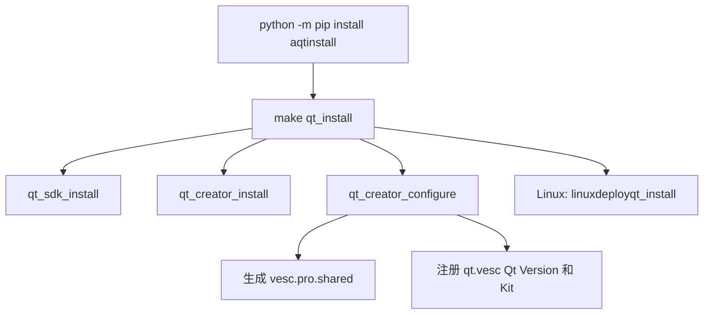

`make qt_install` 会访问网络并下载较大的工具包。若 Qt/Qt Creator 已经安装，可以只执行生成脚本并手工配置 Kit，不必重复安装整套 SDK。

## 5. 自动生成 Qt Creator 配置

`make qt_creator_configure` 执行两类操作：

1. 调用 Python 脚本生成 `vesc.pro.shared`；
2. 使用 Qt Creator 的 `sdktool` 注册名为 `qt.vesc` 的 Qt Version 和 Kit。

执行命令：

```text
make qt_creator_configure
```

根 Makefile 自动扫描 `hwconf/**/hw_*.h` 得到 `ALL_BOARD_NAMES`，并把目标列表传给脚本：

```text
python Project/scripts/qt_creator_firmware_configuration.py \
  --targets <全部板卡名称> sim_posix
```

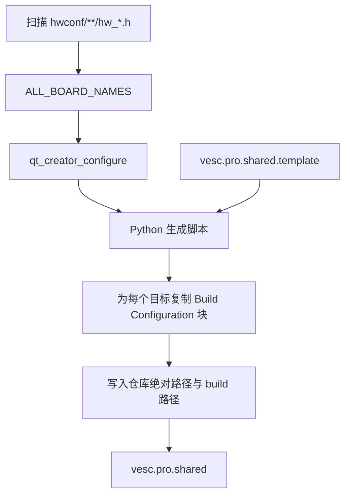

### 5.1 手动运行生成脚本

如果只想生成少数目标，可从 `bldc` 根目录运行：

```text
python Project/scripts/qt_creator_firmware_configuration.py --targets 100_250 75_300_R2
```

PowerShell 示例：

```powershell
Set-Location C:\WorkSpace\vedderb_bldc\Lee_fork\bldc
python .\Project\scripts\qt_creator_firmware_configuration.py --targets 100_250 75_300_R2
```

目标名称必须是根 Makefile 可接受的目标名。可以先运行不带目标的 `make` 查看帮助和支持的板卡列表。

### 5.2 必须从 bldc 根目录运行

脚本使用相对路径：

```text
Project/Qt Creator/vesc.pro.shared.template
Project/Qt Creator/vesc.pro.shared
```

同时使用当前工作目录作为 `{ROOT REPOSITORY PATH}`。如果从 `Project/scripts` 目录直接运行，模板路径会找不到，或者生成文件中的根路径错误。

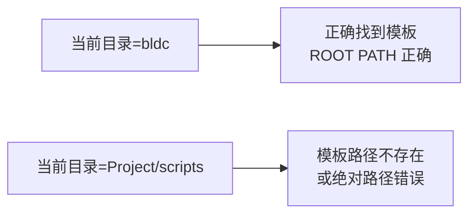

## 6. 生成脚本的工作机制

脚本接受 `--targets` 后面的一个或多个名称。对每个目标，它会生成一个 Qt Creator Build Configuration：

- Display Name：目标名称；
- Build Directory：`<仓库根>/build`；
- Build Command：`make <目标名称>`；
- Clean Command：`make <目标名称>_clean`；
- Working Directory：`%{sourceDir}/../../`，即 `bldc` 根目录。

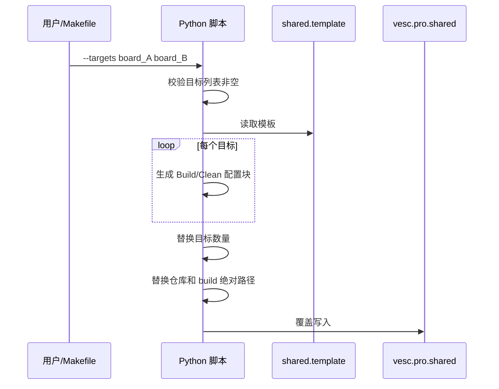

脚本每次都会覆盖 `vesc.pro.shared`，不会合并 Qt Creator 中对该共享文件所做的手工编辑。长期配置应修改模板或脚本，而不是只修改生成文件。

## 7. 打开 Qt Creator 工程

完成配置后：

1. 启动 Qt Creator；
2. 选择“File → Open File or Project”；
3. 打开 `bldc/Project/Qt Creator/vesc.pro`；
4. 选择名为 `VESC Firmware` 或 `qt.vesc` 的 Kit；
5. 在左侧 Projects/Build Settings 或窗口左下角选择目标板卡配置。

项目文件路径：

```text
bldc/Project/Qt Creator/vesc.pro
```

仓库工具安装的 Qt Creator 常见路径：

- Linux/macOS：`bldc/tools/Qt/Tools/QtCreator/bin/qtcreator`，具体目录可能随安装包变化；
- Windows：`bldc\tools\Qt\Tools\QtCreator\bin\qtcreator.exe`。

如果实际安装目录不同，应以 `bldc/tools/Qt` 下的文件为准。

## 8. 在 Qt Creator 中选择板卡

每个脚本目标对应一个 Build Configuration，而不是独立 Kit。

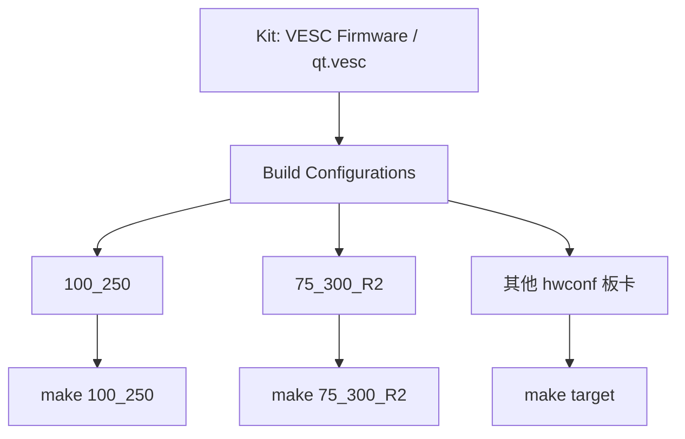

选择板卡后点击 Build，Qt Creator 会在 `bldc` 根目录执行对应 Make 目标。点击 Clean 则执行 `<target>_clean`。

修改板卡选择不会修改源码中的 `hw.h`。根 Makefile通过 `HW_SOURCE` 和 `HW_HEADER` 编译宏选择实际硬件文件。

## 9. 编译操作

### 9.1 从 IDE 编译

1. 选择正确 Build Configuration；
2. 点击锤子图标或“Build → Build Project”；
3. 在 Compile Output 中查看 Make 和 ARM GCC 输出；
4. 构建完成后到 `bldc/build/<target>/` 查看产物。

典型产物：

```text
build/<target>/<target>.elf
build/<target>/<target>.bin
```

### 9.2 从命令行验证同一目标

当 IDE 构建失败时，先在 `bldc` 根目录运行同一命令：

```text
make <target> V=1
```

`V=1` 显示完整编译命令，便于判断问题属于 Make、工具链还是 Qt Creator 环境。

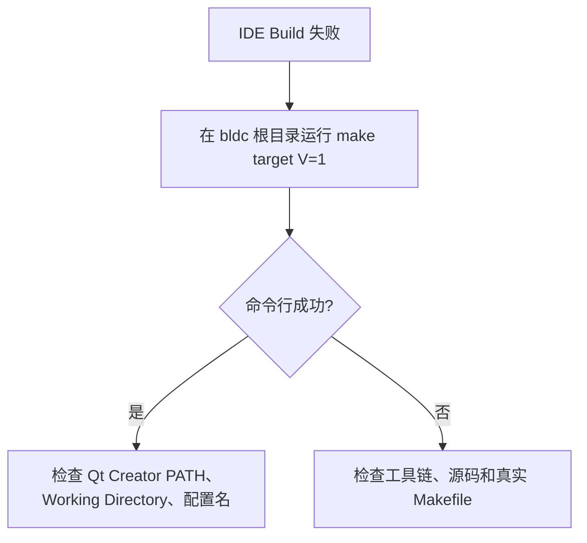

### 9.3 清理

在 Qt Creator 点击 Clean，或命令行执行：

```text
make <target>_clean
```

如果板卡配置列表变化，应重新运行生成脚本，不需要为了刷新列表删除全部固件构建目录。

## 10. 烧录与运行边界

模板只配置 Build 和 Clean，没有配置自动 Flash 或调试器启动步骤。构建成功后可在命令行烧录：

```text
make <target>_flash
```

或者使用 VESC Tool 上传生成的 `.bin`。

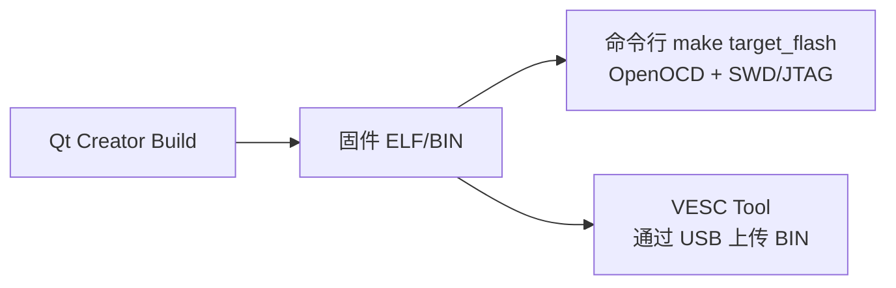

Qt Creator 模板中的 Run Configuration 是 BareMetal 占位配置，未启用 C++ Debugger，也没有设置 OpenOCD/GDB Server。点击 Run 不等同于烧录固件。

## 11. vesc.pro 的作用

`vesc.pro` 是 qmake 风格的项目描述，主要通过 `SOURCES`、`HEADERS` 和 `OTHER_FILES` 把文件显示到 Qt Creator 项目树。

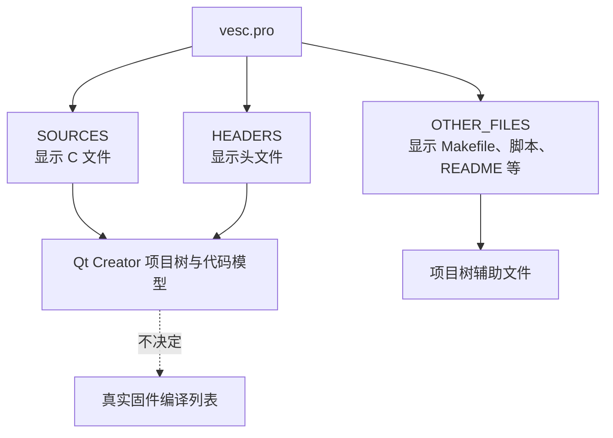

当前 `vesc.pro` 中的文件列表并不覆盖仓库所有现有目录，例如 `motor`、`comm`、`driver`、`encoder` 等核心目录没有完整列出。这不会影响 Make 固件编译，但会导致 Qt Creator 项目树或代码索引不完整。

需要补充显示目录时，在 `SOURCES` 和 `HEADERS` 中添加相应通配符，例如：

```text
$${ROOT_SRC_DIR}/motor/*.c
$${ROOT_SRC_DIR}/motor/*.h
```

修改后重新加载项目即可，通常无需重新生成 `vesc.pro.shared`。

## 12. vesc.pro.shared.template 的作用

模板包含：

- Qt Creator 编辑器设置；
- 自动测试和 Clang Tools 设置；
- `qt.vesc` Kit/Target 信息；
- Deploy 和 Run Configuration；
- `{BUILD CONFIGURATION TARGETS}` 占位符；
- `{ROOT REPOSITORY PATH}` 等路径占位符。

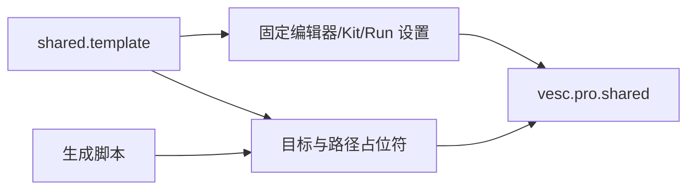

如果要为所有目标统一增加 Build Step，应修改脚本中的 `reference_target_configuration`。如果要修改 Qt Creator 固定项目设置，应修改模板。修改后重新运行脚本。

模板标记为 Qt Creator 6.0.0、文件版本 22。较新 Qt Creator 首次打开时可能升级配置格式；升级后的用户配置不一定适合直接回写旧模板。

## 13. 添加或删除板卡配置

### 13.1 自动加入新板卡

如果新硬件按仓库约定增加了 `hwconf/**/hw_<name>.h`，根 Makefile会在下次 `make qt_creator_configure` 时自动发现它。


### 13.2 手动生成精简列表

```text
python Project/scripts/qt_creator_firmware_configuration.py --targets board_a board_b
```

再次打开或重新加载 Qt Creator 项目后，只会保留脚本传入的 Build Configurations。

### 13.3 检查目标是否真实存在

生成脚本不会验证目标是否是有效 Make 目标。它只把字符串写入 Build Step。因此生成成功不代表该目标能够编译。

`make/tools.mk` 当前额外传入 `sim_posix`，但在当前根 Makefile 中没有搜索到对应目标定义。选择该配置前应先在命令行验证：

```text
make sim_posix
```

若 Make 报“没有规则可制作目标”，应从生成目标列表移除它，或补齐模拟器构建规则。

## 14. 移动或复制仓库后

`vesc.pro.shared` 包含生成时的绝对路径。仓库移动、用户名改变或在另一台电脑克隆后，应重新生成：

```text
make qt_creator_configure
```

或者只运行 Python 脚本。


不建议把其他电脑生成的 `vesc.pro.shared` 直接复制过来。

## 15. 使用已有 Qt Creator 安装

如果已经安装 Qt Creator，可以采用精简流程：

1. 确保 `make`、Python 和 ARM GCC 可用；
2. 手动运行生成脚本；
3. 在 Qt Creator 中建立 Desktop/Bare Metal Kit；
4. 打开 `vesc.pro`；
5. 确保 Build Step 是 `make <target>`，工作目录是 `bldc` 根目录。

不必强制使用 `tools/Qt` 中的版本。`qt.vesc` Kit 的关键作用是让 Qt Creator接受并打开该 qmake 项目，真正编译仍由外部 Make 进程完成。

## 16. 常见问题

### 16.1 找不到 vesc.pro.shared

原因：尚未运行生成脚本或 `qt_creator_configure`。

处理：

```text
make qt_creator_configure
```

若只生成文件：

```text
python Project/scripts/qt_creator_firmware_configuration.py --targets <board>
```

### 16.2 Python 报模板文件不存在

典型原因：不在 `bldc` 根目录运行脚本。

处理：先 `cd bldc`，再运行脚本。

### 16.3 Qt Creator 中没有板卡列表

检查：

- `vesc.pro.shared` 是否存在；
- 文件中是否有 `BuildConfigurationCount`；
- Qt Creator 是否重新加载了工程；
- 当前打开的是否是正确仓库中的 `vesc.pro`；
- Kit 是否选择了 `qt.vesc`。

### 16.4 Build 报 make 命令不存在

Qt Creator 的环境 PATH 中没有 GNU Make。Windows 上需要安装 Make，并完全重启 Qt Creator使其读取新 PATH。

也可把模板/生成配置中的 `ProjectExplorer.ProcessStep.Command` 改为 Make 的绝对路径，但重新生成会覆盖修改。

### 16.5 Build 报 arm-none-eabi-gcc 不存在

先运行：

```text
make arm_sdk_install
```

然后在命令行验证同一板卡。若命令行成功而 IDE 失败，检查 Qt Creator 是否从正确工作目录启动以及环境变量是否一致。

### 16.6 项目树缺少 motor、comm 等目录

这是 `vesc.pro` 文件列表不完整，不是固件没有编译这些模块。向 `vesc.pro` 的 `SOURCES/HEADERS` 补充目录通配符并重新加载项目。

### 16.7 修改 vesc.pro 后构建内容没变化

符合预期。`vesc.pro` 只影响 Qt Creator 项目视图。需要修改 `make/fw.mk` 或对应目录 `.mk` 才能改变固件源文件列表。

### 16.8 Clean 或 Build 调用了错误板卡

检查当前 Build Configuration 的显示名称和 Compile Output 中实际执行的 Make 目标。必要时用精简目标列表重新生成 `vesc.pro.shared`。

### 16.9 点击 Run 没有烧录

当前模板没有完整烧录/调试步骤。使用 `make <target>_flash` 或 VESC Tool 上传 `.bin`。

### 16.10 重新生成后自定义 Build Step 丢失

脚本会覆盖 `vesc.pro.shared`。把通用修改放到 `vesc.pro.shared.template` 或 Python 的 `reference_target_configuration` 中。

## 17. 推荐日常工作流

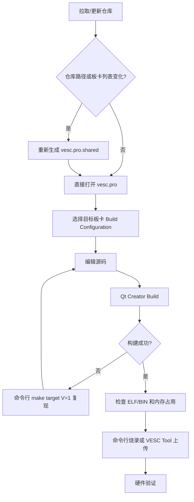

## 18. 文件修改决策表

| 目标 | 应修改的文件 |
|---|---|
| Qt Creator 项目树增加源码目录 | `vesc.pro` |
| 固件真正加入/删除源文件 | `make/fw.mk` 或业务目录 `.mk` |
| 所有板卡的 Build/Clean 步骤 | Python 脚本中的配置块 |
| 固定 Kit、Run、编辑器设置 | `vesc.pro.shared.template` |
| 增加自动发现的硬件目标 | `hwconf` 中规范命名的硬件文件 |
| 只生成少量 IDE 板卡配置 | 手动运行 Python 脚本并指定 `--targets` |
| 修改工具安装版本或路径 | `make/tools.mk` |

## 19. 安全注意事项

- 编译成功不代表硬件配置正确，烧录前确认目标板卡与实际功率板一致；
- 不要把其他硬件目标的固件上传到当前控制器；
- 首次烧录或修改 PWM、ADC、栅极驱动代码时应使用限流电源和安全负载；
- Qt Creator 的板卡显示名称最终只是 Make 目标字符串，脚本不会验证硬件匹配；
- 烧录、擦除和 Option Bytes 操作不由 `Project` 默认 Build Step 执行，应在明确目标后单独操作。

## 20. 小结

`bldc/Project` 为 Qt Creator 提供一层轻量 IDE 集成：`vesc.pro` 管理项目视图，模板保存共享配置骨架，Python 脚本将板卡列表展开为 Build/Clean 配置，生成的 `vesc.pro.shared` 再让 Qt Creator调用根 Makefile。

使用时最重要的原则是：从 `bldc` 根目录生成配置，在 Qt Creator 中选择正确板卡，并把 IDE 项目文件与真实固件 Make 构建列表区分开。遇到 IDE 构建问题时，用相同 Make 目标在命令行复现通常是最快的定位方法。
