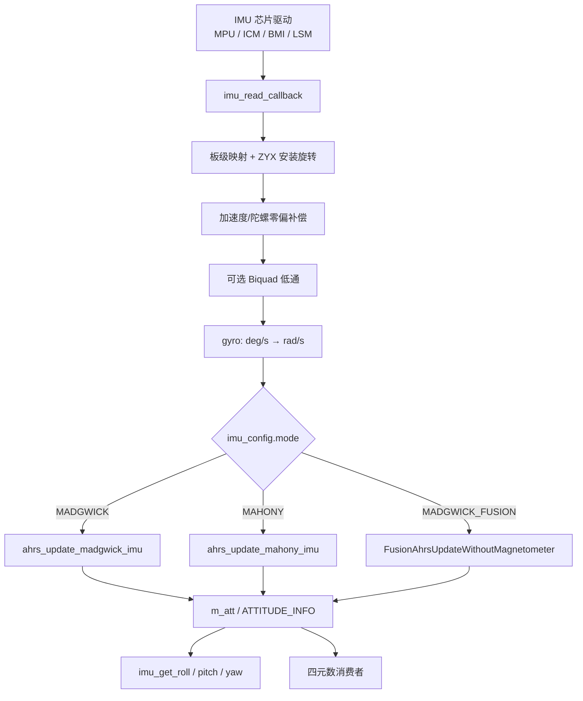
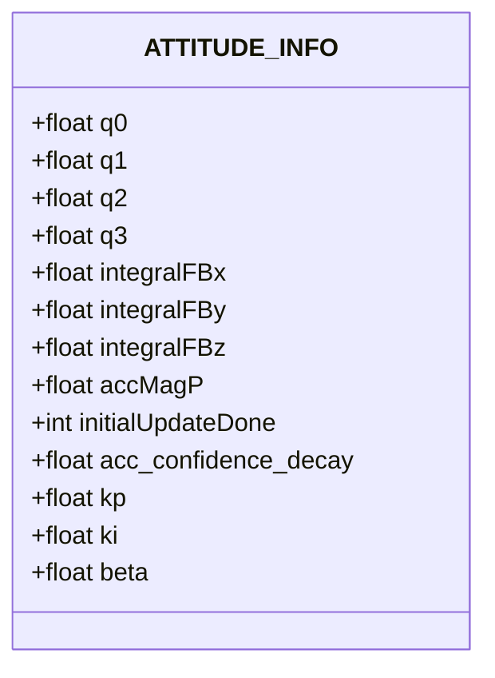
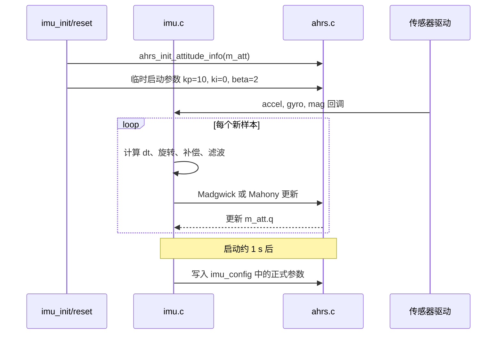
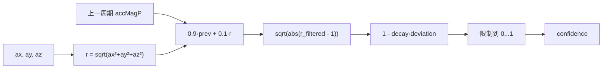
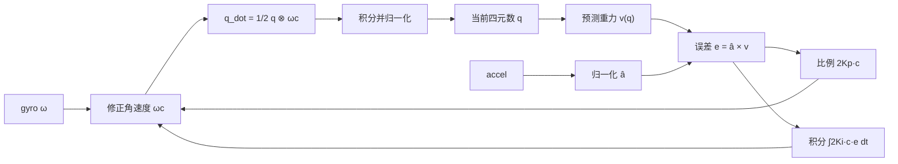
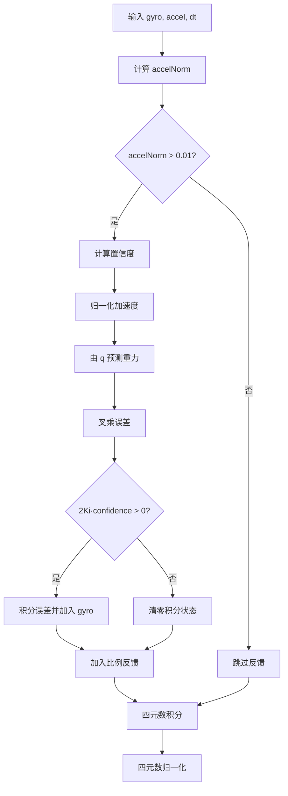
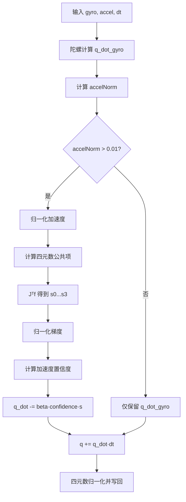
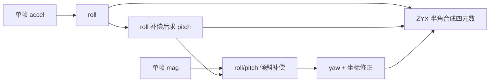
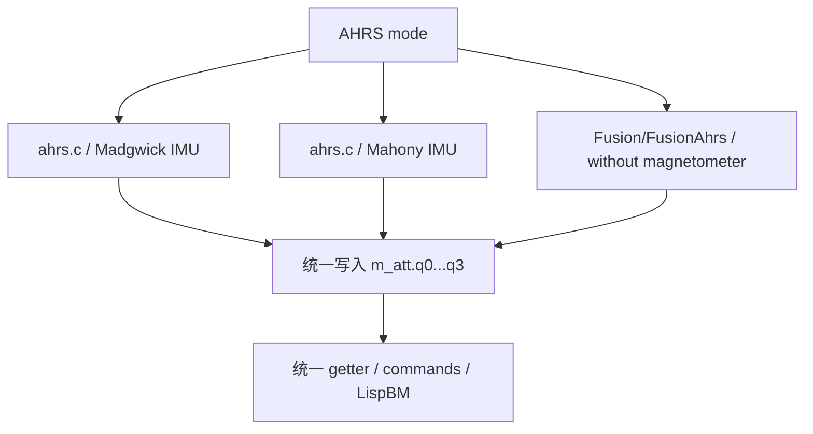
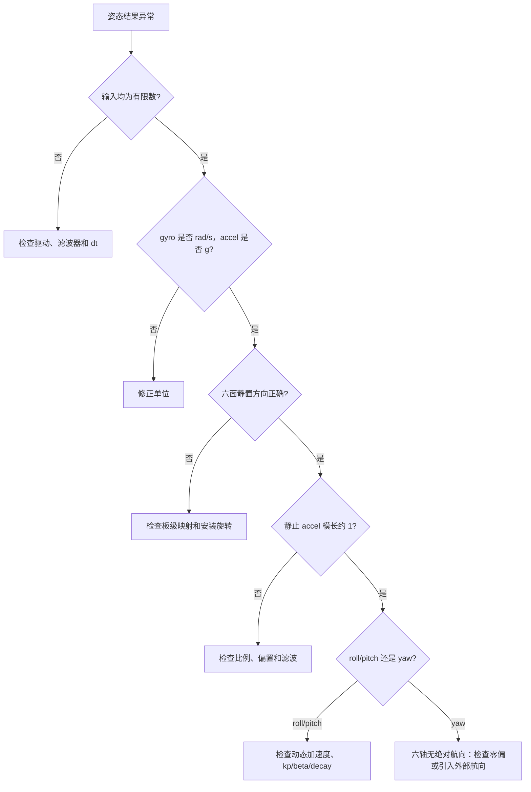

# `imu/ahrs.c` 模块算法及数学推导

## 1. 文档范围

本文针对 `imu/ahrs.c`、`imu/ahrs.h` 及其在 `imu/imu.c` 中的调用关系，说明以下内容：

- `ATTITUDE_INFO` 的状态和参数；
- 初始姿态解算；
- Mahony IMU 姿态算法；
- Madgwick IMU 姿态算法；
- 加速度置信度机制；
- 四元数积分和欧拉角输出；
- 与 `Fusion/FusionAhrs.c`、传感器驱动和上层接口的关系。

本文件中的两个周期更新函数均为六轴 IMU 算法，只融合陀螺仪和加速度计。它们不是完整的九轴 AHRS：磁力计没有进入周期更新，所以 yaw 没有绝对方向约束。

## 2. 模块位置和调用关系

`ahrs.c` 不负责读取芯片、坐标安装变换、传感器偏置标定和滤波。它假定调用者已经提供同一机体坐标系下的有效物理量。

## 3. 输入、输出和约定

### 3.1 输入单位

| 参数 | 实际要求 | 工程中的来源 |
|---|---|---|
| `gyroXYZ` | rad/s | `imu.c` 将 `m_gyro` 从 deg/s 转换 |
| `accelXYZ` | g | 驱动换算、安装旋转、偏置和低通后的 `m_accel` |
| `dt` | s | 相邻回调的实测时间差 |
| `att` | 可写状态 | 静态对象 `m_att` |

加速度方向会被归一化，因此姿态几何只依赖方向；但置信度公式以模长 1 g 为基准，所以输入不能任意缩放成 $m/s^2$。如果输入为 $m/s^2$，静止模长约 9.80665，置信度将错误地趋近于零。

### 3.2 四元数顺序

代码使用：

$$
q=(q_0,q_1,q_2,q_3)=(w,x,y,z)
$$

$q_0$ 是实部，$q_1,q_2,q_3$ 是虚部。单位约束为：

$$
q_0^2+q_1^2+q_2^2+q_3^2=1
$$

四元数正负表示同一姿态，即 $q$ 和 $-q$ 等价。

### 3.3 输出

更新函数把新四元数写回 `ATTITUDE_INFO`。getter 输出 roll、pitch、yaw，单位为 rad。上层若需要 degree，必须显式乘 $180/\pi$。

## 4. `ATTITUDE_INFO` 状态结构

结构定义位于 `datatypes.h`。

| 字段 | 含义 |
|---|---|
| `q0..q3` | 当前姿态单位四元数 |
| `integralFBx..z` | Mahony 积分反馈状态，可用于补偿慢变陀螺偏置 |
| `accMagP` | 平滑后的加速度模长，名称中的 `Mag` 是 magnitude，不是 magnetometer |
| `initialUpdateDone` | 当前文件只初始化，未在算法中读取或置位 |
| `acc_confidence_decay` | 加速度置信度衰减强度 |
| `kp`, `ki` | Mahony 比例、积分增益 |
| `beta` | Madgwick 梯度下降修正增益，量纲可视为 rad/s |

`ahrs_init_attitude_info` 将姿态设为单位四元数、清空 Mahony 积分项、把 `accMagP` 设为 1，并清除 `initialUpdateDone`。它不设置四个算法参数；参数由 `ahrs_update_all_parameters` 单独写入。

## 5. 工程生命周期

启动阶段使用较大增益，使从单位四元数向真实倾角更快收敛。`imu_ready` 在约 1 s 后置位并切换到正式参数。

## 6. 四元数运动学基础

设机体角速度为：

$$
\boldsymbol\omega=(\omega_x,\omega_y,\omega_z)
$$

把它写成纯四元数：

$$
\Omega=(0,\omega_x,\omega_y,\omega_z)
$$

本实现采用的微分方程是：

$$
\dot q=\frac12q\otimes\Omega
$$

Hamilton 乘积为：

$$
(a_0,\mathbf a)\otimes(b_0,\mathbf b)
=\left(a_0b_0-\mathbf a\cdot\mathbf b,
a_0\mathbf b+b_0\mathbf a+\mathbf a\times\mathbf b\right)
$$

代入 $q=(q_0,q_1,q_2,q_3)$ 和纯四元数 $\Omega$，得到：

$$
\dot q_0=\frac12(-q_1\omega_x-q_2\omega_y-q_3\omega_z)
$$

$$
\dot q_1=\frac12(q_0\omega_x+q_2\omega_z-q_3\omega_y)
$$

$$
\dot q_2=\frac12(q_0\omega_y-q_1\omega_z+q_3\omega_x)
$$

$$
\dot q_3=\frac12(q_0\omega_z+q_1\omega_y-q_2\omega_x)
$$

这四行分别对应两个更新函数中的四元数变化率计算。

前向欧拉离散化为：

$$
q'_k=q_{k-1}+\dot q_{k-1}\Delta t
$$

随后归一化：

$$
q_k=\frac{q'_k}{\sqrt{{q'_0}^2+{q'_1}^2+{q'_2}^2+{q'_3}^2}}
$$

归一化用于抑制浮点误差和欧拉积分造成的模长漂移，不能省略。

## 7. 加速度置信度

车辆加速、振动或冲击时，加速度计测到的是重力与线性加速度的叠加，不能完全当作重力方向。代码先计算：

$$
r_k=\|\mathbf a_k\|=\sqrt{a_x^2+a_y^2+a_z^2}
$$

再用固定系数一阶平滑：

$$
\bar r_k=0.9\bar r_{k-1}+0.1r_k
$$

置信度为：

$$
c_k=\operatorname{clip}\left(1-d\sqrt{|\bar r_k-1|},0,1\right)
$$

其中 $d$ 是 `acc_confidence_decay`。静止时 $\bar r\approx1$，故 $c\approx1$；偏离 1 g 越多，置信度越低。

它是基于模长的启发式门控，并不能识别所有动态污染。例如水平匀加速与某些转弯情况下，总模长仍可能接近 1 g，但方向已经偏离真实重力。

## 8. Mahony IMU 算法

### 8.1 核心思想

Mahony 算法将姿态估计视为一个非线性互补滤波器：

- 高频和短时运动主要信任陀螺仪；
- 低频倾角参考来自加速度计；
- 预测重力与测量重力的叉乘形成误差；
- PI 控制器把误差反馈到角速度。

### 8.2 预测重力方向

由当前四元数得到一半的预测重力：

$$
\frac12\mathbf v=
\begin{bmatrix}
q_1q_3-q_0q_2\\
q_0q_1+q_2q_3\\
q_0^2-\frac12+q_3^2
\end{bmatrix}
$$

完整单位方向为：

$$
\mathbf v=
\begin{bmatrix}
2(q_1q_3-q_0q_2)\\
2(q_0q_1+q_2q_3)\\
2(q_0^2+q_3^2)-1
\end{bmatrix}
$$

第三项利用了单位四元数约束：

$$
2(q_0^2+q_3^2)-1=2(q_0^2-\tfrac12+q_3^2)
$$

源码保存一半的量，是为了让后续的系数 2 与 `twoKp`、`twoKi` 合并，减少乘法。

### 8.3 叉乘误差推导

归一化加速度为：

$$
\hat{\mathbf a}=\frac{\mathbf a}{\|\mathbf a\|}
$$

源码计算：

$$
\frac12\mathbf e=\hat{\mathbf a}\times\frac12\mathbf v
$$

逐项展开：

$$
\frac12e_x=a_y\frac12v_z-a_z\frac12v_y
$$

$$
\frac12e_y=a_z\frac12v_x-a_x\frac12v_z
$$

$$
\frac12e_z=a_x\frac12v_y-a_y\frac12v_x
$$

两单位向量夹角为 $\theta$ 时：

$$
\|\hat{\mathbf a}\times\mathbf v\|=\sin\theta\approx\theta
\quad(\theta\text{ 很小时})
$$

因此叉乘同时给出小角度误差的旋转轴和近似角度，无需反三角函数。

### 8.4 PI 反馈

考虑置信度后，代码使用：

$$
K_{p,k}'=2K_pc_k,\qquad K_{i,k}'=2K_ic_k
$$

积分状态更新：

$$
\mathbf I_k=\mathbf I_{k-1}+K_{i,k}'\frac12\mathbf e_k\Delta t
$$

修正角速度：

$$
\boldsymbol\omega_c=\boldsymbol\omega+\mathbf I_k
+K_{p,k}'\frac12\mathbf e_k
$$

由于误差使用半向量，两个“2”相消，其物理效果等价于标准 $K_p\mathbf e$ 和 $K_i\int\mathbf e dt$。

比例项直接修正当前姿态误差；积分项能慢慢估计持续性的陀螺仪零偏。当 `twoKi <= 0` 时，代码立即把三个积分状态清零以防 windup。由于 `twoKi` 已乘置信度，当置信度恰好降至零时，即使配置的 $K_i>0$，历史积分也会被清空。

### 8.5 Mahony 单周期流程

## 9. Madgwick IMU 算法

### 9.1 核心思想

Madgwick 算法把“当前四元数预测的重力方向应等于归一化加速度方向”写成最小二乘问题。陀螺仪给出姿态变化率，目标函数的归一化梯度给出最快减小重力方向误差的修正方向。

$$
\dot q=\dot q_\omega-\beta\frac{\nabla F}{\|\nabla F\|}c
$$

其中 $\dot q_\omega=\frac12q\otimes\Omega$，$\beta$ 是修正强度，$c$ 是加速度置信度。

### 9.2 重力目标函数

令归一化加速度为 $(a_x,a_y,a_z)$。四元数预测重力方向与第 8 节一致。定义残差：

$$
f_1(q)=2(q_1q_3-q_0q_2)-a_x
$$

$$
f_2(q)=2(q_0q_1+q_2q_3)-a_y
$$

$$
f_3(q)=2(\tfrac12-q_1^2-q_2^2)-a_z
$$

写成向量：

$$
\mathbf f(q)=
\begin{bmatrix}f_1\\f_2\\f_3\end{bmatrix}
$$

目标是最小化平方代价：

$$
F(q)=\frac12\mathbf f(q)^T\mathbf f(q)
$$

### 9.3 Jacobian 和梯度

残差对四元数的 Jacobian 为：

$$
\mathbf J=\frac{\partial\mathbf f}{\partial q}=
\begin{bmatrix}
-2q_2 & 2q_3 & -2q_0 & 2q_1\\
2q_1 & 2q_0 & 2q_3 & 2q_2\\
0 & -4q_1 & -4q_2 & 0
\end{bmatrix}
$$

由链式法则：

$$
\nabla F=\mathbf J^T\mathbf f=
\begin{bmatrix}s_0\\s_1\\s_2\\s_3\end{bmatrix}
$$

将 $\mathbf J^T\mathbf f$ 展开并合并同类项，得到源码形式：

$$
s_0=4q_0q_2^2+2q_2a_x+4q_0q_1^2-2q_1a_y
$$

$$
\begin{aligned}
s_1={}&4q_1q_3^2-2q_3a_x+4q_0^2q_1-2q_0a_y-4q_1\\
&+8q_1^3+8q_1q_2^2+4q_1a_z
\end{aligned}
$$

$$
\begin{aligned}
s_2={}&4q_0^2q_2+2q_0a_x+4q_2q_3^2-2q_3a_y-4q_2\\
&+8q_2q_1^2+8q_2^3+4q_2a_z
\end{aligned}
$$

$$
s_3=4q_1^2q_3-2q_1a_x+4q_2^2q_3-2q_2a_y
$$

源码中的 `_2q0`、`_4q1`、`_8q2` 等只是公共子表达式缓存，不代表新的物理量。

### 9.4 为什么归一化梯度

梯度模长会随目标误差和参数化尺度变化。代码使用：

$$
\hat{\mathbf s}=\frac{\nabla F}{\|\nabla F\|}
$$

使 `beta` 直接控制修正变化率，而不是让修正强度额外依赖当前梯度模长。最终：

$$
\dot q_c=\dot q_\omega-\beta c\hat{\mathbf s}
$$

并执行：

$$
q_k=\operatorname{normalize}(q_{k-1}+\dot q_c\Delta t)
$$

### 9.5 Madgwick 单周期流程

## 10. Mahony 与 Madgwick 对比

| 维度 | Mahony | Madgwick |
|---|---|---|
| 误差形式 | 测量重力与预测重力的叉乘 | 重力残差平方的梯度 |
| 参数 | `kp`, `ki` | `beta` |
| 长期陀螺偏置补偿 | 有积分状态 | 本实现无显式偏置状态 |
| 状态量 | 四元数、PI 积分、模长平滑 | 四元数、模长平滑 |
| 动态加速度抑制 | 同一置信度缩放 P 和 I | 置信度缩放梯度修正 |
| 磁力计周期融合 | 无 | 无 |

二者在小误差条件下具有相近直觉：都是用重力方向误差修正陀螺积分。主要区别是误差在四元数空间还是三维角速度空间构造，以及 Mahony 具有显式积分反馈。

## 11. 初始姿态函数

`ahrs_update_initial_orientation(accelXYZ, magXYZ, att)` 用单帧加速度和磁场直接求初始 roll、pitch、yaw。当前 `imu.c` 主更新链没有调用它，但它通过 C 库接口向扩展代码公开。

### 11.1 roll

代码使用：

$$
\phi=\operatorname{atan2}(-a_y,a_z)
$$

该式来自把重力向量投影到机体 $YZ$ 平面。`atan2` 同时利用符号确定象限，比单独的 $\arctan(-a_y/a_z)$ 稳健。

### 11.2 pitch

先用 roll 消除 $Y/Z$ 倾斜，得到旋转后的竖直分量：

$$
a_z'= -a_y\sin\phi+a_z\cos\phi
$$

于是：

$$
\theta=\arctan\left(\frac{-a_x}{a_z'}\right)
$$

源码用 `atanf` 而不是 `atan2f`，当分母接近零时数值和象限鲁棒性较弱。

### 11.3 倾斜补偿航向

源码先改变磁力计 $X$ 轴符号：

$$
(m_x,m_y,m_z)=(-mag_x,mag_y,mag_z)
$$

再将磁场补偿到水平面：

$$
m_x^c=m_x\cos\theta+m_y\sin\phi\sin\theta
+m_z\cos\phi\sin\theta
$$

$$
m_y^c=m_y\cos\phi-m_z\sin\phi
$$

航向为：

$$
\psi=\operatorname{atan2}(-m_y^c,m_x^c)-\frac\pi2
$$

然后归一到工程使用的角度区间。额外的 $m_x$ 取反和 $-\pi/2$ 是本工程坐标约定修正，移植时必须结合实际板级轴向验证，不能视为通用公式。

### 11.4 欧拉角合成为四元数

代码使用半角三角函数，将带符号调整后的 roll、pitch、yaw 合成：

$$
q_0=c_r c_p c_y+s_r s_p s_y
$$

$$
q_1=s_r c_p c_y-c_r s_p s_y
$$

$$
q_2=c_r s_p c_y+s_r c_p s_y
$$

$$
q_3=c_r c_p s_y-s_r s_p c_y
$$

其中源码实际令：

$$
c_r=\cos(-\phi/2),\ s_r=\sin(-\phi/2)
$$

$$
c_p=\cos(\theta/2),\ s_p=\sin(\theta/2)
$$

$$
c_y=\cos(-\psi/2),\ s_y=\sin(-\psi/2)
$$

符号与 getter 中 roll/yaw 前的负号相对应。

## 12. 四元数到欧拉角

getter 实现如下：

$$
roll=-\operatorname{atan2}\left(q_0q_1+q_2q_3,
\frac12-(q_1^2+q_2^2)\right)
$$

$$
pitch=\arcsin\left[-2(q_1q_3-q_0q_2)\right]
$$

$$
yaw=-\operatorname{atan2}\left(q_0q_3+q_1q_2,
\frac12-(q_2^2+q_3^2)\right)
$$

标准公式通常在 `atan2` 的分子和分母中各有系数 2。这里同时除以 2，不改变 `atan2(y,x)` 的结果。

欧拉角采用工程约定的符号。接近 pitch $=\pm90^\circ$ 时存在万向节锁；四元数仍连续，但 roll/yaw 分解不唯一。控制和坐标旋转应尽量直接使用四元数。

## 13. 与 `FusionAhrs` 的关系

工程提供三种模式：

差异包括：

- `ahrs.c` 的陀螺输入为 rad/s；`FusionAhrs` 的陀螺输入为 deg/s；
- `ahrs.c` 的 Madgwick 使用目标函数梯度；Mahony 使用叉乘 PI；
- 当前 `FusionAhrs` 使用叉乘比例反馈和相同形式的加速度置信度；
- 三个主链模式都没有周期融合 `m_mag`，因此都可能发生 yaw 长期漂移。

`imu.c` 在 Fusion 模式下直接把 `m_fusionAhrs.quaternion` 内部字段复制到 `m_att`，而不是调用返回共轭四元数的 `FusionAhrsGetQuaternion`，从而保持与本文件 getter 的内部方向约定一致。

## 14. 参数含义和整定

### 14.1 Mahony `kp`

$K_p$ 越大，倾角回正越快，但线性加速度和振动更容易进入姿态。太小则陀螺漂移修正缓慢。

### 14.2 Mahony `ki`

$K_i$ 用于积累持续误差，能够补偿陀螺慢变零偏。过大会导致低频摆动和积分饱和；没有充分验证时可从 0 开始。

### 14.3 Madgwick `beta`

$\beta$ 越大，梯度修正越强；越小则更依赖陀螺仪。其合理值与陀螺噪声、采样率、振动环境相关。

### 14.4 `acc_confidence_decay`

值越大，算法在加速度模长偏离 1 g 时越快放弃加速度反馈。它不能替代机械减振、正确量程和低通滤波。

推荐整定顺序：先确认单位、轴向、`dt` 和静态偏置，再固定 `ki=0` 调比例参数，之后按需要缓慢增加 `ki`，最后在真实动态工况下调整置信度衰减。

## 15. 数值边界和源码注意事项

### 15.1 加速度门限

仅当 $\|\mathbf a\|>0.01$ 才使用加速度反馈，避免归一化接近零的向量。门限按 g 理解。

### 15.2 Madgwick 零梯度

代码检查了加速度模长，却没有检查梯度模长。当姿态预测与加速度完全一致时，理论上可能有：

$$
s_0=s_1=s_2=s_3=0
$$

随后 `invSqrt(0)` 产生无穷大，$0\times\infty$ 可能得到 NaN。真实噪声常使该问题不明显，但健壮实现应只在 $\|\mathbf s\|^2$ 大于小正数时归一化和施加修正。

### 15.3 四元数零模

更新末尾同样未显式保护四元数零模。正常单位四元数积分不会变成零，但内存破坏、非有限输入或异常 `dt` 仍可能导致 NaN 扩散。

### 15.4 `asin` 输入范围

浮点舍入可能使 pitch 公式的输入略超 $[-1,1]$。当前 getter 没有截断，边界姿态可能返回 NaN。稳健实现应在 `asinf` 前 clamp。

### 15.5 `dt` 异常

`imu.c` 使用实际时间差，但当前更新器不限制过大或非正 `dt`。传感器重连、线程长时间阻塞后，首个样本可能造成姿态跳变。调用层宜拒绝异常值或重置姿态状态。

### 15.6 未使用状态

`initialUpdateDone` 在当前 `ahrs.c` 中只被清零，没有后续用途。`ahrs_update_initial_orientation` 也没有在固件主更新链中调用。阅读时不要假设算法会自动用磁力计完成首次对准。

### 15.7 并发一致性

采样线程写 `m_att`，其他线程可能通过 getter 同时读取。单个 float 通常可原子读取，但一次 RPY 或四元数读取可能跨越两个采样周期。需要严格一致姿态快照的控制逻辑应增加锁、序列号或双缓冲。

## 16. 故障定位流程

| 现象 | 常见原因 |
|---|---|
| 姿态变化速度约差 57.3 倍 | deg/s 与 rad/s 混用 |
| 静止姿态逐渐偏离 | 陀螺偏置、反馈过弱或加速度置信度为零 |
| 加减速时 pitch 明显变化 | 将线性加速度误认为重力 |
| yaw 长期漂移 | 六轴算法的预期现象 |
| 突然全部变为 NaN | 零梯度/零模归一化、`asin` 越界、非有限输入 |
| 启动后快速回正但随后变慢 | 1 s 启动参数切换的预期行为 |

## 17. 推荐测试

1. 单位四元数、零角速度、$(0,0,1)$ g 输入，验证姿态保持不变且不产生 NaN；
2. 绕单轴输入恒定角速度、关闭反馈，验证积分角度约为 $\omega t$；
3. 六面静置，验证 roll/pitch 符号和重力预测方向；
4. 人为注入陀螺常值偏置，比较 Mahony `ki=0` 与 `ki>0`；
5. 注入加速度脉冲，验证 `acc_confidence_decay` 对误差峰值的影响；
6. 用带时间戳的真实数据同时回放 Madgwick、Mahony 和 Fusion，比较收敛、噪声和动态误差；
7. 覆盖零梯度、零加速度、异常 `dt` 和 pitch 接近 $\pm90^\circ$ 的数值边界。

## 18. 总结

`ahrs.c` 的两条路径共享同一基础：用陀螺仪驱动四元数运动学，用加速度计提供重力参考，并在每次前向欧拉积分后恢复单位四元数。Mahony 在三维角速度空间通过叉乘误差和 PI 反馈修正；Madgwick在四元数空间对重力残差执行归一化梯度下降。工程又增加了基于加速度模长的置信度衰减，以降低车辆动态加速度造成的误校正。

可靠应用该模块的前提依次是：坐标和符号一致、陀螺为 rad/s、加速度为 g、时间步长可信、静态偏置受控。参数整定只能改善这些前提满足后的动态权衡，不能补偿单位或坐标错误。
