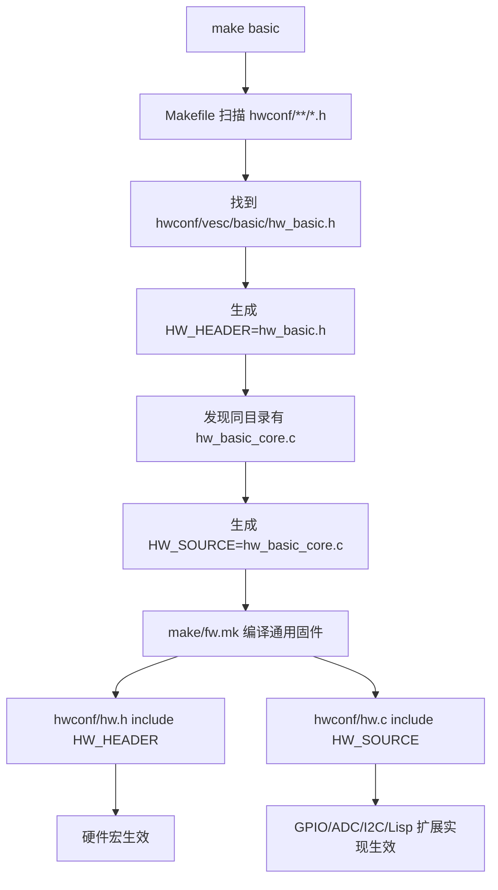
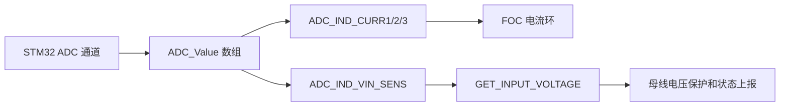

# basic 实现逻辑分析

本文继续分析 `basic` 固件目标的实现逻辑。重点不是环境搭建，而是回答三个问题：

- `make basic` 最终选择了哪些文件。
- `hw_basic_core.h/.c` 里定义的宏和函数分别影响什么。
- 这些硬件配置如何进入主程序、电机控制、ADC 采样和 VESC Tool 配置限制。

## 总览

`basic` 是一个硬件目标，不是一套独立算法。它的作用是把一块硬件板子的引脚、ADC 通道、电流采样参数、电压采样参数、默认电机配置和安全限值告诉通用固件。



最终 `basic` 只是通过 `HW_HEADER` 和 `HW_SOURCE` 注入硬件差异。FOC、BLDC、通信、配置存储、命令协议等大逻辑仍然来自通用源码。

## 文件关系

| 文件                                         | 作用                                                                      |
| -------------------------------------------- | ------------------------------------------------------------------------- |
| `hwconf/vesc/basic/hw_basic.h`               | `basic` 默认目标入口，只定义 `HW_BASIC`，然后包含 `hw_basic_core.h`。     |
| `hwconf/vesc/basic/hw_basic_025.h`           | `basic_025` 入口，定义 `HW_BASIC_025`，表示 0.25 mOhm 电流采样电阻版本。  |
| `hwconf/vesc/basic/hw_basic_035.h`           | `basic_035` 入口，定义 `HW_BASIC_035`，表示 0.35 mOhm 电流采样电阻版本。  |
| `hwconf/vesc/basic/hw_basic_035_no_limits.h` | `basic_035_no_limits` 入口，定义 `HW_BASIC_035` 和 `DISABLE_HW_LIMITS`。  |
| `hwconf/vesc/basic/hw_basic_core.h`          | 公共硬件宏：硬件名、采样参数、ADC 索引、引脚映射、默认配置、硬件限值。    |
| `hwconf/vesc/basic/hw_basic_core.c`          | 公共硬件实现：GPIO 初始化、ADC 通道配置、I2C 启停/恢复、LispBM 扩展函数。 |
| `hwconf/hw.h`                                | 全局硬件入口，编译时 `#include HW_HEADER`。                               |
| `hwconf/hw.c`                                | 全局硬件源文件入口，编译时 `#include HW_SOURCE`。                         |

`basic` 系列的设计方式是“入口头文件只选择变体，core 文件承载公共实现”。因此阅读时不要只停在 `hw_basic.h`，真正要读的是 `hw_basic_core.h` 和 `hw_basic_core.c`。

## make basic 如何选中文件

主 Makefile 先扫描所有硬件头文件：

```makefile
RAW_TARGET_PATHS := $(call rwildcard,$(ROOT_DIR)/hwconf,*.h)
TARGET_PATHS := $(strip $(filter-out %core.h,$(RAW_TARGET_PATHS)))
ALL_BOARD_NAMES := $(sort $(subst .h,,$(subst hw_,,$(filter hw_%, $(notdir $(TARGET_PATHS))))))
```

这段逻辑会把 `hw_basic.h` 变成目标名 `basic`，把 `hw_basic_035.h` 变成 `basic_035`。`hw_basic_core.h` 被过滤掉，因为它是公共头文件，不是独立目标。

当执行：

```bash
make basic
```

Makefile 中的 `FW_TEMPLATE` 会展开出：

```text
basic_HW_DIR      = hwconf/vesc/basic/
basic_HW_HEADER   = hwconf/vesc/basic/hw_basic.h
basic_HW_SRC_FILE = hwconf/vesc/basic/hw_basic_core.c
```

`FIND_TARGET_C_CODE` 的关键逻辑是：如果目标目录里存在 `hw_*_core.c`，优先使用它；否则才找 `hw_<target>.c`。

所以 `basic` 实际编译时会带上类似宏：

```text
-DHW_HEADER=".../hwconf/vesc/basic/hw_basic.h"
-DHW_SOURCE=".../hwconf/vesc/basic/hw_basic_core.c"
```

`make/fw.mk` 再把这些 `build_args` 放进编译选项。随后：

```c
// hwconf/hw.h
#include HW_HEADER

// hwconf/hw.c
#include HW_SOURCE
```

这就是 `basic` 硬件配置进入通用固件的入口。

## basic 变体差异

| 目标                  | 入口宏                               | `HW_NAME`        | 电流采样电阻 | 电机电流限值        | 输入电流限值        | 绝对电流限值        | 备注                                                |
| --------------------- | ------------------------------------ | ---------------- | -----------: | ------------------- | ------------------- | ------------------- | --------------------------------------------------- |
| `basic`               | `HW_BASIC`                           | `VESC_BASIC`     |   0.0005 ohm | `-150.0, 150.0`     | `-130.0, 130.0`     | `0.0, 160.0`        | 默认版本。                                          |
| `basic_035`           | `HW_BASIC_035`                       | `VESC_BASIC_035` |  0.00035 ohm | `-180.0, 180.0`     | `-150.0, 150.0`     | `0.0, 250.0`        | 更低采样电阻，电流量程更大。                        |
| `basic_025`           | `HW_BASIC_025`                       | `VESC_BASIC_025` |  0.00025 ohm | `-200.0, 200.0`     | `-150.0, 150.0`     | `0.0, 300.0`        | 采样电阻更低，电流量程更大。                        |
| `basic_035_no_limits` | `HW_BASIC_035` + `DISABLE_HW_LIMITS` | `VESC_BASIC_035` |  0.00035 ohm | 同 `basic_035` 定义 | 同 `basic_035` 定义 | 同 `basic_035` 定义 | 写配置时跳过硬件限值裁剪，固件名为 `no_hw_limits`。 |

`no_limits` 不会改变 ADC、PWM、采样电阻和控制算法。它主要影响配置写入时是否执行 `HW_LIM_*` 裁剪。`comm/commands.c` 中 `commands_apply_mcconf_hw_limits()` 被 `#ifndef DISABLE_HW_LIMITS` 包围，定义了 `DISABLE_HW_LIMITS` 后，这段硬件限值裁剪就不会执行。

## hw_basic_core.h 的关键宏

### 硬件能力

```c
#define HW_HAS_3_SHUNTS
#define HW_HAS_PHASE_FILTERS
#define INVERTED_SHUNT_POLARITY
```

含义如下：

| 宏                        | 含义                                                     |
| ------------------------- | -------------------------------------------------------- |
| `HW_HAS_3_SHUNTS`         | 三相电流采样。FOC 可以使用三路相电流信息。               |
| `HW_HAS_PHASE_FILTERS`    | 有相电压滤波相关硬件。                                   |
| `INVERTED_SHUNT_POLARITY` | 电流采样极性是反的，通用采样换算逻辑需要按这个方向处理。 |

`basic` 没有定义 `HW_HAS_DRV8301`、`HW_HAS_DRV8323S` 这类 SPI 栅极驱动芯片宏，因此它不是走 DRV83xx SPI 配置路径的板型。它更多依赖通用 PWM 输出、ADC 采样和外部硬件连接。

### LED 和输出控制

| 功能       | 端口/引脚        | 宏                                         |
| ---------- | ---------------- | ------------------------------------------ |
| 绿灯       | `GPIOB 7`        | `LED_GREEN_ON()` / `LED_GREEN_OFF()`       |
| 红灯       | `GPIOB 5`        | `LED_RED_ON()` / `LED_RED_OFF()`           |
| 输出 1     | `GPIOC 10`       | `OUT_1_ON()` / `OUT_1_OFF()`               |
| 输出 2     | `GPIOC 11`       | `OUT_2_ON()` / `OUT_2_OFF()`               |
| 输出 3     | `GPIOA 15`       | `OUT_3_ON()` / `OUT_3_OFF()`               |
| 相滤波控制 | `GPIOC 13/14/15` | `PHASE_FILTER_ON()` / `PHASE_FILTER_OFF()` |

`hw_basic_core.c` 还把 `OUT_1/2/3` 暴露成 LispBM 扩展：

```text
basic-set-out1
basic-set-out2
basic-set-out3
basic-read-brake
```

其中 `basic-read-brake` 读取 `ADC_IND_EXT2` 对应 ADC 电压，小于 0.5V 时返回 1。

### PWM 和霍尔/编码器

`hw_init_gpio()` 把 TIM1 的 6 路 PWM 相关引脚配置为复用功能：

| 功能             | 引脚             |
| ---------------- | ---------------- |
| TIM1 CH1/CH2/CH3 | `GPIOA 8/9/10`   |
| TIM1 互补输出    | `GPIOB 13/14/15` |

霍尔/编码器输入：

| 功能         | 引脚      |
| ------------ | --------- |
| Hall 1       | `GPIOC 6` |
| Hall 2       | `GPIOC 7` |
| Hall 3       | `GPIOC 8` |
| 编码器定时器 | `TIM3`    |

对应读取宏：

```c
#define READ_HALL1() palReadPad(HW_HALL_ENC_GPIO1, HW_HALL_ENC_PIN1)
#define READ_HALL2() palReadPad(HW_HALL_ENC_GPIO2, HW_HALL_ENC_PIN2)
#define READ_HALL3() palReadPad(HW_HALL_ENC_GPIO3, HW_HALL_ENC_PIN3)
```

### ADC 采样结构

`basic` 定义：

```c
#define HW_ADC_CHANNELS     18
#define HW_ADC_INJ_CHANNELS 3
#define HW_ADC_NBR_CONV     6
```

普通 ADC 采样一共 18 个索引，ADC1/ADC2/ADC3 各 6 个通道。注入通道为 3 个，主要用于同步采三相电流。

| ADC 索引 | 含义                      |
| -------: | ------------------------- |
|        0 | `CURR1`，第一相电流       |
|        1 | `CURR2`，第二相电流       |
|        2 | `CURR3`，第三相电流       |
|        3 | `SENS1`，相电压/检测      |
|        4 | `SENS2`，相电压/检测      |
|        5 | `SENS3`，相电压/检测      |
|        8 | `EXT`，外部 ADC 输入      |
|       10 | `TEMP_MOS`，MOS 温度      |
|       11 | `VIN_SENS`，输入电压采样  |
|       12 | `VREFINT`，内部参考电压   |
|       15 | `EXT2`，第二外部 ADC 输入 |
|       16 | `TEMP_MOTOR`，电机温度    |

`hw_setup_adc_channels()` 将这些索引映射到 STM32 ADC 通道。例如：

```text
ADC1 Channel 10 -> index 0 -> CURR1
ADC2 Channel 11 -> index 1 -> CURR2
ADC3 Channel 12 -> index 2 -> CURR3
ADC3 Channel 13 -> index 11 -> VIN_SENS
```

因此分析 ADC 时要分清两层：

| 层级                | 示例                | 作用                           |
| ------------------- | ------------------- | ------------------------------ |
| STM32 物理 ADC 通道 | `ADC_Channel_10`    | MCU 实际采哪个 ADC 输入脚。    |
| 固件 ADC 索引       | `ADC_IND_CURR1 = 0` | 通用固件用哪个数组索引取数据。 |

通用电机算法通常不直接关心 `ADC_Channel_10`，它只关心 `ADC_Value[ADC_IND_CURR1]`。

### 电流和电压换算

`basic` 的电流换算核心参数：

```c
#define CURRENT_AMP_GAIN 20.0
#define CURRENT_SHUNT_RES 0.0005 / 0.00035 / 0.00025
```

电流采样的本质是：

```text
实际电流 ≈ 采样电压 / (采样电阻 * 运放增益)
```

所以 `CURRENT_SHUNT_RES` 必须和硬件实际采样电阻一致。这个值错了，固件显示的电流、过流保护、FOC 控制都会跟着错。

输入电压换算：

```c
#define V_REG  3.3
#define VIN_R1 150000.0
#define VIN_R2 4700.0

#define GET_INPUT_VOLTAGE() \
    ((V_REG / 4095.0) * ADC_Value[ADC_IND_VIN_SENS] * ((VIN_R1 + VIN_R2) / VIN_R2))
```

这表示母线电压通过 `VIN_R1/VIN_R2` 分压后进入 ADC，固件再按分压比还原真实输入电压。

### 默认电机配置

`basic` 在硬件头文件里覆盖了一些默认电机配置：

| 宏                          |           默认值 | 含义                                  |
| --------------------------- | ---------------: | ------------------------------------- |
| `MCCONF_L_MIN_VOLTAGE`      |           `15.0` | 默认最低输入电压。                    |
| `MCCONF_L_MAX_VOLTAGE`      |           `50.0` | 默认最高输入电压。                    |
| `MCCONF_DEFAULT_MOTOR_TYPE` | `MOTOR_TYPE_FOC` | 默认使用 FOC。                        |
| `MCCONF_FOC_F_ZV`           |        `30000.0` | FOC 控制/采样相关频率默认值。         |
| `MCCONF_L_MAX_ABS_CURRENT`  |          `150.0` | 默认绝对最大电流。                    |
| `MCCONF_FOC_SAMPLE_V0_V7`   |          `false` | 不在 v0/v7 两个零矢量都运行控制循环。 |
| `MCCONF_L_IN_CURRENT_MAX`   |           `30.0` | 默认输入电流上限。                    |
| `MCCONF_L_IN_CURRENT_MIN`   |          `-30.0` | 默认输入电流下限。                    |

这些是“默认配置”，不是最终不可突破的硬件上限。最终用户写入配置时，还会经过 `HW_LIM_*` 裁剪，除非编译了 `no_limits` 目标。

### 硬件限值

| 宏                   | `basic`         | `basic_035`     | `basic_025`     |
| -------------------- | --------------- | --------------- | --------------- |
| `HW_LIM_CURRENT`     | `-150.0, 150.0` | `-180.0, 180.0` | `-200.0, 200.0` |
| `HW_LIM_CURRENT_IN`  | `-130.0, 130.0` | `-150.0, 150.0` | `-150.0, 150.0` |
| `HW_LIM_CURRENT_ABS` | `0.0, 160.0`    | `0.0, 250.0`    | `0.0, 300.0`    |
| `HW_LIM_VIN`         | `11.0, 94.0`    | `11.0, 94.0`    | `11.0, 94.0`    |
| `HW_LIM_ERPM`        | `-200e3, 200e3` | `-200e3, 200e3` | `-200e3, 200e3` |
| `HW_LIM_DUTY_MIN`    | `0.0, 0.1`      | `0.0, 0.1`      | `0.0, 0.1`      |
| `HW_LIM_DUTY_MAX`    | `0.0, 0.99`     | `0.0, 0.99`     | `0.0, 0.99`     |
| `HW_LIM_TEMP_FET`    | `-40.0, 110.0`  | `-40.0, 110.0`  | `-40.0, 110.0`  |

这些限值在 `commands_apply_mcconf_hw_limits()` 中用于裁剪 VESC Tool 写入的配置。例如电机电流、输入电流、绝对电流、输入电压、ERPM、占空比和 FET 温度都会被限制到硬件允许范围内。

## hw_basic_core.c 的运行逻辑

### GPIO 初始化

`main.c` 初始化阶段会调用：

```c
timer_init();
hw_init_gpio();
conf_general_init();
```

对于 `basic`，`hw_init_gpio()` 来自 `hw_basic_core.c`。它主要做这些事：

| 阶段           | 作用                                                 |
| -------------- | ---------------------------------------------------- |
| 开 GPIO 时钟   | 使能 `GPIOA/B/C/D`。                                 |
| 配置 LED       | `PB7/PB5` 设为推挽输出。                             |
| 配置 PWM       | `PA8/PA9/PA10` 和 `PB13/PB14/PB15` 设为 TIM1 复用。  |
| 配置霍尔       | `PC6/PC7/PC8` 上拉输入。                             |
| 配置相滤波     | `PC13/PC14/PC15` 开漏输出，默认关闭相滤波。          |
| 配置 ADC 引脚  | 多个 `GPIOA/B/C` 引脚设为模拟输入。                  |
| 配置 DAC       | `GPIOA4` 作为采样运放参考，DAC 输出约半量程 `2047`。 |
| 配置输出口     | `OUT_1/2/3` 设为输出并默认关闭。                     |
| 注册 Lisp 扩展 | 把 basic 专用 IO 操作挂到 LispBM。                   |

这一步是 `basic` 硬件真正开始接管 MCU 引脚的地方。

### ADC 通道配置

FOC 初始化时会调用：

```c
hw_setup_adc_channels();
```

`basic` 的实现把 ADC1/ADC2/ADC3 的规则通道和注入通道都配置好。FOC 电流采样对同步性要求高，所以三相电流 `CURR1/2/3` 也被配置到 injected channels。

运行时大致关系是：



### I2C 管理

`basic` 使用：

```c
static const I2CConfig i2cfg = {
    OPMODE_I2C,
    100000,
    STD_DUTY_CYCLE
};
```

并实现：

| 函数                   | 作用                                                        |
| ---------------------- | ----------------------------------------------------------- |
| `hw_start_i2c()`       | 配置 SCL/SDA 为 I2C 复用开漏上拉，启动 `I2CD2`。            |
| `hw_stop_i2c()`        | 停止 I2C，把 SCL/SDA 恢复成输入。                           |
| `hw_try_restore_i2c()` | I2C 卡住时手动拉 SCL/SDA 生成时钟和起停条件，尝试恢复总线。 |

注意 `HW_UART_TX/RX` 和 `HW_I2C_SCL/SDA` 都定义在 `PB10/PB11`，实际使用时由对应模块切换引脚模式。分析外设冲突时，这对引脚值得优先检查。

## 与通用控制逻辑的关系

`basic` 自己不实现电机控制算法。它提供的是通用控制逻辑需要的硬件接口。

| 通用模块               | 使用 basic 的内容                                                                                       |
| ---------------------- | ------------------------------------------------------------------------------------------------------- |
| `main.c`               | 调用 `hw_init_gpio()` 完成板级 GPIO 初始化。                                                            |
| `motor/mcpwm_foc.c`    | 调用 `hw_setup_adc_channels()`，使用 `CURRENT_SHUNT_RES`、`CURRENT_AMP_GAIN`、ADC 索引等完成 FOC 采样。 |
| `motor/mcpwm.c`        | BLDC 模式下也会使用 ADC 通道和输入电压宏。                                                              |
| `motor/mc_interface.c` | 电机类型切换或配置更新时可能重新初始化硬件/控制模块。                                                   |
| `comm/commands.c`      | 连接 VESC Tool 时上报 `HW_NAME`、`FW_NAME`，写配置时应用 `HW_LIM_*`。                                   |
| `conf_general.c`       | 生成默认配置、测量流程和一些自动计算会使用硬件限值。                                                    |

可以把 `basic` 理解为“板级适配层”。通用固件问它：

```text
你的硬件叫什么？
你的三相电流在哪几个 ADC 索引？
你的输入电压怎么换算？
你的采样电阻是多少？
你的 PWM、Hall、UART、I2C 引脚在哪里？
这块板允许用户设置多大电流、多高电压？
```

`hw_basic_core.h/.c` 就负责回答这些问题。

## 建议继续阅读路线

读 `basic` 时可以按这条线继续深入：

```text
make basic
  -> Makefile: FW_TEMPLATE / FIND_TARGET_C_CODE
  -> hwconf/hw.h / hwconf/hw.c
  -> hwconf/vesc/basic/hw_basic*.h
  -> hwconf/vesc/basic/hw_basic_core.h
  -> hwconf/vesc/basic/hw_basic_core.c
  -> main.c: hw_init_gpio()
  -> motor/mcpwm_foc.c: hw_setup_adc_channels()
  -> comm/commands.c: commands_apply_mcconf_hw_limits()
```

实操命令：

```bash
# 查看 basic 系列文件
rg -n "hw_basic|HW_BASIC|DISABLE_HW_LIMITS" hwconf/vesc/basic

# 查看 make 如何注入硬件文件
rg -n "FIND_TARGET_C_CODE|FW_TEMPLATE|HW_SOURCE|HW_HEADER" Makefile make/fw.mk

# 查看 basic 的 GPIO/ADC 实现
rg -n "hw_init_gpio|hw_setup_adc_channels|ADC_RegularChannelConfig|ADC_InjectedChannelConfig" hwconf/vesc/basic/hw_basic_core.c

# 查看硬件限值在哪里生效
rg -n "DISABLE_HW_LIMITS|HW_LIM_CURRENT|commands_apply_mcconf_hw_limits" comm conf_general.c

# 编译 basic 并显示详细命令
make basic V=1
```

## 分析结论

`basic` 的核心逻辑可以概括为：

```text
入口头文件选择硬件变体
  -> core 头文件定义采样、电压、限值、引脚和默认配置
  -> core 源文件初始化 GPIO/ADC/I2C 并注册扩展
  -> 通用电机控制模块使用这些硬件定义运行 FOC/BLDC
  -> 通信模块使用 HW_NAME/FW_NAME 上报身份，并用 HW_LIM_* 保护配置写入
```

如果要移植一块和 `basic` 类似的新板，最关键的不是改 FOC 算法，而是确认这些硬件事实是否正确：

- 采样电阻 `CURRENT_SHUNT_RES` 是否和实物一致。
- 运放增益 `CURRENT_AMP_GAIN` 是否和实物一致。
- `VIN_R1/VIN_R2` 是否和输入电压分压电阻一致。
- `ADC_IND_*` 是否和实际 ADC 接线一致。
- TIM1 PWM 引脚、Hall 引脚、UART/I2C 引脚是否和原理图一致。
- `HW_LIM_*` 是否符合 MOS、母线电压、电流采样和散热能力。

这些确认无误后，`basic` 的通用控制链路才能可靠运行。
```bash
lee@DESKTOP-QG45PR9:~/bldc$ rg -n "hw_basic|HW_BASIC|DISABLE_HW_LIMITS" hwconf/vesc/basic
Command 'rg' not found, but can be installed with:
sudo snap install ripgrep  # version 12.1.0, or
sudo apt  install ripgrep  # version 13.0.0-2ubuntu0.1
See 'snap info ripgrep' for additional versions.
lee@DESKTOP-QG45PR9:~/bldc$ sudo apt update
[sudo] password for lee:
Hit:1 https://deb.nodesource.com/node_20.x nodistro InRelease
Hit:2 http://packages.osrfoundation.org/gazebo/ubuntu-stable jammy InRelease
Hit:3 https://ppa.launchpadcontent.net/saiarcot895/flightgear/ubuntu jammy InRelease
Hit:4 https://mirrors.ustc.edu.cn/ubuntu jammy InRelease
Hit:5 https://mirrors.ustc.edu.cn/ubuntu jammy-updates InRelease
Hit:6 https://mirrors.ustc.edu.cn/ubuntu jammy-backports InRelease
Hit:7 https://mirrors.ustc.edu.cn/ubuntu jammy-security InRelease
Reading package lists... Done
Building dependency tree... Done
Reading state information... Done
37 packages can be upgraded. Run 'apt list --upgradable' to see them.
lee@DESKTOP-QG45PR9:~/bldc$ sudo apt install -y ripgrep
Reading package lists... Done
Building dependency tree... Done
Reading state information... Done
The following NEW packages will be installed:
  ripgrep
0 upgraded, 1 newly installed, 0 to remove and 37 not upgraded.
Need to get 1,300 kB of archives.
After this operation, 4,247 kB of additional disk space will be used.
Get:1 https://mirrors.ustc.edu.cn/ubuntu jammy-updates/universe amd64 ripgrep amd64 13.0.0-2ubuntu0.1 [1,300 kB]
Fetched 1,300 kB in 9s (148 kB/s)
Selecting previously unselected package ripgrep.
(Reading database ... 250832 files and directories currently installed.)
Preparing to unpack .../ripgrep_13.0.0-2ubuntu0.1_amd64.deb ...
Unpacking ripgrep (13.0.0-2ubuntu0.1) ...
Setting up ripgrep (13.0.0-2ubuntu0.1) ...
Processing triggers for man-db (2.10.2-1) ...
lee@DESKTOP-QG45PR9:~/bldc$ rg --version
ripgrep 13.0.0
-SIMD -AVX (compiled)
+SIMD +AVX (runtime)
lee@DESKTOP-QG45PR9:~/bldc$ rg -n "hw_basic|HW_BASIC|DISABLE_HW_LIMITS" hwconf/vesc/basic
hwconf/vesc/basic/hw_basic_025.h
20:#ifndef HW_BASIC_025_H_
21:#define HW_BASIC_025_H_
23:#define HW_BASIC_025
25:#include "hw_basic_core.h"
27:#endif /* HW_BASIC_025_H_ */

hwconf/vesc/basic/hw_basic_035_no_limits.h
20:#ifndef HW_BASIC_035_NO_LIMITS_H_
21:#define HW_BASIC_035_NO_LIMITS_H_
23:#define HW_BASIC_035
25:#define DISABLE_HW_LIMITS
27:#include "hw_basic_core.h"
29:#endif /* HW_BASIC_035_NO_LIMITS_H_ */

hwconf/vesc/basic/hw_basic_035.h
20:#ifndef HW_BASIC_035_H_
21:#define HW_BASIC_035_H_
23:#define HW_BASIC_035
25:#include "hw_basic_core.h"
27:#endif /* HW_BASIC_035_H_ */

hwconf/vesc/basic/hw_basic_core.h
20:#ifndef HW_BASIC_CORE_H_
21:#define HW_BASIC_CORE_H_
23:#ifdef HW_BASIC
25:#elif defined(HW_BASIC_035) // 0.35 mOhm shunts
27:#elif defined(HW_BASIC_025) // 0.25 mOhm shunts
131:#ifdef HW_BASIC_035
133:#elif defined(HW_BASIC_025)
266:#ifdef HW_BASIC_035
270:#elif defined(HW_BASIC_025)
285:#endif /* HW_BASIC_CORE_H_ */

hwconf/vesc/basic/hw_basic.h
20:#ifndef HW_BASIC_H_
21:#define HW_BASIC_H_
23:#define HW_BASIC
25:#include "hw_basic_core.h"
27:#endif /* HW_BASIC_H_ */
lee@DESKTOP-QG45PR9:~/bldc$
```  
