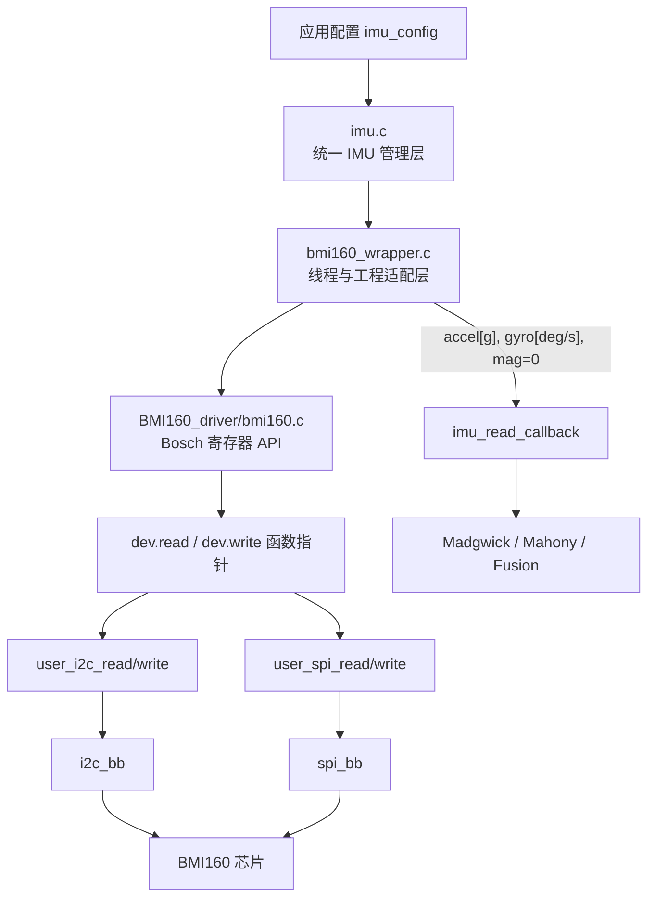
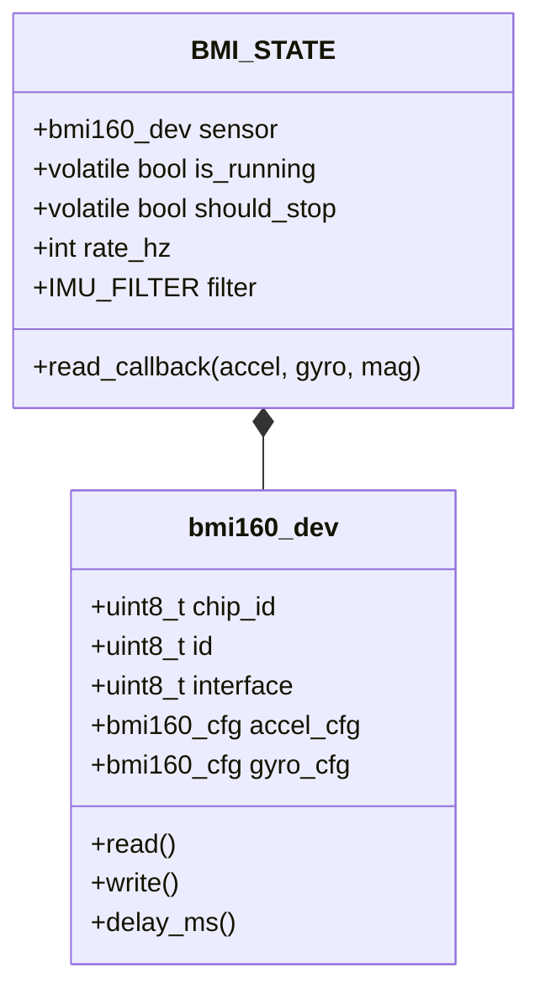
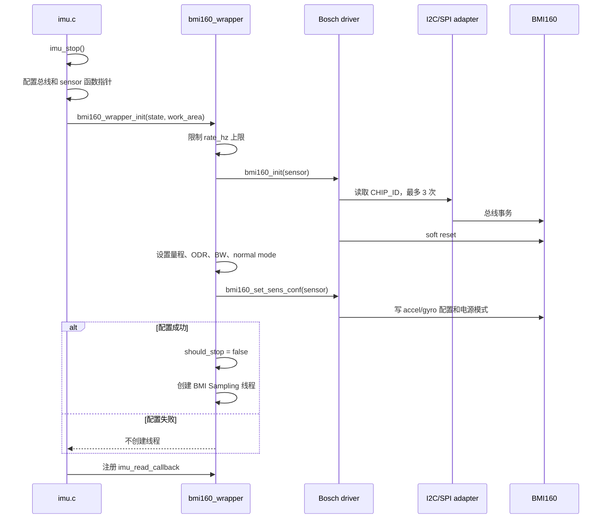
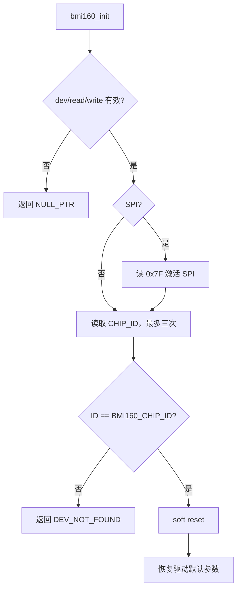
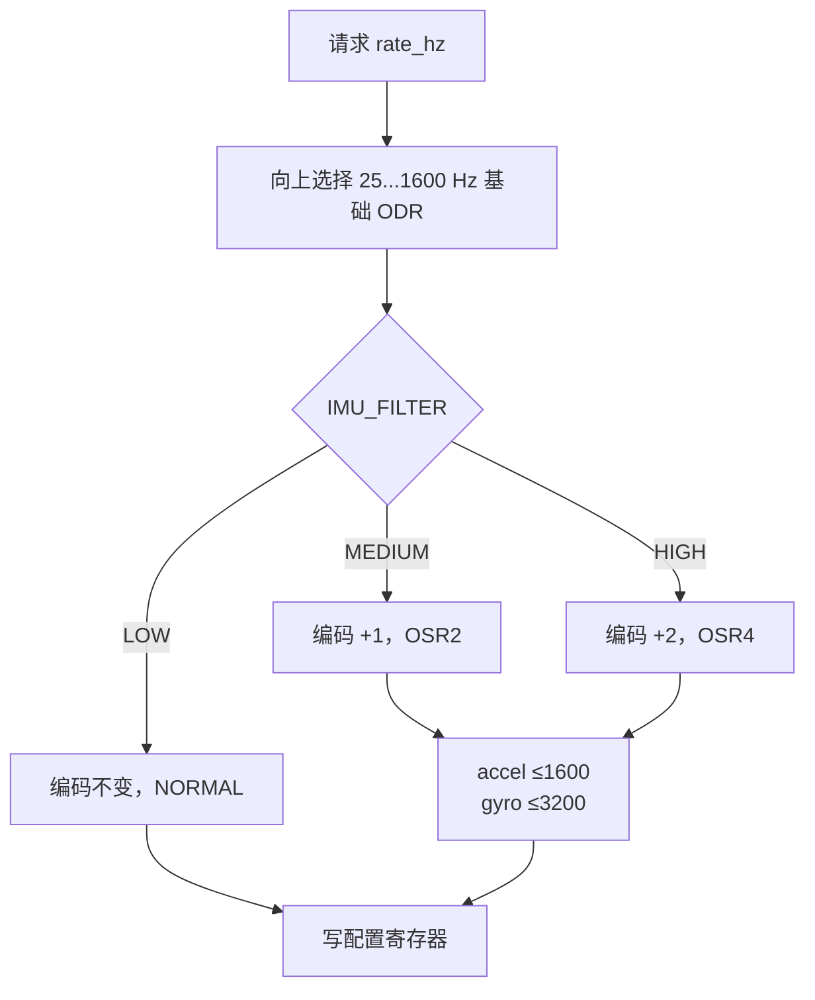
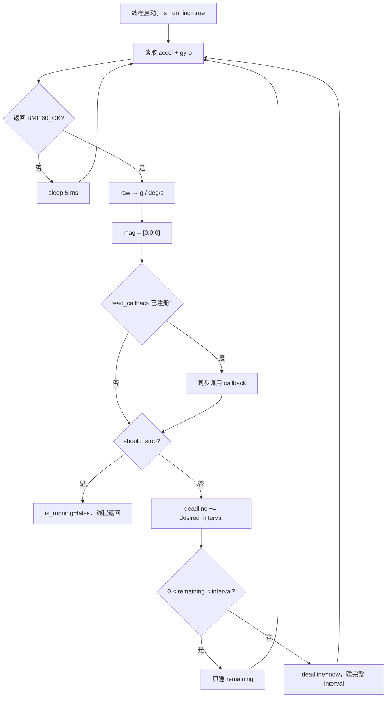
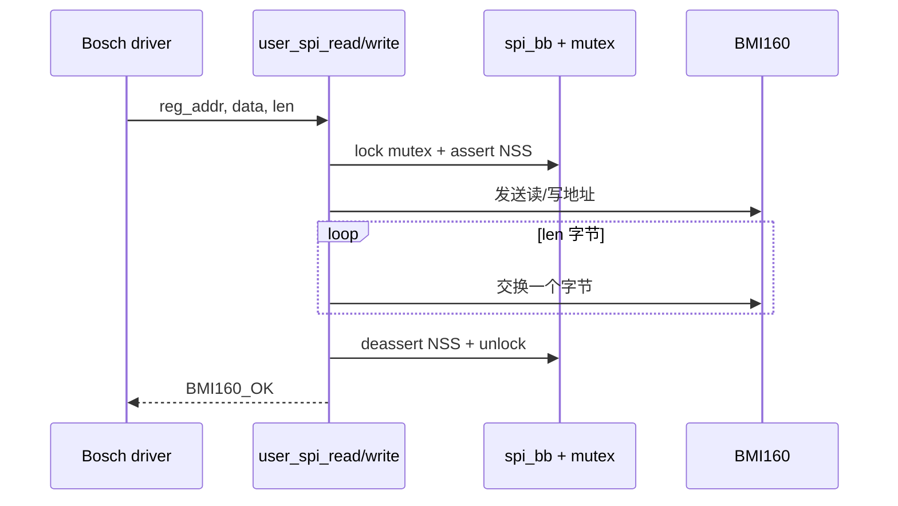
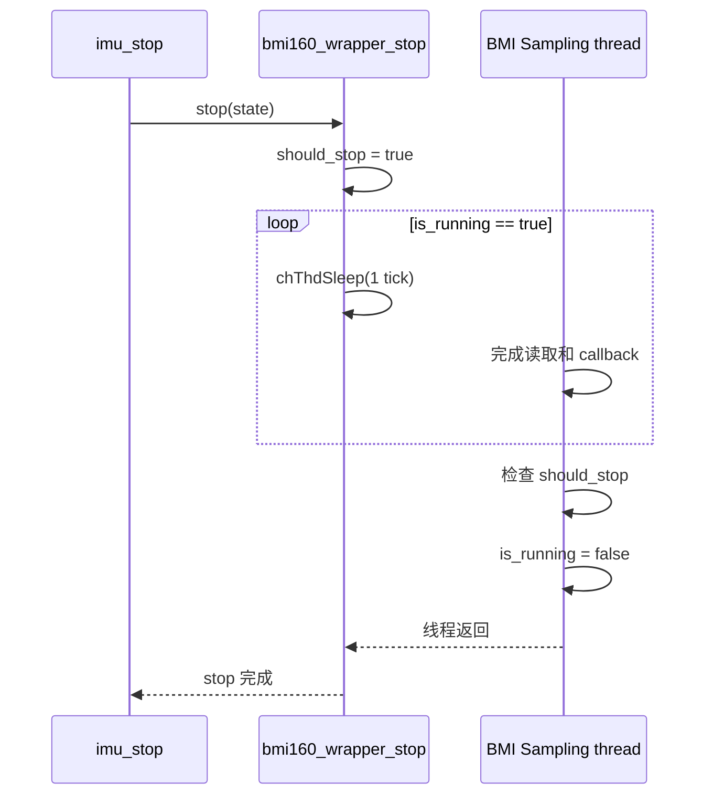
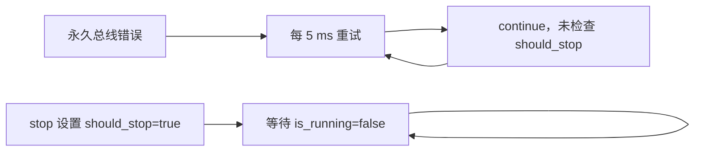
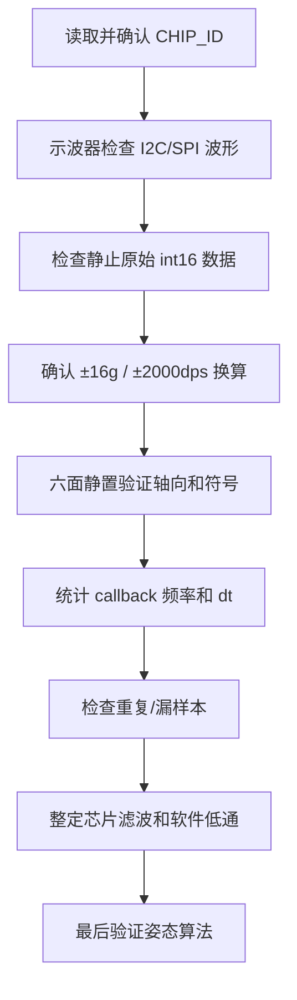

# `bmi160_wrapper.c` 及相关模块详细说明

## 1. 文档范围

本文以 `imu/bmi160_wrapper.c` 为中心，说明 BMI160 从工程配置到姿态融合输入的完整路径。涉及文件如下。

| 文件 | 职责 |
|---|---|
| `imu/bmi160_wrapper.c/.h` | BMI160 的 ChibiOS 生命周期、配置映射、周期采样和单位换算 |
| `imu/BMI160_driver/bmi160.c` | Bosch 通用寄存器驱动、芯片识别、配置和数据解包 |
| `imu/BMI160_driver/bmi160_defs.h` | 寄存器、枚举、设备结构和错误码定义 |
| `imu/imu.c` | I2C/SPI 总线适配、统一回调、坐标变换、滤波和 AHRS |
| `imu/imu.mk` | 编译源文件与包含路径 |
| `i2c_bb.*` / `spi_bb.*` | 软件 I2C、软件 SPI 的板级传输实现 |

BMI160 本体是六轴器件：三轴加速度计和三轴陀螺仪。当前 wrapper 没有配置 BMI160 辅助传感器接口，因此回调中的磁力计向量恒为零。

## 2. 分层结构



这种分层使 Bosch 驱动只依赖读、写、延时三个函数指针，不需要了解 ChibiOS 线程、GPIO 类型或上层姿态算法。

## 3. `BMI_STATE` 状态结构



| 字段 | 生产者 | 消费者 | 含义 |
|---|---|---|---|
| `read_callback` | `imu.c` | 采样线程 | 新样本上报函数 |
| `sensor` | `imu.c` 和 wrapper | Bosch 驱动 | 总线、地址和传感器配置 |
| `is_running` | 采样线程 | stop 调用者 | 线程是否仍在运行 |
| `should_stop` | stop 调用者 | 采样线程 | 协作式停止请求 |
| `rate_hz` | `imu_init` | wrapper | 软件采样循环目标频率 |
| `filter` | `imu_init` | wrapper | 芯片内部带宽/过采样策略 |

`m_bmi_state` 在 `imu.c` 中是静态对象，程序启动时由 C 运行时清零。若在其他场景把 `BMI_STATE` 放在未初始化的栈内存中，必须先整体初始化，否则 `is_running` 等字段没有可靠初值。

## 4. 初始化入口

### 4.1 `imu.c` 选择 I2C 或 SPI

I2C 初始化设置：

- 软件 I2C 引脚和 400 kHz 速率；
- `sensor.id = BMI160_I2C_ADDR`；
- `sensor.interface = BMI160_I2C_INTF`；
- 读写函数为 `user_i2c_read/write`。

SPI 初始化设置：

- 软件 SPI 的 NSS、SCK、MOSI、MISO 引脚；
- `sensor.id = 0`，因为片选由共享 `m_spi_bb` 状态管理；
- `sensor.interface = BMI160_SPI_INTF`；
- 读写函数为 `user_spi_read/write`。

两条路径随后都调用 `bmi160_wrapper_init`，再注册 `imu_read_callback`。

### 4.2 初始化时序



注意：wrapper 调用 `bmi160_init` 后没有检查其返回值，仍继续设置配置并调用 `bmi160_set_sens_conf`。最终是否创建线程只取决于 `bmi160_set_sens_conf` 的返回值，不直接取决于芯片 ID 初始化结果。

## 5. Bosch 驱动初始化过程

`bmi160_init` 的主要步骤为：

1. 检查 `dev` 和读写函数指针；
2. SPI 模式先读取 `0x7F`，使芯片进入 SPI 通信状态；
3. 最多读取三次 `CHIP_ID`；
4. 芯片 ID 正确时发送 soft-reset 命令；
5. 等待芯片复位，并把驱动中的默认配置状态同步到 `bmi160_dev`。



soft reset 会覆盖芯片寄存器，因此量程、ODR、带宽和电源模式必须在 reset 后重新写入。

## 6. 量程和灵敏度

wrapper 固定使用：

- 加速度计量程：$\pm16g$；
- 陀螺仪量程：$\pm2000\ ^\circ/s$；
- 加速度计和陀螺仪：normal power mode。

BMI160 输出为 16 位有符号补码，理想码值区间为 $[-32768,32767]$。对对称满量程 $\pm R$，每 LSB 灵敏度为：

$$
k=\frac{R}{2^{15}}=\frac{R}{32768}
$$

因此加速度灵敏度：

$$
k_a=\frac{16g}{32768}=0.00048828125g/LSB
=0.48828125\text{ mg/LSB}
$$

陀螺仪灵敏度：

$$
k_g=\frac{2000}{32768}=0.06103515625\ ^\circ/s/LSB
$$

换算公式正是 wrapper 中的：

$$
a_i=raw_{a,i}\frac{16}{32768}\quad[g]
$$

$$
\omega_i=raw_{g,i}\frac{2000}{32768}\quad[^\circ/s]
$$

若要转为 SI 单位：

$$
a_i[m/s^2]=a_i[g]\times9.80665
$$

$$
\omega_i[rad/s]=\omega_i[^\circ/s]\times\frac{\pi}{180}
$$

后一个转换在 `imu_read_callback` 中、进入本地 Madgwick/Mahony 算法之前完成。

### 6.1 量化误差

理想均匀量化的最大舍入误差为半个 LSB：

$$
|e_{q,a}|\le\frac{k_a}{2}=0.24414\text{ mg}
$$

$$
|e_{q,g}|\le\frac{k_g}{2}=0.03052\ ^\circ/s
$$

实际噪声还包括传感器本底噪声、温漂、电源噪声和机械振动，通常不能只用量化误差估计测量精度。

## 7. 原始寄存器解包

Bosch 驱动把每轴的两个字节按 little-endian 合成：

$$
u=(MSB\ll8)\;|\;LSB
$$

再转换为 `int16_t`。补码解释为：

$$
raw=\begin{cases}
u,&0\le u<2^{15}\\
u-2^{16},&2^{15}\le u<2^{16}
\end{cases}
$$

例如字节 `LSB=0x00, MSB=0xC0`：

$$
u=0xC000=49152,\qquad raw=49152-65536=-16384
$$

在 $\pm16g$ 量程下对应：

$$
-16384\times\frac{16}{32768}=-8g
$$

wrapper 同时请求 `BMI160_ACCEL_SEL | BMI160_GYRO_SEL`，驱动从连续数据寄存器读取并分别填入两个 `bmi160_sensor_data`。当前请求没有 `BMI160_TIME_SEL`，所以不使用芯片内部时间戳。

## 8. 请求频率到芯片 ODR 的映射

基础映射采用向上取档：

| `rate_hz` 条件 | accel ODR | gyro ODR |
|---|---:|---:|
| $r\le25$ | 25 Hz | 25 Hz |
| $25<r\le50$ | 50 Hz | 50 Hz |
| $50<r\le100$ | 100 Hz | 100 Hz |
| $100<r\le200$ | 200 Hz | 200 Hz |
| $200<r\le400$ | 400 Hz | 400 Hz |
| $400<r\le800$ | 800 Hz | 800 Hz |
| $r>800$ | 1600 Hz | 1600 Hz |

设支持的离散 ODR 集合为：

$$
\mathcal F=\{25,50,100,200,400,800,1600\}
$$

基础选择可以写为：

$$
f_{ODR}=\min\{f\in\mathcal F\mid f\ge r\}
$$

请求超过 1600 Hz 时饱和到 1600 Hz。

### 8.1 `IMU_FILTER` 对 ODR 编码的调整

| filter | 加速度 BW | 陀螺 BW | ODR 编码调整 |
|---|---|---|---|
| LOW | NORMAL/AVG4 | NORMAL | 不调整 |
| MEDIUM | OSR2/AVG2 | OSR2 | accel、gyro 编码各加 1 |
| HIGH | OSR4/AVG1 | OSR4 | accel、gyro 编码各加 2 |

BMI160 的相邻 ODR 编码通常表示频率翻倍。因此在未达到上限时，可近似理解为：

$$
f_{sensor}\approx f_{base}\,2^n,qquad n\in\{0,1,2\}
$$

但 filter 名称 LOW/MEDIUM/HIGH 在此表示工程预设等级，并不能简单理解成截止频率从低到高。OSR4、OSR2、NORMAL 对应不同内部过采样/平均策略，最终带宽应以 BMI160 数据手册为准。

代码用 `fmin` 限制编码：加速度最高 1600 Hz，陀螺仪最高 3200 Hz。



## 9. 芯片 ODR 与软件读取频率不是同一个量

wrapper 还维护独立的软件线程频率 $f_{loop}=rate\_hz$：

- I2C 模式只限制到最大 1000 Hz；
- SPI 模式只限制到最大 5000 Hz；
- 没有在 wrapper 内限制最小值。

芯片以 $f_{sensor}$ 更新输出寄存器，线程以 $f_{loop}$ 读取。二者关系决定数据行为：

$$
f_{loop}>f_{sensor}\Rightarrow\text{可能多次读到同一传感器样本}
$$

$$
f_{loop}<f_{sensor}\Rightarrow\text{中间样本被覆盖，仅读取最新值}
$$

当前实现没有使用 data-ready 中断、FIFO 或 sensor time，无法从返回值判断是否重复或漏过样本。例如 SPI 请求 5000 Hz，而加速度最高 ODR 为 1600 Hz，读取回调可能远快于新加速度数据产生速度。

## 10. 采样线程

### 10.1 周期计算

目标周期为：

$$
T_d=\frac{1}{f_{loop}}
$$

源码以微秒整数计算：

$$
T_{d,\mu s}=\left\lfloor\frac{1000000}{rate\_hz}\right\rfloor
$$

再由 `US2ST` 转换为 ChibiOS tick。由于整数除法和系统 tick 分辨率，实际可表示周期存在量化误差。若量化后的周期为 $T_q$，频率误差为：

$$
\varepsilon_f=\frac{1/T_q-f_{loop}}{f_{loop}}
$$

### 10.2 绝对期限调度

线程不是简单地在每轮末尾固定 sleep，而是维护下一次绝对期限：

$$
t_{deadline,k}=t_{deadline,k-1}+T_d
$$

当读取和回调耗时为 $C_k$，剩余睡眠时间为：

$$
T_{sleep,k}=t_{deadline,k}-t_{now,k}
$$

只要 $0<T_{sleep,k}<T_d$，线程就只睡剩余时间。这可以补偿本轮执行时间，避免使用“$C_k+T_d$”导致频率系统性偏低。

若已经错过期限或计算结果异常，代码把基准重置为当前时间并睡一个完整周期，不连续追赶历史欠期。



## 11. 总线适配

### 11.1 I2C

读事务由：

```text
写 1 字节寄存器地址 → repeated/start read → 接收 len 字节
```

写事务构造变长栈数组：

```text
[寄存器地址][data0][data1]...[dataN-1]
```

然后一次发送。`i2c_bb_tx_rx` 的布尔结果被映射为 `BMI160_OK` 或 `BMI160_E_COM_FAIL`。

### 11.2 SPI

SPI 读地址最高位置 1：

$$
addr_{read}=addr\;|\;0x80
$$

SPI 写地址最高位清零：

$$
addr_{write}=addr\;\&\;0x7F
$$



SPI 回调始终返回 `BMI160_OK`，没有检查 bit-bang 层的传输故障。因此断线、MISO 固定电平等问题通常只能通过芯片 ID 或数据合理性间接发现。

## 12. 回调后的统一处理

wrapper 回调的单位和内容为：

```text
accel = g
gyro  = degree/second
mag   = {0, 0, 0}
```

`imu_read_callback` 随后执行：


芯片内部 `filter` 和 `imu.c` 的软件 Biquad 是两级不同滤波器。两级串联时总传递函数为：

$$
H_{total}(z)=H_{sensor}(z)H_{biquad}(z)
$$

总幅频响应相乘、相位延迟相加。降低噪声的同时会增加姿态链路延迟，参数应作为整体整定。

## 13. 生命周期和停止过程

停止采用协作式标志：



线程在成功读取并完成回调后才检查 `should_stop`，因此正常停止延迟至少包含当前总线读取、回调执行和调度延迟。回调必须快速返回，不能执行长期阻塞操作。

## 14. 错误路径及当前实现风险

### 14.1 持续读错误会阻塞停止

读取失败路径执行：

```c
chThdSleepMilliseconds(5);
continue;
```

它发生在 `should_stop` 检查之前。如果总线永久故障，线程会一直失败并 `continue`，`is_running` 始终为 true；与此同时 `bmi160_wrapper_stop` 会无限等待。这会阻止 IMU 切换、重新初始化甚至相关停机流程完成。



健壮实现应在失败分支也检查停止标志，或把停止检查放到循环顶部/统一尾部。

### 14.2 `rate_hz` 没有最小值保护

只限制了上限，没有验证 $rate\_hz>0$。零会在 `1000000 / rate_hz` 处除零，负数转换和 `US2ST` 也没有有意义的调度语义。配置入口应限制为正数和芯片支持范围。

### 14.3 初始化错误信息丢失

`bmi160_wrapper_init` 返回 `void`，上层无法区分芯片未找到、通信错误、非法配置或线程创建失败。失败时只是没有启动采样线程，也没有保存最后错误码。

### 14.4 回调注册存在启动竞态

`imu.c` 先启动 wrapper 线程，再注册回调。线程可能在注册前读到首个样本；代码会安全地跳过空回调，但该样本不会上报。更严格的接口可在启动线程前传入回调。

### 14.5 状态标志只用 `volatile`

`volatile` 阻止编译器消除访问，但不等同于完整的跨核/线程同步原语。当前目标通常是单核 MCU，风险有限；若移植到多核或更严格内存模型，应使用 RTOS 同步机制或原子变量。

### 14.6 没有 data-ready、FIFO 和 sensor time

轮询输出寄存器无法识别重复样本和漏样本。高动态、严格时间同步或高采样率应用应考虑 data-ready 中断、FIFO 批量读取和 BMI160 sensor time。

### 14.7 线程工作区复用

`imu.c` 的多个传感器驱动复用同一块 `m_thd_work_area`。正确前提是旧驱动线程已完全停止后才启动新线程。持续总线错误导致 BMI stop 卡住虽然避免了直接复用，但也会使切换流程永久停滞。

## 15. 采样率、带宽和混叠

连续信号以采样率 $f_s$ 离散化后，频率 $f$ 与 $f+kf_s$ 的分量可能映射到同一离散频率。为避免混叠，理想条件要求输入带宽：

$$
f_{signal}<\frac{f_s}{2}
$$

即 Nyquist 条件。实际滤波器不是砖墙响应，应让有效截止频率低于 $f_s/2$ 并留出过渡带。

如果芯片 ODR 为 $f_{sensor}$，软件读取率为 $f_{loop}$，真正可用于上层的独立新样本率不超过：

$$
f_{effective}\le\min(f_{sensor},f_{loop})
$$

在进入 AHRS 前还需考虑软件低通。滤波延迟会降低姿态快速响应；滤波不足则让电机振动和结构共振进入重力反馈。

## 16. 总线带宽估算

一次 accel+gyro 原始数据至少包含 12 字节，另有寄存器地址、设备地址、ACK、起停条件或 SPI 命令字节。忽略额外开销的理论最低有效载荷带宽为：

$$
B_{payload}=12f_{loop}\quad[byte/s]
$$

I2C 每字节还需要 ACK 位，粗略下界为：

$$
B_{I2C,min}\approx12\times9\times f_{loop}\quad[bit/s]
$$

1000 Hz 时仅数据和 ACK 已约为：

$$
12\times9\times1000=108\text{ kbit/s}
$$

加上地址、寄存器索引、重复起始和软件 bit-bang 开销后更高，但仍低于标称 400 kbit/s。CPU 占用、线程调度以及其他总线设备会进一步限制可达到频率。

## 17. 配置与调试建议

### 17.1 推荐验证顺序



### 17.2 静态预期值

- 水平静止时某一轴应接近 $\pm1g$，另外两轴接近 0；
- 静止陀螺仪应接近 0 deg/s，但存在温度相关零偏；
- 三轴加速度模长应满足 $\sqrt{a_x^2+a_y^2+a_z^2}\approx1g$；
- `tmp_mag` 永远为零是当前实现的正常行为。

### 17.3 常见问题

| 现象 | 优先检查 |
|---|---|
| 完全没有回调 | CHIP_ID、总线函数、`bmi160_set_sens_conf` 返回值、线程是否创建 |
| 加速度约差 16 倍 | 量程配置与换算常数不一致 |
| 陀螺约差 2/4/8/16 倍 | 实际量程不是 2000 dps，换算仍固定 2000 |
| 轴方向错误 | 板级映射、安装旋转，而不是 wrapper 比例换算 |
| 回调频率正确但样本重复 | 软件读取率高于芯片 ODR |
| 切换 IMU 时卡死 | 持续读取失败导致 stop 不检查停止标志 |
| 姿态延迟明显 | 芯片内部滤波与软件 Biquad 延迟叠加 |
| yaw 漂移 | BMI160 当前路径没有磁力计融合 |

## 18. 推荐改进点

1. 让 `reset_init_bmi` 检查并传播 `bmi160_init` 返回值；
2. 让 wrapper 初始化返回明确错误码，并保存最后通信错误；
3. 校验 `rate_hz > 0`，同时明确软件读取率和芯片 ODR 的合法关系；
4. 在所有循环路径上检查 `should_stop`，保证永久总线故障时仍能退出；
5. 在线程启动前注册 callback，消除首帧丢失竞态；
6. 使用 data-ready 或 sensor time 检测新样本，必要时采用 FIFO；
7. 增加读取失败次数、最后成功时间、实际回调率和重复样本计数；
8. SPI 适配层增加可检测的错误返回；
9. 将量程换算系数从实际 `sensor.accel_cfg.range`、`gyro_cfg.range` 推导，避免配置和常数脱节；
10. 为停止过程加入超时和诊断信息，但超时后不能在旧线程仍活动时直接复用工作区。

## 19. 推荐测试

1. 对补码边界 `0x0000`、`0x7FFF`、`0x8000`、`0xFFFF` 做寄存器解包测试；
2. 验证 $\pm16g$ 和 $\pm2000$ dps 的换算端点及零点；
3. 对每个请求频率和 filter 枚举验证最终 ODR/BW 编码；
4. 用模拟时钟验证正常、超期和 tick 回绕时的调度逻辑；
5. 注入 I2C 通信失败，验证重试、停止和重新初始化；
6. 在 callback 中注入不同执行时间，测量周期抖动；
7. 分别以 I2C 1000 Hz、SPI 高速率统计重复样本比例；
8. 快速反复切换 IMU 类型，验证共享线程工作区不会并发使用；
9. 六面静置和恒定角速度转台验证轴向、比例、偏置和滤波延迟；
10. 在电机不同转速下记录频谱，选择内部滤波与软件低通组合。

## 20. 总结

`bmi160_wrapper.c` 的核心职责不是实现传感器寄存器协议，而是把 Bosch 通用驱动适配成 VESC 固件可用的持续数据源：它选择量程、ODR 和内部滤波，创建 ChibiOS 采样线程，把 16 位补码转换为 g 和 deg/s，再通过统一回调送入 `imu.c`。

理解该链路时必须区分三个频率：芯片 ODR、wrapper 软件读取频率和上层实际获得的独立新样本频率。还要区分两级滤波：BMI160 内部 BW/OSR 设置和 `imu.c` 的软件 Biquad。当前实现结构清晰，但错误传播、停止路径、最小采样率校验以及新样本同步仍有明确的健壮性改进空间。
