# bms.c 模块详细说明

本文依据当前工程中的 `bldc/bms.c`、`bms.h`、`datatypes.h` 及其调用点，说明 VESC 固件的 BMS 数据接收、状态缓存、电流限幅、上位机命令转发和 CAN 状态发送机制。

> 重要说明：该模块主要消费 BMS 状态并据此收紧电机控制器的输入电流边界。它不能替代电池包自身的硬件过压、欠压、过流、过温和接触器保护。

## 1. 模块定位

`bms.c` 位于 CAN 通信、上位机命令和电机限流之间。当前 `BMS_TYPE` 只包含 `NONE` 与 `VESC`，源码也明确把支持其他 BMS 作为可扩展方向。

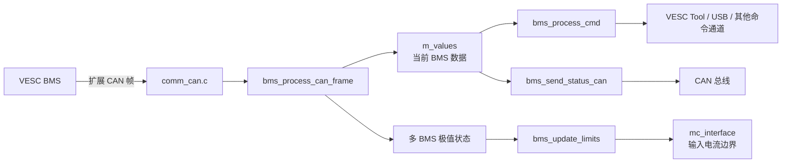

模块的核心职责包括：

- 识别并解码 VESC BMS 的扩展 CAN 数据包；
- 缓存一个当前 BMS 的完整数据；
- 在多个 BMS 同时广播时，另外维护最不利的温度、SOC 和单体电压；
- 根据配置以线性方式收紧驱动和回充电流；
- 把 BMS CAN 帧按配置转发给 USB 或当前命令通道；
- 响应上位机的 BMS 数据查询，并把控制命令转发给当前有效 BMS；
- 将本地 `bms_values` 重新编码为 VESC BMS CAN 状态帧。

## 2. 文件和依赖关系

| 文件/模块 | 作用 |
|---|---|
| `bms.h` | 声明六个公开接口 |
| `datatypes.h` | 定义 `bms_config`、`bms_values`、统计结构和相关枚举 |
| `comm/comm_can.c` | 将标准/扩展 CAN 帧交给 BMS 模块，并提供 CAN 发送接口 |
| `comm/commands.c` | 将 BMS 命令交给 `bms_process_cmd()` |
| `motor/mc_interface.c` | 初始化 BMS，并在计算输入电流范围时调用 BMS 限幅 |
| `buffer` | 按约定比例解码和编码整数、浮点数据 |
| `utils_math`、`utils_sys` | 映射、绝对值限幅和数据年龄计算 |
| `comm_usb` | 实现仅向 USB 转发 BMS 原始 CAN 数据 |
| `app` | 提供本机 controller ID，用于 BMS CAN 状态发送 |
| LispBM 扩展 | 读写 BMS 值、发送状态以及发起充电/均衡等操作 |

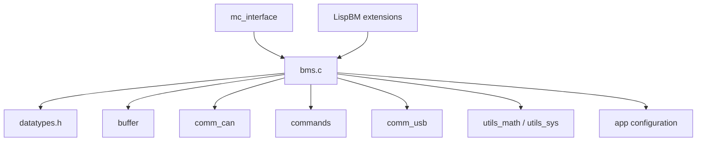

## 3. 公开接口

| 接口 | 说明 |
|---|---|
| `bms_init(bms_config *conf)` | 复制配置、清空全部状态并把各 CAN ID 初始化为无效值 `-1` |
| `bms_process_can_frame(...)` | 尝试解析一帧 CAN 数据，返回该帧是否被 BMS 模块使用 |
| `bms_update_limits(...)` | 根据 BMS 极值状态收紧输入驱动和回充电流边界 |
| `bms_process_cmd(...)` | 处理上位机 BMS 查询，或向有效 BMS 转发控制命令 |
| `bms_get_values()` | 返回全局 `m_values` 的 `volatile` 指针 |
| `bms_send_status_can()` | 把本地 BMS 数据拆成一组 VESC BMS 扩展 CAN 帧发送 |

## 4. 配置和运行数据

### 4.1 `bms_config`

| 字段 | 含义 |
|---|---|
| `type` | BMS 类型，当前支持 `BMS_TYPE_NONE`、`BMS_TYPE_VESC` |
| `limit_mode` bit 0 | 启用最高电芯温度限流 |
| `limit_mode` bit 1 | 启用最低 SOC 驱动限流 |
| `limit_mode` bit 2 | 启用最低单体电压驱动限流 |
| `limit_mode` bit 3 | 启用最高单体电压回充限流 |
| `*_limit_start` | 开始线性降额的阈值 |
| `*_limit_end` | 电流降为零的阈值 |
| `fwd_can_mode` | BMS 原始 CAN 数据的转发模式 |

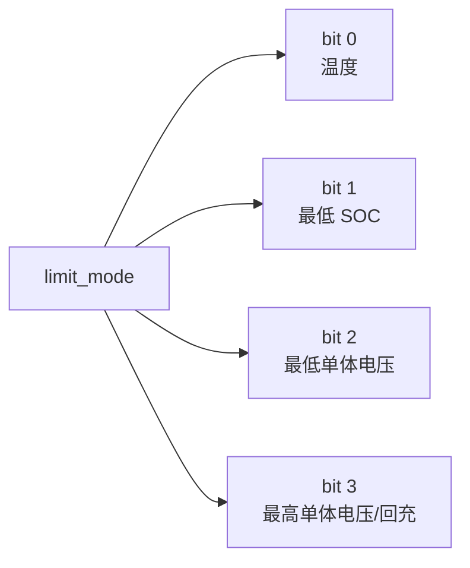

### 4.2 `bms_values`

`m_values` 保存当前选中 BMS 的完整视图，主要分为：

- 总电压、充电器电压、输入电流和电流传感器值；
- Ah/Wh 当前计数和累计充放电计数；
- 最多 50 节单体电压及均衡状态；
- 最多 50 路温度，以及 IC、湿度传感器、最高电芯温度；
- 湿度、气压、SOC、SOH；
- 充电中、均衡中、允许充电和数据版本状态；
- 41 字节状态字符串；
- 当前 BMS CAN ID 和最后更新时间。

### 4.3 多 BMS 极值缓存

完整 `m_values` 同一时刻只对应一个 CAN ID。为避免多电池系统遗漏最不利状态，模块额外维护五个 `bms_soc_soh_temp_stat`：

| 状态 | 选取规则 | 限制方向 |
|---|---|---|
| `m_stat_temp_max` | 最高电芯温度 | 驱动和回充 |
| `m_stat_soc_min` | 最低 SOC | 驱动 |
| `m_stat_soc_max` | 最高 SOC | 当前代码记录但未用于限流 |
| `m_stat_vcell_min` | 最低单体电压 | 驱动 |
| `m_stat_vcell_max` | 最高单体电压 | 回充 |

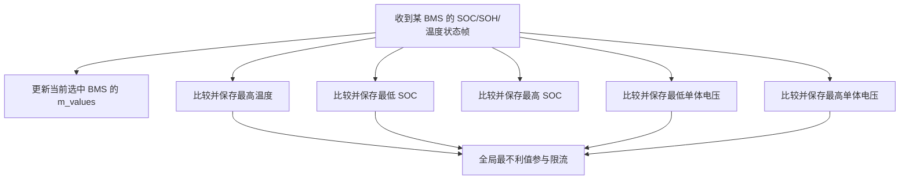

## 5. 初始化过程

`bms_init()` 由 `mc_interface` 初始化或更新电机配置时调用：

1. 按值复制 `bms_config` 到 `m_conf`；
2. 清零完整 BMS 数据及五个极值缓存；
3. 将 `m_values.can_id` 和所有极值记录的 `id` 置为 `-1`。

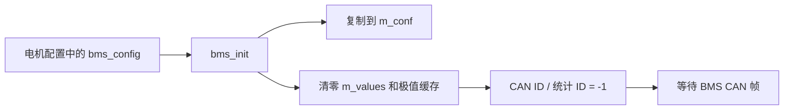

重新调用初始化会丢弃此前缓存的数据和统计状态。

## 6. CAN 接收与 BMS 选择

`bms_process_can_frame()` 当前仅在类型为 `BMS_TYPE_VESC` 且帧为扩展帧时解析数据。扩展 CAN ID 的低 8 位是发送节点 ID，高位是 `CAN_PACKET_ID`：

```text
extended_can_id = controller_id | (CAN_PACKET_ID << 8)
```

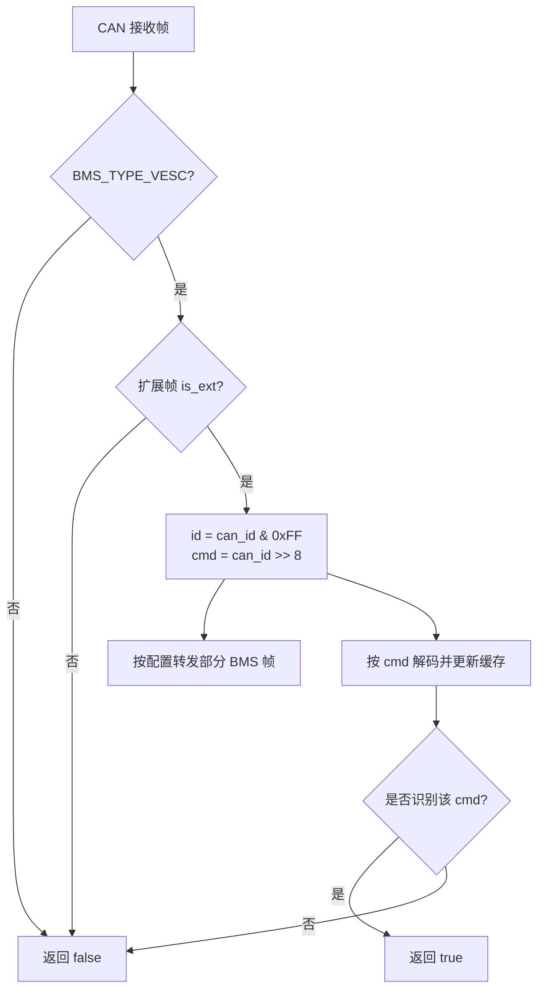

### 6.1 当前 BMS 的保持与接管

大部分数据帧只有满足以下条件之一才更新 `m_values`：

- 帧来自当前 `m_values.can_id`；
- 当前 BMS 数据年龄超过 `MAX_CAN_AGE_SEC`，默认 2 秒；
- 对状态字符串包，还接受当前 ID 为 `-1` 的情况。

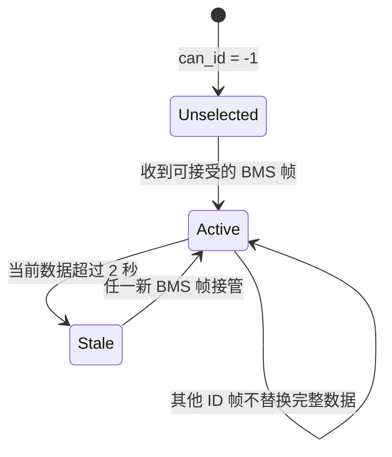

这是一种“黏住当前节点，超时后允许接管”的策略。极值统计则跨多个 BMS 独立更新。

## 7. CAN 数据包类型

| CAN 包 | 更新内容 |
|---|---|
| `BMS_SOC_SOH_TEMP_STAT` | 最低/最高单体电压、SOC、SOH、最高温度和状态位，同时更新多 BMS 极值 |
| `BMS_V_TOT` | 电池总电压、充电器电压 |
| `BMS_I` | BMS 输入电流和 IC 测得电流 |
| `BMS_AH_WH` | 当前 Ah、Wh 计数 |
| `BMS_V_CELL` | 分片传输的单体电压 |
| `BMS_BAL` | 最多 56 位编码中的均衡位，存入最多 50 节数组 |
| `BMS_TEMPS` | 分片传输的温度数组 |
| `BMS_HUM` | 湿度传感器温度、湿度、IC 温度和可选气压 |
| `BMS_AH_WH_CHG_TOTAL` | 累计充电 Ah、Wh |
| `BMS_AH_WH_DIS_TOTAL` | 累计放电 Ah、Wh |
| `BMS_STATUS_1`～`5` | 每帧最多 8 字节，拼成状态字符串缓存 |

单体电压和温度使用“起始偏移 + 总数量 + 最多三个值”的分片形式。接收循环会在实际数组边界处停止写入。

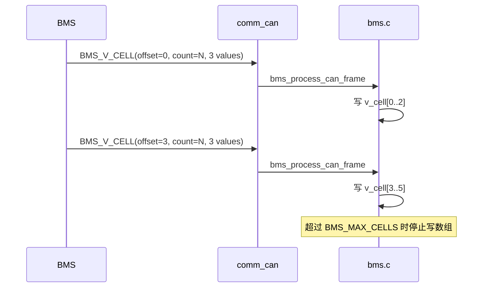

## 8. 原始 CAN 帧转发

对部分常用 BMS 数据包，模块构造 `COMM_BMS_FWD_CAN_RX` 消息，内容包括 BMS ID、命令号和原始 CAN 载荷。

| 模式 | 行为 |
|---|---|
| `BMS_FWD_CAN_MODE_DISABLED` | 不转发 |
| `BMS_FWD_CAN_MODE_USB_ONLY` | 用 `comm_usb_send_packet()` 只发往 USB |
| `BMS_FWD_CAN_MODE_ANY` | 用 `commands_send_packet()` 发往当前命令回复通道 |

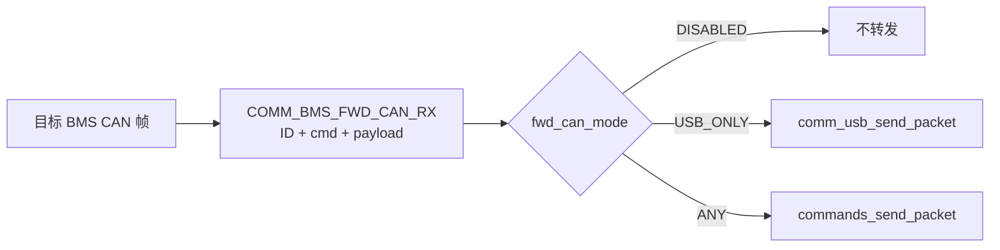

## 9. BMS 输入电流限幅

`mc_interface` 计算输入电流上下限时调用 `bms_update_limits()`。这里通常：

- `i_in_max` 表示从电池取电的最大正向输入电流；
- `i_in_min` 表示再生制动回充方向的负电流边界。

函数先令每个候选限制等于配置电流，再根据启用位和 BMS 极值进行线性降额，最后用 `utils_min_abs()` 合并最严格的绝对值限制。它只会收紧调用方已有边界，不会放宽边界。

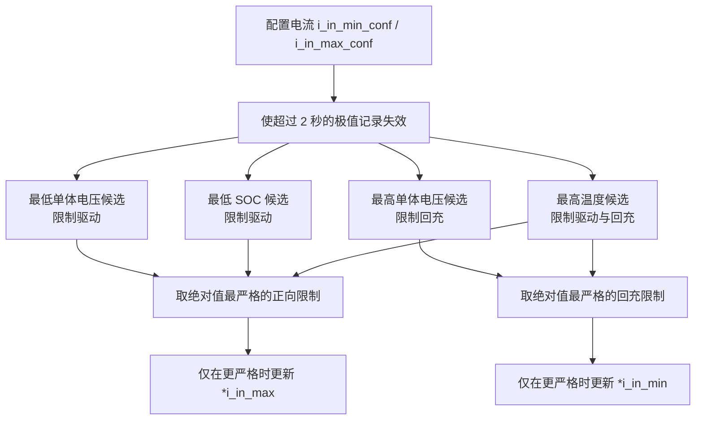

### 9.1 降额曲线

温度在 `t_limit_start` 以下不限制，到 `t_limit_end` 时驱动和回充都变为零。SOC 和最低单体电压随数值下降而削减正向驱动电流；最高单体电压随数值上升而削减回充电流。


阈值判断加入了少量裕量：温度为 `0.1 °C`，SOC 和单体电压为 `0.001`。这避免边界附近因浮点噪声频繁切换分支，但并不是带状态记忆的完整滞回控制。

### 9.2 数据超时语义

超过两秒后，极值记录的 `id` 被置为 `-1`，该项不再参与限流。这意味着通信丢失时当前实现采用“停止使用 BMS 限制”的策略，而不是故障安全式地把电流降为零。系统安全设计必须另外处理 BMS 离线。

## 10. 上位机 BMS 命令

`commands.c` 将 BMS 命令交给 `bms_process_cmd()`。该函数有两类行为。

### 10.1 查询值

`COMM_BMS_GET_VALUES` 把 `m_values` 序列化到 256 字节栈缓冲区，并调用传入的 `reply_func` 返回。内容包括电压、电流、计数、单体、均衡、温度、湿度、SOC/SOH、CAN ID、累计计数、气压、数据版本和状态字符串。

### 10.2 转发控制命令

以下命令仅在 BMS 类型为 VESC 且当前数据年龄小于两秒时，经 `comm_can_send_buffer()` 发给 `m_values.can_id`：

- `COMM_BMS_SET_CHARGE_ALLOWED`；
- `COMM_BMS_SET_BALANCE_OVERRIDE`；
- `COMM_BMS_RESET_COUNTERS`；
- `COMM_BMS_FORCE_BALANCE`；
- `COMM_BMS_ZERO_CURRENT_OFFSET`。

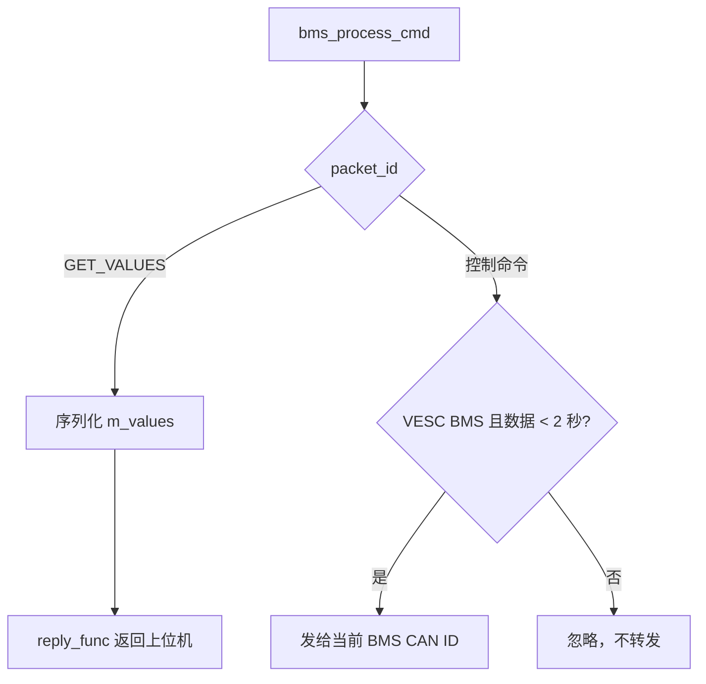

## 11. 发送 BMS CAN 状态

`bms_send_status_can()` 使用本机 `controller_id` 作为低 8 位节点 ID，将 `m_values` 编码成一整组 VESC BMS 帧。单体电压和温度每帧最多发送三个元素，其余标量通常每帧两个自动浮点或四个 16 位值。

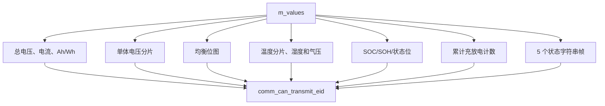

该接口适用于把本地生成或由 LispBM 修改的 BMS 数据广播到 CAN。调用方应控制发送频率；一次调用会连续产生多帧，单体和温度数量越多，总线占用越高。

## 12. 并发与数据一致性

模块状态均为文件级 `static volatile`，但没有互斥锁或快照机制。`volatile` 不能保证包含多个浮点数和数组的结构体在并发读写时保持一致。

可能的并发关系包括：

- CAN 接收线程更新 `m_values` 和极值状态；
- 电机控制路径读取极值并更新电流限制；
- 命令线程序列化 `m_values`；
- LispBM 通过返回指针读写 `m_values`；
- 其他任务调用 `bms_send_status_can()` 读取整组数据。

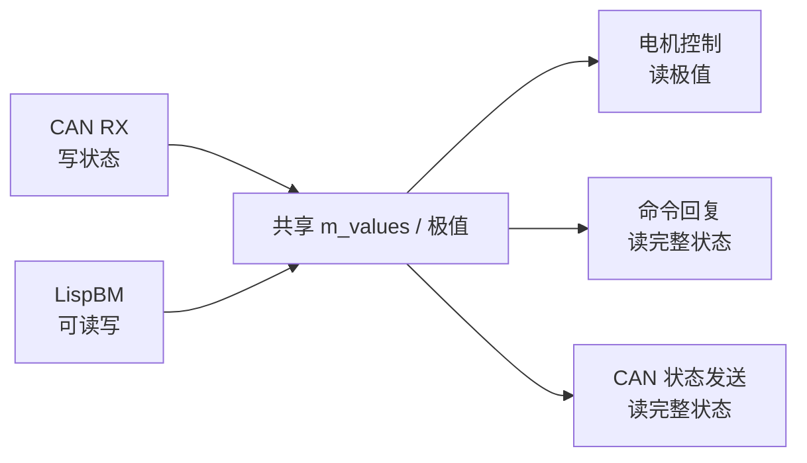

如果要求严格一致的遥测快照，建议在短临界区内复制结构，再在锁外完成序列化和发送。对限流路径则应平衡实时性与锁竞争。

## 13. 边界条件与实现注意事项

### 13.1 接收长度校验不足

不同 CAN 包的解码逻辑假定载荷长度符合协议，许多标量包在读取前没有逐项验证 `len`。畸形或过短 CAN 帧可能造成越界读取。建议按每种包的最小/精确长度先校验。

### 13.2 报告数量与实际数组容量

接收单体和温度分片时，数组写入有容量检查，但 `m_values.cell_num` 和 `temp_adc_num` 仍直接取自报文。`COMM_BMS_GET_VALUES` 随后按这些数量遍历数组并写入固定 256 字节回复缓冲区。如果远端报告大于 50 或数量组合过大，可能造成数组越界读取或回复缓冲区溢出。

### 13.3 命令长度前置条件

`bms_process_cmd()` 直接读取 `data[0]`，随后执行 `len--`。调用方必须保证 `data != NULL` 且 `len >= 1`，函数内部当前没有防御性检查。

### 13.4 回复函数前置条件

处理 `COMM_BMS_GET_VALUES` 时会无条件调用 `reply_func()`。如果该命令可能从不需要回复的内部调用进入，必须保证回调非空，或在函数中增加检查。

### 13.5 状态字符串

接收端按五个最多 8 字节的 CAN 分片写入 41 字节数组；上位机回复使用 `strcpy`/`strlen` 语义读取它。初始化时数组为零，但如果后续 40 个字节全部被非零数据覆盖，最后第 41 字节仍保持初始化的零值。若其他代码直接改写该数组，应始终保留结尾 `\0`。

### 13.6 超时不是离线故障

两秒超时只让极值限流状态失效，并允许其他 BMS 接管完整缓存；它不会清零旧的 `m_values`，也不会主动上报 BMS 离线故障。

## 14. 安全性建议

1. 电池包必须保留独立硬件 BMS 保护，固件限流只能作为附加层；
2. 明确系统对 BMS 通信丢失采取“继续运行”“降额”还是“停机”的策略；
3. 配置阈值前核对电芯化学体系、串数、允许温度和充放电倍率；
4. 回充电流的符号和 `i_in_min` 配置必须与电机控制约定一致；
5. 强制均衡、允许充电、计数清零和电流零偏校准应受权限与工况约束；
6. 多 BMS 系统需要验证两秒窗口和最不利值选取是否符合拓扑；
7. 广播完整状态时评估 CAN 波特率、节点数量和调用周期。

## 15. 常见问题定位

### 15.1 上位机一直显示旧数据

检查 `m_values.update_time`、当前 `can_id`、扩展帧标志、BMS 类型配置以及数据包 ID。旧数据超时后不会自动清零。

### 15.2 新 BMS 节点的数据不生效

当前完整数据会黏住原 CAN ID，直到其数据年龄超过两秒；但新节点仍可能参与极值统计。等待超时或重新初始化后再观察接管。

### 15.3 电机没有按 BMS 状态降额

检查 `limit_mode` 位、start/end 阈值方向、极值记录是否在两秒内有效，以及 `mc_interface` 是否实际调用了 `bms_update_limits()`。

### 15.4 BMS 离线后限流反而消失

这是当前超时逻辑的直接结果。若产品要求离线即降额或停机，需要在系统级增加通信健康状态和故障策略。

### 15.5 BMS 控制命令未转发

只有白名单中的命令会转发，并且要求 `BMS_TYPE_VESC`、当前 CAN ID 有效且数据更新时间小于两秒。

## 16. 推荐改进方向

- 为每类 CAN 包增加严格的长度和字段范围校验；
- 接收时将 `cell_num`、`temp_adc_num` 限制到数组容量；
- 计算 GET_VALUES 最大长度，改用容量感知的序列化接口；
- 为 `bms_process_cmd()` 增加空指针、最小长度和回复回调检查；
- 为共享状态引入短临界区或版本化快照；
- 将“数据有效”“当前选中节点”和“最不利统计有效”做成明确状态；
- 允许配置 BMS 离线后的电流策略；
- 让 `bms_send_status_can()` 支持分步发送或速率限制，降低 CAN 突发负载；
- 为新增 BMS 类型抽象解析器接口，避免主函数继续增长；
- 增加畸形帧、边界数量、多节点接管和限流曲线单元测试。

## 17. 推荐阅读顺序


## 18. 总结

`bms.c` 是 VESC 电机控制器侧的 BMS 适配和策略模块。它从 CAN 汇聚电池状态，维护一个当前 BMS 的完整快照和跨节点最不利指标，再把温度、SOC、最低单体电压和最高单体电压转化为驱动/回充电流限制。同时，它承担上位机查询、控制命令转发以及 BMS 状态再广播。

理解该模块时最关键的三点是：完整状态采用两秒超时后的节点接管机制；限流使用跨 BMS 极值并只收紧现有电流边界；通信超时会取消相应 BMS 限制而不会自动停机。产品安全策略必须围绕这三个实际行为进行补充。
