# conf_custom.c 模块详细说明

本文依据 `bldc/conf_custom.c`、`conf_custom.h` 及其实际调用点，说明自定义配置的注册、读取、写入、XML 描述分片传输和固件集成方式。

## 1. 模块定位

`conf_custom.c` 是一个轻量级的“自定义配置适配层”。它不定义具体配置字段，也不直接负责 EEPROM/Flash 持久化，而是保存一组由扩展模块提供的函数指针，并把 VESC 通信协议中的自定义配置命令转发给这些函数。

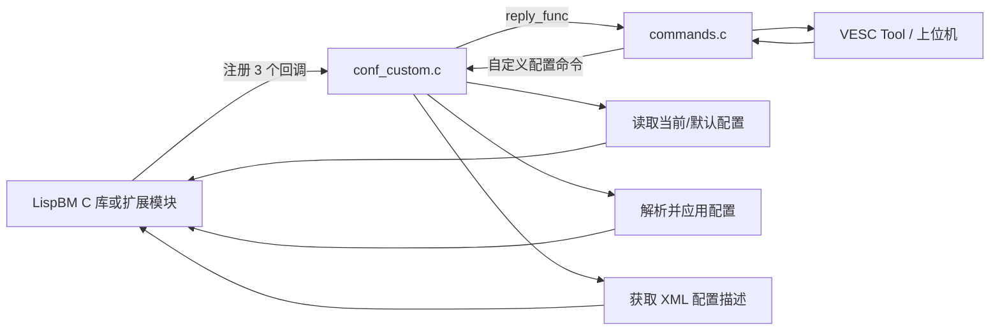

它解决的是以下接口对接问题：

- 扩展代码如何向固件声明“我有一份自定义配置”；
- 上位机如何取得当前配置和默认配置；
- 上位机如何提交新配置；
- 上位机如何分片下载描述配置界面的 XML；
- 固件如何把自定义 XML 纳入硬件 CRC。

当前实现虽然函数名使用复数 `configs`，但实际上只保存一组回调，只支持配置索引 `0`。

## 2. 文件和依赖关系

| 文件/模块 | 关系 |
|---|---|
| `conf_custom.h` | 声明注册、清除、枚举、XML 访问和命令处理接口 |
| `comm/commands.c` | 将四种自定义配置协议命令交给本模块 |
| `datatypes.h` | 定义相关 `COMM_PACKET_ID` |
| `mempools` | 为配置和 XML 回复提供共享 packet buffer |
| `buffer` | 编解码 XML 总长度和偏移量的 32 位整数 |
| `utils_sys` | 使用 `utils_is_func_valid()` 检查回调和 XML 地址 |
| `main.c` | 枚举自定义 XML，并将其内容加入硬件 CRC |
| LispBM C interface | 向动态加载的 C 库暴露注册和清除函数 |
| 示例 `lispBM/c_libs/examples/config` | 展示序列化、默认值、EEPROM 持久化和 XML 注册的完整用法 |

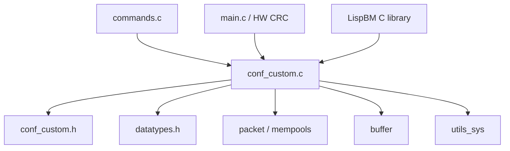

## 3. 内部状态

模块只保存三个静态函数指针：

```c
static int (*m_get_cfg)(uint8_t *data, bool is_default) = 0;
static bool (*m_set_cfg)(uint8_t *data) = 0;
static int (*m_get_cfg_xml)(uint8_t **data) = 0;
```

| 回调 | 输入/输出约定 | 责任归属 |
|---|---|---|
| `m_get_cfg` | 把序列化配置写到调用方缓冲区，返回字节数；`is_default` 指定当前值还是默认值 | 扩展模块 |
| `m_set_cfg` | 从缓冲区反序列化、应用并按需保存，返回是否成功 | 扩展模块 |
| `m_get_cfg_xml` | 通过二级指针返回 XML 首地址，并返回 XML 字节数 | 扩展模块 |

`conf_custom.c` 不知道配置结构体类型、序列化格式、XML 内容和存储位置。三者必须由同一个提供者保持一致。

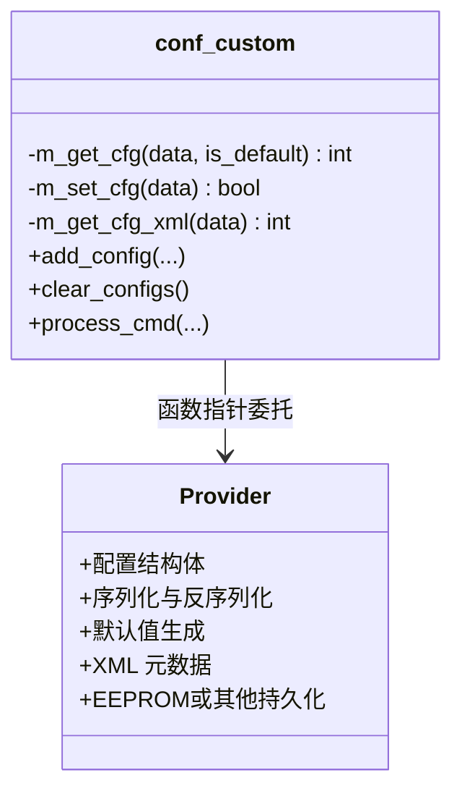

## 4. 公开接口

| 接口 | 说明 |
|---|---|
| `conf_custom_add_config(...)` | 三个地址都通过有效性检查后，整体替换当前回调组 |
| `conf_custom_clear_configs()` | 将三个回调全部清零，使配置立即不可用 |
| `conf_custom_cfg_num()` | XML 回调存在且返回地址有效时返回 `1`，否则返回 `0` |
| `conf_custom_get_cfg_xml(conf_ind, data)` | 索引为 `0` 且回调存在时返回 XML；否则返回 `0` |
| `conf_custom_process_cmd(...)` | 处理协议中的读取、写入和 XML 分片请求 |

## 5. 注册与清除

`conf_custom_add_config()` 要求三个回调全部通过 `utils_is_func_valid()`，否则不会改变现有注册。注册成功会直接覆盖上一组指针，没有多配置数组，也没有返回值告知调用方是否成功。

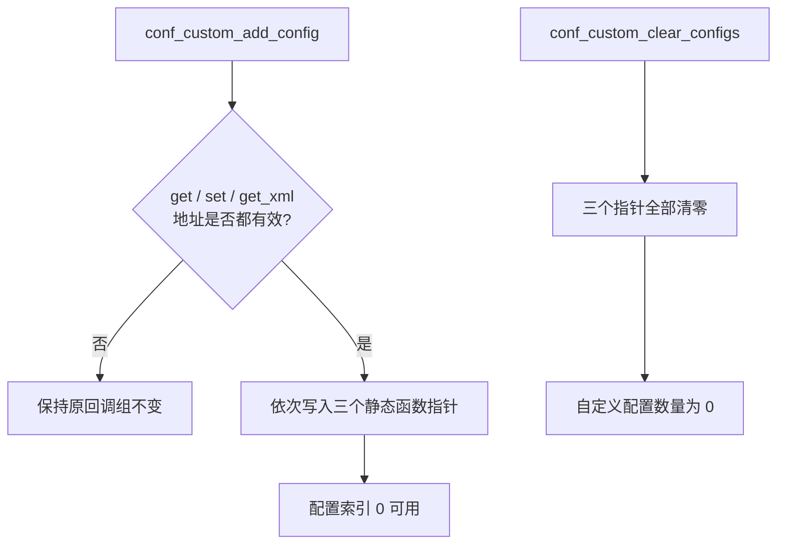

示例 C 库在初始化时注册回调，在库停止函数中调用 `conf_custom_clear_configs()`，防止固件继续调用已经卸载代码中的函数地址。

## 6. 配置数量与 XML 可用性

`conf_custom_cfg_num()` 并不只检查注册标志，而是实际调用 XML 回调：

1. 初始化 `xml_data = NULL`；
2. 调用 `m_get_cfg_xml(&xml_data)`；
3. 用 `utils_is_func_valid(xml_data)` 检查返回地址；
4. 地址有效则返回 `1`，否则返回 `0`。

它没有检查 XML 回调返回的长度是否大于零。因此“数量为 1”主要表示 XML 地址可用，不保证 XML 非空或格式正确。

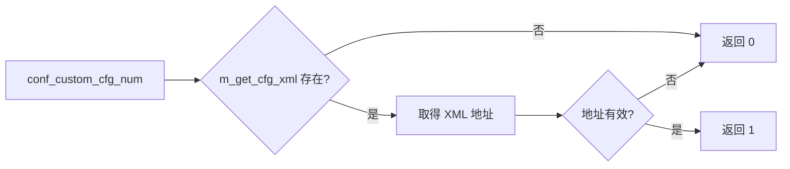

该数量被 `commands.c` 放入固件信息回复，上位机由此知道设备是否提供自定义配置页。

## 7. 命令入口与分发

`commands.c` 接收到以下包 ID 时调用：

```c
conf_custom_process_cmd(data - 1, len + 1, reply_func);
```

因此传给本模块的数据首字节仍是 `COMM_PACKET_ID`。函数读取首字节后移动数据指针，再按包类型处理。

| 包 ID | 数值 | 功能 |
|---|---:|---|
| `COMM_GET_CUSTOM_CONFIG_XML` | 92 | 分片读取配置 XML |
| `COMM_GET_CUSTOM_CONFIG` | 93 | 读取当前配置 |
| `COMM_GET_CUSTOM_CONFIG_DEFAULT` | 94 | 读取默认配置 |
| `COMM_SET_CUSTOM_CONFIG` | 95 | 设置当前配置 |

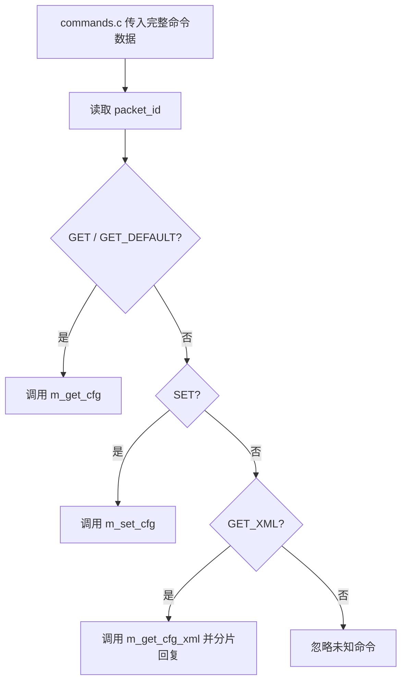

## 8. 读取当前配置和默认配置

两种读取命令使用同一流程，区别只在传给回调的 `is_default`：

- `COMM_GET_CUSTOM_CONFIG`：`false`；
- `COMM_GET_CUSTOM_CONFIG_DEFAULT`：`true`。

只有索引为 `0` 且 `m_get_cfg` 已注册时才回复。

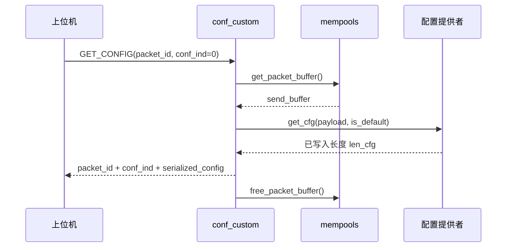

回复格式为：

```text
[packet_id][conf_ind][serialized configuration ...]
```

序列化格式由扩展模块和对应 XML/上位机解析器共同约定，本模块不添加配置长度字段。

## 9. 写入配置

`COMM_SET_CUSTOM_CONFIG` 的数据格式为：

```text
[packet_id][conf_ind][serialized configuration ...]
```

索引为 `0` 且设置回调存在时，本模块调用 `m_set_cfg(data + 1)`，之后回复一个只含 `packet_id` 的确认包。

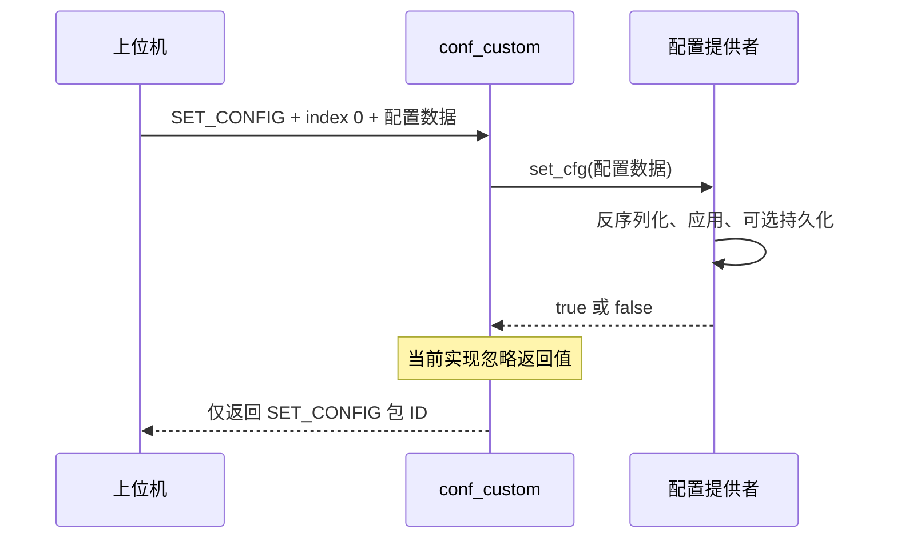

需要特别注意：`m_set_cfg()` 的布尔返回值当前被忽略。即使提供者报告反序列化或保存失败，本模块仍发送相同确认包，上位机无法从该回复判断写入是否成功。

## 10. XML 分片读取

XML 请求负载为：

```text
[conf_ind: u8][len_conf: i32][ofs_conf: i32]
```

回复负载为：

```text
[packet_id][conf_ind][xml_total_len: i32][ofs_conf: i32][xml fragment ...]
```

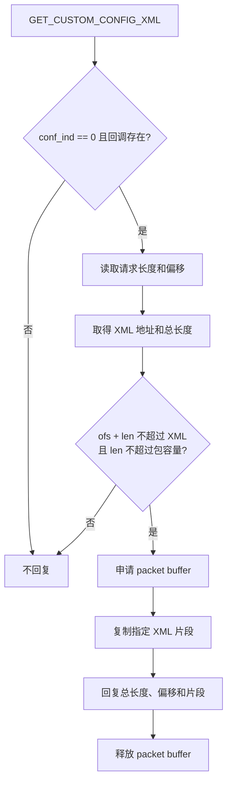

分片机制避免一次把完整 XML 放入通信包。上位机可从偏移零开始循环请求，直至已接收字节数达到 `xml_total_len`。

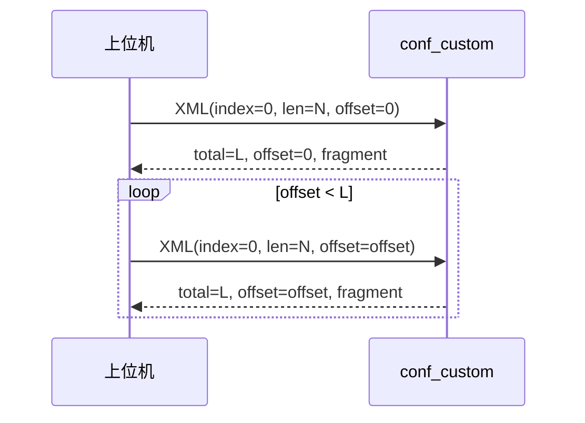

## 11. XML 与硬件 CRC

`main_calc_hw_crc()` 遍历 `conf_custom_cfg_num()`，取得每份 XML 并计算 CRC。因此自定义配置界面描述发生变化时，硬件 CRC 也会变化。这有助于上位机识别硬件相关 UI/配置定义版本。


调用 CRC 计算时，XML 提供者必须仍处于有效生命周期内，返回地址和长度也必须稳定。

## 12. 示例扩展的完整职责划分

工程中的配置示例体现了推荐分层：

| 功能 | 实现位置 |
|---|---|
| 配置结构体 | 扩展 C 库 |
| 当前配置序列化 | `get_cfg(false)` |
| 默认值生成 | `get_cfg(true)` 调用生成的 defaults 函数 |
| 反序列化 | `set_cfg()` 调用生成的 parser |
| EEPROM 读写 | 扩展的初始化和 `set_cfg()` |
| 配置有效签名 | 扩展自行定义并校验 |
| XML 数据 | 生成的 `confxml` 数据 |
| 协议命令和分片 | `conf_custom.c` |

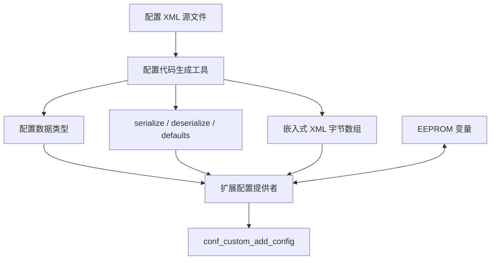

`get_cfg_xml()` 示例会给链接后二进制中的相对地址加 `PROG_ADDR`，这是动态加载 C 库的地址重定位需求，不是 `conf_custom.c` 本身完成的工作。

## 13. 生命周期和并发

三个函数指针没有互斥保护。潜在并发参与者包括通信命令线程、主程序 CRC 计算和动态 C 库加载/停止流程。

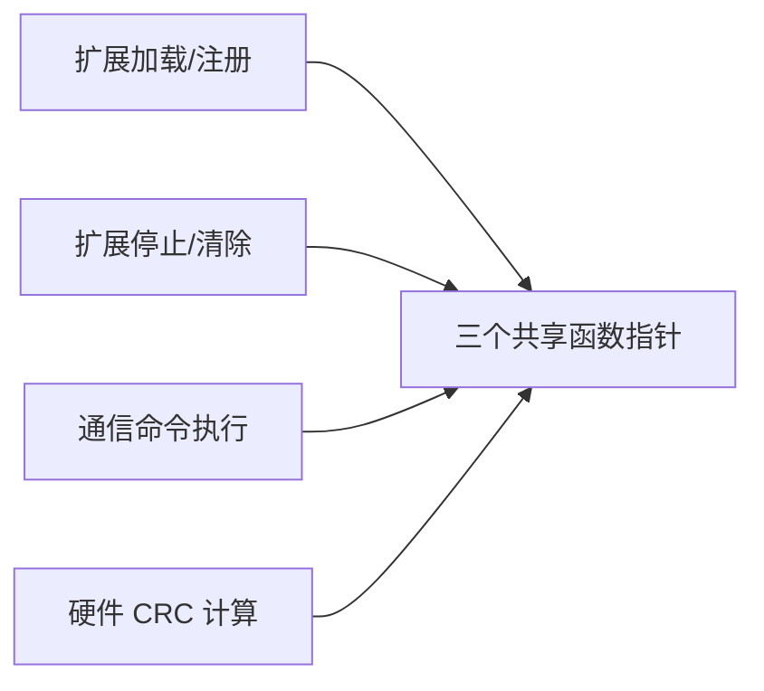

安全生命周期应满足：

1. 扩展代码和 XML 数据完全可访问后再注册；
2. 注册期间不要并发处理自定义配置命令；
3. 停止扩展前禁止新命令进入，并等待正在执行的回调结束；
4. 清除回调后才能释放或覆盖扩展代码和数据。

仅调用 `conf_custom_clear_configs()` 不能取消一个已经进入回调的命令。

## 14. 输入校验与潜在风险

### 14.1 命令最小长度

`conf_custom_process_cmd()` 未检查 `data`、`len` 和 `reply_func`。函数直接读取 `data[0]`，各分支还会读取配置索引及 XML 的两个 32 位字段。调用方必须保证数据完整；更稳妥的实现应在每个分支验证最小长度。

### 14.2 XML 的负数长度和偏移

`len_conf`、`ofs_conf` 使用有符号 `int32_t`。当前范围检查只判断：

```c
(len_conf + ofs_conf) > xml_len
len_conf > (PACKET_MAX_PL_LEN - 10)
```

没有拒绝负数。负长度传给 `memcpy()` 时会转换为巨大的 `size_t`；负偏移也会使源地址落到 XML 之前。还应防止有符号加法溢出。建议先要求 `len_conf >= 0`、`ofs_conf >= 0`，再用避免溢出的方式判断 `ofs_conf <= xml_len` 和 `len_conf <= xml_len - ofs_conf`。

### 14.3 `get_cfg()` 返回长度

`m_get_cfg()` 返回的 `len_cfg` 直接累加到回复长度，未检查负值或 packet buffer 容量。提供者若返回错误长度，可能造成越界发送。接口最好同时传入可写容量，并验证返回值。

### 14.4 XML 地址与长度

命令分支取得 XML 后没有再次检查 `xml_data` 是否有效，也没有验证 `xml_len >= 0`。注册成功不代表扩展生命周期内每次调用都能返回有效数据。

### 14.5 设置结果不可见

设置回调的 `bool` 返回值被忽略。协议回复应包含明确的成功/失败状态，或者失败时不确认并返回错误码。

### 14.6 内存池和回复回调

代码假定 `mempools_get_packet_buffer()` 总能取得有效缓冲区，并假定 `reply_func` 在同步调用期间使用完数据。回复完成后缓冲区立即归还内存池，回复函数不能异步保存该裸指针继续使用。

## 15. 新增自定义配置的推荐步骤

1. 定义配置结构体及字段范围；
2. 准备与字段一致的 XML 描述；
3. 实现当前/默认配置序列化回调；
4. 实现带完整校验的反序列化回调；
5. 在提供者内部实现版本、签名和持久化迁移；
6. 实现返回稳定 XML 地址和长度的回调；
7. 在模块完全初始化后注册三个回调；
8. 测试当前值、默认值、设置失败和 XML 分片边界；
9. 卸载时先停止访问，再清除回调；
10. 验证固件信息中的配置数量和硬件 CRC 变化。

## 16. 常见问题定位

### 16.1 上位机看不到自定义配置

检查三个回调是否全部有效、XML 回调是否返回有效地址、扩展是否过早调用了 `clear_configs()`，以及固件信息中的自定义配置数量是否为 1。

### 16.2 读取配置没有回复

检查配置索引是否为 0、`m_get_cfg` 是否存在、命令长度是否正确，以及 packet buffer 和 `reply_func` 是否可用。

### 16.3 设置后重启丢失

本模块不负责持久化。检查提供者的 `m_set_cfg()` 是否在反序列化成功后写入 EEPROM/Flash，以及启动时是否校验签名并恢复数据。

### 16.4 点击写入显示成功但配置未改变

当前本模块忽略 `m_set_cfg()` 返回值并始终发送确认。检查提供者反序列化结果、字段校验和持久化写入结果。

### 16.5 XML 下载到某个偏移后失败

检查请求的 `offset + length` 是否超过 XML 总长、分片是否超过 `PACKET_MAX_PL_LEN - 10`，以及 XML 长度在整个传输期间是否保持不变。

## 17. 改进建议

- 给注册函数增加成功/失败返回值和所有者标识；
- 若未来需要多份配置，使用真正的描述符数组和稳定索引；
- 对回调表增加生命周期锁或引用计数；
- 为所有命令增加严格的最小长度、空指针和范围检查；
- XML 范围计算改用无溢出的非负边界判断；
- 为 `get_cfg()` 增加输出容量参数；
- 在设置回复中携带 `m_set_cfg()` 的结果；
- 验证 XML 地址、长度和 packet buffer 申请结果；
- 明确 `reply_func` 必须同步消费缓冲区的接口契约；
- 增加畸形包、零长度 XML、最大分片和扩展卸载竞态测试。

## 18. 推荐阅读顺序

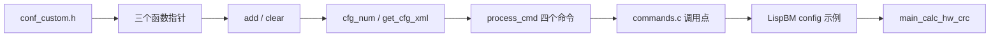

## 19. 总结

`conf_custom.c` 本质上是单槽位的配置插件桥接器：扩展模块提供配置编码、解码和 XML 描述，固件核心负责协议分发、分片回复以及将 XML 纳入硬件 CRC。默认值和持久化都属于配置提供者，而不是本模块。

维护时最需要注意的是回调生命周期、只支持索引 0、设置结果被忽略，以及命令长度和 XML 有符号范围校验不足。把这些边界补齐后，该机制可以继续作为固件核心与动态扩展配置之间清晰而低耦合的接口。
