# flash_helper.c 详细说明

本文详细说明 `bldc/flash_helper.c` 与 `flash_helper.h` 的 Flash 分区、擦写流程、固件 CRC 校验、QML/Lisp 代码区格式、Bootloader 跳转和 package NVM 接口。内容基于当前 STM32F4 1 MiB Flash 布局和仓库实现。

> Flash 擦除、写入和分区地址属于高风险底层功能。修改前必须同时核对链接脚本、Bootloader、固件升级协议和具体 STM32 型号的扇区布局。

## 1. 模块定位

`flash_helper` 为上层提供统一的片上 Flash 操作：

- 擦除并写入待升级固件区；
- 擦除 Bootloader 区；
- 管理 QML、Lisp 和 Lisp 常量代码区；
- 验证当前应用固件完整性；
- 跳转到 Bootloader；
- 为 package/C 接口提供一块 NVM 读写区域；
- 在 Flash 操作前停止电机、调整看门狗并抑制控制输入。

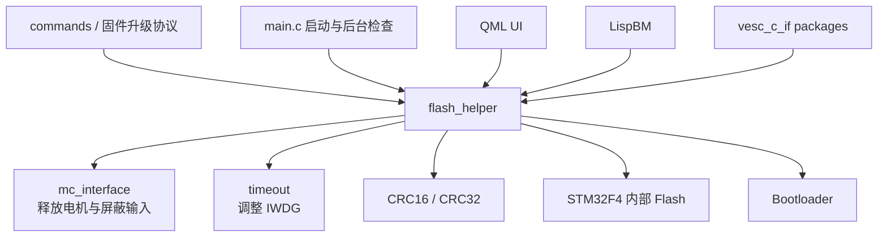

## 2. 公开接口分类

### 2.1 固件升级

| 接口 | 作用 |
|---|---|
| `flash_helper_erase_new_app(size)` | 按新固件大小擦除 Sector 8~10 中需要的扇区 |
| `flash_helper_write_new_app_data(offset,data,len)` | 将升级数据写入 Sector 8 起始的暂存区 |
| `flash_helper_erase_bootloader()` | 擦除 Sector 11 |
| `flash_helper_jump_to_bootloader()` | 停止关键外设、关闭 RTOS/中断并跳到 `0x080E0000` |

### 2.2 QML/Lisp 代码区

| 接口 | 作用 |
|---|---|
| `flash_helper_erase_code(ind)` | 擦除指定代码区 |
| `flash_helper_write_code(ind,offset,data,len)` | 按偏移写入指定代码区 |
| `flash_helper_code_data(ind)` | 校验通过后返回 payload 指针 |
| `flash_helper_code_data_raw(ind)` | 不校验，直接返回扇区起始地址 |
| `flash_helper_code_size(ind)` | 校验通过后返回 payload 长度 |
| `flash_helper_code_flags(ind)` | 校验通过后返回头部 flags |

代码区索引：

```c
#define CODE_IND_QML        0
#define CODE_IND_LISP       1
#define CODE_IND_LISP_CONST 2
```

### 2.3 完整性与地址查询

| 接口 | 作用 |
|---|---|
| `flash_helper_verify_flash_memory()` | 启动时全量验证或首次生成应用 CRC |
| `flash_helper_verify_flash_memory_chunk()` | 运行期按 1 KiB 分块验证应用 |
| `flash_helper_app_crc()` | 读取固件末尾保存的 CRC32 |
| `flash_helper_get_sector_address()` | 将 STM32 标准库扇区编号转换为地址 |

### 2.4 Package NVM

| 接口 | 作用 |
|---|---|
| `flash_helper_read_nvm()` | 从 NVM 区读取字节 |
| `flash_helper_write_nvm()` | 向 NVM 区逐字节编程 |
| `flash_helper_wipe_nvm()` | 擦除整个 NVM 扇区 |

## 3. STM32F4 Flash 物理布局

当前代码按 STM32F4 1 MiB、12 扇区布局硬编码：

| Sector | 起始地址 | 大小 |
|---:|---:|---:|
| 0 | `0x08000000` | 16 KiB |
| 1 | `0x08004000` | 16 KiB |
| 2 | `0x08008000` | 16 KiB |
| 3 | `0x0800C000` | 16 KiB |
| 4 | `0x08010000` | 64 KiB |
| 5 | `0x08020000` | 128 KiB |
| 6 | `0x08040000` | 128 KiB |
| 7 | `0x08060000` | 128 KiB |
| 8 | `0x08080000` | 128 KiB |
| 9 | `0x080A0000` | 128 KiB |
| 10 | `0x080C0000` | 128 KiB |
| 11 | `0x080E0000` | 128 KiB |

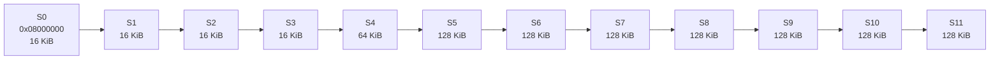

若目标 MCU 的 Flash 容量或扇区结构不同，这些地址不可直接复用。

## 4. 逻辑分区关系

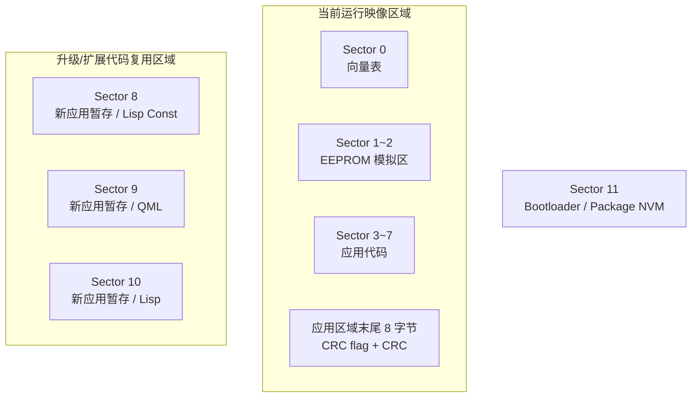

关键重叠关系：

- 新应用暂存区使用 Sector 8、9、10；
- 平时 Sector 8 是 Lisp 常量区，Sector 9 是 QML，Sector 10 是 Lisp；
- 下载新固件会覆盖这些扩展代码区；
- Sector 11 同时被 `BOOTLOADER_BASE` 和 package NVM 定义使用。

这些不是独立的物理分区，而是同一扇区的不同用途。

## 5. 当前应用 CRC 覆盖范围

宏定义：

```text
VECTOR_TABLE_ADDRESS = 0x08000000
VECTOR_TABLE_SIZE    = 16 KiB
APP_START_ADDRESS    = 0x0800C000
APP_MAX_SIZE         = 512 KiB - 8
APP_SIZE             = APP_MAX_SIZE - 16 KiB - 32 KiB
```

CRC 按逻辑拼接以下区域：

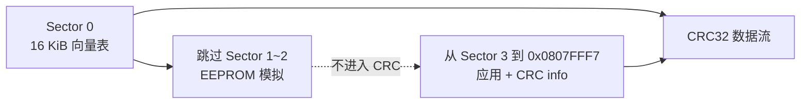

虽然物理地址中间存在 EEPROM 模拟区，CRC 外设接收到的是“向量表数据紧接应用数据”的逻辑流。

## 6. `.crcinfo` 结构

```c
typedef struct {
    uint32_t crc_flag;
    uint32_t crc;
} crc_info_t;
```

常量 `crc_info` 被链接到 `.crcinfo` 节，初始内容均为 `0xFFFFFFFF`：


链接脚本应把该节放到当前应用 CRC 范围的最后 8 字节：

- `APP_CRC_WAS_CALCULATED_FLAG_ADDRESS`：倒数第 8 字节；
- `APP_CRC_ADDRESS`：倒数第 4 字节。

Flash 擦除态为全 1，使固件首次启动时仍能把 flag 和 CRC 从 1 编程为 0/任意位组合，而无需擦除运行映像。

## 7. 首次启动生成 CRC

当 flag 不是 `0x00000000` 时，代码认为 CRC 尚未写入：

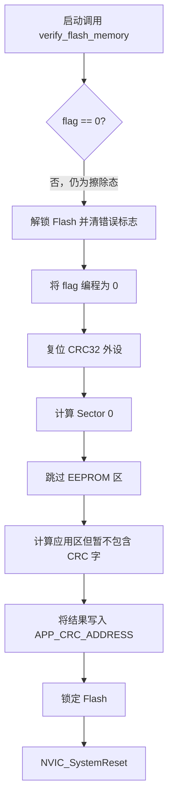

CRC 字的选择使下一次对“向量表 + 完整应用区（包括 CRC 字）”计算时余数为 0。写入完成后必须复位，下一次启动才走验证分支。

如果 flag 或 CRC 编程失败，函数返回 `FAULT_CODE_FLASH_CORRUPTION`，`main.c` 会进入安全闪灯循环。

## 8. 后续启动全量验证

当 flag 已经为 0：

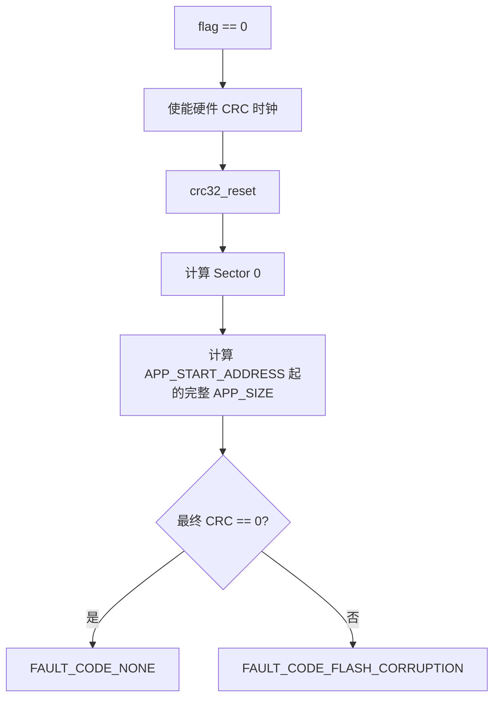

它不会重新写 CRC，只验证零余数。EEPROM 模拟区变化不会影响固件 CRC。

## 9. 运行期分块验证

`flash_helper_verify_flash_memory_chunk()` 使用静态 `index`，每次处理 1024 字节：

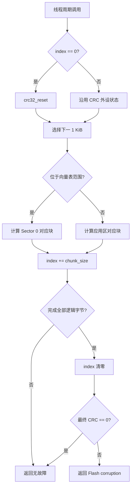

`main.c` 的低优先级 Flash 检查线程在创建时使能 CRC 外设时钟，并在每块之间 sleep 6 ms。分块函数自身只在一轮开始时复位 CRC，不负责使能 CRC 时钟。

总验证时间约等于“块数 × 至少 6 ms”，实际还受调度影响；它用较低实时开销换取持续完整性监控。

## 10. 新固件暂存区

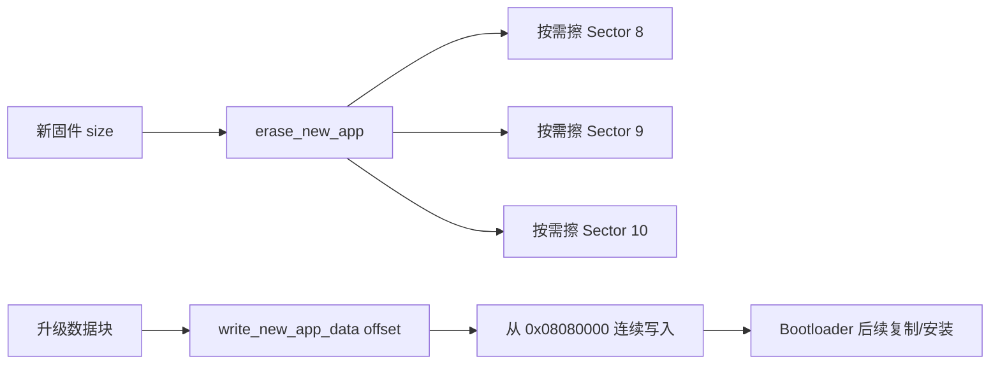

`NEW_APP_BASE=8`，最多使用 3 个 128 KiB 扇区，共 384 KiB。擦除数量根据 `new_app_size` 与每个扇区起始地址比较决定。

擦除前若启用 LispBM，会调用 `lispif_stop()`，因为升级暂存区与 Lisp/Lisp Const 区重叠。

当前接口没有在 `flash_helper_erase_new_app()` 或 `flash_helper_write_new_app_data()` 中显式验证：

- `new_app_size <= 384 KiB`；
- `offset + len` 不越过 Sector 10；
- 数据块与声明的新应用大小一致。

这些边界必须由调用方保证。

## 11. 通用擦除安全流程

`erase_sector()` 是代码区、Bootloader 和 NVM wipe 的公共底层入口：

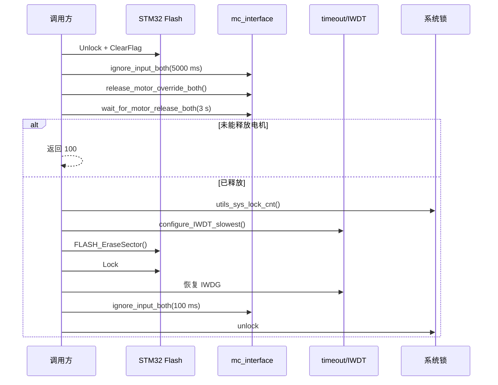

设计意图是先消除电机输出，再避免擦除期间被调度或看门狗复位打断。

需要注意：若等待电机释放失败，当前实现直接返回 `100`，没有重新 `FLASH_Lock()`，也没有把 5000 ms 输入屏蔽缩短。这是异常路径资源恢复不完整的问题。

## 12. 通用写入安全流程

`write_data()` 与擦除流程相似，但逐字节调用 `FLASH_ProgramByte()`：

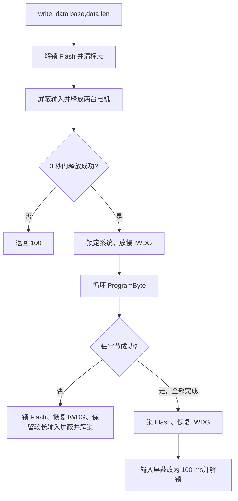

逐字节编程通用但速度较慢。Flash 编程只能把位从 1 写成 0，不能在未擦除时把 0 恢复为 1。更新已有内容前通常必须擦除整个扇区。

和擦除函数一样，电机释放失败路径没有重新锁定 Flash。

## 13. 擦除电压范围

```c
#define ERASE_VOLTAGE_RANGE \
    ((PWR->CSR & PWR_CSR_PVDO) ? VoltageRange_2 : VoltageRange_3)
```

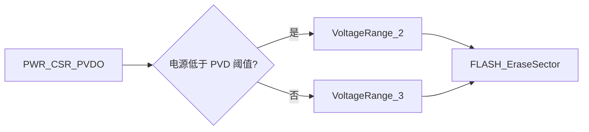

擦除电压范围会影响 Flash 并行度和允许电压。该逻辑依赖 PVD 已正确配置，且供电在整个擦除期间稳定。

## 14. QML/Lisp 代码区映射

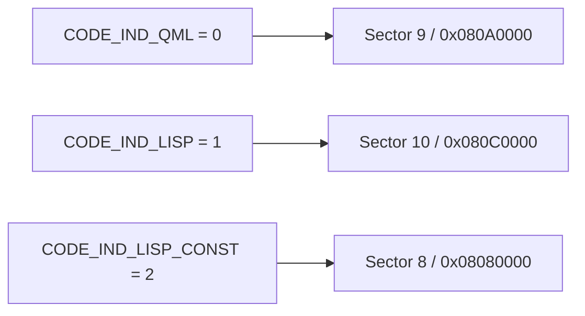

映射由两个数组实现：

```text
code_sectors = { QMLUI_BASE, LISP_BASE, LISP_CONST_BASE }
code_checks  = 每个代码区的校验缓存
```

当前代码没有检查 `ind` 是否位于 0~2。非法索引会越界访问 `code_sectors` 和 `code_checks`，调用方必须严格使用头文件定义的三个索引。

## 15. 代码区数据格式

每个 128 KiB 代码区采用 8 字节头部：

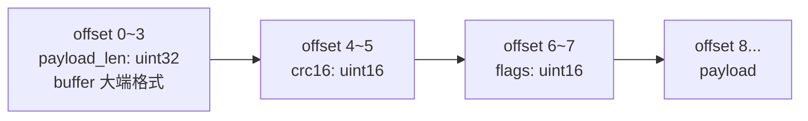

实际解析步骤：

1. `buffer_get_uint32()` 读取长度，索引变为 4；
2. `buffer_get_uint16()` 读取保存的 CRC，索引变为 6；
3. 从 offset 6 开始计算 `payload_len + 2` 字节 CRC，即 flags + payload；
4. 校验通过后 `flash_helper_code_data()` 返回 base + 8；
5. `flash_helper_code_flags()` 从 offset 6 读取 flags。

CRC 不覆盖长度字段和 CRC 字段本身，但覆盖 flags 与 payload。

## 16. 代码区懒校验与缓存

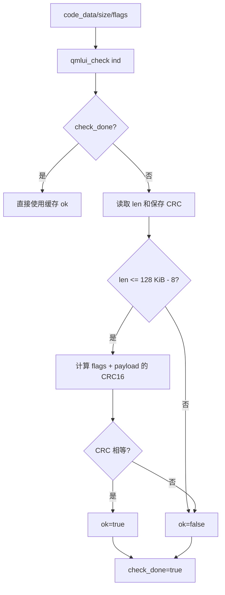

擦除或写入代码区时会清除对应缓存，使下一次读取重新校验。直接通过 `flash_helper_code_data_raw()` 或其他指针修改 Flash 不会自动刷新缓存。

函数名 `qmlui_check()` 虽然包含 QMLUI，但实际同时用于 QML、Lisp 和 Lisp 常量区。

## 17. 代码区擦除

`flash_helper_erase_code(ind)`：

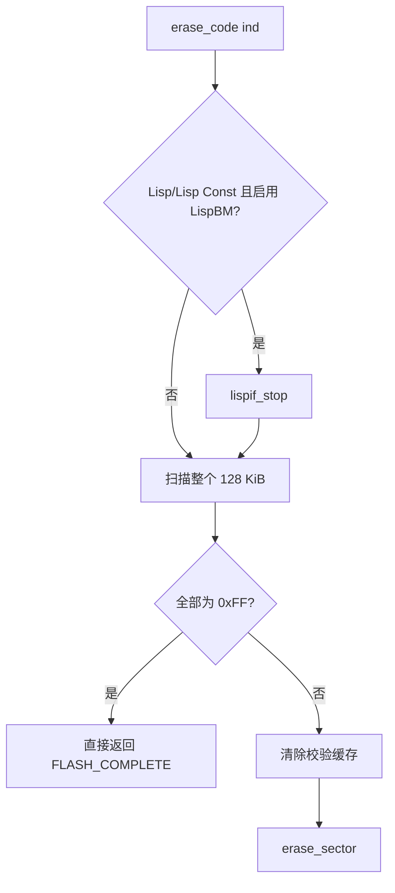

先扫描是否已有数据可避免不必要擦除和 Flash 寿命消耗，但扫描固定 128 KiB，调用耗时与实际 payload 长度无关。

## 18. Bootloader 跳转流程

Bootloader 固定在 `0x080E0000`：

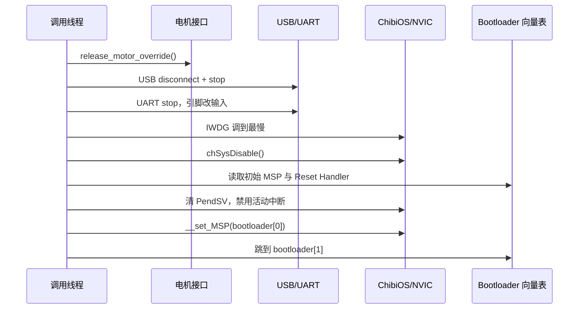

该函数不会返回。它没有验证 Bootloader 向量表是否为空、栈地址是否位于 RAM、入口地址是否位于有效 Flash。Sector 11 被擦除或损坏时调用可能跳到无效地址。

它只调用单电机版本 `mc_interface_release_motor_override()`，不像擦写函数那样显式释放两台电机。双电机系统应确认调用上下文选中了正确电机，或者在上层先关闭两台电机。

## 19. 中断清理细节

跳转前代码：

- 清除 PendSV pending；
- 对 8 组 NVIC寄存器执行 `ICER[i] = IABR[i]`；
- 设置 Bootloader 初始 MSP；
- 直接调用 Reset Handler。

`IABR` 表示当前 active 中断，而不是所有 enabled 中断。该写法不等同于把 `ICER[i]` 全写 1，也没有显式清除全部 NVIC pending 位、SysTick 或重设 `SCB->VTOR`。Bootloader 必须足够早地重建自身中断环境。

## 20. Sector 地址查询

`flash_helper_get_sector_address(fsector)` 在线性表中查找 STM32 标准库的 `FLASH_Sector_n` 常量：

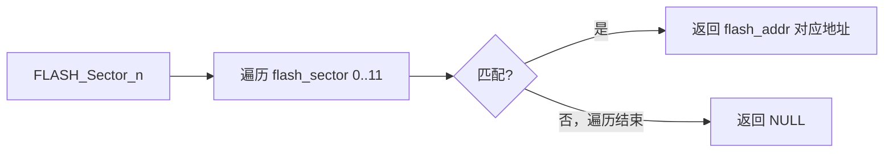

参数不是普通数字 0~11，而是 STM32 标准库编码后的扇区常量。

## 21. Package NVM 接口

```c
#define VESC_IF_NVM_REGION_SIZE \
    (ADDR_FLASH_SECTOR_11 - ADDR_FLASH_SECTOR_10)
```

该表达式结果是 128 KiB，但读写基址使用 `ADDR_FLASH_SECTOR_11`：


### 21.1 读取

`flash_helper_read_nvm()` 只做范围判断，然后 `memcpy()`。

### 21.2 写入

`flash_helper_write_nvm()` 调用通用 `write_data()`，不会自动擦除扇区。它适合向擦除态字节写入一次，或继续把位从 1 清为 0；不支持任意覆盖更新。

### 21.3 擦除

`flash_helper_wipe_nvm()` 擦除整个 Sector 11。

> 当前 Sector 11 同时是 Bootloader 区。调用 `write_nvm()` 或 `wipe_nvm()` 可能修改或彻底擦除 Bootloader。除非具体产品明确不使用 Sector 11 Bootloader，或者有另行分区约定，否则 package NVM 接口与 Bootloader 存在直接冲突。

## 22. 边界检查特点

NVM 接口检查：

```c
if ((address + len) > VESC_IF_NVM_REGION_SIZE) {
    return false;
}
```

但其他写入接口没有等价检查。并且 `address + len` 使用无符号整数，理论上存在加法溢出绕过检查的可能。更稳健的形式是先验证：

```text
address <= region_size
len <= region_size - address
```

这是代码审查结论，本文未修改实现。

## 23. 与 main.c 的关系

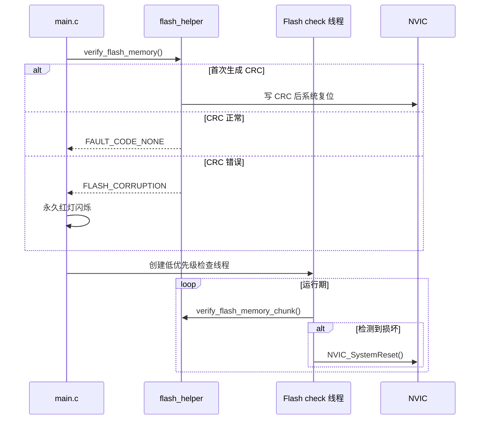

配置复位时，`main.c` 还会调用 `erase_code()` 清除 Lisp、Lisp Const 和 QML。

## 24. 与电机和看门狗的关系

```mermaid
flowchart TD
    FLASHOP[Flash 擦除/写入请求] --> IGNORE[屏蔽两台电机输入 5 s]
    IGNORE --> RELEASE[强制释放两台电机]
    RELEASE --> WAIT{3 s 内关闭?}
    WAIT -->|否| ABORT[返回错误 100]
    WAIT -->|是| LOCK[系统锁定]
    LOCK --> SLOW[将 IWDG 调到最慢]
    SLOW --> PROGRAM[执行擦除/编程]
    PROGRAM --> RESTORE[恢复 IWDG、锁 Flash、解锁系统]
    RESTORE --> HOLD[再屏蔽输入 100 ms]
```

Flash 擦写可能让 CPU 无法从同一 Bank 取指，并持续远长于普通实时控制周期。先停止电机是必要的安全条件。

## 25. 返回值语义

擦写函数大多返回 `uint16_t`：

- `FLASH_COMPLETE`：操作成功；
- STM32 标准库的其他 Flash 状态：擦除/编程失败；
- 自定义值 `100`：3 秒内未确认电机释放。

`verify_flash_memory*()` 返回 `FAULT_CODE_NONE` 或 `FAULT_CODE_FLASH_CORRUPTION`，不是 Flash 标准库状态。

NVM 接口将底层状态转换成 `bool`。

调用方不应把这三类返回值混为同一种错误枚举。

## 26. 并发与调用上下文

- 擦除和写入函数会 sleep 等待电机释放，必须在线程上下文调用；
- 不能从 ISR 调用；
- `utils_sys_lock_cnt()` 期间不应执行依赖调度的操作；
- `code_checks[]` 没有互斥保护，并发读写同一代码区可能得到过期或中间状态；
- 分块 CRC 使用单个静态 `index` 和硬件 CRC 累加状态，只允许一个调用序列；
- 在后台 CRC 一轮尚未结束时，其他代码使用同一 CRC32 外设会破坏结果，除非外部进行协调。

```mermaid
flowchart TD
    CALL[调用 Flash API] --> CTX{当前上下文}
    CTX -->|ISR| BAD[禁止：可能 sleep/锁系统/长耗时]
    CTX -->|普通线程| SERIAL{是否与其他 Flash/CRC 操作串行?}
    SERIAL -->|否| RISK[缓存、CRC 外设或 Flash 状态冲突]
    SERIAL -->|是| OK[可执行，仍需先确保供电和电机安全]
```

## 27. 已识别的高风险点

### 27.1 Bootloader 与 NVM 重叠

Sector 11 同时用于 Bootloader 和 package NVM，`wipe_nvm()` 会擦除 Bootloader。

### 27.2 缺少代码区索引检查

`ind` 非 0~2 时会越界访问静态数组。

### 27.3 缺少升级区和代码区写边界检查

`offset + len` 可以越过目标扇区，甚至写入其他分区。

### 27.4 电机释放失败时 Flash 保持解锁

通用擦写路径在 `wait_for_motor_release_both()` 失败后直接返回，没有 `FLASH_Lock()`。

### 27.5 NVM 不支持普通覆盖写

未擦除直接写只能执行 1→0 位变化，无法完成常规键值更新。

### 27.6 Bootloader 跳转缺少向量有效性检查

空白/损坏 Sector 11 会产生无效 MSP 和入口地址。

### 27.7 分块 CRC 依赖独占硬件 CRC 状态

其他模块在中间调用 `crc32_reset()` 或 `crc32()` 会使后台验证误报或漏报。

这些是当前实现约束和审查发现，不代表本文已修改代码。

## 28. 建议的安全校验层次

```mermaid
flowchart TD
    A[收到擦写请求] --> B[验证区域类型和合法索引]
    B --> C[使用减法形式验证 offset/len]
    C --> D[拒绝 Bootloader/NVM 重叠操作]
    D --> E[验证电源电压与电机已释放]
    E --> F[串行化 Flash 与 CRC 外设访问]
    F --> G[擦除目标扇区]
    G --> H[写入并逐块检查返回值]
    H --> I[读取回校验 CRC]
    I --> J[恢复 Flash 锁、IWDG 和输入状态]
```

如果后续修复代码，异常路径也应统一执行清理，避免 Flash 解锁、看门狗模式或输入屏蔽状态残留。

## 29. 常见问题定位

### 29.1 首次刷写后设备自动重启一次

可能是正常行为：CRC flag 为空时，固件首次启动写入 flag 和 CRC，然后主动 `NVIC_SystemReset()`。

### 29.2 启动后持续红灯闪烁

表示启动全量 CRC 返回 `FAULT_CODE_FLASH_CORRUPTION`。检查：

- `.crcinfo` 是否位于期望的最后 8 字节；
- 链接脚本是否匹配该固件版本；
- EEPROM 模拟区和应用起始地址是否一致；
- 固件是否完整写入；
- CRC 字是否在首次启动时成功编程。

### 29.3 写代码区后 `code_data()` 返回 NULL

检查头部长度、CRC16、flags/payload 布局以及是否写齐全部数据。CRC 覆盖的是 flags + payload。

### 29.4 Flash 操作返回 100

表示电机在 3 秒内未被确认释放。检查电机状态、双电机选择、控制线程是否持续重新提交命令，以及 `mc_interface_wait_for_motor_release_both()` 的条件。

### 29.5 NVM 第二次写入失败或数据异常

可能是未擦除情况下尝试将位从 0 改回 1。当前接口不是带磨损均衡的 EEPROM 仿真。

### 29.6 跳转 Bootloader 后死机

检查 Sector 11 是否存在有效向量表、是否被 NVM 操作覆盖、初始 MSP 是否在 RAM、Reset Handler 是否为 Thumb 地址，以及 Bootloader 是否重新初始化中断和时钟。

## 30. 推荐阅读顺序

```mermaid
flowchart TB
    A[flash_helper.h<br/>接口和代码区索引] --> B[地址与分区宏]
    B --> C[crc_info 与链接脚本 .crcinfo]
    C --> D[verify_flash_memory<br/>首次和后续启动]
    D --> E[verify_flash_memory_chunk]
    E --> F[erase_sector / write_data<br/>安全公共路径]
    F --> G[新应用升级接口]
    G --> H[代码区格式与 qmlui_check]
    H --> I[jump_to_bootloader]
    I --> J[Package NVM 与 Sector 11 冲突]
```

同时建议对照：

- `ld_eeprom_emu.ld`：应用和 `.crcinfo` 实际链接地址；
- `main.c`：启动及后台校验调用；
- `commands.c`：固件/QML/Lisp 下载协议；
- Bootloader 工程：新应用暂存区的安装流程；
- `conf_general.c`：EEPROM 模拟区使用。

## 31. 小结

`flash_helper` 把 STM32F4 内部 Flash 划分为当前应用、升级暂存、QML/Lisp、Bootloader 和 package NVM 等用途，并在擦写前协调电机与看门狗。当前应用通过 CRC32 零余数机制验证，扩展代码区通过“长度 + CRC16 + flags + payload”格式懒校验。

理解该模块最重要的是掌握物理扇区复用关系和异常路径：Sector 8~10 在升级暂存与扩展代码之间复用，Sector 11 在 Bootloader 与 NVM 之间发生直接重叠；写接口本身缺少多项边界检查。任何上层调用都必须先验证索引、范围、供电、电机状态和目标分区，不能把这些接口当作普通文件读写 API。
