# `foc_math.c` 模块设计流程图

## 1. 文档范围

本文档描述 `motor/foc_math.c` 中各算法函数的设计流程，流程图使用 Mermaid 表示。接口和共享状态结构定义于 `motor/foc_math.h`，函数由 `motor/mcpwm_foc.c` 的初始化流程、FOC 实时控制流程和 PID 控制线程调用。

该模块不拥有独立任务或中断，主要承担以下计算职责：

- 电机磁链观测与转子电角度估算；
- PLL 角度跟踪和速度估算；
- 空间矢量调制 SVM；
- 位置环、速度环和弱磁控制；
- 编码器、霍尔传感器与无感观测角度的切换或融合；
- HFI 角度修正和 FOC 常用参数预计算。

## 2. 模块总体设计

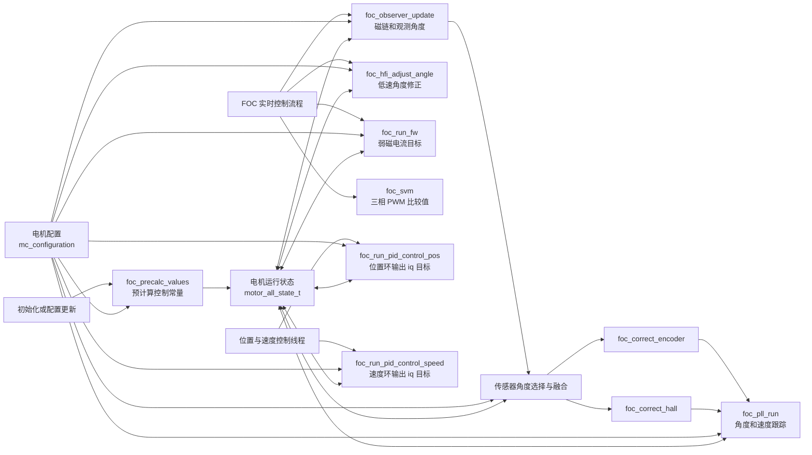

> 上图表示职责和主要数据关系，不表示每次控制周期一定按图中所有节点顺序执行。实际调用由 `mcpwm_foc.c` 根据硬件配置、传感器模式和控制模式选择。

### 2.1 函数接口摘要

| 函数 | 主要输入 | 输出或关键状态更新 | 设计目的 |
|---|---|---|---|
| `foc_observer_update` | αβ 电压、电流、`dt` | `observer_state`、可选 `phase` | 估算磁链矢量和转子电角度 |
| `foc_pll_run` | 测量角度、`dt` | `phase_var`、`speed_var` | 连续跟踪角度并估算电角速度 |
| `foc_svm` | αβ 调制量、最大调制率、PWM 周期 | A/B/C 相比较值、扇区 | 将 αβ 电压矢量映射为三相 PWM |
| `foc_run_pid_control_pos` | 位置目标、当前位置、`dt` | `m_iq_set` 和位置 PID 状态 | 位置误差到 q 轴电流目标 |
| `foc_run_pid_control_speed` | 速度目标、速度估计、`dt` | `m_iq_set` 和速度 PID 状态 | 速度误差到 q 轴电流目标 |
| `foc_correct_encoder` | 观测角、编码器角、转速 | `m_using_encoder`、选定角度 | 带迟滞地切换编码器和无感角度 |
| `foc_correct_hall` | 观测角、霍尔值、`dt` | 霍尔插值状态、融合角度 | 霍尔角重建、限速及过渡融合 |
| `foc_run_fw` | 运行状态、占空比、q 轴电流误差 | `m_i_fw_set` | 高占空比区域生成弱磁电流目标 |
| `foc_hfi_adjust_angle` | HFI 角误差、`dt` | HFI 角度、双积分器、就绪标志 | 通过误差反馈修正低速估算角度 |
| `foc_precalc_values` | 电机参数、PWM 配置 | `p_*` 预计算字段、初始磁链 | 降低实时控制路径的重复计算量 |

## 3. 磁链观测器 `foc_observer_update`

### 3.1 主流程

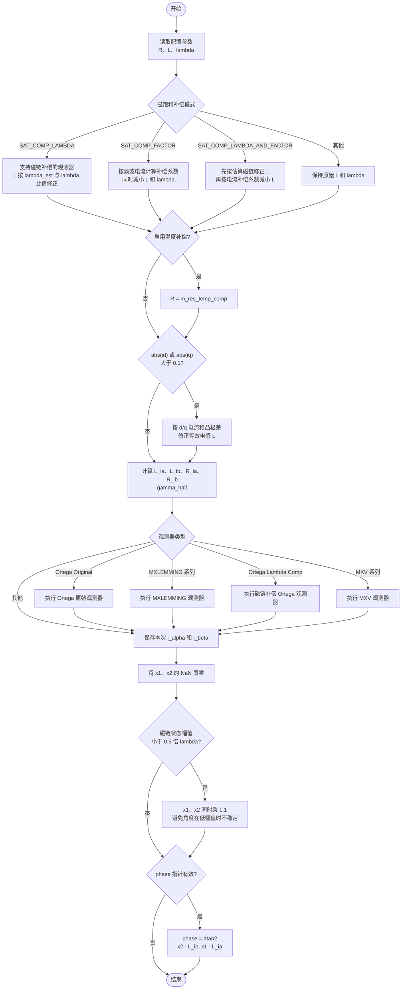

### 3.2 各观测器分支

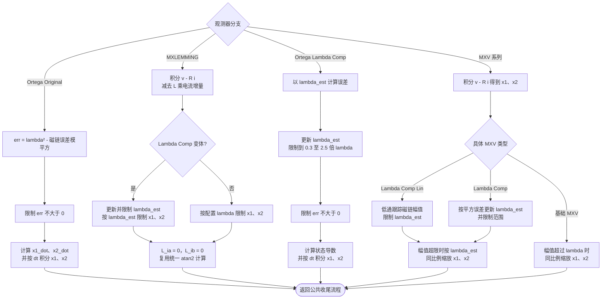

观测器的核心输出状态是 `x1`、`x2` 和 `lambda_est`。其中 `i_alpha_last`、`i_beta_last` 仅供 MXLEMMING 离散电流增量项使用；最终角度由修正后的 αβ 磁链矢量计算。

## 4. PLL 跟踪 `foc_pll_run`

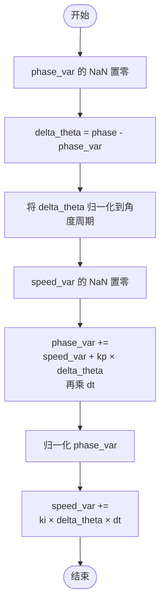

PLL 的比例通道直接修正相位推进速度，积分通道形成连续的电角速度估计。

## 5. 空间矢量调制 `foc_svm`

### 5.1 扇区判定

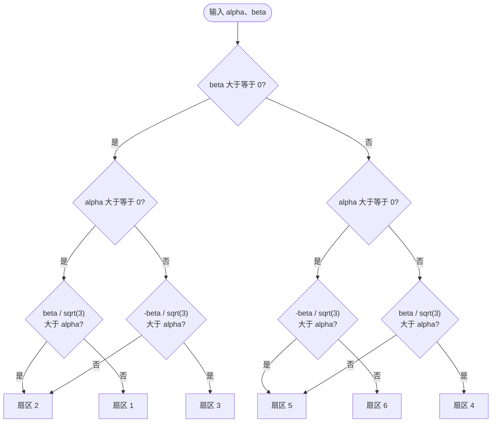

### 5.2 PWM 比较值生成

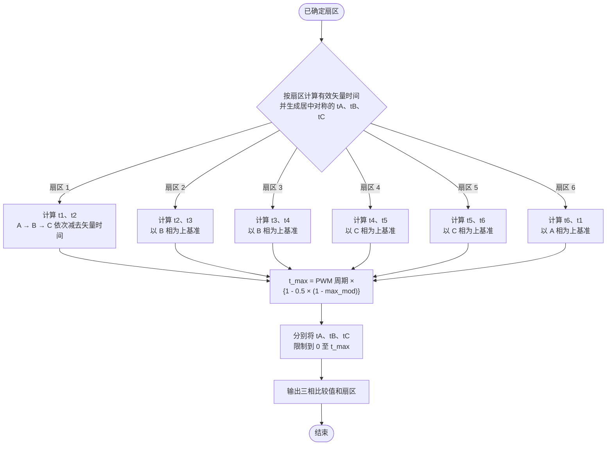

输入调制矢量的幅值应不超过 `sqrt(3) / 2`，即约 `0.866`，以避免过调制。`max_mod` 还会进一步限制三相比较值的上界。

## 6. 位置 PID `foc_run_pid_control_pos`

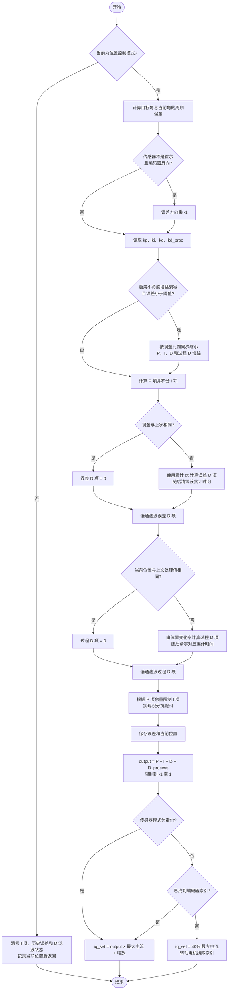

位置环同时包含“误差微分”和“过程量微分”两路 D 项。累计 `dt` 的设计用于处理低速时位置量化导致的多个控制周期读数不变问题。

## 7. 速度 PID `foc_run_pid_control_speed`

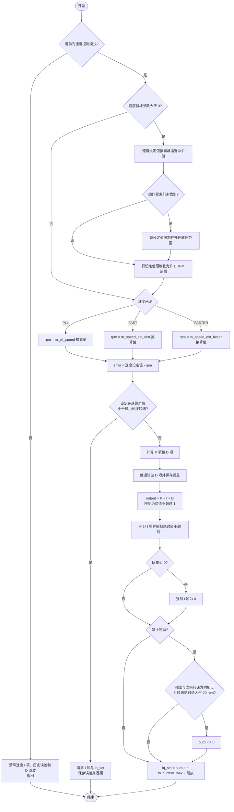

## 8. 编码器与观测角切换 `foc_correct_encoder`

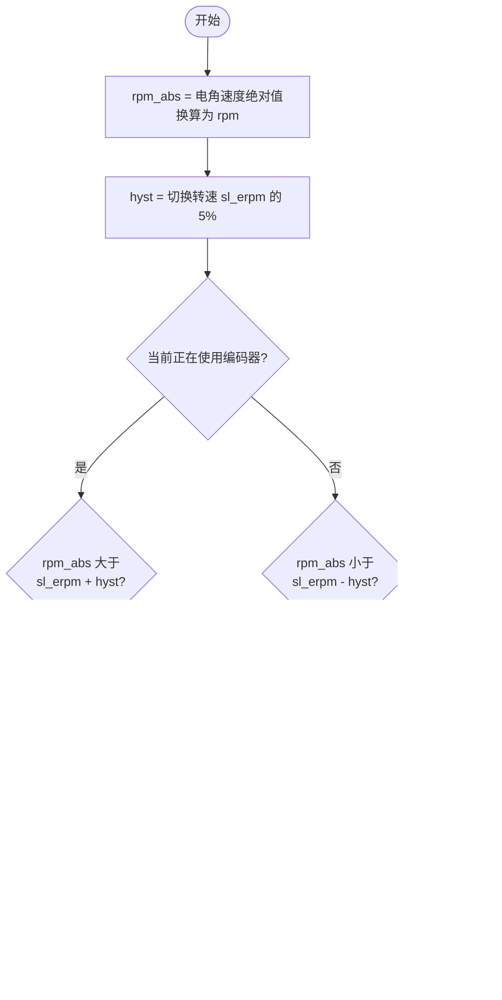

上下两个不同阈值形成迟滞区，避免转速在切换点附近波动时角度来源频繁跳变。

## 9. 霍尔角修正与融合 `foc_correct_hall`

### 9.1 霍尔状态更新

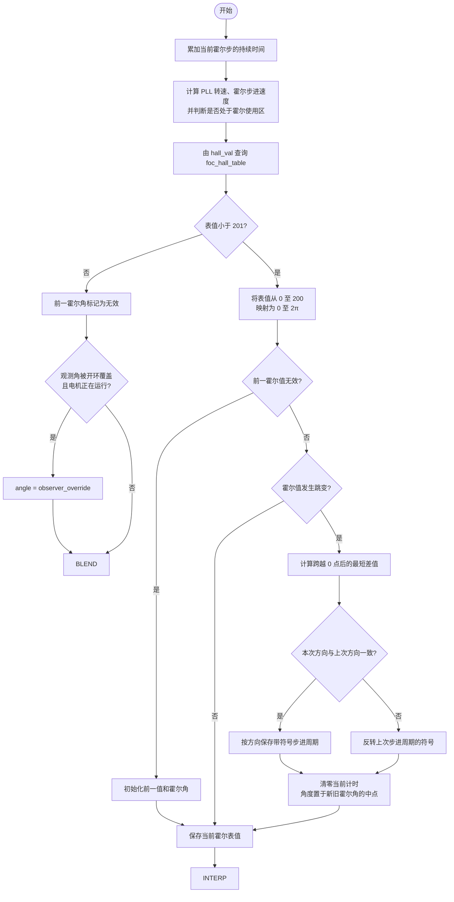

### 9.2 插值、变化率限制与过渡融合

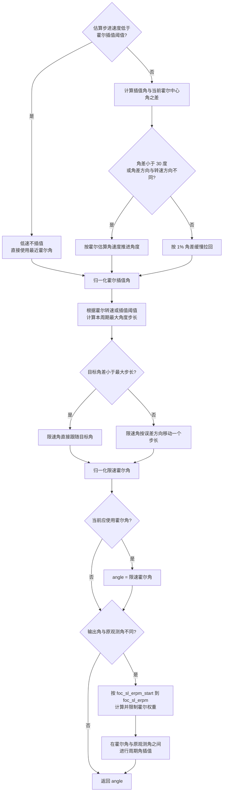

霍尔路径包含三层平滑机制：扇区内角度插值、每周期角度变化率限制，以及切换转速区间内与观测角的加权融合。无效霍尔读数不会更新霍尔角，并允许在满足条件时退回开环覆盖角度。

## 10. 弱磁控制 `foc_run_fw`

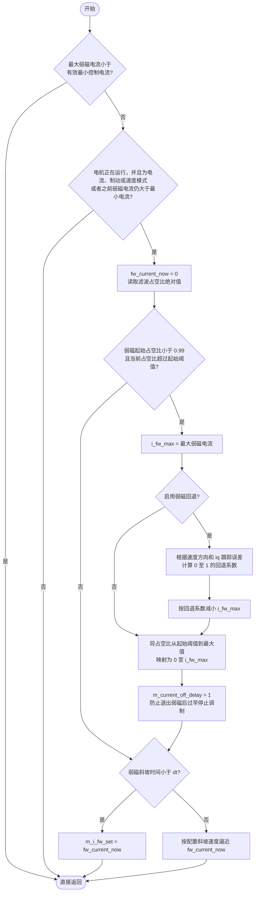

回退逻辑在 `iq` 超过目标且可能挤占 q 轴电压裕量时降低弱磁请求，用于减小过度弱磁导致的失控风险。

## 11. HFI 角度修正 `foc_hfi_adjust_angle`

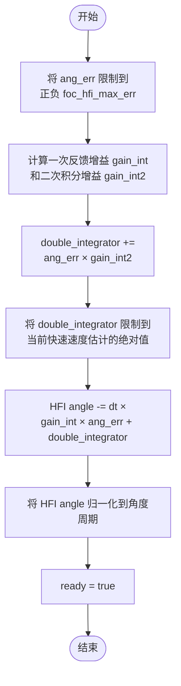

该函数以受限角误差驱动比例反馈和双积分状态，输出连续的 HFI 角度；`ready` 表示角度修正链路已产生有效更新。

## 12. 参数预计算 `foc_precalc_values`

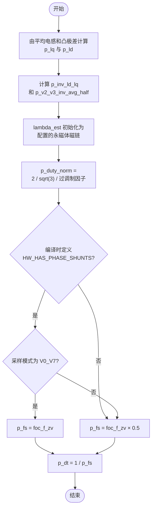

此函数在电机初始化及配置更新后执行。`p_fs` 的取值取决于相分流硬件能力和控制采样模式，`p_dt` 则作为对应采样周期供实时算法使用。

## 13. 关键状态与约束

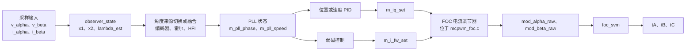

- 角度均为电角度，涉及周期差值时必须使用角度归一化或周期角插值函数。
- 速度状态主要以电角速度表示，需要通过 `RADPS2RPM_f` 才得到代码中用于阈值判断的 ERPM/rpm 数值。
- `motor_all_state_t` 中 PID、霍尔、HFI 和观测器历史量会跨调用保存，不能把这些函数视为无状态纯函数。
- `dt` 必须与调用周期一致；PLL、观测器、PID 微积分项、霍尔插值、弱磁斜坡和 HFI 修正均直接依赖它。
- SVM 输出在写入硬件前已经按 `max_mod` 限幅，但调用方仍需保证输入调制矢量满足其幅值约束。
