# bldc/imu 目录各层级说明

本文按层级说明 `bldc/imu` 的模块组成、数据流、传感器驱动、姿态融合算法、硬件总线适配及其在当前工程中的调用关系。文档重点是目录架构与协作方式，不替代各芯片数据手册或 Fusion 算法原始文档。

## 1. 目录整体定位

`bldc/imu` 将多种惯性传感器统一为相同的加速度、角速度、磁场、四元数和欧拉角接口。上层应用无需直接知道具体使用 MPU9x50、ICM20948、BMI160 还是 LSM6DS3。

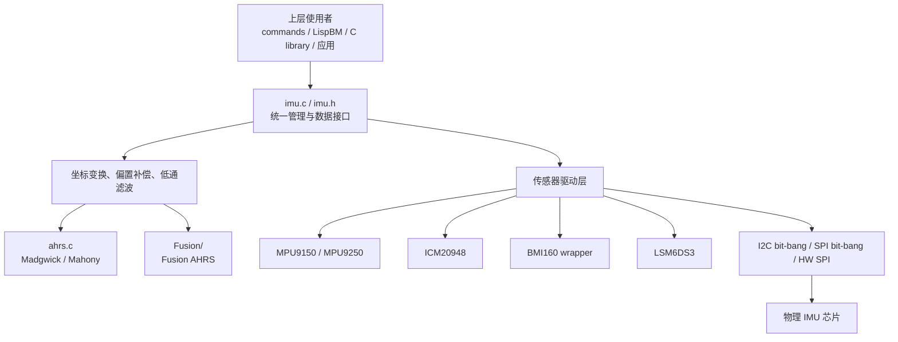

该目录解决四类问题：

- 不同 IMU 芯片和总线的初始化、采样和错误恢复；
- 不同板卡安装方向和用户旋转角的统一；
- 原始数据的偏置补偿、低通滤波和姿态融合；
- 向通信、LispBM 和应用层提供统一读取接口。

## 2. 目录层级划分

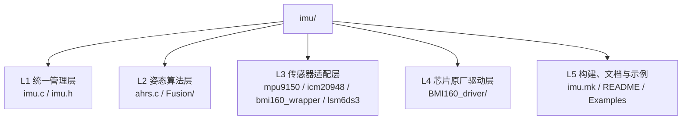

| 层级 | 文件 | 主要职责 |
|---|---|---|
| 统一管理层 | `imu.c/.h` | 选择传感器、管理生命周期、处理采样、融合姿态并对外输出 |
| 姿态算法层 | `ahrs.c/.h` | 工程内的 Madgwick/Mahony IMU 融合实现 |
| Fusion 算法层 | `Fusion/*` | 第三方 C99 AHRS、偏置估计、罗盘、类型和校准工具 |
| 芯片适配层 | `mpu9150`、`icm20948`、`bmi160_wrapper`、`lsm6ds3` | 把芯片寄存器和线程采样统一为回调 |
| 原厂驱动层 | `BMI160_driver/*` | Bosch BMI160 通用寄存器/FIFO/配置 API |
| 构建层 | `imu.mk` | 汇总实际编译源文件和 include 路径 |

## 3. 构建组成

`imu.mk` 将以下实现加入固件：

- `imu.c`、`ahrs.c`；
- MPU9150/9250、ICM20948、BMI160 wrapper、LSM6DS3；
- Bosch BMI160 驱动；
- Fusion 的 AHRS、Bias 和 Compass 模块。

`Fusion/Examples`、README 和测试性示例不在固件源文件列表中。

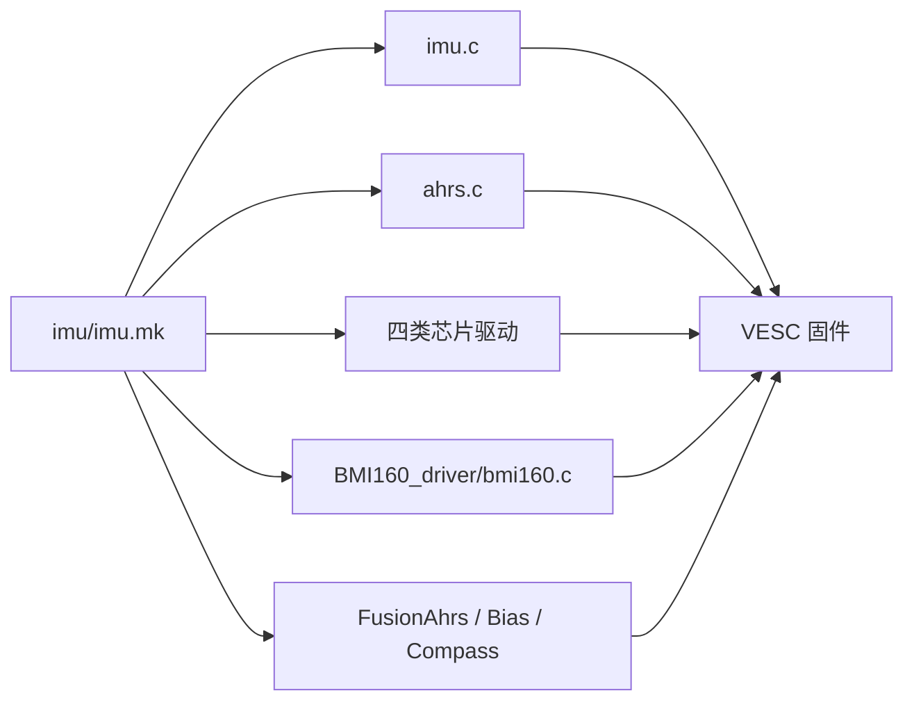

## 4. L1：统一管理层 `imu.c/.h`

这一层是整个目录的门面。主要状态包括：

| 状态 | 作用 |
|---|---|
| `m_settings` | 当前 `imu_config` 的副本 |
| `m_accel/m_gyro/m_mag` | 经过方向、偏置和滤波处理后的三轴数据 |
| `m_att` | 工程内 AHRS 算法的姿态和四元数状态 |
| `m_fusionAhrs` | Fusion 算法状态 |
| `m_i2c_bb/m_spi_bb` | 软件 I²C、软件 SPI 总线状态 |
| `m_icm20948_state/m_bmi_state` | 驱动实例状态 |
| `m_thd_work_area` | 各传感器采样线程复用的静态工作区 |
| `imu_ready/init_time` | 启动稳定期状态 |
| 六个 `Biquad` | 加速度三轴和陀螺仪三轴软件低通滤波 |

### 4.1 公开接口分类

| 类别 | 接口 |
|---|---|
| 配置和生命周期 | `imu_init()`、`imu_stop()`、`imu_reset_orientation()` |
| 芯片显式初始化 | `imu_init_mpu9x50()`、`imu_init_icm20948()`、`imu_init_bmi160_*()`、`imu_init_lsm6ds3*()` |
| 状态 | `imu_startup_done()`、`imu_get_i2c()` |
| 姿态 | `imu_get_roll/pitch/yaw()`、`imu_get_rpy()`、`imu_get_quaternions()` |
| 传感器数据 | `imu_get_accel/gyro/mag()` |
| 坐标转换结果 | `imu_get_accel_derotated()`、`imu_get_gyro_derotated()` |
| 校准和修正 | `imu_get_calibration()`、`imu_set_yaw()` |
| 扩展回调 | `imu_set_read_callback()` |

## 5. 配置结构 `imu_config`

`imu_config` 位于 `datatypes.h`，作为应用配置的一部分。

| 字段组 | 含义 |
|---|---|
| `type` | 关闭、内部 IMU 或四种外部 IMU |
| `mode` | Madgwick、Mahony 或 Fusion Madgwick 模式 |
| `filter` | 芯片级 LOW/MEDIUM/HIGH 滤波选择 |
| `sample_rate_hz` | 目标采样率 |
| `use_magnetometer` | MPU 系列磁力计读取开关 |
| `accel_lowpass_filter_*` | 软件三轴加速度低通截止频率 |
| `gyro_lowpass_filter` | 软件陀螺仪低通截止频率 |
| `accel_confidence_decay` | 动态加速度下的置信度衰减参数 |
| `mahony_kp/ki` | Mahony 比例、积分反馈参数 |
| `madgwick_beta` | Madgwick/Fusion 增益 |
| `rot_roll/pitch/yaw` | 用户配置的传感器安装旋转 |
| `accel_offsets/gyro_offsets` | 三轴静态偏置补偿 |

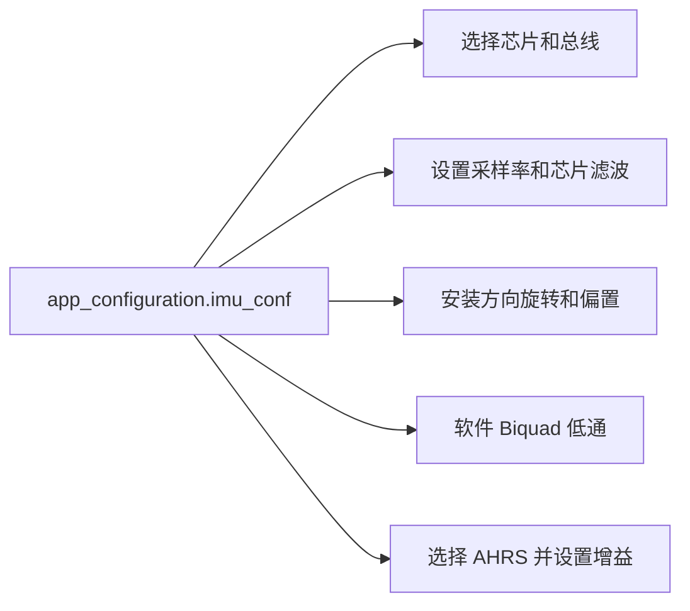

## 6. 初始化与传感器选择

`applications/app.c` 调用 `imu_init(&conf->imu_conf)`。函数先配置软件 Biquad；如果芯片类型、采样率或芯片滤波发生改变，则停止旧驱动、重置姿态，然后启动新驱动。

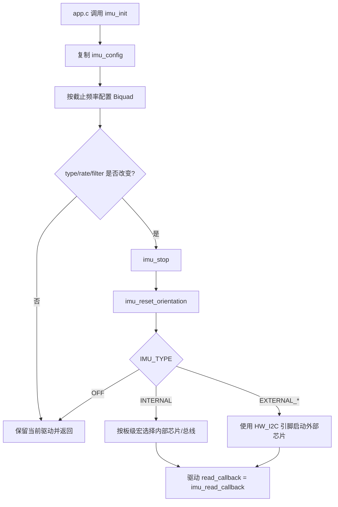

### 6.1 内部 IMU 的编译期选择

`IMU_TYPE_INTERNAL` 不是运行时扫描所有芯片，而是依据当前 `hwconf` 中定义的宏选择实现，例如：

- `MPU9X50_SDA_GPIO`；
- `ICM20948_SDA_GPIO`；
- `BMI160_SDA_GPIO` 或 `BMI160_SPI_PORT_NSS`；
- `LSM6DS3_SDA_GPIO` 或 `LSM6DS3_NSS_GPIO`；
- `LSM6DS3_HWSPI_DEV` 决定硬件 SPI 或 bit-bang SPI。

同一目标不应同时定义互相冲突的内部芯片宏，否则初始化代码会依次进入多个独立 `#ifdef` 块，后面的初始化可能停止前面的驱动。

### 6.2 外部 IMU

外部类型统一使用通信口的 `HW_I2C_SDA/SCL` 引脚。当前支持 MPU9x50、ICM20948、BMI160、LSM6DS3。

源码末尾存在重复的 `IMU_TYPE_EXTERNAL_BMI160` 分支，第二个分支不可达，属于可清理的重复代码。

## 7. L3：传感器适配层

所有芯片适配器最终遵循相似模式：初始化总线和寄存器、创建采样线程、周期读取并缩放数据、调用统一回调。

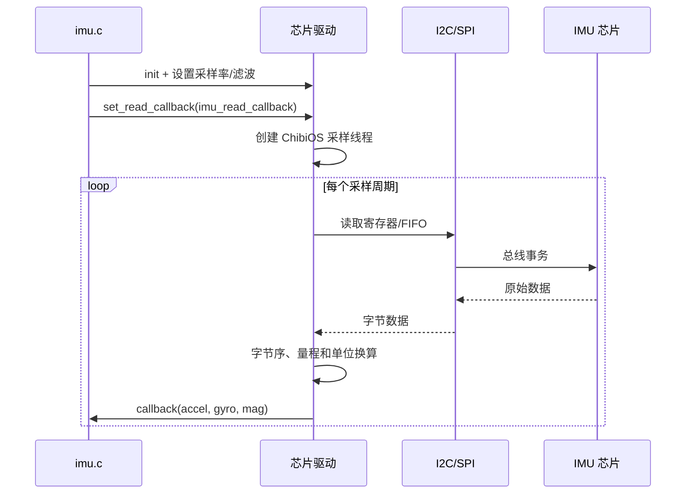

### 7.1 MPU9150/MPU9250

`mpu9150.c` 使用 bit-bang I²C，尝试两个 MPU 地址，通过 WHO_AM_I 区分 MPU9250。驱动包含：

- 独立采样线程；
- 陀螺仪偏置采样；
- 可选磁力计读取；
- 读取失败计数和自动重新初始化；
- 最近采样耗时、更新时间和磁力计更新状态；
- `mpu_status`、`mpu_read_reg` 终端命令。

### 7.2 ICM20948

`icm20948.c` 以 `ICM20948_STATE` 保存总线、地址、回调、线程停止标志和采样率。它使用 bit-bang I²C，并处理 ICM20948 分 bank 寄存器访问。

### 7.3 BMI160

`bmi160_wrapper` 是工程线程和统一回调适配层；`BMI160_driver` 是 Bosch 通用芯片驱动。二者分离后，原厂驱动不需要知道 ChibiOS 的上层姿态流程。

### 7.4 LSM6DS3

LSM6DS3 支持三种传输方式：bit-bang I²C、bit-bang SPI、ChibiOS hardware SPI。驱动根据采样率和 `IMU_FILTER` 配置寄存器滤波，并拥有独立线程和寄存器读取终端命令。

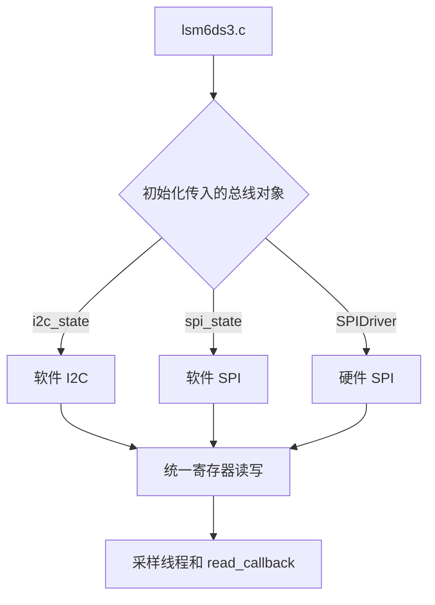

## 8. L4：总线与硬件适配

总线实现本身位于工程其他目录，IMU 层持有或引用其状态：

| 总线 | 使用场景 | 特点 |
|---|---|---|
| `i2c_bb_state` | MPU、ICM、BMI、LSM 外部或内部 I²C | 引脚灵活，占用 CPU，时序由软件实现 |
| `spi_bb_state` | BMI160/LSM6DS3 软件 SPI | 不依赖固定 SPI 外设，CPU 开销较高 |
| `SPIDriver` | LSM6DS3 硬件 SPI | 速度高，依赖板级 SPI 外设和配置 |

BMI160 通过 `user_i2c_read/write` 与 `user_spi_read/write` 把通用驱动接口映射到工程总线函数。

## 9. 统一采样处理流水线

`imu_read_callback()` 是所有驱动数据汇合点。

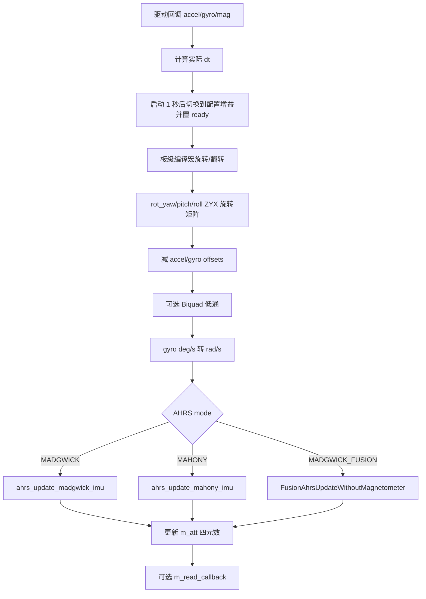

### 9.1 时间步长

`dt` 由 `timer_time_now()` 与上一采样时间计算，而不是简单使用 `1/sample_rate_hz`。这样能反映线程调度和总线读取消耗造成的实际采样间隔。

### 9.2 启动稳定期

姿态状态重置后约一秒，模块才把配置的 AHRS 参数写入算法并将 `imu_ready` 置真。稳定期使用初始化时的较高默认增益以加快收敛。

### 9.3 坐标方向

数据先经过硬件宏定义的固定安装变换，再执行配置中的 ZYX 欧拉旋转。偏置和滤波作用于变换后的工程坐标系。

## 10. L2：工程内 `ahrs.c`

`ahrs.c` 提供两个只使用陀螺仪和加速度计的姿态算法：

- Madgwick IMU 更新；
- Mahony IMU 更新。

它以 `ATTITUDE_INFO` 保存四元数、积分误差、增益和加速度置信度相关状态，并提供 roll、pitch、yaw 转换。

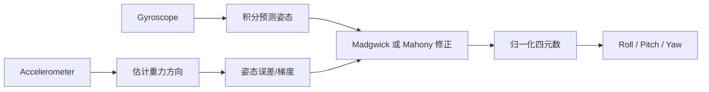

加速度计在车辆加减速和振动时不再只表示重力，因此源码使用置信度机制降低动态加速度对姿态校正的影响。

## 11. L2：`Fusion` 目录

Fusion 是独立的 ANSI C99 传感器融合库，目录包含：

| 模块 | 功能 |
|---|---|
| `FusionTypes.h` | vector、quaternion、matrix、Euler 等基础类型和运算 |
| `FusionCalibration.h` | 惯性和磁场校准辅助函数 |
| `FusionAhrs.c/.h` | AHRS 融合、四元数和线性/地球坐标加速度 |
| `FusionBias.c/.h` | 静止检测与运行时陀螺仪偏置估计 |
| `FusionCompass.c/.h` | 倾斜补偿磁罗盘 |
| `Fusion.h` | 聚合包含入口 |
| `Examples` | 带/不带磁力计的独立使用示例 |

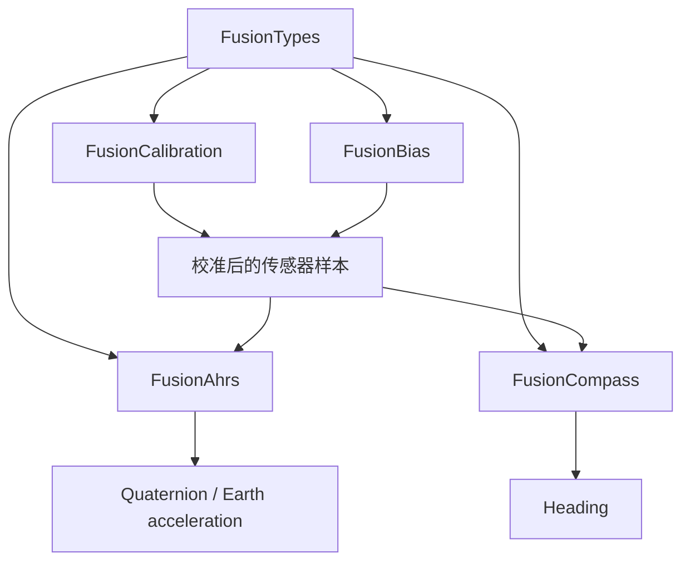

### 11.1 当前工程实际使用范围

`imu.c` 当前实例化并调用 `FusionAhrs`，但更新入口是 `FusionAhrsUpdateWithoutMagnetometer()`。`FusionBias` 和 `FusionCompass` 被编译进固件，但不在 `imu_read_callback()` 主链路中直接调用；它们可供其他代码或未来扩展使用。

## 12. 磁力计在当前路径中的作用

驱动可以读取并旋转 `m_mag`，上层也能通过 `imu_get_mag()` 获取。然而当前三个 AHRS mode 的主更新调用都是 IMU/without-magnetometer 版本，没有把 `m_mag` 送入姿态融合。

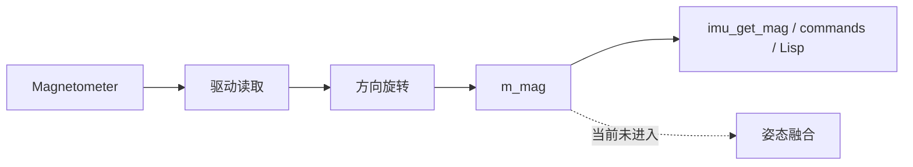

因此当前 yaw 主要依赖陀螺仪积分，长期可能漂移。`imu_set_yaw()` 只对 Fusion 模式有效，可用于外部航向源校正。如果要实现磁航向约束，需要评估车辆电机电流和铁磁材料干扰，并改用带磁力计的融合入口。

## 13. 姿态输出与派生数据

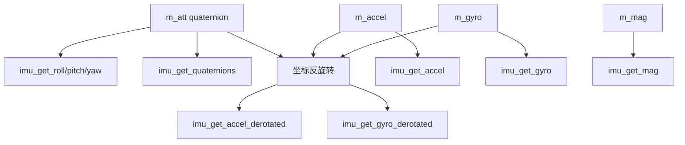

欧拉角便于显示，但存在角度包络和接近俯仰 ±90° 时的表示问题。控制与三维变换更适合直接使用四元数。

## 14. 校准流程

`imu_get_calibration(yaw, imu_cal)` 会临时切换算法参数和模式，通过多段采样估计安装 roll/pitch 等校准量，最后恢复原 AHRS mode 与参数。执行期间设备应保持流程要求的静止姿态。

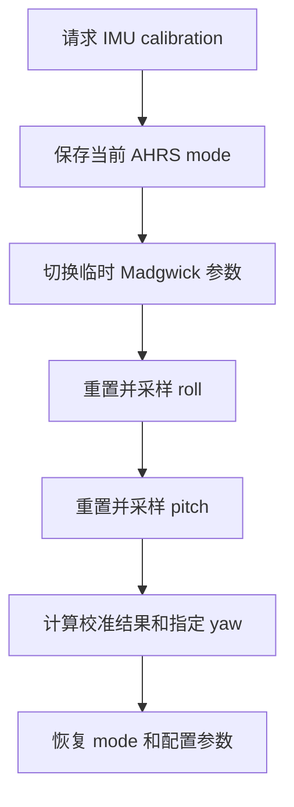

校准调用是同步且耗时的，不能在高实时性线程中执行，也不应在车辆运动时运行。

## 15. 线程与回调关系

MPU、ICM、BMI wrapper 和 LSM 驱动各自实现采样线程模型，但 `imu.c` 复用一块 1024 字节线程工作区。因此正常设计是假定同一时刻只运行一个传感器驱动。

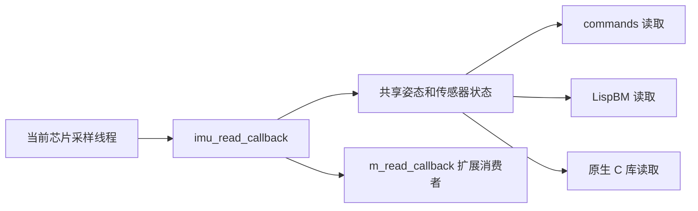

驱动回调内完成三角函数、矩阵旋转、滤波和 AHRS 更新，因此这些计算都占用传感器采样线程时间。自定义 `m_read_callback` 也在该上下文同步执行，不能长时间阻塞。

## 16. 生命周期和停止

`imu_stop()` 会依次停止所有可能的驱动并注销相关资源。切换类型前先停止旧驱动，可保证共享工作区和总线状态不被两个线程同时使用。

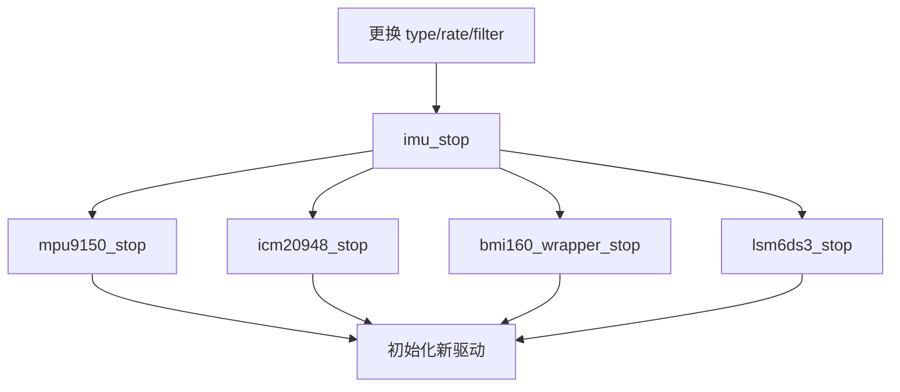

新增驱动时必须把它同时接入初始化选择、停止流程、采样率配置和统一回调，否则动态切换可能留下活动线程。

## 17. 上层消费者

### 17.1 通信命令

`commands.c` 读取 RPY、accel、gyro、mag 和 quaternion，向 VESC Tool 返回实时 IMU 数据；还调用校准接口。

### 17.2 LispBM

`lispif_vesc_extensions.c` 暴露姿态、四元数、原始/反旋转加速度和陀螺仪接口。原生 C 库函数表还提供 IMU getter、校准、设置 yaw、读取回调和基础 AHRS 函数。

### 17.3 应用层

`applications/app.c` 根据 `app_configuration.imu_conf` 初始化 IMU。产品应用可以用统一接口实现平衡、倾角保护、运动检测和遥测。

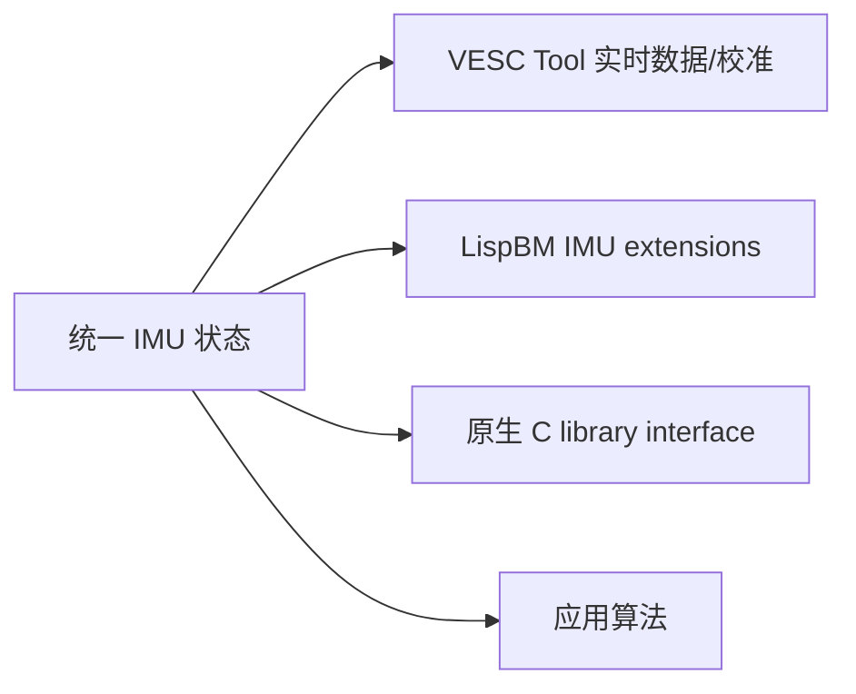

## 18. 并发与数据一致性

姿态四元数和三个向量由采样线程写入，上层线程可能同时读取。当前 getter 没有统一快照锁，因此读取多元素数组或四元数时可能跨越一次采样更新。

对一般遥测影响通常有限；若控制算法要求严格一致，应在采样回调中复制带时间戳的完整样本，或采用双缓冲/序列号快照。不要仅依赖 `volatile` 解决结构一致性。

## 19. 参数与数值注意事项

- `sample_rate_hz` 必须为正，否则低通归一化截止频率计算会除零；
- 软件低通截止频率应低于 Nyquist 频率，并与实际传感器输出率匹配；
- MPU 和 ICM 的采样率在管理层限制到最高 1000 Hz，其他芯片由自身配置逻辑决定；
- `dt` 异常过大时姿态积分会产生跳变，驱动错误恢复后应关注首个样本；
- 加速度单位、陀螺仪单位和 Fusion API 单位必须保持一致；
- 当前回调传给外部消费者的 gyro 是 rad/s，而 `imu_get_gyro()` 缓存是 deg/s；
- 欧拉角和 `imu_set_yaw()` 的角度单位需按接口约定区分；
- 动态加速度会污染重力方向，车辆运动场景应调整 confidence decay 和滤波。

## 20. 常见问题定位

### 20.1 IMU 没有数据

检查 `IMU_TYPE`、内部芯片板级宏或外部 I²C 引脚、地址、总线上拉、供电、采样线程是否启动以及驱动失败计数。

### 20.2 轴向或正负号错误

依次检查板级 `IMU_ROT_*`/`IMU_FLIP` 宏、配置的 `rot_roll/pitch/yaw`、芯片安装方向和上层坐标约定，避免同一旋转被补偿两次。

### 20.3 静止时姿态抖动

检查机械振动、芯片级 `IMU_FILTER`、软件低通截止频率、陀螺仪偏置和 Madgwick/Mahony 增益。

### 20.4 运动时倾角明显错误

车辆线性加速度被算法误认为重力。调整加速度置信度衰减、降低增益或引入更适合车辆运动模型的融合方法。

### 20.5 yaw 长期漂移

当前主融合路径没有使用磁力计，yaw 漂移是预期现象。可在 Fusion 模式使用外部航向调用 `imu_set_yaw()`，或设计经过磁干扰验证的磁力计融合。

### 20.6 修改参数后驱动未重启

`imu_init()` 只有 type、sample rate 或芯片 filter 变化才重启驱动。AHRS 参数、偏置、旋转和软件低通会更新配置，但软件滤波器状态是否需要重置应按修改场景评估。

## 21. 新增 IMU 芯片的推荐步骤

1. 实现芯片状态结构、初始化、停止和 read callback 注册；
2. 把原始数据统一为工程使用的 accel、gyro、mag 单位和轴向；
3. 选择 I²C、软件 SPI 或硬件 SPI，并实现错误恢复；
4. 在 `imu_config`/`IMU_TYPE` 中增加类型；
5. 在 `imu_init()` 添加内部/外部选择和采样率、滤波配置；
6. 在 `imu_stop()` 中停止线程并释放总线资源；
7. 加入 `imu.mk`；
8. 测试静止偏置、六面方向、采样率、总线错误和动态切换；
9. 验证姿态符号、四元数顺序和消费者单位；
10. 增加终端状态和失败计数，便于现场诊断。

## 22. 维护与改进建议

- 清理重复的外部 BMI160 分支；
- 对采样率、截止频率、旋转角和算法参数做集中范围检查；
- 缓存安装旋转矩阵，避免每个样本重复计算六次三角函数；
- 为共享输出增加原子快照或序列号；
- 明确所有 getter 和回调的单位、坐标系、四元数顺序；
- 在驱动重连后限制异常 `dt`；
- 把磁力计有效性、校准和 AHRS 使用策略做成明确配置；
- 给每个驱动提供统一健康状态、最后更新时间和错误计数接口；
- 避免多个内部 IMU 宏同时生效；
- 为方向变换、滤波和三种 AHRS 模式增加离线数据回放测试。

## 23. 推荐阅读顺序

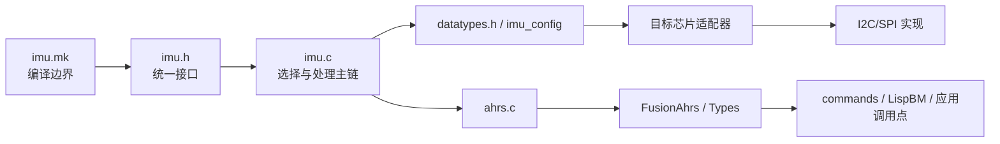

## 24. 总结

`bldc/imu` 采用清晰的分层结构：芯片和总线层负责稳定地产生物理量，`imu.c` 负责选择驱动、统一坐标、补偿滤波和融合，`ahrs.c` 与 Fusion 提供姿态算法，上层通过统一接口消费结果。

理解当前实现时尤其要注意：同一时刻只应运行一个复用工作区的传感器驱动；姿态主链当前没有使用磁力计；采样回调同步承担全部变换和融合；多元素输出没有严格快照锁。围绕这些实际边界配置采样率、滤波和上层控制，才能可靠使用 IMU 数据。
