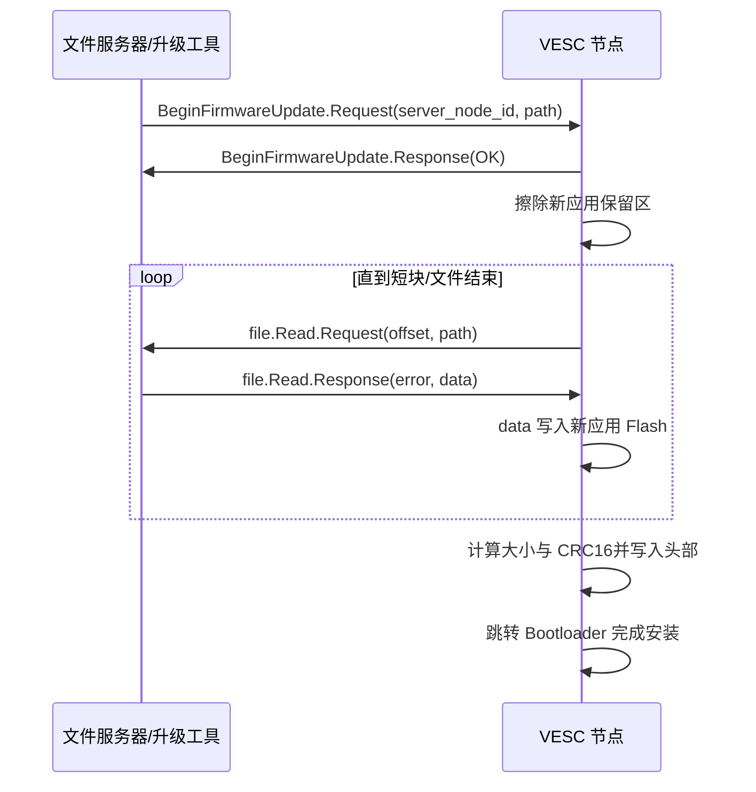

# libcanard/dsdl 功能描述

本文说明 `bldc/libcanard/dsdl` 中各数据类型的用途、生成代码结构，以及它们在当前 VESC 固件中的实际使用情况。

## 1. DSDL 是什么

DSDL（Data Structure Description Language）是 UAVCAN 用来描述总线数据类型的语言。它定义：

- 消息或服务的名称；
- 数据类型 ID；
- 数据类型签名；
- 字段的位宽、数组长度和联合体结构；
- 请求和响应的数据布局。

`libcanard` 负责 CAN 帧分片、重组、传输 ID、CRC 和收发队列；`dsdl` 下的生成代码负责把 C 结构体编码成 UAVCAN 位流，以及把接收位流解码回 C 结构体。


当前代码使用的是 **UAVCAN v0** 数据模型和经典 CAN 帧，不是 Cyphal/UAVCAN v1。判断依据包括 v0 风格的固定数据类型 ID、64 bit signature、`CanardTransferType` 和 `canardBroadcast()` 接口。

## 2. 目录结构

```text
libcanard/dsdl/
├─ definitions/
│  └─ vesc/20601.RTData.uavcan   VESC 自定义 DSDL 源定义
├─ vesc/
│  ├─ RTData.h                   自定义类型的 C 声明
│  └─ vesc_RTData.c              编解码实现
└─ uavcan/
   ├─ equipment/
   │  ├─ esc/                    ESC 控制和状态类型
   │  └─ power/                  电源与电池类型
   └─ protocol/
      ├─ 基础节点协议
      ├─ param/                  参数读写类型
      └─ file/                   文件及固件升级类型
```

标准 UAVCAN 类型在本仓库中只保留生成后的 `.h/.c`，没有对应的原始 `.uavcan` 文件；VESC 自定义类型同时保留了源定义。

生成文件顶部写有 `Autogenerated, do not edit`。需要修改数据布局时，应修改 DSDL 源定义并重新生成，而不是直接改编码器 `.c`，否则其他节点无法依据同一签名和布局互操作。

## 3. “目录存在”“参与编译”和“业务启用”的区别

这三个概念必须分开：

1. **目录存在**：仓库带有该类型的头文件和生成实现；
2. **参与编译**：`canard.mk` 将对应 `.c` 加入 `CANARDSRC`；
3. **业务启用**：`canard_driver.c` 实际发布、订阅或响应该类型。

例如 `BatteryInfo` 文件完整存在，但没有加入 `canard.mk`，业务代码也没有引用，因此当前固件不会发布或处理电池信息。

当前实际编译的生成实现为：

```text
ESC：Status、RawCommand、RPMCommand
节点：GetNodeInfo、HardwareVersion、NodeStatus、SoftwareVersion
参数：Empty、ExecuteOpcode、GetSet、NumericValue、Value
文件：BeginFirmwareUpdate、Read
VESC：RTData
```

其中部分类型只是其他类型的嵌套依赖。例如 `HardwareVersion`、`SoftwareVersion` 是 `GetNodeInfo.Response` 的组成部分；`Empty`、`NumericValue`、`Value` 是参数服务的组成部分，并非独立业务传输。

## 4. 当前实际通信功能总览

| 数据类型 | ID | 传输形式 | 本节点角色 | 当前功能 |
|---|---:|---|---|---|
| `uavcan.protocol.NodeStatus` | 341 | 广播消息 | 发布者 | 每秒发布节点在线状态、运行时间和升级状态 |
| `uavcan.equipment.esc.Status` | 1034 | 广播消息 | 发布者、订阅者 | 发布本 ESC 状态，并缓存其他 ESC 状态 |
| `vesc.RTData` | 20601 | 广播消息 | 发布者 | 发布 VESC 电压、温度、电流、IMU、转速和能量等扩展实时数据 |
| `uavcan.equipment.esc.RawCommand` | 1030 | 广播消息 | 订阅者 | 按 ESC 数组索引接收归一化控制指令 |
| `uavcan.equipment.esc.RPMCommand` | 1031 | 广播消息 | 订阅者 | 按 ESC 数组索引接收机械 RPM 指令 |
| `uavcan.protocol.GetNodeInfo` | 1 | 服务 | 服务端 | 返回节点名、软硬件版本、UID 和当前状态 |
| `uavcan.protocol.param.GetSet` | 11 | 服务 | 服务端 | 按名称或索引读取、修改有限的 VESC 参数 |
| `uavcan.protocol.RestartNode` | 5 | 服务 | 服务端 | 通过看门狗方式重启节点 |
| `uavcan.protocol.file.BeginFirmwareUpdate` | 40 | 服务 | 服务端/升级客户端 | 接收升级启动命令，记录文件服务器和路径 |
| `uavcan.protocol.file.Read` | 48 | 服务 | 客户端 | 分块向文件服务器拉取固件并写入保留 Flash |

`shouldAcceptTransfer()` 只接受上表中需要接收的 8 个 ID：GetNodeInfo、RawCommand、RPMCommand、Status、RestartNode、GetSet、BeginFirmwareUpdate 和 Read。其他 DSDL 类型即使在目录中存在，也会被当前接收过滤器忽略。

## 5. ESC 数据类型

### 5.1 RawCommand：归一化 ESC 控制

定义：`uavcan.equipment.esc.RawCommand`，消息 ID 1030。

核心字段是动态数组 `cmd`，每个元素为有符号原始命令。接收端使用配置项 `uavcan_esc_index` 选择数组中属于自己的元素，并除以 8192 得到归一化值。

当前固件根据 `uavcan_raw_mode` 将归一化值解释为：

- 相对电流；
- 正向相对电流、负向制动电流；
- duty；
- 归一化转速，乘以 `uavcan_raw_rpm_max`。

收到有效命令后会暂时禁止其他应用输出、刷新控制超时，并记录 CAN 接口、命令值和接收时间。数组长度不包含本节点索引时忽略该帧。

### 5.2 RPMCommand：机械转速控制

定义：`uavcan.equipment.esc.RPMCommand`，消息 ID 1031。

核心字段是 RPM 动态数组。固件按 `uavcan_esc_index` 选择目标值，直接传给 `mc_interface_set_pid_speed()`。这里使用的是机械 RPM；发布 ESC Status 时，固件也把内部 ERPM 除以极对数转换为机械 RPM。

### 5.3 Status：标准 ESC 状态

定义：`uavcan.equipment.esc.Status`，消息 ID 1034，最大序列化长度 14 字节，因此在经典 CAN 上通常需要多帧传输。

主要字段和本工程填充值：

| 字段 | 功能 | 当前来源 |
|---|---|---|
| `error_count` | ESC 错误计数/代码 | 当前直接填入 `mc_interface_get_fault()` |
| `voltage` | 输入电压，V | 滤波后的母线输入电压 |
| `current` | 电流，A | 根据配置选择电机电流或输入电流 |
| `temperature` | 温度，K | MOSFET 和电机温度最大值加 273.15 |
| `rpm` | 机械转速 | ERPM 除以电机极对数 |
| `power_rating_pct` | 当前功率/负载百分比 | 由总电流和电流上限估算 |
| `esc_index` | ESC 数组索引 | `uavcan_esc_index` |

发布频率由 `can_status_rate_1` 控制。固件同时订阅其他节点的 Status，最多缓存 10 个节点，500 ms 未更新即移除。缓存目前用于计算全系统电流和平均电压，源码中的总电流限幅仍是 TODO。

## 6. 节点管理类型

### 6.1 NodeStatus：节点心跳

定义：`uavcan.protocol.NodeStatus`，消息 ID 341，固定 7 字节。

字段包括：

- `uptime_sec`：节点运行秒数；
- `health`：健康等级；
- `mode`：运行、初始化、维护或软件升级等模式；
- `sub_mode`：子模式；
- `vendor_specific_status_code`：厂商自定义状态码。

固件每秒在每个可用 CAN 接口发布一次。正常时 mode 为 `OPERATIONAL`；固件下载期间为 `SOFTWARE_UPDATE`。升级时 `vendor_specific_status_code` 用 `1 + 已接收字节数/1024` 粗略表示进度。

### 6.2 GetNodeInfo：节点身份查询

定义：`uavcan.protocol.GetNodeInfo`，服务 ID 1。请求为空，响应由以下嵌套类型组成：

- 当前 `NodeStatus`；
- `SoftwareVersion`；
- `HardwareVersion`；
- 最长 80 字节的节点名。

当前响应内容为：

```text
节点名       org.vesc.<HW_NAME>
软件版本     FW_VERSION_MAJOR / FW_VERSION_MINOR
VCS commit   FW_TEST_VERSION_NUMBER
image CRC    当前填 0
硬件版本     HW_MAJOR / HW_MINOR；未定义时为 0 / 0
unique ID    STM32 96 bit UID，复制到 16 字节字段并将其余字节清零
```

`SoftwareVersion` 和 `HardwareVersion` 不是独立服务 ID，它们是 GetNodeInfo 响应中的复合数据类型。

### 6.3 RestartNode：远程重启

定义：`uavcan.protocol.RestartNode`，服务 ID 5。标准请求带 40 bit magic number，响应带 `ok` 标志。

当前处理代码收到 ID 5 后直接关闭中断并进入无限循环，依赖看门狗复位。它没有解码、校验 magic number，也没有先发送响应。因此实现的是“收到服务传输即重启”，比标准服务语义更宽松，并带来明显的访问控制风险。

## 7. 参数服务

### 7.1 组成类型

参数系统由以下 DSDL 类型组合：

| 类型 | 用途 |
|---|---|
| `param.Empty` | `Value` 联合体的空值，表示未提供参数值 |
| `param.NumericValue` | 数值联合体，可表达整数或实数 |
| `param.Value` | 完整参数值联合体，可表达空、整数、实数、布尔和字符串 |
| `param.GetSet` | 按索引/名称读取参数，或携带新值写参数 |
| `param.ExecuteOpcode` | 保存/擦除等参数操作的标准服务定义 |

当前业务只接收 `GetSet`（服务 ID 11）。`ExecuteOpcode` 虽参与编译，但没有被接收过滤器或业务回调使用。

### 7.2 GetSet 请求和响应

请求包含：

- `index`：按顺序读取参数；
- `value`：为空表示读取，非空表示写入；
- `name`：按名称访问，空名称时按 index 访问。

响应包含当前值、默认值、最大值、最小值和参数名。

本固件只开放 8 个参数：

| 索引 | 名称 | 范围 | 对应配置 |
|---:|---|---|---|
| 0 | `can_baud_rate` | 0～8 | CAN 波特率枚举 |
| 1 | `can_status_rate_1` | 0～1000 | 第一组状态发送率 |
| 2 | `can_status_rate_2` | 0～1000 | 第二组状态发送率 |
| 3 | `can_status_msgs_r1` | 0～255 | 第一组状态消息位掩码 |
| 4 | `can_status_msgs_r2` | 0～255 | 第二组状态消息位掩码 |
| 5 | `can_esc_index` | 0～255 | UAVCAN ESC 数组索引 |
| 6 | `controller_id` | 0～253 | UAVCAN/CAN 节点 ID |
| 7 | `ctl_dir` | 0～1 | 电机方向反转 |

参数副本以 10 Hz 从当前 app/motor 配置刷新。写请求会暂停刷新，将值写入 appconf/mcconf、保存到仿真 EEPROM，并重新应用配置。

当前实现限制：

- 名称最大接受 20 字节，低于 DSDL 的 92 字节上限；
- 参数表主要是整数类型；
- 写入逻辑只处理 `Value.INTEGER_VALUE`，其他联合体标签不会真正修改参数；
- 没有使用 `ExecuteOpcode` 来统一执行 save/erase；
- 只暴露少量 CAN 和方向参数，不是完整 VESC 配置接口。

## 8. 文件服务与固件升级

### 8.1 file 子目录中的类型

目录提供一组标准 UAVCAN 文件服务：

| 类型 | ID | 设计用途 | 当前状态 |
|---|---:|---|---|
| `BeginFirmwareUpdate` | 40 | 通知节点从文件服务器拉取指定固件 | 已编译并使用 |
| `Read` | 48 | 按 offset 读取文件块 | 已编译并使用 |
| `GetInfo` | 45 | 查询文件大小、时间、类型等 | 文件存在，未编译/未使用 |
| `GetDirectoryEntryInfo` | 46 | 枚举目录条目 | 文件存在，未编译/未使用 |
| `Delete` | 47 | 删除文件 | 文件存在，未编译/未使用 |
| `Write` | 49 | 写文件 | 文件存在，未编译/未使用 |
| `Path` | — | 文件路径复合类型 | 被文件服务嵌套使用 |
| `Error` | — | 文件操作错误码 | 被文件服务嵌套使用 |
| `EntryType` | — | 文件/目录/可读写等属性 | 被信息服务嵌套使用 |

### 8.2 固件升级流程



接收 BeginFirmwareUpdate 后，固件记录文件服务器节点 ID 和路径，擦除约 384 KiB 的新应用区，然后以高优先级 Read 请求分块拉取文件。每块响应去除开头 16 bit error 字段后写入保留 Flash；收到短于最大块长的数据时认为文件结束。

完成后固件计算应用 CRC16，写入 6 字节的大小/CRC 头，并跳转 bootloader。NodeStatus 在此期间报告软件升级模式和粗略进度。

值得注意的实现边界：

- `file.Read.Response.error` 被解码，但当前没有据此中止升级；
- Flash 写入结果也标有 TODO，失败时未完整回滚；
- 用“最后一块短于最大长度”判定 EOF，文件大小恰好是整块倍数时依赖服务器返回空/短块；
- BeginFirmwareUpdate 因生成代码的 TAO 问题采用手工解码；
- 当前升级链路没有在此层验证数字签名或来源身份，最终安全性取决于 bootloader 和外部部署策略。

## 9. VESC 自定义 RTData

定义文件为 `definitions/vesc/20601.RTData.uavcan`：

```text
数据类型名称  vesc.RTData
消息 ID       20601
signature     0xBC1F380DD6555010
最大长度      68 字节
```

它是一个广播消息，包含 33 个 `float16` 和两个 `uint8`。由于 68 字节远大于经典 CAN 单帧的 8 字节，libcanard 会将其分割为多帧传输。

### 9.1 字段分组

| 分组 | 字段 | 含义 |
|---|---|---|
| 电压 | `volt_in`、`volt_d`、`volt_q` | 输入电压以及 FOC d/q 轴电压 |
| MOS 温度 | `temp_mos_max`、`temp_mos_1..3` | 最大 MOS 温度和三个通道温度 |
| 电机温度 | `temp_motor_max`、`temp_motor_1..2` | 最大电机温度和两个通道温度 |
| 电流 | `curr_motor`、`curr_in`、`curr_d`、`curr_q` | 电机/输入电流和 FOC d/q 轴电流 |
| 姿态 | `roll`、`pitch`、`yaw` | IMU 欧拉角 |
| 加速度 | `acc_x..z` | IMU 三轴加速度 |
| 角速度 | `gyro_x..z` | IMU 三轴陀螺仪数据 |
| 运动 | `erpm`、`rpm`、`duty`、`encoder_pos` | 电转速、机械转速、占空比和位置 |
| 能量 | `ah_used`、`ah_charged`、`wh_used`、`wh_charged` | 使用/回充的电量和能量 |
| 电池 | `battery_level`、`battery_wh_tot` | 剩余比例和估算总能量 |
| 标识 | `fault_code`、`vesc_id` | 当前故障码和控制器 ID |

所有物理量字段使用半精度 `float16` 传输，以缩小带宽。C 结构体中仍用 `float`，编码时转为 IEEE 754 binary16，因此动态范围和精度低于内部 32 bit 浮点；大 ERPM、累计 Wh 等值可能量化明显，超过 float16 范围还会饱和或成为无穷值，接收端应做好有效性判断。

### 9.2 发布条件

RTData 不被本节点订阅，只主动发布。发送由两个状态组的位掩码控制：

- `can_status_msgs_r1` bit 0：随 `can_status_rate_1` 发布；
- `can_status_msgs_r2` bit 0：随 `can_status_rate_2` 发布。

如果两个组都使能，RTData 会按两组时序分别发送。高频发布一个 68 字节多帧消息会显著增加 CAN 总线负载，应结合波特率和节点数评估。

当前 `battery_wh_tot = wh_left / battery_level`，当电池比例为零或无效时存在除零/非有限值风险，接收端不应无条件信任此字段。

## 10. power 类型：已生成但未启用

`uavcan/equipment/power` 包含：

| 类型 | ID | 设计用途 |
|---|---:|---|
| `PrimaryPowerSupplyStatus` | 1090 | 主电源是否正常、剩余能量和运行时间估计 |
| `CircuitStatus` | 1091 | 指定电路的电压、电流和错误标志 |
| `BatteryInfo` | 1092 | 电池温度、电压、电流、SOC/SOH、容量和型号等 |

这些 `.c` 没有列入当前 `canard.mk`，`canard_driver.c` 也没有发布或订阅代码。因此它们只是可复用的生成资产，不构成当前产品功能。若要启用，需要同时：

1. 将生成源文件加入 `CANARDSRC`；
2. 在业务层构造或消费结构体；
3. 发布消息或在 `shouldAcceptTransfer()` 中登记 ID/signature；
4. 在 `onTransferReceived()` 中增加解码和处理；
5. 评估带宽、超时和数据来源。

## 11. 其他未启用的类型

除 power 类型外，下列生成文件也没有形成当前业务功能：

- `param.ExecuteOpcode`：已编译但未接收；
- `file.GetInfo`、`GetDirectoryEntryInfo`、`Delete`、`Write`：未加入构建；
- `file.Path`、`Error`、`EntryType`：作为复合类型存在，只有被已启用服务引用的部分间接参与；
- `RestartNode` 的生成 `.c` 未加入构建，但当前处理不调用其编解码函数，所以仍可按 ID 触发本地重启逻辑。

## 12. 运行机制和资源

`canard_driver_init()` 创建名为 `UAVCAN` 的普通优先级线程，线程栈工作区为 1024 字节。每个 CAN 接口分别拥有：

- 一个 `CanardInstance`；
- 1024 字节 libcanard 内存池；
- 独立接收状态和发送队列。

线程在 `CAN_MODE_UAVCAN` 或 `CAN_MODE_VESC_UAVCAN` 下工作，循环周期约 1 ms。它负责：

- 设置本地节点 ID 为 `controller_id`；
- 把 CAN RX 帧交给 libcanard 重组；
- 清空 libcanard TX 队列并发送到底层 CAN；
- 每秒清理过期传输并发布 NodeStatus；
- 按配置频率发送 ESC Status 和 RTData；
- 以 10 Hz 刷新参数副本和计算其他 ESC 的总电流；
- 驱动固件文件分块读取和升级跳转。

`CAN_MODE_UAVCAN` 下线程主动从接收队列取帧；组合模式 `CAN_MODE_VESC_UAVCAN` 的接收路径由现有 VESC CAN 分发机制配合完成，发送仍从 libcanard 队列送到底层 CAN。

## 13. 数据类型 ID、签名与兼容性

UAVCAN v0 用数据类型 ID 标识传输内容，用 64 bit signature 验证发送方和接收方是否理解相同的数据布局。`shouldAcceptTransfer()` 对接受的每个 ID返回预期 signature，libcanard 用它处理多帧传输 CRC。

修改 DSDL 字段顺序、类型、位宽或数组上限会改变 signature，并破坏与旧节点的线级兼容性。扩展 `vesc.RTData` 时应：

1. 明确是否需要保留旧类型；
2. 修改 `.uavcan` 源定义；
3. 使用与现有工具链兼容的 DSDL 编译器重新生成 `.h/.c`；
4. 更新 `canard.mk` 和业务代码；
5. 用另一实现做编码/解码互操作测试；
6. 重新计算最坏总线负载。

不要只手改 `VESC_RTDATA_SIGNATURE` 或结构体字段。签名、编码布局和两端 DSDL 必须一致。

## 14. 安全性与健壮性注意事项

当前 DSDL 功能直接连接电机控制、持久配置、复位和固件写入，风险等级不同：

- RawCommand/RPMCommand 可直接改变电机输出；
- GetSet 可写入持久配置和改变节点 ID/方向；
- RestartNode 可使节点立即重启；
- BeginFirmwareUpdate/Read 可擦写固件区并跳转 bootloader。

UAVCAN v0 的传输 CRC 用于发现传输错误，不提供发送者身份认证、授权或防重放。当前代码也没有应用层鉴权。因此部署到非可信 CAN 网络时，应在系统架构上限制物理接入，并考虑命令源白名单、magic number 校验、升级签名验证、安全状态约束和超时保护。

另外建议关注：

- 对 RawCommand/RPMCommand 增加明确的数据新鲜度和来源策略；
- 校验 RestartNode 的 magic number 并发送规范响应；
- 检查固件 Read 响应错误和 Flash 写入结果；
- 在 bootloader 中验证镜像长度、CRC，最好再使用数字签名；
- 限制 RTData 发布率，避免挤占控制命令带宽；
- 对 float16 的非有限值、饱和和量化进行接收端检查。

## 15. 阅读和扩展入口

推荐阅读顺序：

```text
libcanard/canard.mk
  确认哪些生成实现参与编译
        ↓
libcanard/canard_driver.c
  查看实际发布、接收、服务处理和线程周期
        ↓
libcanard/dsdl/**.h
  查看 ID、signature、最大长度、结构体字段和常量
        ↓
libcanard/dsdl/**.c
  查看精确位级编码、TAO 和动态数组处理
        ↓
libcanard/canard.c、canard.h
  查看传输分片、重组、队列、CRC 和内存池
```

判断新增类型是否真正接入时，至少检查五处：生成文件、`canard.mk`、头文件 include、`shouldAcceptTransfer()` 和 `onTransferReceived()`；发布型消息还要查找 `canardBroadcast()`，服务还要查找 `canardRequestOrRespond()`。

## 16. 小结

`libcanard/dsdl` 不是一个完整的业务模块，而是 UAVCAN v0 的“线级数据契约和序列化层”。当前 VESC 固件利用它实现了：

1. ESC 原始量和 RPM 控制；
2. 标准 ESC 状态广播和多 ESC 状态汇总；
3. 节点心跳、身份查询和远程重启；
4. 少量参数的远程读取与写入；
5. 基于文件服务的固件拉取升级；
6. VESC 专用多维实时数据广播。

目录中的电源、电池、文件管理和参数 opcode 等类型目前只是生成代码储备。分析或扩展功能时，应始终以 `canard.mk` 的编译列表、接收过滤器和业务回调三者共同作为“功能已实现”的判断依据。
