# LispBM 在当前工程中的应用说明

本文聚焦当前 `bldc` 工程如何实际使用 LispBM，而不是重复解释 LispBM 语言或解释器内部算法。内容沿工程调用链说明编译启用、启动位置、程序存储、VESC Tool 交互、电机控制、CAN 和自定义数据事件、BMS、硬件扩展、原生 C 库及故障恢复。

解释器内核、内存和调度机制可配合阅读《lispBM子系统详细说明.md》。Lisp 语法及函数参数应以 `bldc/lispBM/README.md` 和 `bldc/lispBM/lispBM/doc` 为准。

## 1. 当前工程中的角色

在本工程中，LispBM 是位于基础固件之上的可编程应用层。基础固件继续负责实时电机控制、故障保护、通信协议和硬件驱动；Lisp 应用通过扩展函数组合这些能力，实现无需重新编译主固件的业务逻辑。

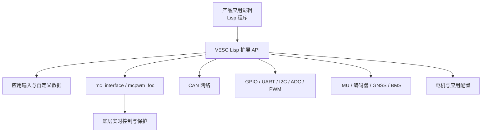

适合放到 LispBM 的功能包括：

- 输入信号组合、状态机和产品策略；
- CAN 节点协调和自定义协议适配；
- 传感器读取、数据显示与记录；
- 小规模控制逻辑和参数切换；
- VESC Tool 自定义界面配套逻辑；
- 原型验证和现场更新。

高速电流环、FOC 中断、硬件故障保护等硬实时功能仍由 C 固件完成。

## 2. 编译时启用方式

`make/fw.mk` 中当前默认：

```make
USE_LISPBM ?= 1
```

当值为 `1` 时，构建系统包含 `lispBM/lispbm.mk`、定义 `USE_LISPBM`，并把解释器内核、VESC 扩展和原生库加载器加入源文件及头文件路径。

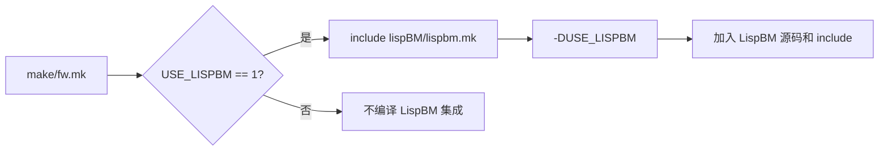

因此当前默认固件具备 LispBM 能力，但具体硬件 makefile 或命令行仍可覆盖 `USE_LISPBM`。阅读调用点时常见的 `#ifdef USE_LISPBM` 就是这一编译边界。

## 3. 工程启动时序

LispBM 并不直接从 `main()` 启动。`commands.c` 的 blocking thread 先等待 `main_init_done()`，再调用 `lispif_init()`。源码注释说明这样做是因为 main 线程栈空间不足。

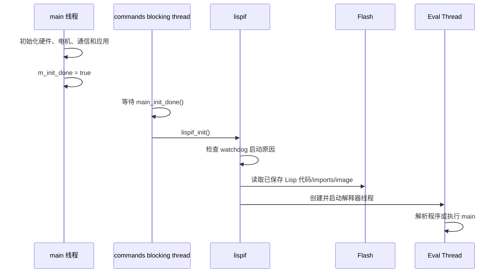

这意味着：

- Lisp 应用在基础硬件和主初始化完成后启动；
- 启动工作发生在通信 blocking thread 的调用链上；
- LispBM 自己随后建立独立 Eval 线程；
- 若上次是独立看门狗复位，已保存脚本不会自动启动，以降低复位循环风险。

## 4. 程序部署与开机运行

VESC Tool 上传的 Lisp 应用由 `flash_helper` 写入专用代码区域。`lispif_restart()` 读取该区域，恢复 imports 和 LispBM image，再解析程序或调用已存在的 `main`。

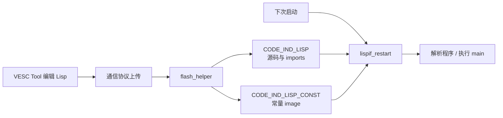

固件 application CRC 被用作 image 版本。主固件更新后，如果 CRC 与旧 image 版本不一致，常量 image 会被重建。这避免旧解释器数据结构直接跨不兼容固件使用。

### 4.1 Flash 操作与解释器停止

`flash_helper.c` 在以下场景主动停止 LispBM：

- 擦除新固件升级区域之前；
- 擦除 `CODE_IND_LISP` 或 `CODE_IND_LISP_CONST` 时。

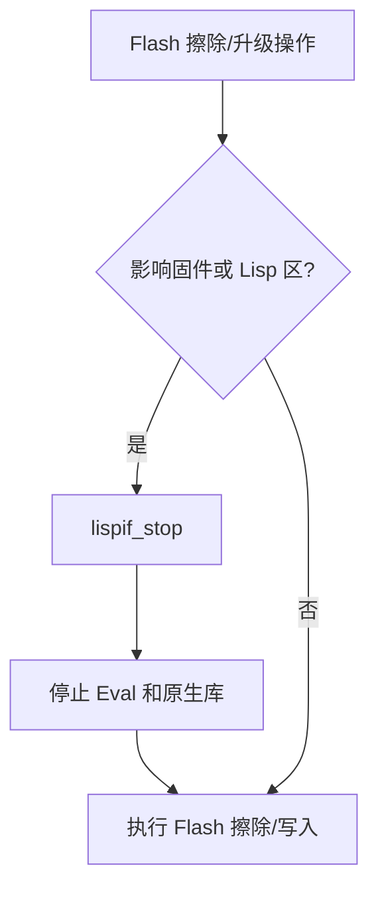

这样可以避免解释器继续从正在擦除的 Flash 代码或常量数据取指/读取。

## 5. VESC Tool 交互应用

`commands.c` 是 LispBM 面向 VESC Tool 的主要协议入口。它把 Lisp 管理包交给 `lispif_process_cmd()`，并用 `commands_printf_lisp()` 把脚本输出、异常和 REPL 结果发送到 Lisp 控制台。

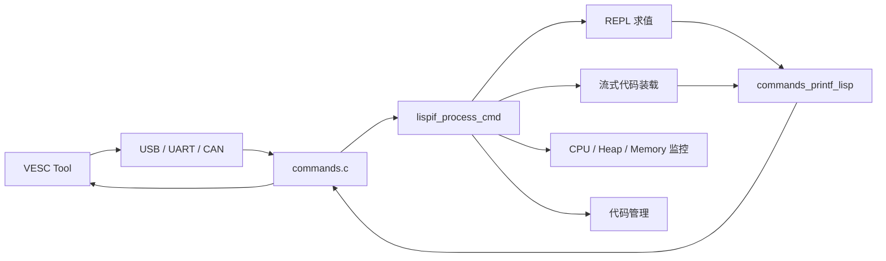

当前工程支持的开发体验包括：

- 在线执行表达式，并访问已上传程序的全局绑定；
- 查看 heap、GC、符号表、数组和 Flash image 空间；
- 查看运行和阻塞的 Lisp contexts；
- 启停 profiler 并查看 context 负载；
- 暂停、继续、重置解释器；
- 流式上传并立即运行程序；
- 在 VESC Tool 中监视变量和绘图。

## 6. 电机控制中的应用

`lispif_vesc_extensions.c` 把 `mc_interface`、FOC 和 CAN 电机接口包装成 Lisp 函数。脚本可以控制本机或远端 VESC，并读取电流、转速、位置、温度、故障和能量统计。

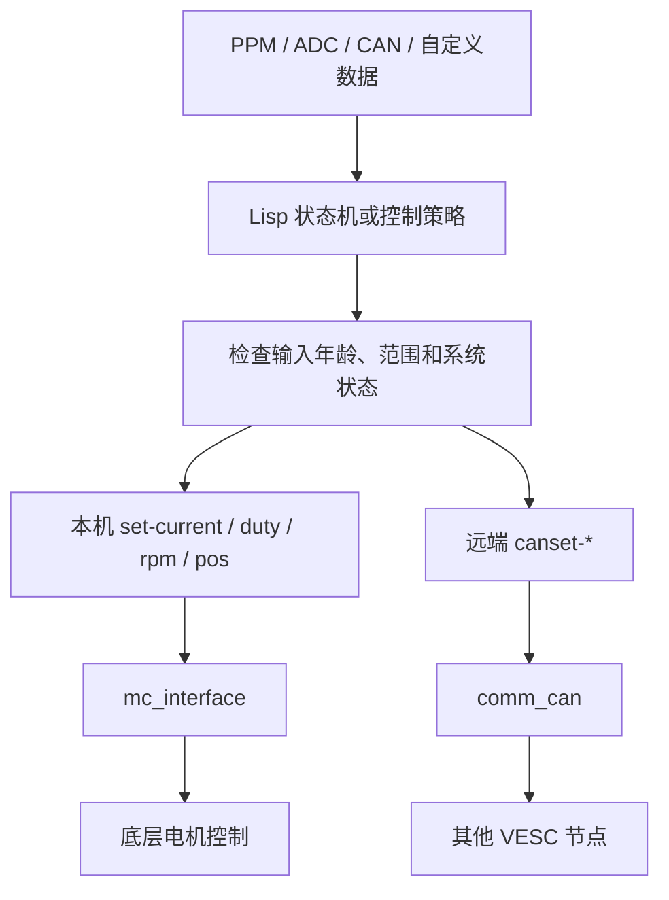

典型用途：

- 根据 PPM、ADC 或自定义传感器生成电机指令；
- 对油门应用曲线、死区和模式切换；
- 双电机硬件中选择 motor 1/2；
- 协调 CAN 网络中的多个控制器；
- 根据温度、电压、故障和通信年龄降额；
- 在调试或标定阶段执行有限的 FOC 操作。

### 6.1 控制超时

部分 motor-set 扩展会刷新 `timeout`，因此持续运行的脚本可以保持电机输出。脚本必须为输入丢失、context 异常和退出路径设计明确的停止动作。软件超时之外仍需硬件急停和功率级保护。

## 7. CAN 总线中的应用

`comm_can.c` 在接收标准帧和扩展帧时调用 `lispif_process_can()`。Lisp 扩展既能提供阻塞式接收，也能将帧投递为事件；脚本还能发送原始 SID/EID 帧和 VESC 控制命令。

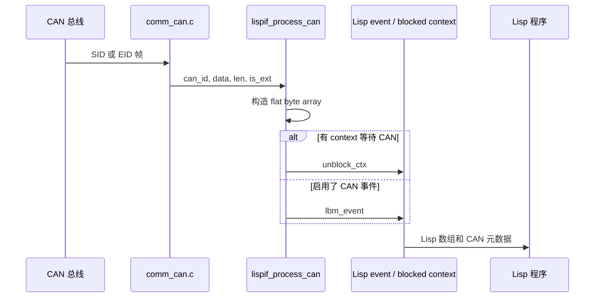

当前工程中可以用 LispBM 实现：

- 非标准 CAN 传感器或 BMS 协议适配；
- CAN 节点扫描和诊断；
- 多 VESC 协同控制；
- 原始 CAN 数据网关；
- 将 CAN 数据转换成 VESC Tool 自定义数据。

脚本必须限制帧处理耗时和发送频率，避免事件堆积或挤占控制报文带宽。

## 8. Custom App Data 的应用

`commands.c` 收到 `COMM_CUSTOM_APP_DATA` 时，除固件注册的 app data handler 外，还会将数据送入 `lispif_process_custom_app_data()`。Lisp 程序可以等待该数据或通过事件处理。

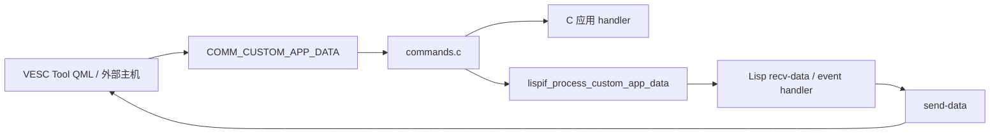

这使当前工程可以采用“QML 界面 + Lisp 业务逻辑”的组合：界面发送自定义二进制数据，Lisp 解析、控制或查询，再把结果发回界面。协议格式由两端共同定义。

## 9. BMS 功能中的应用

Lisp 扩展通过 `bms_get_values()` 读写当前 BMS 数据，并可调用 `bms_send_status_can()` 广播。它还可以发起允许充电、强制均衡和电流零偏操作。

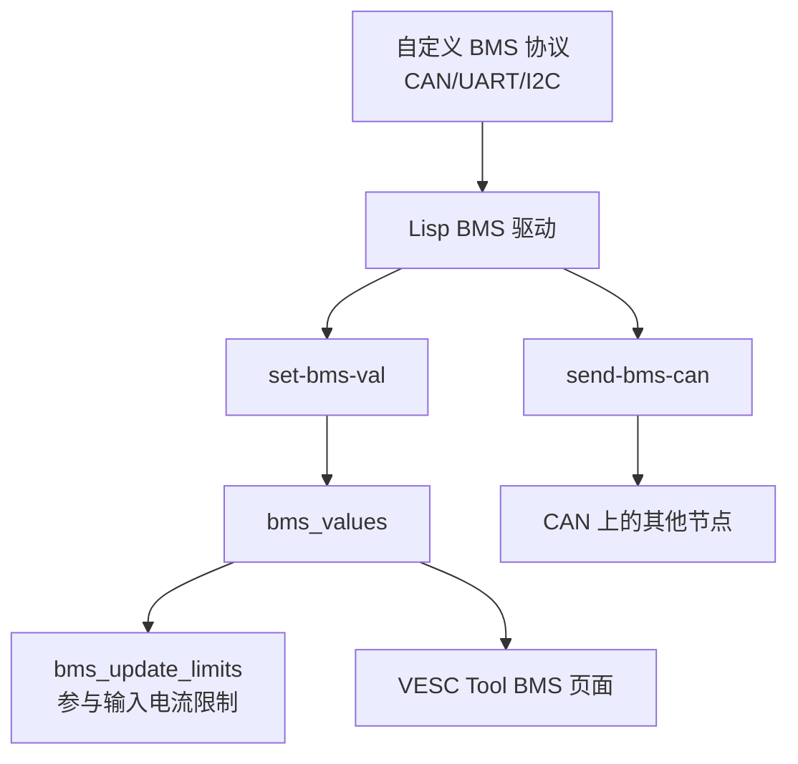

这允许脚本把非 VESC BMS 转换为工程统一的 `bms_values`。但必须正确维护更新时间、单体数量、温度数量和电压极值，否则可能造成显示越界或限流策略失真。BMS 软件集成不能替代电池包硬件保护。

## 10. 硬件和应用专用扩展

当前工程不只注册通用 VESC 扩展。多个硬件和应用模块调用 `lispif_add_ext_load_callback()`，在每次 LispBM 重启时加入自己的函数。

实际调用点包括：

- `applications/er/app_erockit_v2.c`；
- 多个 `hwconf/vesc/*`、`hwconf/trampa/*` 和 `hwconf/itr/*` 硬件实现；
- 其他定制应用代码。

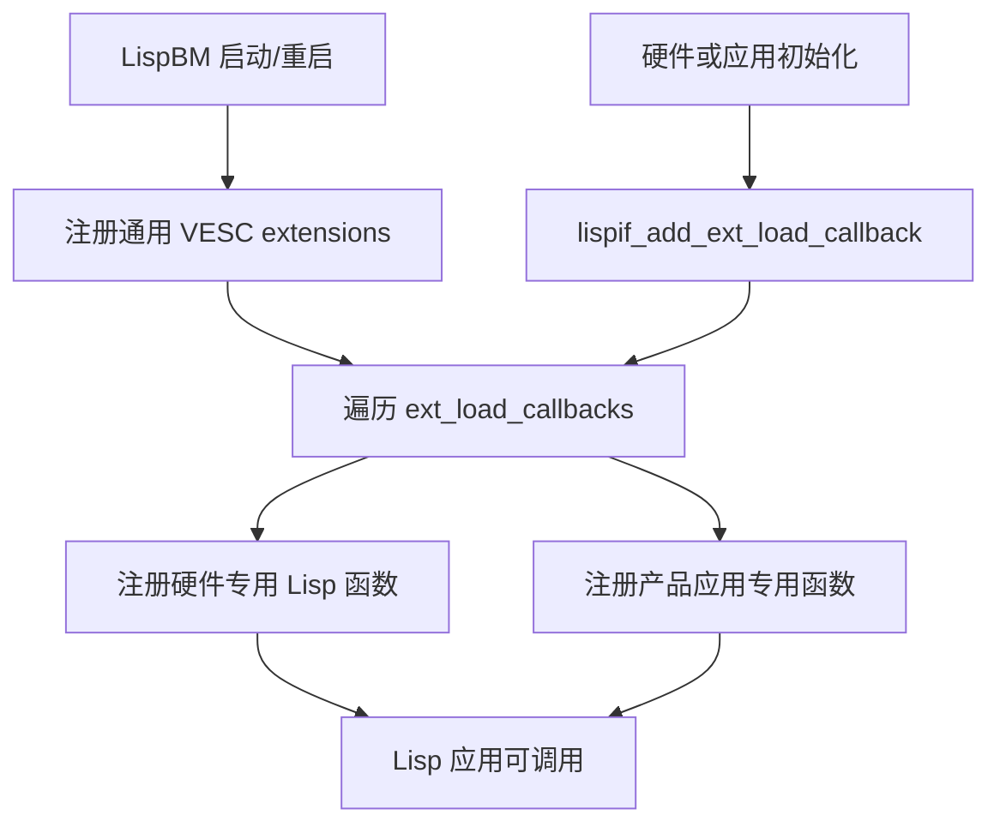

例如 `app_erockit_v2.c` 注册踏板相关扩展，使 Lisp 可以读取速度、获取和修改踏板电流参数。这个模式适合把性能敏感或强类型的底层功能留在 C 中，再暴露少量清晰的 Lisp API。

### 10.1 重启后重新注册

LispBM 重启会重建 extension table。因此硬件/应用模块注册的是“扩展装载回调”，而不是只在系统启动时直接调用一次 `lbm_add_extension()`。装载回调会在每次解释器重建后重新执行。

## 11. 自定义配置中的应用

原生 C 库可通过 `vesc_c_if` 调用 `conf_custom_add_config()`，向 VESC Tool 暴露自定义配置。工程示例 `c_libs/examples/config` 展示了配置 XML、序列化、默认值和 EEPROM 持久化。


因此当前工程的 LispBM 应用可以同时包含：

- Lisp 脚本业务逻辑；
- 原生 C 扩展；
- VESC Tool 自动生成的自定义配置页；
- EEPROM 中的扩展专用参数。

卸载原生库时必须先清除自定义配置回调，防止留下指向已卸载代码的函数指针。

## 12. 原生 C 库在项目中的应用

`lispif_c_lib.c` 和 `c_libs/vesc_c_if.h` 让单独编译的 C 库通过固件函数表使用电机、通信、线程、终端和配置能力。工程已提供多类示例：

| 示例 | 展示用途 |
|---|---|
| `extension` | 增加 Lisp 扩展函数 |
| `config` | 自定义配置与 EEPROM |
| `thread` | 创建原生线程 |
| `custom_data_comm` | 自定义数据与 QML 通信 |
| `ssd1306` | 外设显示驱动 |
| `ws2812` | 灯带控制 |
| `speed_test` | Lisp 与原生实现性能对比 |


原生库适合性能敏感或需要直接硬件访问的功能，但它不受 Lisp heap、GC 和求值配额保护。错误库可以破坏整个固件，只应加载可信且与当前 ABI 匹配的二进制。

## 13. 关机事件应用

`hwconf/shutdown.c` 在关机流程中调用 `lispif_process_shutdown()`。集成层把它转为 Lisp 事件，脚本可以在电源关闭前执行有限清理。

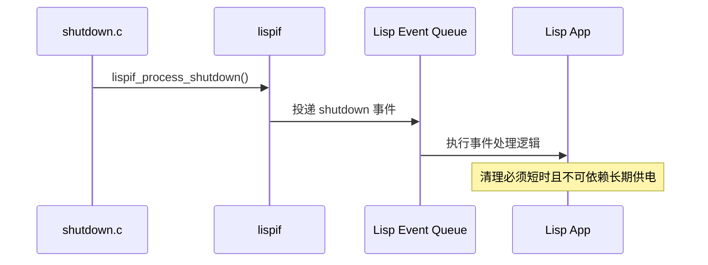

适合执行保存少量必要状态、停止外设输出或通知其他节点。不能假定关机阶段仍有足够时间完成大块 Flash 写入或长时间通信。

## 14. 输出与多设备调试

所有 Lisp 打印经 `commands_printf_lisp()` 发送。该函数支持 print prefix，可在多个 CAN 节点同时向 VESC Tool 输出时标识来源，并对多行文本逐行加前缀。

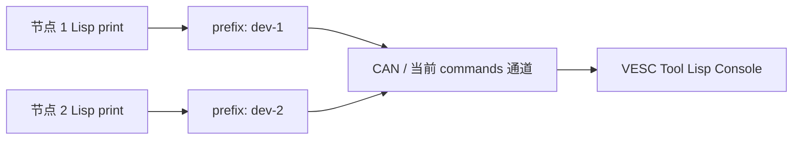

日志输出应限频。高频打印会占用格式化时间、通信带宽和 packet buffer，并干扰实时行为。

## 15. 与故障和看门狗的关系

当前工程对 LispBM 采取以下恢复策略：

1. 上次发生 IWDG/watchdog 启动时，不自动启动已保存脚本；
2. 重启解释器时禁用事件、停止原生库并重建运行时；
3. 固件升级或相关 Flash 擦除前停止 LispBM；
4. Lisp heap/stack/GC 错误限制在解释器资源范围内时，可通过 restart 恢复；
5. 原生扩展造成的内存破坏或死循环可能超出解释器恢复能力。

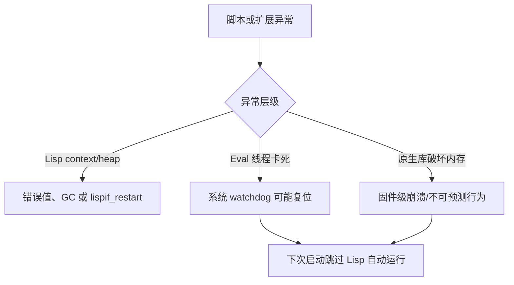

watchdog 防重启循环是恢复手段，不是运行未知代码的安全保障。

## 16. 当前工程的推荐应用模式

### 16.1 纯 Lisp 应用

适用于状态机、输入映射、CAN 协调和 UI 数据处理。开发速度快、可在线更新，性能和确定性有限。

### 16.2 Lisp + 固件现有扩展

大多数产品逻辑的首选。脚本组合经过固件实现的电机、传感器、通信和配置 API，不需要维护原生库 ABI。

### 16.3 Lisp + 产品专用 C 扩展回调

适用于特定硬件采样或算法。功能静态编入主固件，通过 `lispif_add_ext_load_callback()` 在每次重启时注册，稳定性通常高于动态原生库。

### 16.4 Lisp + 动态原生 C 库

适用于需要现场装载的高性能算法或新驱动。灵活性最高，同时具有最大的内存、ABI 和权限风险。

| 模式 | 更新便利性 | 性能 | 隔离性 | 维护成本 |
|---|---|---|---|---|
| 纯 Lisp | 高 | 中低 | 相对较好 | 低 |
| 现有 VESC 扩展 | 高 | 中高 | 取决于扩展 | 低 |
| 静态产品扩展 | 需更新固件 | 高 | 原生权限 | 中 |
| 动态 C 库 | 高 | 高 | 无内存隔离 | 高 |

## 17. 一个典型产品逻辑链

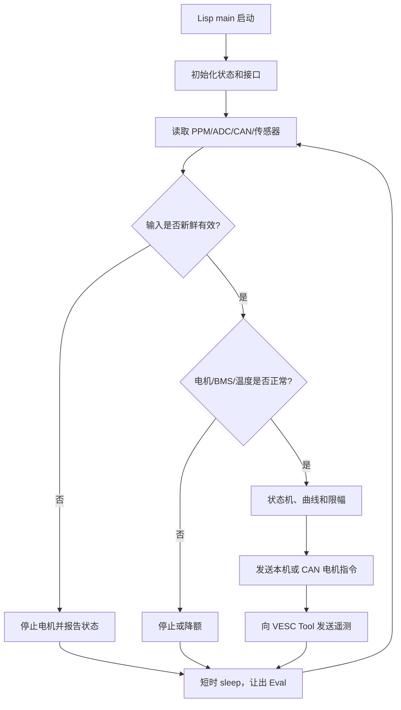

这一模式把安全检查放在每次输出之前，并通过 `sleep` 避免忙循环。实际产品还应在 C 层配置合理的电流、电压、温度和 timeout 限制。

## 18. 使用注意事项

### 18.1 不承担硬实时控制

Lisp contexts 在单个 Eval 线程上由解释器调度，并受到 GC、其他 context 和扩展调用影响。不要用 Lisp 实现需要固定微秒周期的 PWM、FOC 或保护逻辑。

### 18.2 所有外部输入都要检查年龄

PPM、CAN、遥控器和 BMS 数据可能停止更新但保留旧值。脚本必须同时检查数值和消息年龄。

### 18.3 设置输出前限制范围

不要直接把网络或 UI 输入传给电流、占空比或 RPM 接口。先限制范围、变化率和适用工况。

### 18.4 管理资源所有权

事件 flat buffer、原生线程、终端回调、自定义配置回调和外设接口都需要明确停止/释放路径。

### 18.5 控制 Flash 写入频率

配置保存、EEPROM 变量、代码上传和 image 更新均涉及非易失存储。运行时高频数据应留在 RAM。

## 19. 调试建议


调试电机应用时，应先断开动力或抬离负载，以低电流限值验证逻辑。确认停止条件、通信丢失和脚本异常均安全后，再逐步提高输出。

## 20. 常见问题

### 20.1 当前固件是否默认包含 LispBM？

是。`USE_LISPBM ?= 1` 默认启用，但目标构建可以覆盖它，最终应检查编译参数中的 `USE_LISPBM`。

### 20.2 为什么 main 初始化完成后才启动？

工程从 `commands.c` 的 blocking thread 调用 `lispif_init()`，既等待基础初始化完成，也避开 main 线程栈不足的问题。

### 20.3 为什么更新固件后 Lisp image 被重建？

image 版本绑定固件 application CRC，固件变化时旧 image 可能不兼容，因此自动擦除并创建新 image。

### 20.4 为什么看门狗复位后脚本不自动运行？

工程假定脚本可能是复位原因，启动时跳过自动运行以避免无限复位循环。可在排查脚本后手动恢复。

### 20.5 硬件专用 Lisp 函数为什么重启后仍存在？

硬件或应用注册的是 extension-load callback。每次解释器重建 extension table 后，这些 callback 会重新注册专用函数。

### 20.6 Lisp 能否替代 C 应用模块？

可以替代部分产品策略和通信逻辑，但不能替代中断级控制、硬实时采样或底层安全保护。复杂产品通常采用 Lisp 与 C 分层协作。

## 21. 推荐阅读当前工程代码的顺序


## 22. 总结

当前工程把 LispBM 作为默认编译启用的可编程应用平台。它在主初始化完成后由通信 blocking thread 启动，从 Flash 恢复应用，在独立 Eval 线程中运行，并通过 VESC 扩展连接电机、CAN、BMS、传感器、IO、配置和 VESC Tool。

工程还允许硬件与应用模块在每次解释器重启时注册专用函数，并允许动态原生 C 库扩展终端、自定义配置、线程和驱动能力。实际使用时应保持清晰分层：实时控制和最终安全保护留在 C 固件，Lisp 负责可更新的业务策略，原生库只用于确有性能或硬件访问需求的可信功能。
