# bldc/lispBM 子系统详细说明

本文从 VESC 固件集成角度说明 `bldc/lispBM` 的目录结构、解释器运行机制、内存布局、代码启动与重启、REPL、流式代码上传、事件桥接、VESC 扩展以及原生 C 库体系。语言语法和全部 LispBM 内建函数应继续参考目录中的官方语言文档。

> 安全提示：LispBM 语言执行器提供资源配额和独立解释器上下文，但 VESC 扩展可以控制电机、修改配置、访问 CAN/UART/I²C/GPIO，原生 C 库还可以直接调用固件接口。“沙箱”不能等同于安全权限隔离。运行未知脚本或原生库可能造成电机动作、配置损坏、通信阻塞甚至固件崩溃。

## 1. 子系统定位

LispBM 让 VESC 在不重新编译主固件的情况下运行 Lisp 应用。代码可以存入 Flash、开机自动运行，也可以通过 VESC Tool 的 REPL 即时求值和调试。

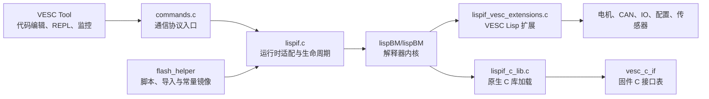

主要能力包括：

- 在 MCU 上执行 LispBM 程序和多个 Lisp 上下文；
- 将上传的应用保存到 Flash 并在启动时自动加载；
- 提供交互式 REPL、环境查看、上下文查看和性能分析；
- 以函数扩展方式访问 VESC 电机控制、通信、传感器和配置；
- 把 CAN、Custom App Data、关机及远程消息转换为 Lisp 事件；
- 动态加载 Lisp 库和编译后的原生 C 库；
- 通过配额、垃圾回收和专用内存限制解释器资源占用。

## 2. 目录分层

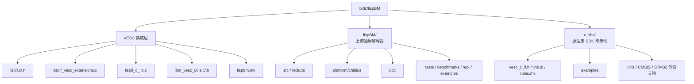

| 区域 | 职责 |
|---|---|
| `lispif.c/.h` | 初始化、内存、解释器线程、REPL、上传、重启、Flash image |
| `lispif_vesc_extensions.c` | 注册 VESC 专用 Lisp 函数和事件入口 |
| `lispif_c_lib.c` | 装载、初始化、停止原生 C 扩展，并建立固件函数表 |
| `lbm_vesc_utils` | VESC 集成使用的 LispBM 辅助转换工具 |
| `lispBM/lispBM/src` | 求值器、堆、GC、解析、符号、通道、image 和通用扩展 |
| `lispBM/lispBM/platform/chibios` | LispBM 对 ChibiOS 时间戳和互斥量的适配 |
| `c_libs` | 原生扩展 ABI、链接脚本、构建规则和示例 |
| `README.md` | VESC 专用 Lisp 扩展的用户文档 |
| `lispBM/lispBM/doc` | LispBM 语言、运行时、字符串、数学等参考文档 |

## 3. 构建集成

`lispbm.mk` 将解释器内核和四个 VESC 集成源文件加入固件：

- 环境、基础函数、堆、GC 与通用内存；
- tokenizer/parser、打印、符号表和 CPS 求值器；
- channel、flat value、C interop、自定义类型和 profiler；
- 常量 image、内存整理及动态库；
- 数组、数学、字符串和互斥量扩展；
- ChibiOS 平台互斥量与时间戳；
- `lispif.c`、VESC 扩展、C 库加载器和 VESC 工具函数。

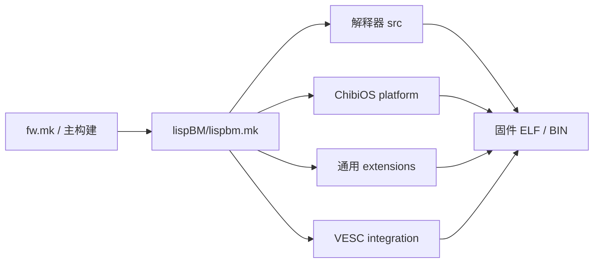

## 4. `lispif.h` 对外接口

| 接口组 | 代表接口 | 用途 |
|---|---|---|
| 生命周期 | `lispif_init()`、`lispif_stop()`、`lispif_restart()` | 启动、停止和重建解释器 |
| 同步 | `lispif_lock_lbm()`、`lispif_unlock_lbm()` | 保护外部对 LispBM 状态的操作 |
| 状态 | `lispif_get_restart_cnt()`、`lispif_is_eval_task()` | 查询重启次数和当前线程身份 |
| 扩展装载 | `lispif_add_ext_load_callback()`、`lispif_load_vesc_extensions()` | 在重启后重新注册扩展 |
| 通信命令 | `lispif_process_cmd()` | 处理 REPL、上传、状态等协议命令 |
| 事件输入 | `lispif_process_can()`、`lispif_process_custom_app_data()` | 将外部数据送入 Lisp 世界 |
| 系统事件 | `lispif_process_shutdown()`、`lispif_process_rmsg()` | 关机和远程消息通知 |
| 资源/辅助 | `lispif_const_heap_max_ind()`、`lispif_spawn()` | 常量镜像与原生库线程辅助 |
| 硬件映射 | `lispif_symbol_to_io()`、`lispif_get_ppm()` | VESC 扩展内部的 IO/输入支持 |

## 5. 内存与资源布局

`lispif.c` 为解释器预留多类静态内存：

| 资源 | 当前定义 | 作用 |
|---|---:|---|
| Lisp cons heap | 由约 24 KiB、ADC 缓冲配置和扩展表共同计算 | 列表、闭包和求值对象 |
| 通用 Lisp 内存 | 约 28 KiB | 数组、字符串、符号等动态块 |
| GC stack | 160 项 | 垃圾回收遍历 |
| Print stack | 128 项 | Lisp 值格式化打印 |
| Extension storage | 默认 319 项 | Lisp 扩展函数注册表 |
| Profiler entries | 30 项 | 上下文采样统计 |
| Eval thread stack | 2048 字节 | ChibiOS 求值线程工作区 |
| Extension-load callbacks | 20 项 | 重启后的额外扩展注册 |

多个大数组通过 `.ram4` section 放置，最终地址取决于硬件链接脚本。

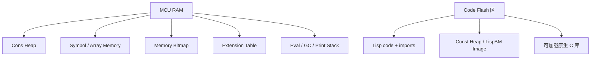

LispBM 的垃圾回收只管理解释器对象。由原生扩展、固件内存池或其他 C API 分配的资源仍需要各模块按接口释放。

## 6. 初始化与启动保护

`commands.c` 初始化通信系统时调用 `lispif_init()`。初始化首先检查上一次是否为独立看门狗复位或记录了 watchdog boot fault；若是，则不自动运行已存脚本，以避免脚本造成复位循环。

之后设置求值配额并初始化互斥量。根据编译选项，配额采用时间额度或每轮 50 个求值步骤。

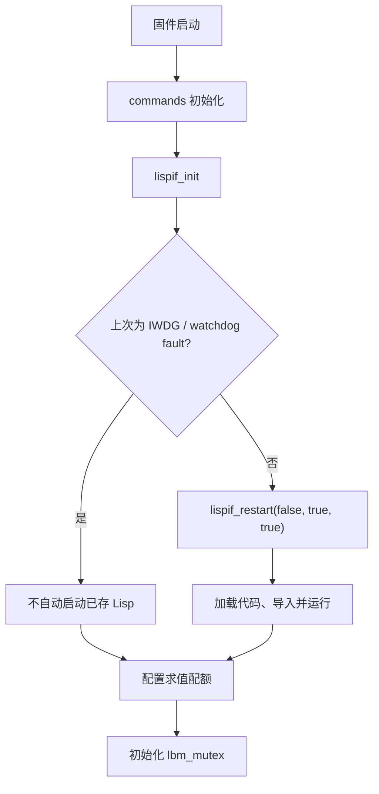

这一保护仅针对已识别的 watchdog 启动原因。脚本仍可能造成危险外设动作，因此还需要应用级安全设计。

## 7. 解释器重启流程

`lispif_restart(print, load_code, load_imports)` 是生命周期核心：

1. 增加重启计数，停止 profiler 和未完成的流通道；
2. 取得 Flash 中的 Lisp 代码和长度；
3. 禁用全部事件，停止原生库及旧求值线程；
4. 必要时保存常量 heap 指针；
5. 初始化 heap、通用内存、bitmap、扩展表和回调；
6. 初始化或重建 LispBM image；
7. 启动 ChibiOS 求值线程，并等待其进入暂停状态；
8. 检查持久 image 中是否已有 `main` 闭包；
9. 注册 VESC 扩展和额外装载回调；
10. 根据参数恢复导入数组、解析 Flash 代码或调用 `main`；
11. 继续求值器运行。

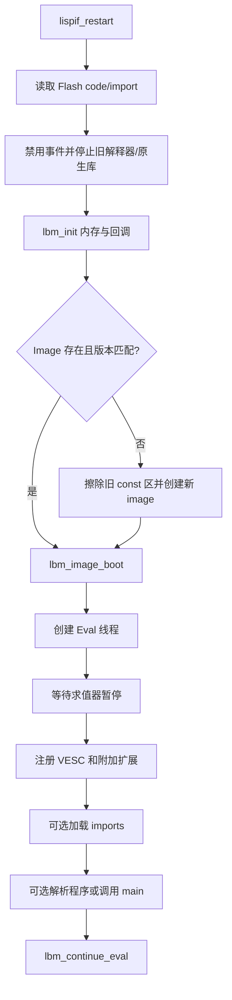

## 8. Image、代码和导入数据

Lisp 应用代码由 `flash_helper` 的 `CODE_IND_LISP` 区提供；常量 image 使用 `CODE_IND_LISP_CONST` 原始区域。image 版本字符串由固件 application CRC 生成。当固件变化导致版本不匹配时，旧 image 会被擦除并重建。

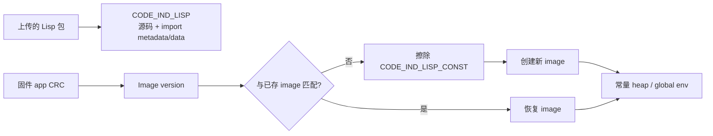

导入区位于源码字符串结束符之后，包含导入数量、名称、偏移和长度。重启时通过 `lbm_share_array_const()` 把这些 Flash 数据以常量数组形式绑定到全局环境，避免复制大资源到 RAM。

## 9. 求值线程和调度

LispBM 使用一个 ChibiOS Eval 线程承载 CPS 求值器，优先级为 `NORMALPRIO - 1`。Lisp 里的多个上下文由 LispBM 自身调度，不等同于每个 Lisp 上下文对应一个 ChibiOS 线程。

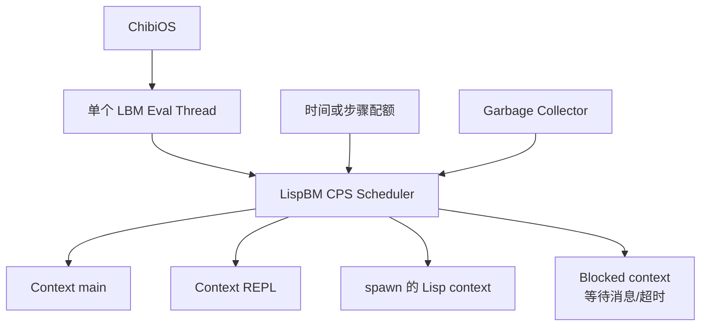

休眠、等待消息和部分异步扩展会阻塞当前 Lisp context，让其他 context 继续执行。原生 C 扩展若长时间同步占用 Eval 线程，仍会拖住整个 Lisp 调度。

## 10. 暂停、锁与一致性

`lbm_mutex` 用于协调固件线程对解释器的外部操作；`pause_eval()` 请求求值器暂停，并可要求 GC 先释放指定数量的单元。两者解决不同层次的问题：互斥量保护固件侧操作序列，暂停确保 Lisp 求值器不再修改运行时结构。

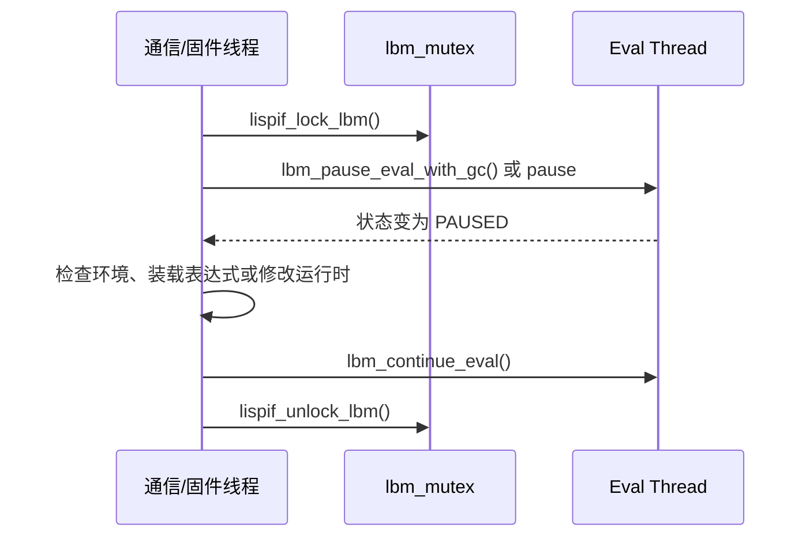

调用扩展时必须理解当前是否已处于 Eval 线程或持有锁，避免递归锁、停机等待和回调反向调用形成死锁。

## 11. 通信命令处理

`commands.c` 将 Lisp 相关协议包交给 `lispif_process_cmd()`。主要命令族包括：

- 运行状态和 CPU/heap/memory 统计；
- REPL 命令与表达式求值；
- `COMM_LISP_STREAM_CODE` 流式代码输入；
- 远程消息 `COMM_LISP_RMSG`；
- 代码擦除、写入、读取及其他管理命令。

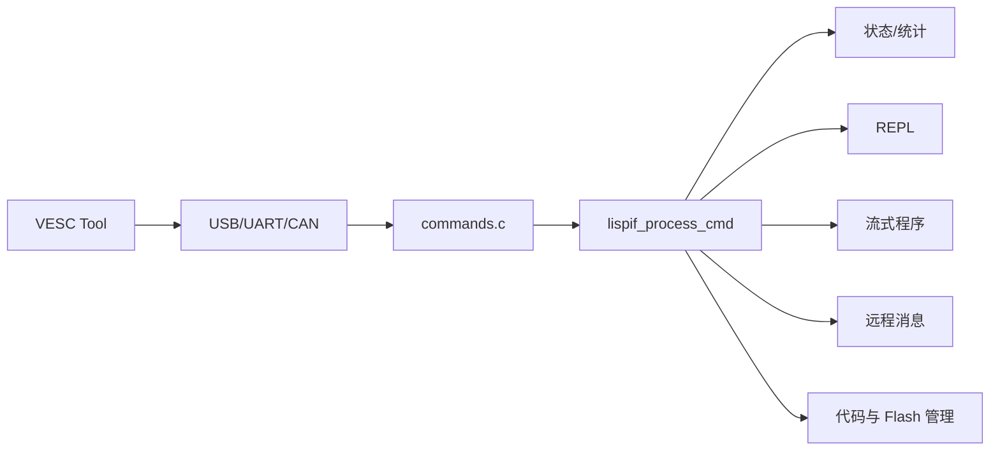

命令执行和回复通常复用通信 packet buffer。耗时暂停、Flash 操作和流通道等待会影响当前命令处理路径。

## 12. REPL 工作机制

REPL 输入分为冒号开头的固件管理命令和普通 Lisp 表达式。

| REPL 特殊命令 | 作用 |
|---|---|
| `:help` | 显示特殊命令 |
| `:info` | heap、GC、符号、数组、扩展和 Flash image 统计 |
| `:prof start/stop/report` | 控制采样 profiler |
| `:env` | 打印全局环境中的绑定 |
| `:ctxs` | 显示运行和阻塞的 Lisp contexts |
| `:symbols` | 打印符号表 |
| `:reset` | 重建 LispBM |
| `:pause` / `:continue` | 暂停或继续求值器 |
| `:undef name` | 删除全局符号绑定 |
| `:verb` | 切换详细错误输出 |

普通表达式流程如下：

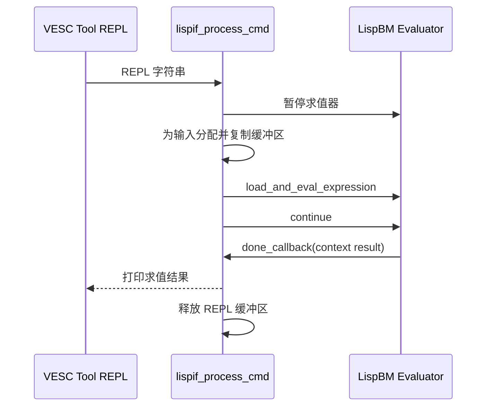

代码通过 context ID 关联 REPL 结果、主程序和输入缓冲区。回复只在限定时间窗口内显示，避免迟到结果被错误归属到新的交互。

## 13. 流式代码执行

`COMM_LISP_STREAM_CODE` 用于分片传送较大的程序，包中包含偏移、总长度、重启模式和本片数据。第一片可以选择保留现有代码启动、空重启或重新加载 Flash 代码。

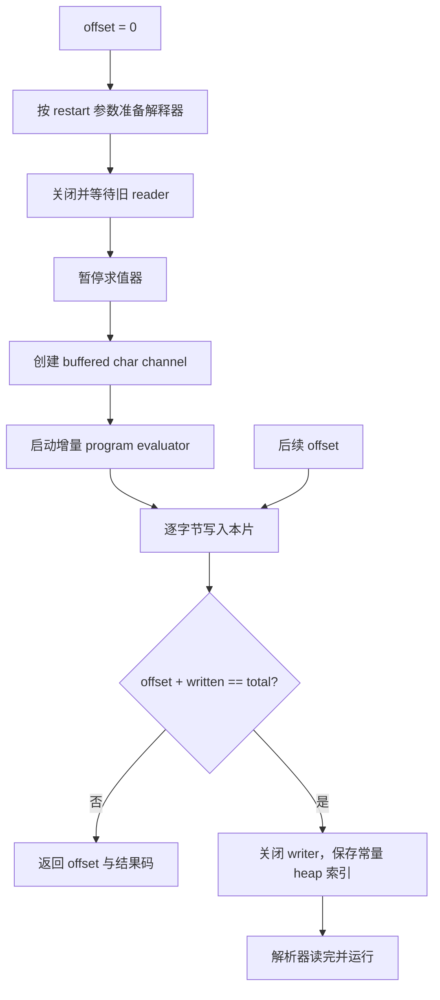

代码处理了重复 offset、reader 未关闭、暂停失败、通道写超时和 reader 提前关闭等情况。协议调用方应按回复 offset/result 决定重试，而不能盲目继续发送。

## 14. VESC 专用扩展层

`lispif_vesc_extensions.c` 是最大的集成文件。它调用 `lbm_add_extension()` 注册大量 Lisp 函数，并在最后初始化通用数组、数学、字符串、互斥量和动态库扩展。

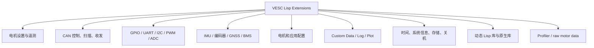

典型扩展类别：

| 类别 | 示例 |
|---|---|
| 电机控制 | 设置 duty/current/brake/RPM/position、FOC 开环、选电机 |
| 电机状态 | current、RPM、温度、位置、fault、能量计数 |
| CAN | 控制远端 VESC、枚举节点、SID/EID 原始收发 |
| BMS | 读取/设置 BMS 值、发送 BMS CAN、均衡和零偏操作 |
| 输入输出 | PPM、ADC、servo、GPIO、UART、I²C、PWM |
| 传感器 | IMU、编码器、GNSS、IO board |
| 配置 | 读写/保存配置、FOC 检测与参数测量 |
| 可视化 | plot、log、自定义 app data |
| 系统 | timeout reset、系统信息、EEPROM 变量、关机 |

README 中记录了这些扩展的参数和固件版本要求。源码注册表反映当前构建实际提供的函数。

## 15. 事件桥接

CAN、Custom App Data、关机和 RMSG 并不直接执行 Lisp 代码。集成层先把数据编码为 `lbm_flat_value_t`，再唤醒等待中的 context 或投递到 LispBM 事件队列。

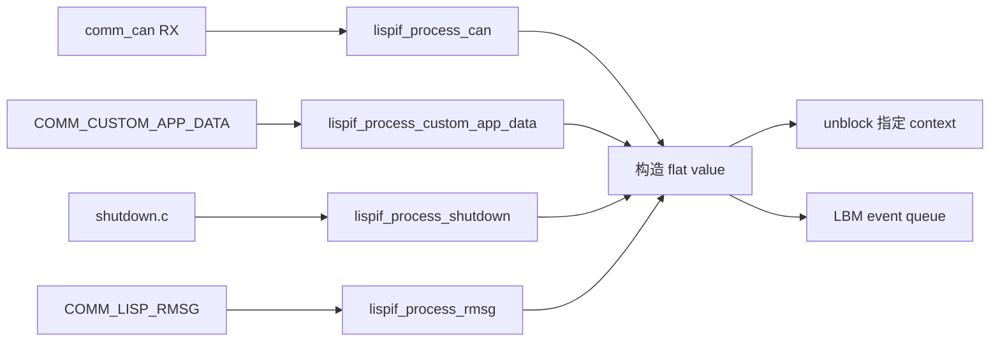

如果投递或解除阻塞失败，代码需要释放 flat buffer。事件消费者必须及时处理，否则队列容量和动态内存会成为压力点。

## 16. 原生 C 库体系

`lispif_c_lib.c` 支持将单独编译、链接的 C 库装入固件预留代码区域。`vesc_c_if.h` 定义一个大型函数指针表，让库通过稳定入口访问固件服务，而不是在库中直接静态链接全部主固件符号。

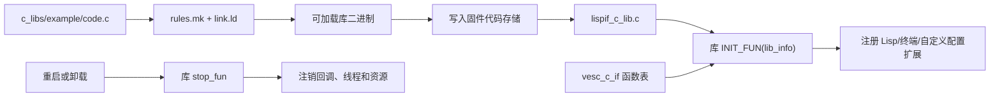

原生库可以提供高性能算法、硬件驱动、独立线程、自定义配置和 Lisp 函数。代价是它运行在 MCU 原生权限下，绕过 Lisp 对内存和执行步骤的保护。

### 16.1 原生库生命周期要求

- 初始化失败时不能留下已注册回调或活动线程；
- `stop_fun` 必须停止线程、注销终端命令和自定义配置，并释放资源；
- 卸载前必须确保没有固件或 Lisp 回调仍在执行库代码；
- 库 ABI 必须与当前固件的 `vesc_c_if` 版本兼容；
- 不能信任任意来源的库二进制。

## 17. 动态 Lisp 库

VESC 扩展注册动态加载回调。解释器遇到未定义但可由库提供的符号时，可以按需加载对应 Lisp 库。通用 `lbm_dyn_lib` 与 VESC 的 loader 共同减少主程序必须预加载的代码量。

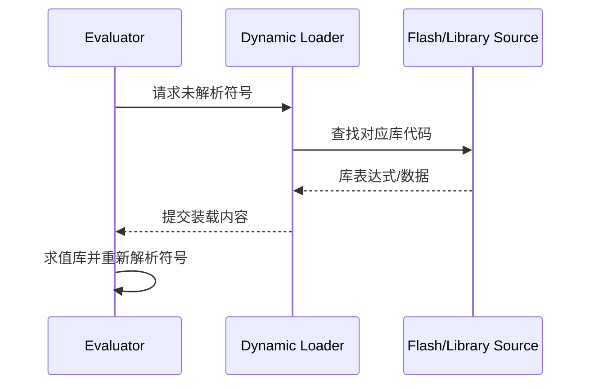

动态库内容仍占用 heap、符号表、常量 image 或通用内存，按需加载并不代表零资源开销。

## 18. 停止与故障恢复

`lispif_stop()` 首先停止原生库，然后取得 Lisp 锁，反复调用 `lbm_kill_eval()`，直至 Eval 线程退出。重启会在停止前禁用事件，并重建解释器内存。

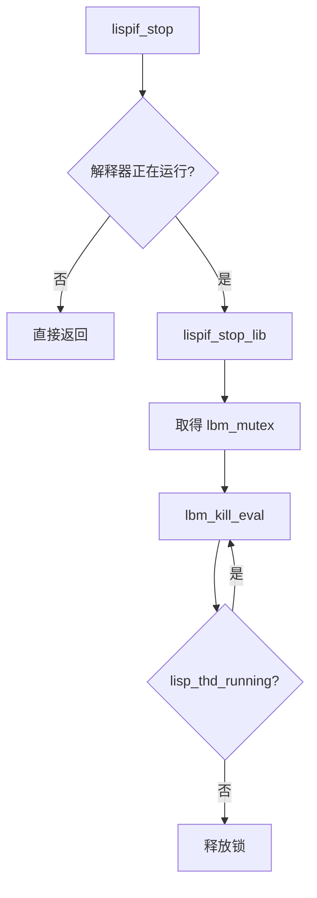

如果原生库停止函数阻塞，或 Eval 线程停在不可返回的原生扩展中，停机过程可能无法完成。这也是原生扩展必须短时、可取消的重要原因。

## 19. 性能监控与调试

系统提供多层观测手段：

- 状态命令计算 Eval 线程 CPU 占用、heap 使用率和通用内存使用率；
- `:info` 显示 GC、数组、符号表、扩展数和 Flash image 空间；
- `:ctxs` 查看运行/阻塞 contexts 及栈使用；
- `:prof` 启动采样线程，按 context 汇总运行、GC、system 和 sleep 比例；
- VESC Tool 支持变量监控和绘图；
- `commands_printf_lisp()` 统一输出到 Lisp 控制台。

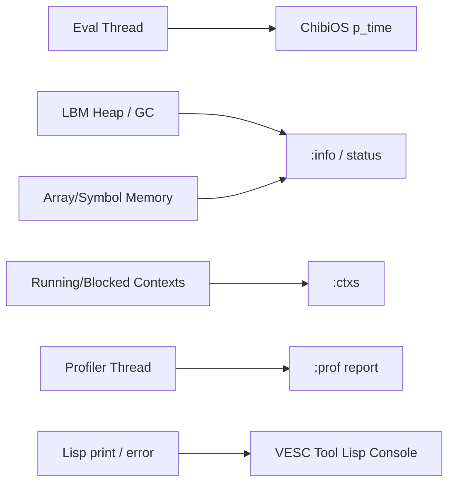

部分统计命令会清零线程 `p_time` 或暂停求值器，调试行为本身会轻微影响被观察系统。

## 20. 实时性和安全边界

### 20.1 Lisp 执行配额

时间/步骤配额让解释器在 contexts 间让出执行机会，并降低死循环独占 CPU 的可能性。它不保证脚本满足硬实时截止时间，也无法中断一个长时间运行的同步 C 扩展。

### 20.2 电机控制

许多 motor-set 扩展会刷新普通控制超时。脚本若持续发送设定值，可让电机长期运行。必须在脚本中验证输入年龄、范围和故障状态，并保留独立急停。

### 20.3 硬件资源冲突

UART、I²C、GPIO、PWM、ADC、servo 等引脚可能已被固件应用或硬件功能占用。脚本重新配置外设前必须核对硬件原理图和当前 app 配置。

### 20.4 配置与 Flash 寿命

频繁调用配置保存、EEPROM 写入或 image 更新会消耗非易失存储寿命。高频状态不应通过持久化 API 保存。

### 20.5 原生代码

原生库拥有直接内存和硬件访问能力，错误指针、栈溢出或 ABI 不匹配可破坏整个固件。只加载可信且与目标固件匹配的库。

## 21. 典型应用启动时序

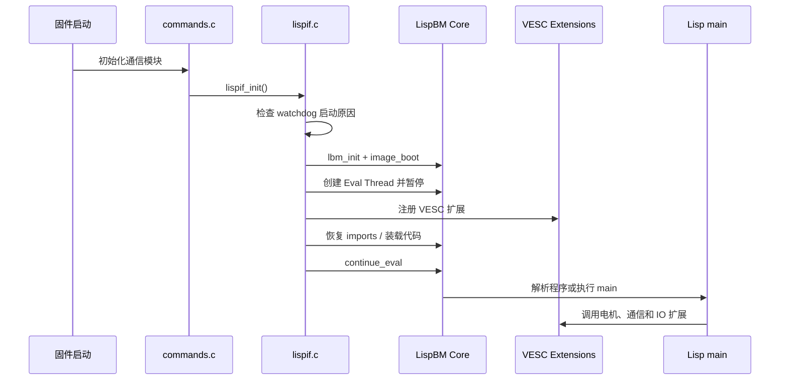

## 22. 开发 Lisp 应用的建议流程

1. 先阅读 `lispBM/lispBM/doc/lbmref.md` 和根目录 `README.md`；
2. 在 VESC Tool REPL 中验证纯计算和数据结构；
3. 用低风险输入输出验证扩展 API；
4. 为电机控制增加输入年龄、限幅、fault 和退出条件；
5. 使用 `:info`、`:ctxs` 和 profiler 检查 heap、上下文和 CPU；
6. 测试脚本异常、内存不足、通信丢失和重启恢复；
7. 最后再写入 Flash 并启用开机自动运行；
8. 保留 watchdog 恢复、VESC Tool 连接和硬件急停手段。

## 23. 开发原生 C 库的建议流程

1. 从 `c_libs/examples` 中最接近的示例开始；
2. 使用工程提供的 `rules.mk`、`link.ld` 和 `vesc_c_if.h`；
3. 不直接假设主固件符号地址，使用 C interface 表；
4. 检查目标 MCU、浮点 ABI、固件接口版本和代码存储限制；
5. 初始化过程按失败可回滚设计；
6. 为所有线程提供退出条件并在 `stop_fun` 中等待退出；
7. 注销终端、自定义配置和 Lisp 回调后再允许卸载；
8. 先在无动力环境测试，再连接电机和高压电源。

## 24. 常见问题定位

### 24.1 上电后已保存脚本没有启动

检查上次是否为 IWDG/watchdog reset、Lisp 代码区是否有效、image 版本是否因固件更新而重建，以及脚本是否定义或正确调用了 `main`。

### 24.2 REPL 显示 LispBM 未运行

检查初始化保护是否跳过启动，尝试安全地执行 REPL reset，并查看 heap/image 初始化或 Eval 线程创建是否失败。

### 24.3 程序上传中途失败

检查 offset、total length、返回结果码、通道 reader 状态和通信重发逻辑。重复分片应使用相同 offset，不能改变总长度。

### 24.4 脚本运行一段时间后内存不足

使用 `:info` 查看 cons heap、通用内存、最长空闲块、数组数量和 GC 恢复量；检查无限增长列表、未消费事件、保留大数组和频繁创建符号。

### 24.5 某个 Lisp context 卡住

使用 `:ctxs` 查看其运行或阻塞状态，再检查等待消息的超时、同步 C 扩展、互斥锁和 channel 是否有生产者。

### 24.6 固件整体卡顿但 Lisp 配额很低

检查脚本调用的原生扩展。配额只能在解释器求值边界调度，不能抢占长时间执行的 C 函数。

### 24.7 原生库卸载后崩溃

通常是仍有线程、函数指针、终端回调、自定义配置回调或 Lisp extension 指向已卸载代码。审查 `stop_fun` 和所有注册点。

## 25. 代码维护关注点

- `lispif.c` 同时承担生命周期、协议、REPL、Flash 和 image 管理，修改时应按职责拆分测试；
- `lispif_vesc_extensions.c` 规模很大，新增扩展应使用统一参数校验和错误返回风格；
- 所有通信包分支都应验证最小长度、偏移和总长度；
- 共享的 context ID、通道状态、事件开关和回调表需要明确同步规则；
- 任何 pause 后的分支都应确保最终 continue，任何 lock 后路径都应 unlock；
- packet buffer、flat value 和 REPL buffer 的所有权必须在成功和失败路径一致；
- image 格式、固件 CRC 与 Flash 布局变更需要兼容性验证；
- 原生库 ABI 应有显式版本检查和能力协商；
- 高风险扩展宜增加权限/策略层，而不只依赖脚本自律；
- 对重启、流式上传、内存耗尽和卸载竞态建立回归测试。

## 26. 推荐阅读顺序

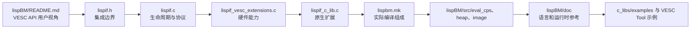

如果目标是编写 Lisp 应用，优先读 README 和语言参考；如果目标是排查启动、上传或内存问题，优先读 `lispif.c`；如果目标是增加硬件函数，读 VESC extensions；只有修改解释器语义、GC 或 parser 时才深入上游 core。

## 27. 总结

`bldc/lispBM` 不是单一脚本解释文件，而是三层系统：通用 LispBM 内核负责语言、求值、内存和 contexts；VESC 集成层负责线程、Flash、通信、事件和硬件扩展；原生 C 库层提供高性能、可动态装载但不受 Lisp 沙箱约束的扩展能力。

理解其运行机制的关键是：Lisp contexts 运行在单个 Eval 线程中；代码、imports 和常量 image 分处不同 Flash 数据结构；每次重启都必须重新建立扩展与事件状态；脚本配额只能约束解释器步骤，不能约束长时间原生调用。围绕这些边界设计资源、错误恢复和电机安全策略，才能可靠地把 LispBM 用作 VESC 的可编程应用层。
