# `imu/lsm6ds3.c` 功能描述及流程图

## 1. 模块定位

`lsm6ds3.c` 是 VESC IMU 子系统中面向 LSM6DS3 系列六轴惯性传感器的适配驱动。它负责：

- 支持软件 I²C、软件 SPI 和 ChibiOS 硬件 SPI 三种传输方式；
- 自动尝试 `0x6A`、`0x6B` 两个 I²C 地址；
- 通过 `WHO_AM_I` 兼容多个 LSM6DS3 系列变体；
- 配置加速度计、陀螺仪、内部低通、块数据更新和地址自增；
- 创建周期采样线程；
- 连续读取六轴寄存器并转换为 g 和 deg/s；
- 通过统一回调把数据交给 `imu.c`；
- 提供寄存器读取终端命令；
- 在停止时终止并等待采样线程退出。

LSM6DS3 是六轴器件，不包含磁力计。本驱动仍需满足统一九元素回调接口，因此使用固定 `{1, 2, 3}` 作为磁力计占位值。

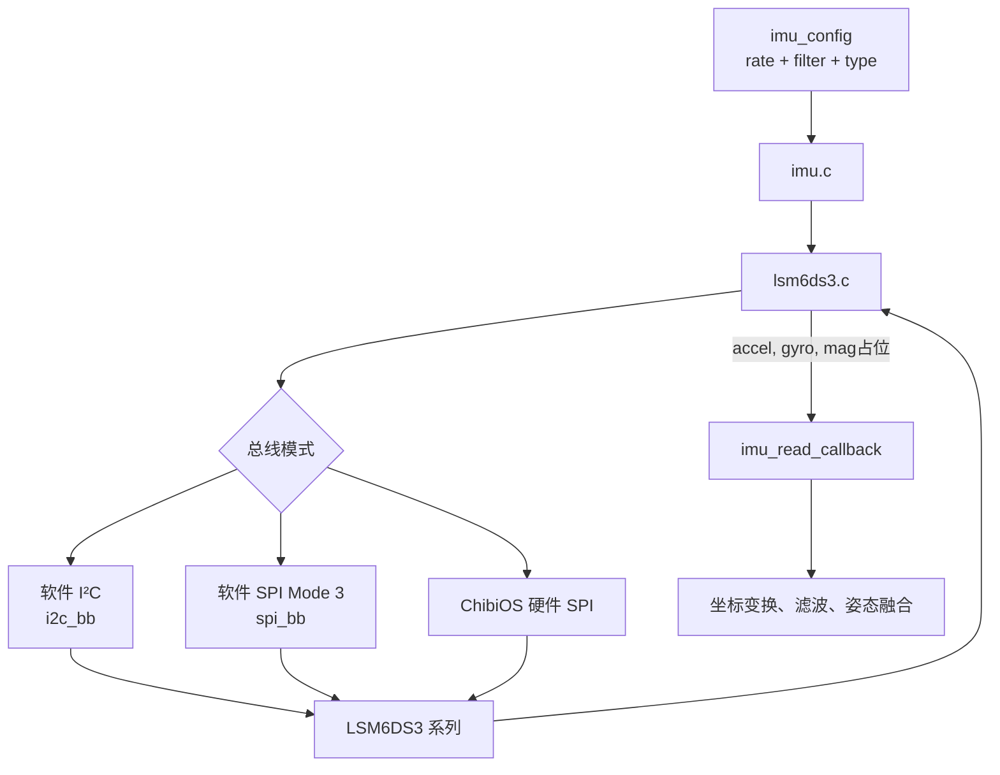

## 2. 相关文件与职责边界

| 文件 | 职责 |
|---|---|
| `imu/lsm6ds3.c` | 总线抽象、寄存器配置、线程采样和数据换算 |
| `imu/lsm6ds3.h` | 公共 API、寄存器地址、位掩码和枚举 |
| `imu/imu.c` | 选择总线、配置 GPIO、消费样本并执行 AHRS |
| `i2c_bb.*` | GPIO 模拟 I²C |
| `spi_bb.*` | GPIO 模拟 Mode-3 SPI |
| ChibiOS HAL | 硬件 SPI、线程、互斥锁和时间管理 |

驱动不负责安装方向、偏置补偿、软件 Biquad 或姿态算法；这些位于 `imu_read_callback`。

## 3. 静态状态

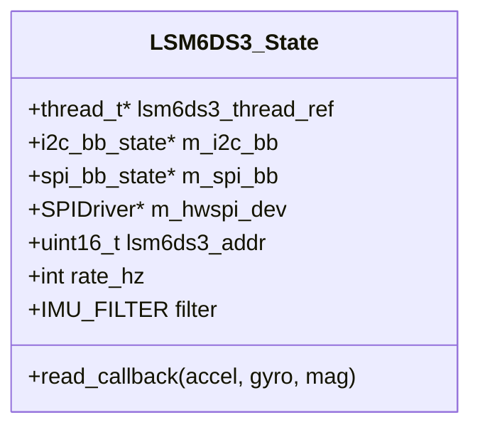

模块采用单实例静态状态，同一时刻只能管理一个 LSM6DS3。传给 `lsm6ds3_init` 的三个总线指针应当只有一个非空；读取函数按 I²C、软件 SPI、硬件 SPI 的优先顺序选择第一个有效指针。

默认线程采样率为 1000 Hz。`imu_init` 会在初始化驱动前调用 `lsm6ds3_set_rate_hz` 和 `lsm6ds3_set_filter` 写入用户配置。

## 4. 三种总线模式

### 4.1 软件 I²C

`imu_init_lsm6ds3` 配置 SDA/SCL 后，根据板级宏选择 400 kHz 或 700 kHz bit-bang I²C，再调用：

```text
lsm6ds3_init(&m_i2c_bb, NULL, NULL, ...)
```

### 4.2 软件 SPI

未定义 `LSM6DS3_HWSPI_DEV` 时，`imu.c` 配置 NSS/SCK/MOSI/MISO 的软件 SPI 状态，调用：

```text
lsm6ds3_init(NULL, &m_spi_bb, NULL, ...)
```

寄存器访问使用 SPI Mode 3，并通过 `m_spi_bb->mutex` 保护整个片选事务。

### 4.3 硬件 SPI

定义 `LSM6DS3_HWSPI_DEV` 时，GPIO 切换为 SPI 复用功能并启动 ChibiOS `SPIDriver`：

```text
lsm6ds3_init(NULL, NULL, &LSM6DS3_HWSPI_DEV, ...)
```

配置阶段使用 `spiPolledExchange`。源码注释说明 DMA 形式曾导致 CAN 处理线程冻结，因此配置寄存器采用轮询交换；周期的 12 字节数据读取则使用 `spiExchange`。

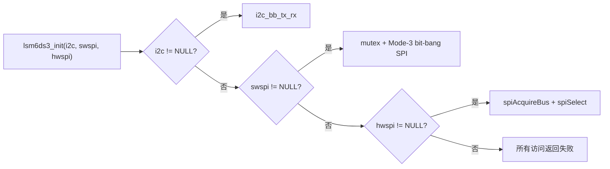

## 5. SPI 地址规则

SPI 读操作把寄存器地址最高位置 1：

$$
addr_{read}=addr\;|\;0x80
$$

SPI 写操作把最高位清零：

$$
addr_{write}=addr\;\&\;0x7F
$$

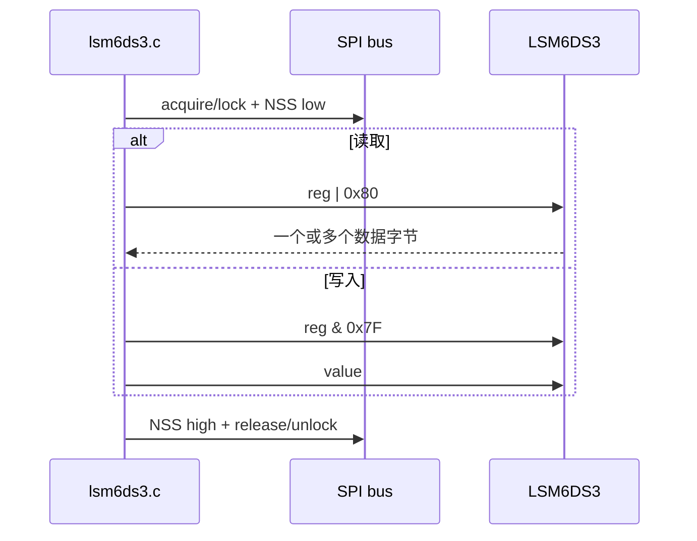

软件 SPI 与硬件 SPI 分支在当前实现中都把完成的事务视为成功，没有底层错误状态返回。

## 6. 初始化和芯片识别

初始化首先保存三个总线指针，然后尝试从地址 A `0x6A` 读取 `WHO_AM_I`。若通信失败或 ID 不匹配，再尝试地址 B `0x6B`。

接受的 ID 为：

| `WHO_AM_I` | 驱动行为 |
|---:|---|
| `0x69` | 作为标准/兼容 LSM6DS3 分支 |
| `0x6A` | 作为 TRC 变体，启用专用滤波配置 |
| `0x6C` | 作为标准/兼容分支 |
| 其他 | 初始化返回，不创建线程 |

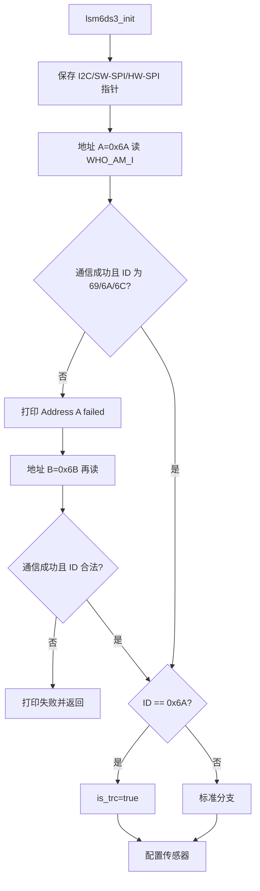

当第一次 `read_reg` 失败时，局部数组 `rxb` 没有在调用前初始化；失败日志仍打印 `rxb[0]`，因此日志中的 `rx` 数值可能是不确定值，不应据此判断实际芯片响应。

## 7. 初始化寄存器写入顺序

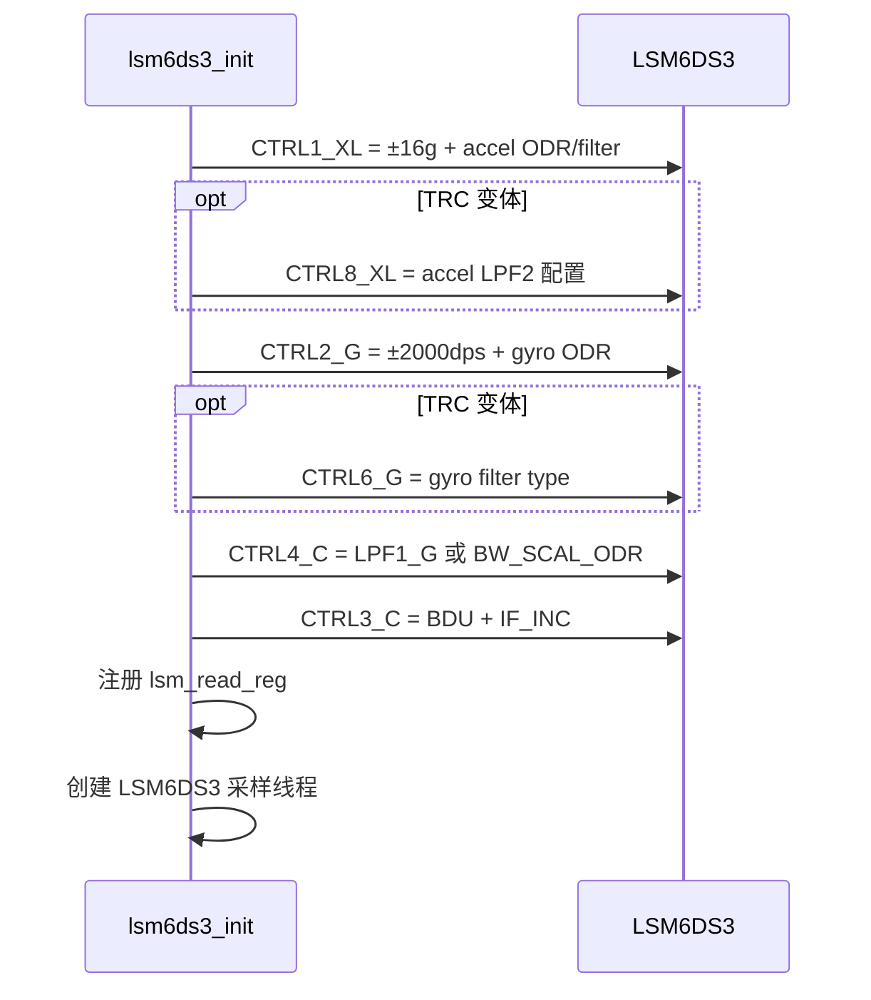

任何配置写入失败都会打印对应错误并提前返回，不注册终端命令，也不创建采样线程。

## 8. 加速度计配置

加速度量程固定为 $\pm16g$，ODR 固定写为 6660 Hz，不随 `rate_hz` 改变：

```text
CTRL1_XL = FS_XL_16g | ODR_XL_6660Hz | filter bits
```

因此需区分：

- 芯片加速度输出数据率 $f_{XL}=6660$ Hz；
- 软件线程轮询率 $f_{loop}=rate\_hz$。

线程通常只读取芯片不断更新的最新寄存器值。没有使用 FIFO，若 $f_{loop}<f_{XL}$，中间样本会被覆盖。

### 8.1 标准变体的加速度滤波

仅当 `rate_hz >= 208` 且 filter 至少为 MEDIUM 时手动配置抗混叠带宽，并在 `CTRL4_C` 使能 `BW_SCAL_ODR`：

| 条件 | 选择带宽 |
|---|---:|
| MEDIUM 且 $rate\le208$，或 HIGH 缩放后满足 | 50 Hz |
| 缩放 rate $\le416$ | 100 Hz |
| 缩放 rate $\le833$ | 200 Hz |
| 更高 | 保留默认编码 |

HIGH 使用 `scaled_rate = rate_hz / 2`，因此相同线程频率下会选择比 MEDIUM 更低的带宽。

### 8.2 TRC 变体的加速度滤波

TRC 分支始终启用约 400 Hz 模拟低通，并根据 filter 配置 LPF2：

- LOW：不启用额外 LPF2；
- MEDIUM：LPF2，ODR/50；
- HIGH：LPF2，ODR/100。

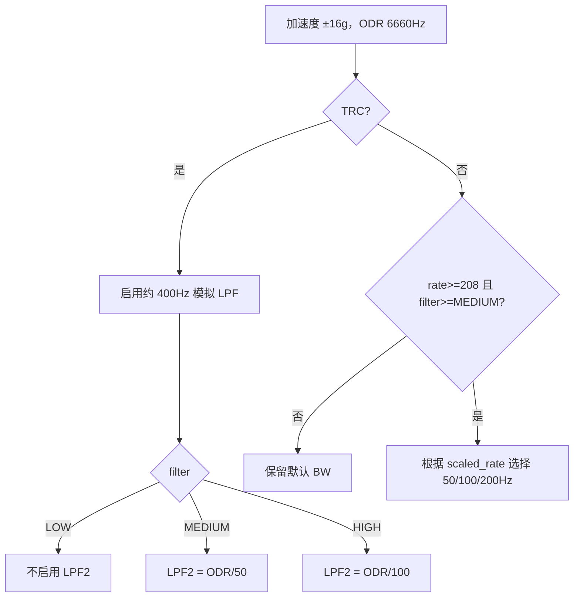

## 9. 陀螺仪配置

陀螺量程固定为 $\pm2000\ ^\circ/s$。

### 9.1 标准变体 ODR 映射

标准分支把请求频率向上映射到最接近的支持档位：

| `rate_hz` 条件 | 陀螺 ODR |
|---|---:|
| $r\le13$ | 13 Hz |
| $13<r\le26$ | 26 Hz |
| $26<r\le52$ | 52 Hz |
| $52<r\le104$ | 104 Hz |
| $104<r\le208$ | 208 Hz |
| $208<r\le416$ | 416 Hz |
| $416<r\le833$ | 833 Hz |
| $r>833$ | 1660 Hz |

若支持集合为 $\mathcal F_G$，该策略可写成：

$$
f_G=\min\{f\in\mathcal F_G\mid f\ge rate\_hz\}
$$

请求超过 833 Hz 时饱和为 1660 Hz。

### 9.2 TRC 变体

TRC 分支把陀螺 ODR 固定为 6660 Hz，并启用数字 LPF1。`CTRL6_G` 的 filter type 随 LOW、MEDIUM、HIGH 改变。

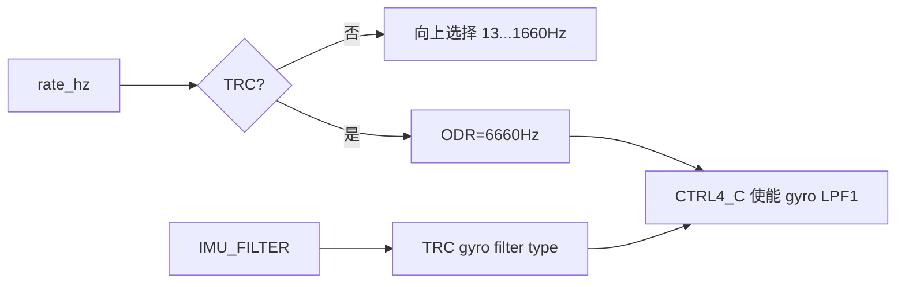

## 10. BDU 和寄存器自增

`CTRL3_C` 同时使能：

- BDU（Block Data Update）；
- IF_INC（多字节访问地址自动递增）。

BDU 的目的，是在一组高低字节尚未完整读取前保持数据不被新样本部分覆盖。否则可能出现高字节来自样本 $k+1$、低字节来自样本 $k$ 的撕裂值。

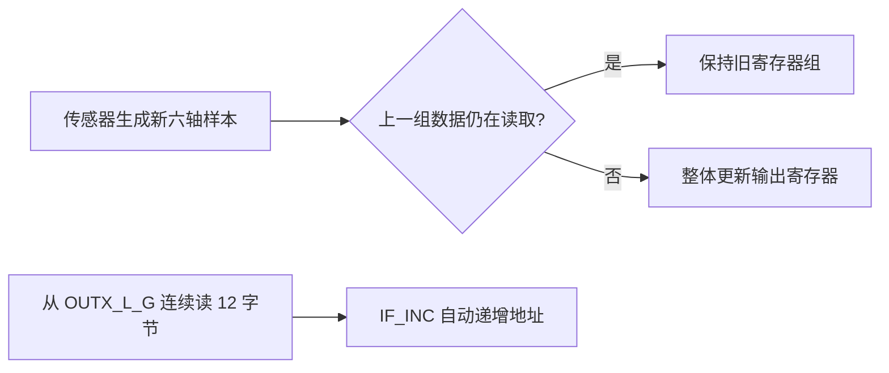

## 11. 六轴数据读取

`read_gyro_accel` 从 `OUTX_L_G (0x22)` 连续读取 12 字节：

```text
0..5   Gyro X/Y/Z，little-endian
6..11  Accel X/Y/Z，little-endian
```

每轴解包公式为：

$$
raw=(int16\_t)((MSB\ll8)+LSB)
$$

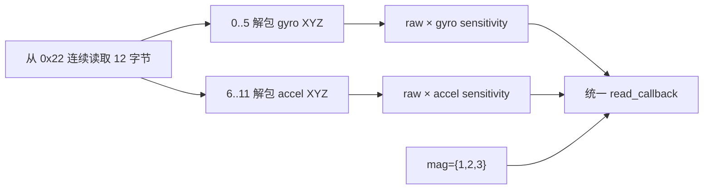

## 12. 物理量换算

### 12.1 陀螺仪

源码换算为：

$$
\omega=raw\times4.375\times\frac{2000/125}{1000}
$$

由于 $2000/125=16$：

$$
k_G=4.375\times16/1000=0.07\ ^\circ/s/LSB
$$

所以：

$$
\omega[ ^\circ/s]=raw\times0.07
$$

### 12.2 加速度计

源码换算为：

$$
a=raw\times0.061\times\frac{(16\mathbin{\texttt{>>}}1)}{1000}
$$

$16\mathbin{\texttt{>>}}1=8$，因此：

$$
k_A=0.061\times8/1000=0.000488\ g/LSB
$$

$$
a[g]=raw\times0.000488
$$

这与 $\pm16g$ 的理想比例 $16/32768=0.00048828125g/LSB$ 接近。

### 12.3 回调单位

| 向量 | 单位/内容 |
|---|---|
| accel | g |
| gyro | deg/s |
| mag | 固定 `{1,2,3}`，不是实际磁场 |

`imu.c` 在进入本地 Madgwick/Mahony 前把 gyro 转为 rad/s。

## 13. 采样线程

线程名为 `LSM6DS3`，持续轮询六轴输出寄存器。

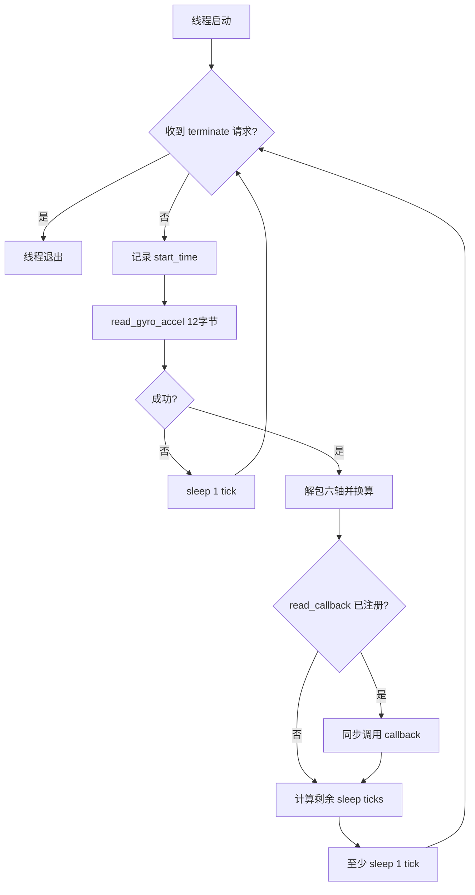

SPI 分支总是返回成功，I²C 分支能返回通信失败。I²C 失败时接收缓冲区会清零，但线程不会回调这些零数据，而是等待一个 tick 后重试。

## 14. 周期计算与调度

源码先计算：

$$
interval=US2ST\left(\left\lfloor\frac{1000000}{rate\_hz}\right\rfloor\right)-1
$$

减 1 tick 的注释意图是抵消 `US2ST` 向上取整，使频率至少达到配置值或略高。每轮以开始时刻为基准：

$$
t_{deadline}=t_{start}+interval
$$

$$
t_{remain}=t_{deadline}-t_{now}
$$

若 $0<t_{remain}\le interval$，睡眠剩余时间；否则睡眠至少 1 tick。

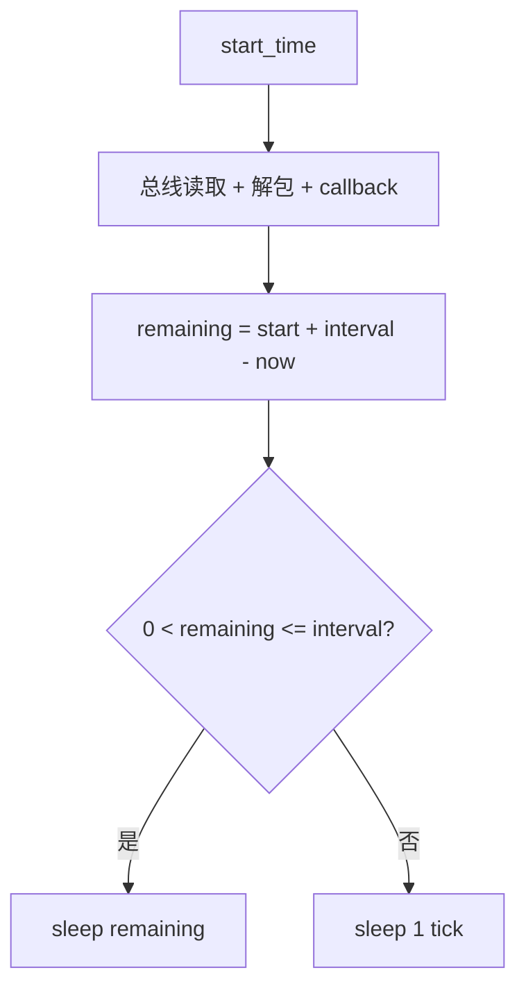

风险边界：

- `rate_hz == 0` 会整数除零；
- 负采样率没有有效语义；
- 当 `US2ST(...)` 为 0 时再减 1，若 `systime_t` 为无符号类型会下溢；
- 实际最高回调率受到 RTOS tick、总线时间和 callback 耗时限制。

## 15. 回调后的工程链路

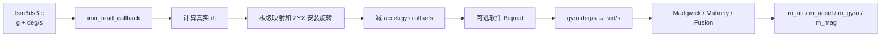

LSM6DS3 内部滤波和 `imu.c` 软件低通是串联系统：

$$
H_{total}(z)=H_{sensor}(z)H_{software}(z)
$$

噪声衰减会叠加，群延迟也会叠加。姿态响应慢时应同时检查两级滤波，而不是只调整 AHRS 增益。

## 16. 磁力计占位值

采样线程构造：

```c
float tmp_mag[3] = {1, 2, 3};
```

这不是有效磁场测量。它经过 `imu_read_callback` 的坐标旋转后写入 `m_mag`，因此 `imu_get_mag()` 在 LSM6DS3 模式下可能返回旋转后的占位向量，而不是零或“无数据”。

当前三个主 AHRS 更新入口都没有把 `m_mag` 用作周期航向约束，所以占位值通常不会影响姿态；但终端、LispBM、用户回调或未来九轴融合若把它当真实磁场，会产生错误结果。更清晰的接口应传零向量并提供有效标志，或明确不支持磁力计。

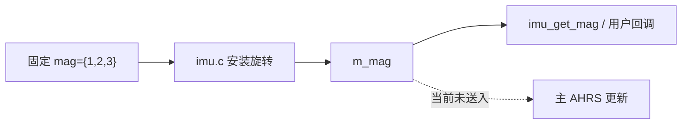

## 17. 停止流程

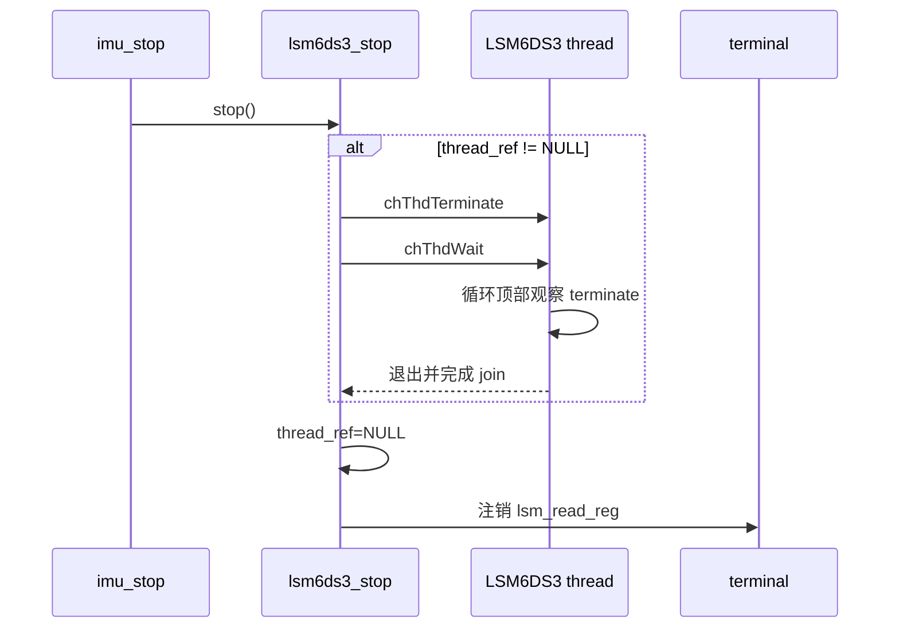

硬件 SPI 模式下，`imu_stop` 在 `lsm6ds3_stop` 返回后再调用 `spiStop`，保证采样线程不再访问外设。

与协作式布尔标志相比，ChibiOS terminate + wait 提供明确的线程 join。但如果 callback 永久阻塞，线程无法返回循环顶部，`chThdWait` 仍会一直等待。

## 18. 终端诊断

初始化成功后注册：

```text
lsm_read_reg [reg]
```

参数按十进制解析。读取成功时输出寄存器的 8 位二进制值，失败时输出 `Read failed`。

当前命令没有同时打印寄存器地址和十六进制数，也不限制参数上界；传入大于 255 的值会在调用 `read_reg(uint8_t)` 时截断为低 8 位。

## 19. 当前实现的注意事项

1. 加速度 ODR 对所有识别变体固定为 6660 Hz，与线程 `rate_hz` 独立；
2. TRC 陀螺 ODR 固定 6660 Hz，标准变体才按请求频率映射；
3. 不读取 status/data-ready，不使用 FIFO 或传感器时间戳；
4. SPI 读写分支总是报告成功，无法发现 MISO 固定或设备掉线；
5. 回调中的磁力计是固定 `{1,2,3}` 占位值；
6. `rate_hz` 缺少正数和可表示周期检查；
7. 首次地址 A 读取失败时，日志可能打印未初始化的 `rxb[0]`；
8. 初始化函数返回 `void`，上层无法直接获得错误码；
9. `imu.c` 的 I²C 初始化函数自身不先调用 `imu_stop`，依赖更上层正常调用顺序；
10. callback 在线程上下文同步执行，阻塞会破坏采样周期和停止过程；
11. 驱动是单实例静态设计，不支持同时连接两个 LSM6DS3；
12. 线程先创建、`imu.c` 随后才注册 callback，首个样本可能被安全跳过；
13. 配置写入没有读回验证；
14. 当前硬件 SPI 数据读取采用 `spiExchange`，应结合目标 ChibiOS 配置确认其对其他实时线程的影响。

## 20. 故障定位流程

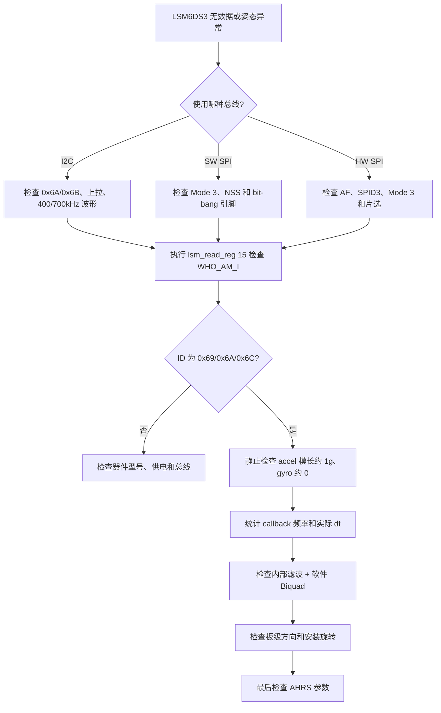

常见问题：

| 现象 | 优先检查 |
|---|---|
| 初始化打印两个地址都失败 | 总线模式、地址、供电、WHO_AM_I |
| I²C 无回调 | 初始化配置写失败或持续 12 字节读取失败 |
| SPI 断线仍有回调 | SPI 分支固定返回成功，需检查数据合理性 |
| 加速度比例错误 | CTRL1_XL 是否为 ±16g，换算是否仍为 0.488 mg/LSB |
| 陀螺比例错误 | CTRL2_G 是否为 ±2000 dps，换算是否为 0.07 dps/LSB |
| 数据重复 | 线程频率高于有效新样本率，且无 data-ready 判断 |
| 姿态延迟明显 | 内部 LPF 与软件 Biquad 延迟叠加 |
| 磁场显示为奇怪常量 | `{1,2,3}` 占位向量经过安装旋转 |
| 停止时卡住 | callback 或底层 SPI/I²C 调用未返回 |

## 21. 推荐改进

1. 给初始化函数增加返回状态和最后错误原因；
2. 初始化 `rxb`，避免失败日志引用未定义内容；
3. 校验 `rate_hz` 的下限、上限和 tick 可表示性；
4. 用 data-ready 或 FIFO 区分新样本与重复读取；
5. 为 SPI 增加芯片在线性验证和异常数据检测；
6. 用有效标志替代 `{1,2,3}` 磁力计占位值；
7. 在线程创建前完成 callback 注册；
8. 对关键配置寄存器执行读回校验；
9. 增加读取失败计数、最后更新时间、实际采样率和超期计数；
10. 将变体识别、ODR 和滤波配置整理为数据表，减少分支与魔数；
11. 明确硬件 SPI `spiExchange` 的执行模型和最坏阻塞时间；
12. 为 I²C、软件 SPI、硬件 SPI 分别增加模拟总线测试。

## 22. 总结

`lsm6ds3.c` 将多个 LSM6DS3 系列变体和三种总线实现统一为周期六轴数据源。它通过 WHO_AM_I 探测地址与变体，配置 ±16 g、±2000 dps、内部滤波、BDU 和寄存器自增，再由 ChibiOS 线程连续读取 12 字节并回调上层。

理解该驱动时应重点区分芯片 ODR 与线程轮询率，区分标准变体和 TRC 变体的滤波路径，并注意 `{1,2,3}` 只是磁力计占位值。对于高可靠或严格时间同步应用，还需要补充 data-ready/FIFO、错误传播、SPI 在线检测和采样率边界保护。
