# main.c 详细说明

本文详细说明 `bldc/main.c` 与 `main.h` 的职责、启动顺序、线程模型、模块依赖、配置复位、Flash 完整性检查及强制复位机制。文档基于当前仓库代码，而不是通用 VESC 启动流程。

## 1. 模块定位

`main.c` 是固件从 ChibiOS 启动环境进入 VESC 业务系统的总装入口。它不实现具体电机算法或通信协议，而是决定各子系统的初始化顺序、启动条件和长期后台任务。

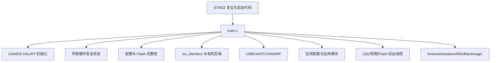

`main.c` 的核心任务可以概括为：

1. 建立 RTOS 和硬件抽象层；
2. 在功率级初始化前建立安全输出状态；
3. 读取并校验持久化数据；
4. 按依赖顺序启动电机、通信和应用；
5. 创建系统级后台线程；
6. 发布“初始化完成”状态并保持主线程存活。

## 2. main.h 的公开接口

`main.h` 只公开三个函数：

| 接口 | 作用 |
|---|---|
| `main_init_done()` | 查询系统是否已经完成主要启动流程 |
| `main_calc_hw_crc()` | 计算硬件相关 QML/自定义配置内容的 CRC32 |
| `main_stop_motor_and_reset()` | 直接关闭 PWM 输出并触发 MCU 系统复位 |

`main()` 本身由 C 启动代码调用，不需要在头文件声明。

## 3. 主要依赖关系

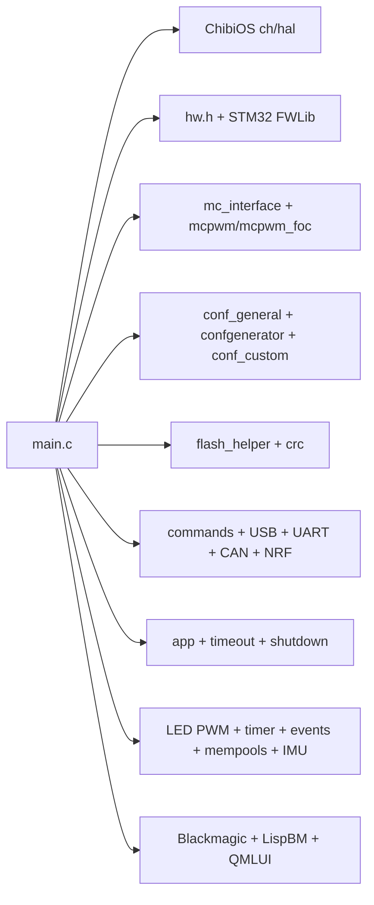

部分依赖由编译宏控制：

- `CAN_ENABLE`：CAN 头文件、初始化和启动帧；
- `COMM_USE_USB`：USB 通信初始化；
- `HW_HAS_PERMANENT_NRF`：板载 NRF 探测和回退；
- `HAS_BLACKMAGIC`：Black Magic 调试接口；
- `USE_LISPBM`：LispBM 接口头文件；
- `BOOT_OK_GPIO`：外部启动成功指示；
- `HW_HAS_DUAL_MOTORS`：第二路 PWM 的强制关闭；
- `FOC_PROFILE_EN`：全局 FOC 性能分析结构。

## 4. 硬件资源说明

源码顶部记录了主要定时器和 DMA 分配：

| 资源 | 典型用途 |
|---|---|
| TIM1 | `mcpwm`/`mcpwm_foc` 电机 PWM |
| TIM2 | FOC 采样时序 |
| TIM5 | 通用高精度 `timer` 模块 |
| TIM8 | 电机 PWM、第二电机或并联功率级 |
| TIM3 | 舵机解码、部分硬件编码器或 PWM servo |
| TIM4 | WS2811/WS2812 LED 或其他硬件编码器 |
| DMA1 Stream2/7 | I2C1，Nunchuk 或温度传感器 |
| DMA2 Stream4 | ADC 与电机控制采样 |

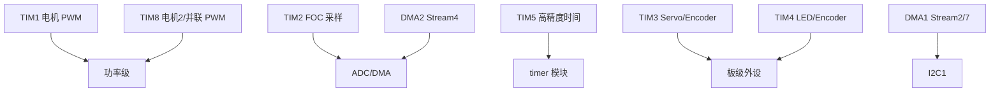

该注释是资源概览，具体映射仍可能由板级宏改变。新增外设前应检查对应 `hwconf` 和驱动实现，而不能只依据此表判断资源空闲。

## 5. 私有状态和线程

`main.c` 只保存一个长期业务状态：

```c
static volatile bool m_init_done = false;
```

并为三个静态线程各分配 256 字节 ChibiOS 工作区：

| 线程 | 优先级 | 周期/阻塞 | 作用 |
|---|---:|---|---|
| `Main LED` | `NORMALPRIO` | 通常 10 ms；故障闪码时更长 | 显示电机运行状态和故障码 |
| `Main periodic` | `NORMALPRIO` | 10 ms | 上报转子位置/误差并修调 HSI |
| `Flash check` | `LOWPRIO` | 每处理一块后 sleep 6 ms | 分块验证 Flash，发现损坏后复位 |

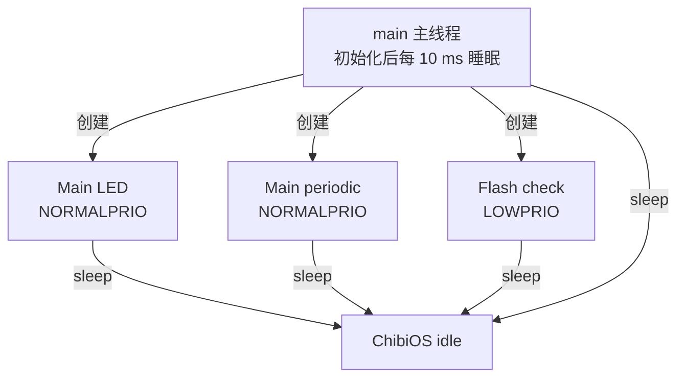

工作区是文件级静态对象，生命周期覆盖固件整个运行期。

## 6. main() 总体启动流程

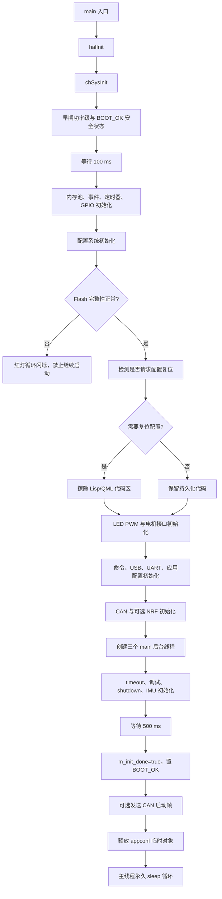

这一顺序体现了关键依赖：定时器必须早于可能使用 I2C 的 `hw_init_gpio()`；应用配置必须早于 CAN 初始化；电机接口必须在 timeout 和部分应用使用电机 API 前完成。

## 7. RTOS 与 HAL 初始化

```c
halInit();
chSysInit();
```

`halInit()` 初始化 ChibiOS HAL 及启用的底层驱动对象；`chSysInit()` 初始化 ChibiOS/RT，并把当前执行 `main()` 的控制流登记为主线程。

从 `chSysInit()` 返回后：

- 中断和抢占式调度已建立；
- `main()` 可以调用 `chThdSleepMilliseconds()`；
- 后续创建的高优先级线程可以抢占主线程；
- 初始化阶段中的 sleep 会让已经就绪的线程运行。

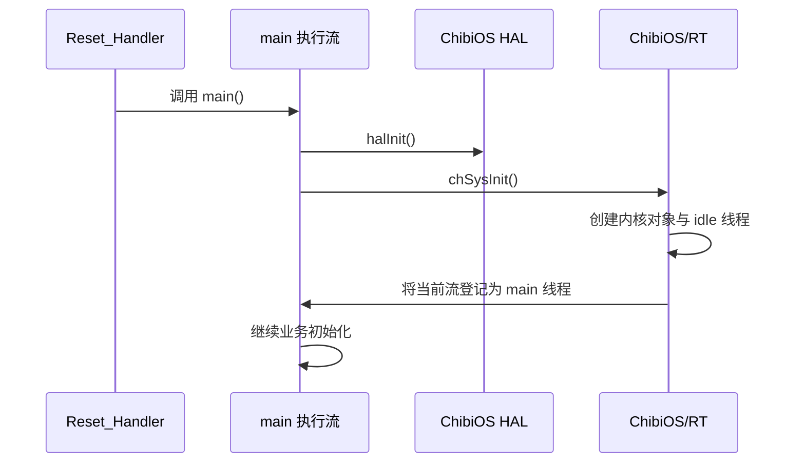

## 8. 早期硬件安全状态

RTOS 启动后，代码立即处理功率级和启动状态引脚：

1. `HW_HAS_DRV8313` 时初始化桥臂控制引脚；
2. 调用 `HW_EARLY_INIT()` 执行板级早期操作；
3. 将 `BOOT_OK_GPIO` 配置为输出并拉低；
4. 等待 100 ms 后再进行完整初始化。

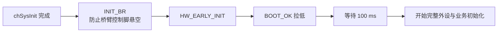

目的在于避免上电期间功率控制引脚浮空导致异常电流，并让外部电源、电压检测或其他板级电路稳定。

## 9. 基础服务初始化

等待结束后依次执行：

```text
mempools_init()
events_init()
timer_init()
hw_init_gpio()
LED_RED_OFF()
LED_GREEN_OFF()
conf_general_init()
```


源码明确说明 `timer_init()` 放在 `hw_init_gpio()` 之前，是为了允许硬件初始化过程使用 I2C 等依赖定时的功能。

## 10. Flash 完整性门禁

`conf_general_init()` 后立即执行完整 Flash 验证：

```c
flash_helper_verify_flash_memory()
```

若返回 `FAULT_CODE_FLASH_CORRUPTION`，系统不会继续启动电机和通信，而是进入红灯闪烁循环：亮 100 ms、灭 75 ms。

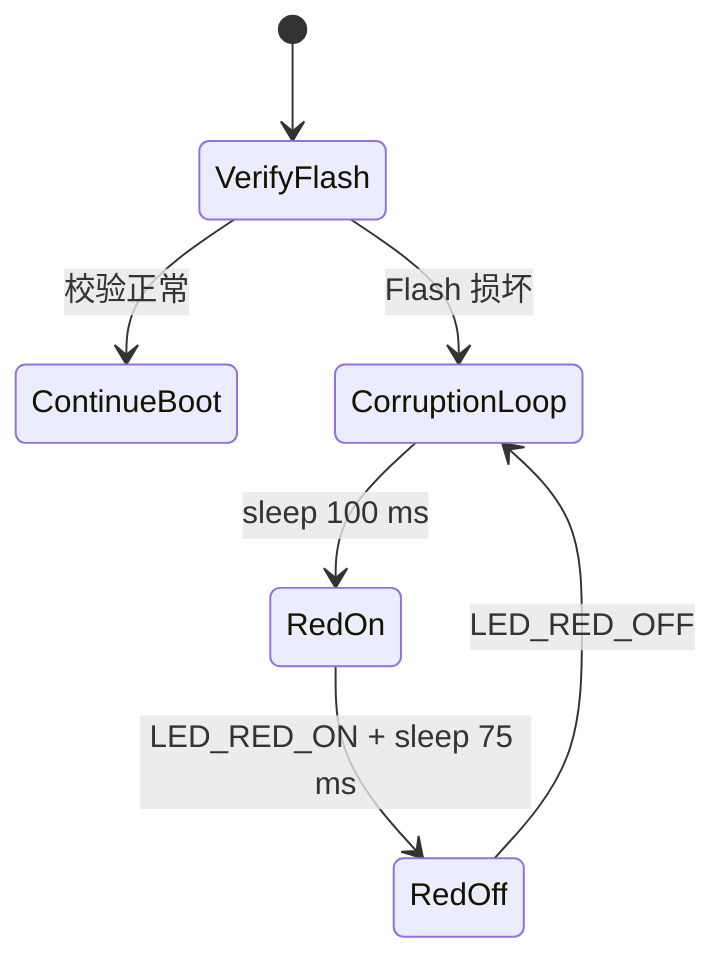

这是启动安全门禁：Flash 损坏时继续运行电机控制代码风险过高，因此代码选择永久停留而不是仅记录故障。

## 11. 配置复位检测

`should_reset_config()` 检查 HALL2 与 SWCLK/PA14 是否被外部短接。它通过多次改变 PA14 模式和输出电平，并比较 `palReadPad(GPIOA, 14)` 与 `READ_HALL2()` 来确认两者是否同步。

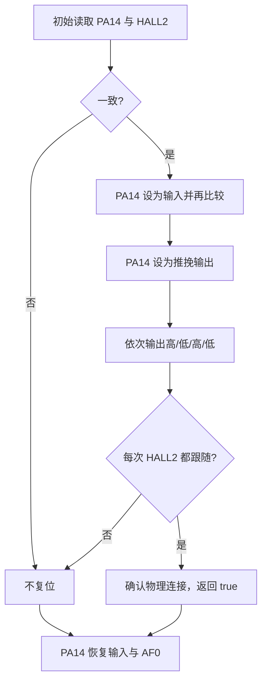

`PIN_CHECK()` 每次先 sleep 1 tick，再比较两个输入。不一致时用 `goto check_end` 统一恢复 PA14 模式。

该检测会临时改变 SWCLK 引脚模式，执行期间调试器连接可能受影响。检测结束后恢复为 `PAL_MODE_ALTERNATE(0)`。

## 12. 配置复位的后续动作

当 `cfg_reset == true`：

- 擦除 Lisp 常量区 `CODE_IND_LISP_CONST`；
- 擦除 Lisp 代码区 `CODE_IND_LISP`；
- 擦除 QML 代码区 `CODE_IND_QML`；
- `mc_interface_init(true)` 重置电机配置；
- 应用配置使用 `confgenerator_set_defaults_appconf()` 并写回存储。

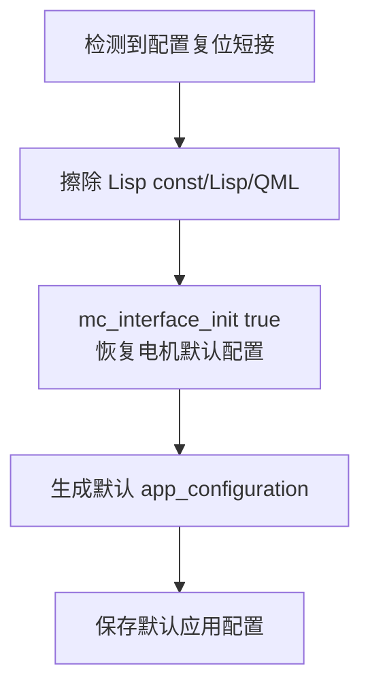

因此该操作不只是重置电机参数，还会清除用户 Lisp/QML 内容。

## 13. 电机子系统初始化

```text
ledpwm_init();
mc_interface_init(cfg_reset);
```

`mc_interface_init()` 会进一步：

- 读取或重置电机配置；
- 初始化编码器和栅极驱动；
- 根据 `motor_type` 初始化 `mcpwm` 或 `mcpwm_foc`；
- 创建接口层的故障、统计、采样发送和定时线程；
- 执行 ADC 偏置校准等后端启动工作。

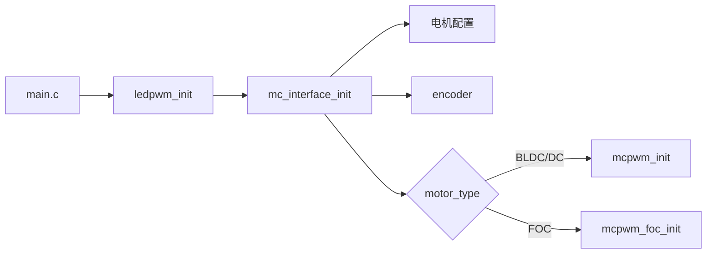

该调用可能执行较长的校准并创建多个线程。返回后电机子系统已具备接受统一控制 API 的条件。

## 14. 命令与通信初始化

初始化顺序为：

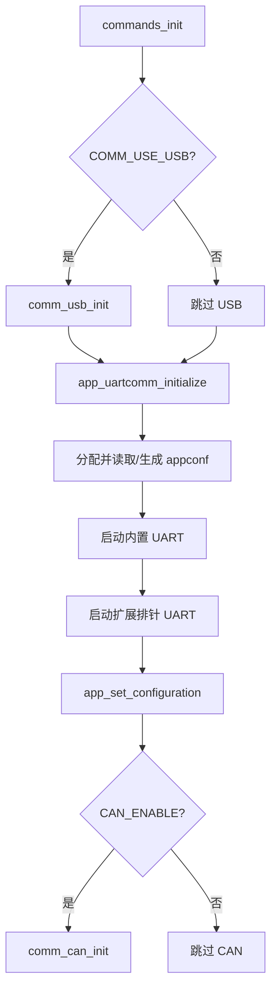

`comm_can_init()` 必须在 `app_set_configuration()` 之后，因为 CAN 初始化会读取应用配置中的 CAN 模式、控制器 ID 等参数。

### 14.1 appconf 的生命周期

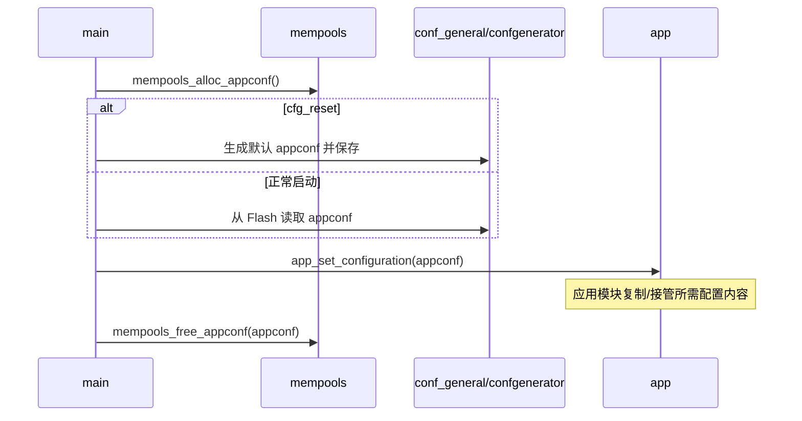

临时配置对象在启动末尾归还内存池，后续不得继续通过该局部指针访问。

## 15. 永久 NRF 初始化与回退

只有定义 `HW_HAS_PERMANENT_NRF` 时执行：

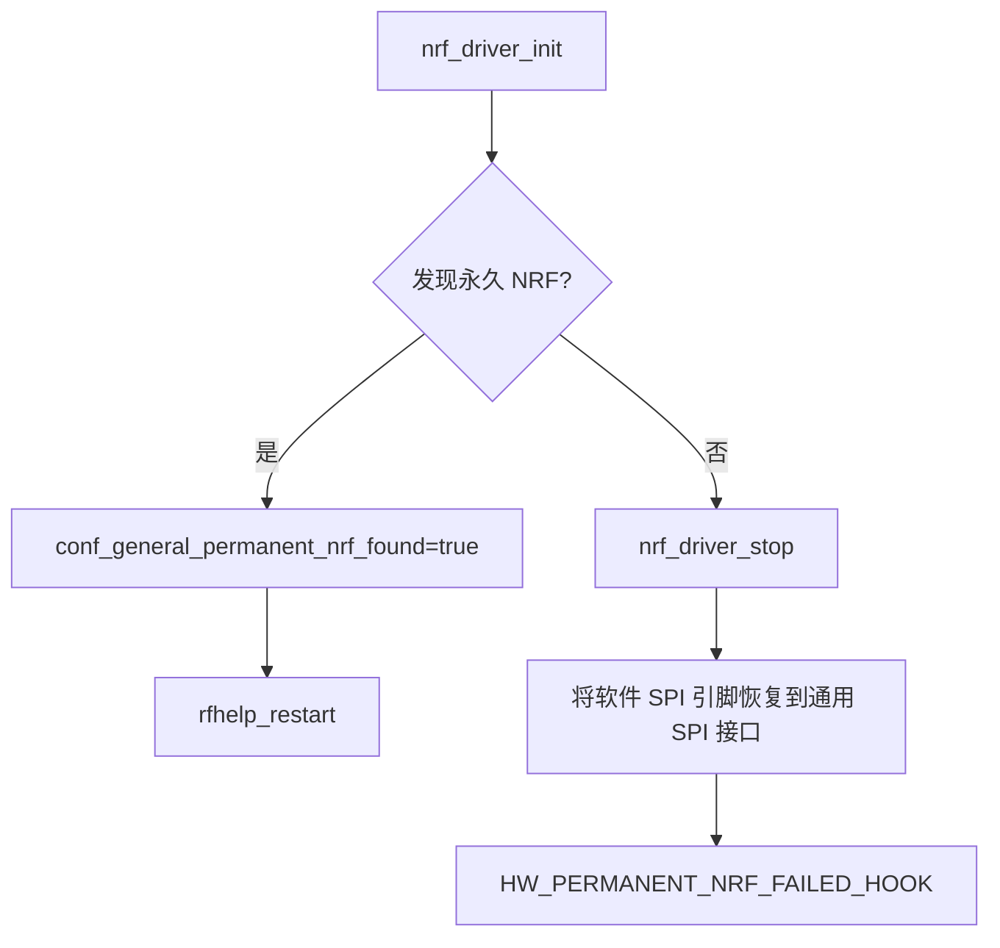

回退路径允许外部 NRF 应用继续复用同一组 SPI 引脚，而不是让失败的板载 NRF 驱动长期占用资源。

## 16. Main LED 线程

LED 线程轮流查询两台电机。单电机构建下选择电机 2 会由接口层回退到电机 1，因此不会访问不存在的第二状态对象。

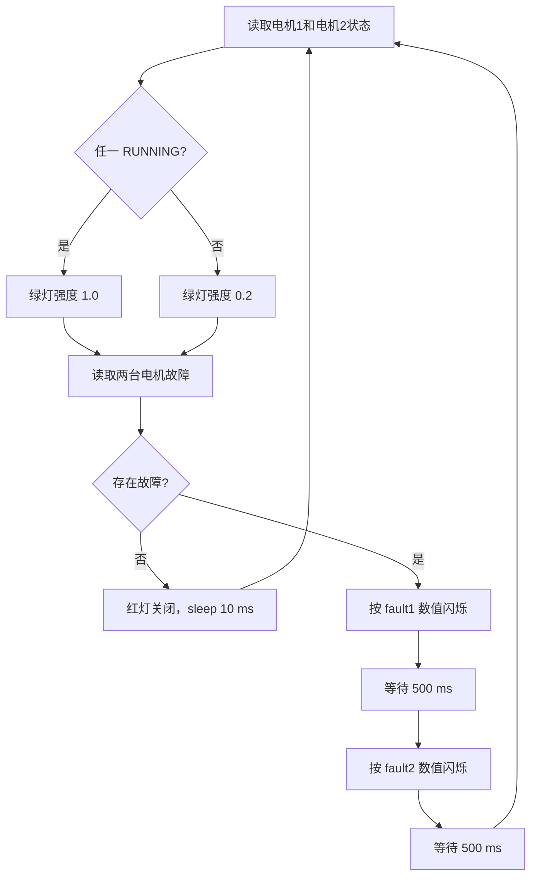

故障码数值直接决定红灯闪烁次数。如果两台电机都有故障，两组闪码之间各有 500 ms 间隔。

注意：闪码期间线程会多次 sleep，下一次状态刷新可能延迟数秒，这是显示策略而不是调度故障。

## 17. Main periodic 线程

周期线程每 10 ms 执行两类工作：向命令系统发送当前选择的转子位置数据，以及调用 `HW_TRIM_HSI()` 补偿内部高速时钟随温度的漂移。

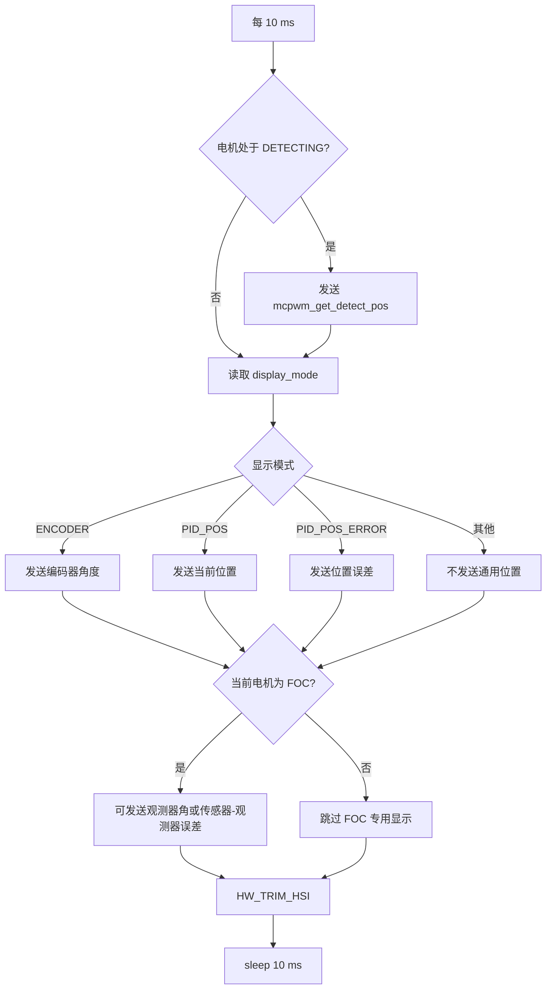

可显示的数据包括：

- 编码器角度；
- PID 当前位置；
- PID 位置误差；
- FOC 观测器角度；
- 编码器与观测器误差；
- Hall 与观测器误差；
- BLDC 检测位置。

## 18. Flash check 线程

启动时已经执行一次全量验证；后台线程则分块持续检查：

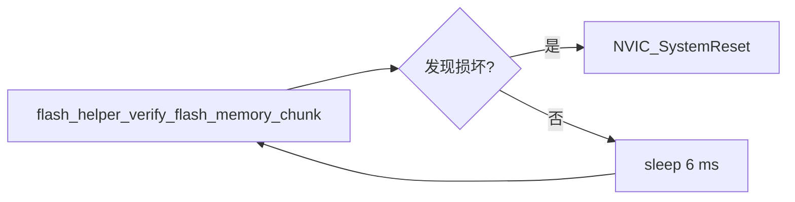

线程使用 `LOWPRIO`，并在每块之后 sleep，避免长时间占用 CPU。发现损坏时直接复位，下一次启动的全量检查会把系统锁定在安全闪灯循环。

## 19. timeout、shutdown、IMU 与调试接口

创建本地线程后继续初始化：

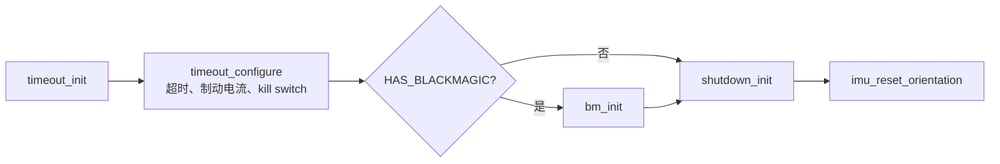

timeout 配置直接来自已经加载的 `appconf`。因此在 `mempools_free_appconf()` 之前完成配置。

`imu_reset_orientation()` 在这里重置方向状态，但完整 IMU 工作线程可能由应用配置或其他模块启动。

## 20. 启动完成发布

所有主要模块启动后，主线程等待 500 ms：

```c
chThdSleepMilliseconds(500);
m_init_done = true;
```

然后：

- 将 `BOOT_OK_GPIO` 拉高；
- 若 CAN 模式是 VESC，则发送 `CAN_PACKET_NOTIFY_BOOT`；
- 释放临时 `appconf`；
- 进入永久 sleep 循环。

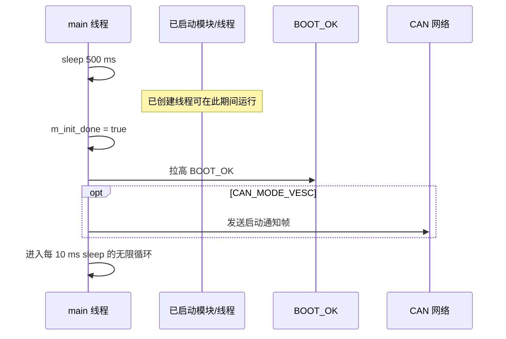

500 ms 不是所有外设都完全稳定的严格证明，而是启动后的缓冲窗口。`main_init_done()` 表示主初始化序列已经走完。

## 21. CAN 启动帧

CAN 启动通知使用扩展 ID：

```text
controller_id | (CAN_PACKET_NOTIFY_BOOT << 8)
```

负载是 `HW_NAME`，最大 8 字节，超过时截断。

```mermaid
flowchart LR
    DONE[m_init_done] --> ENABLE{CAN_ENABLE?}
    ENABLE -->|是| MODE{can_mode == CAN_MODE_VESC?}
    MODE -->|是| ID[组合 controller ID 与通知类型]
    ID --> PAYLOAD[截取最多 8 字节 HW_NAME]
    PAYLOAD --> SEND[comm_can_transmit_eid]
    MODE -->|否| SKIP[不发送]
    ENABLE -->|否| SKIP
```

## 22. main_calc_hw_crc()

该函数计算“硬件相关可变内容”的 CRC32，而不是整个固件镜像 CRC。

```mermaid
flowchart TD
    A[crc=0] --> B{定义 QMLUI_SOURCE_HW?}
    B -->|是| C[加入内置 data_qml_hw]
    B -->|否| D[遍历 conf_custom 配置]
    C --> D
    D --> E[将每份有效配置 XML 加入 CRC]
    E --> F{Flash 中存在 CODE_IND_QML?}
    F -->|是| G[加入外部 QML 代码区]
    F -->|否| H[返回 CRC]
    G --> H
```

CRC 输入包括：

- 可选内置硬件 QML 数据；
- 所有 `conf_custom_get_cfg_xml()` 返回的有效 XML；
- Flash 中的 QML 代码区。

它不包含 `main.c`、电机算法或全部 Flash 固件内容。固件完整性由 `flash_helper` 的另一套验证逻辑负责。

## 23. assert_failed()

STM32 标准外设库参数断言失败时：

1. 通过命令接口打印文件和行号；
2. 调用 `mc_interface_release_motor()` 请求释放电机；
3. 当前线程永久每 1 ms 睡眠。

```mermaid
flowchart LR
    ASSERT[参数断言失败] --> LOG[commands_printf 文件和行号]
    LOG --> RELEASE[mc_interface_release_motor]
    RELEASE --> LOOP[永久 sleep 1 ms]
```

该路径不会自动复位。若命令/通信系统尚未初始化，日志可见性取决于底层状态。源码上方“启用断言时 PWM 频率减半”的注释描述的是性能影响，不是 `assert_failed()` 函数主动调整 PWM。

## 24. main_stop_motor_and_reset()

该函数绕过普通电机接口，直接操作 TIM1（双电机时还操作 TIM8）：

```mermaid
flowchart TD
    A[调用 main_stop_motor_and_reset] --> B[TIM1 三通道强制为 inactive]
    B --> C[高侧保持关闭，互补低侧禁用]
    C --> D[产生 TIM1 COM 事件]
    D --> E{HW_HAS_DRV8313?}
    E -->|是| F[DISABLE_BR]
    E -->|否| G{HW_HAS_DUAL_MOTORS?}
    F --> G
    G -->|是| H[对 TIM8 执行对应关闭]
    G -->|否| I[NVIC_SystemReset]
    H --> I
```

它用于必须立即关闭功率输出再复位的场景，不等待 RTOS 线程或控制环完成清理。

当前双电机分支在关闭 TIM8 后，对 `HW_HAS_DRV8313_2` 调用的是 `ENABLE_BR_2()`。由于第一路使用 `DISABLE_BR()`，该命名表现不对称；是否符合具体硬件有效电平，需要结合板级宏定义确认，修改前不应仅凭函数名判断。

## 25. 启动时的并发时序

初始化不是等 `main()` 最后进入循环后才开始并发。许多 `*_init()` 会创建线程或启用中断。

```mermaid
sequenceDiagram
    participant M as main 线程
    participant MC as 电机控制 ISR/线程
    participant COMM as 通信线程
    participant LOCAL as main 本地线程

    M->>MC: mc_interface_init()
    MC-->>MC: 创建线程并启用 ADC/PWM 中断
    M->>COMM: comm_usb/app_uart/CAN init
    COMM-->>COMM: 创建接收/处理线程
    M->>LOCAL: 创建 LED/Periodic/Flash 线程
    M->>M: sleep 500 ms
    Note over MC,LOCAL: sleep 期间其他线程和中断持续运行
    M->>M: m_init_done=true
```

因此启动阶段的共享状态必须考虑并发。例如 `appconf` 必须在所有读取它的初始化调用完成后才能归还内存池。

## 26. 编译条件关系

```mermaid
flowchart TB
    MAIN[main.c]
    USB{COMM_USE_USB}
    CAN{CAN_ENABLE}
    NRF{HW_HAS_PERMANENT_NRF}
    BM{HAS_BLACKMAGIC}
    BOOT{BOOT_OK_GPIO}
    DUAL{HW_HAS_DUAL_MOTORS}

    MAIN --> USB -->|启用| U[comm_usb_init]
    MAIN --> CAN -->|启用| C[comm_can_init + 启动帧]
    MAIN --> NRF -->|启用| N[永久 NRF 探测]
    MAIN --> BM -->|启用| B[bm_init]
    MAIN --> BOOT -->|定义| O[启动成功 GPIO]
    MAIN --> DUAL -->|定义| D[TIM8 强制关闭路径]
```

代码同时使用 `#ifdef CAN_ENABLE` 和 `#if CAN_ENABLE`。当宏“已定义但值为 0”时，两者行为不同：头文件区可能仍被包含，而初始化区被排除。维护配置时应保持宏定义方式一致。

## 27. 值得注意的实现细节

1. `ledpwm.h` 在 include 列表中重复包含，头文件保护使其不影响功能，但可清理。
2. `main.c` 使用 `#pragma GCC optimize("Os")`，该文件单独偏向代码尺寸优化。
3. LED 线程总会尝试选择电机 2，再恢复电机 1；它没有恢复进入线程前的任意选择，但该线程自身固定以电机 1 为默认上下文。
4. 配置复位检测临时复用 SWCLK/PA14，连接调试器时应注意时序影响。
5. 启动 Flash 损坏时永久闪灯；运行期分块检查发现损坏时先复位，再由启动检查拦截。
6. 主线程最后不返回，只通过 sleep 保持有效线程上下文。
7. `m_init_done` 是 `volatile bool`，用于简单跨线程状态观察；调用者仍应理解它只是启动序列标志，不是完整内存同步协议。
8. `main_stop_motor_and_reset()` 直接操作硬件，调用前不会保存配置或等待通信发送完成。

## 28. 常见问题定位

### 28.1 上电后只闪红灯

优先检查 `flash_helper_verify_flash_memory()` 是否报告 Flash 损坏、固件烧录是否完整、链接布局是否匹配，以及 EEPROM/QML/Lisp 分区是否被错误覆盖。

### 28.2 main_init_done() 一直为 false

按启动顺序检查：

- 是否卡在 Flash 完整性循环；
- 电机 ADC 校准是否等待；
- UART/CAN/NRF 初始化是否阻塞；
- 是否在 500 ms 启动等待前发生故障或复位。

### 28.3 配置每次启动都被重置

检查 HALL2 与 PA14/SWCLK 是否意外短接、板级 `READ_HALL2()` 定义是否正确，以及调试器或外部电路是否影响 PA14 电平。

### 28.4 CAN 没有启动通知

确认：

- 编译时 `CAN_ENABLE` 为真；
- `appconf->can_mode == CAN_MODE_VESC`；
- controller ID 和 CAN 波特率正确；
- `m_init_done` 已置位；
- `HW_NAME` 截断不影响上位机识别。

### 28.5 LED 故障码似乎更新很慢

故障值越大，闪烁一轮越久；双电机故障还会连续显示两组闪码。这是当前线程中的阻塞式显示设计。

## 29. 推荐阅读顺序

```mermaid
flowchart TB
    A[main.h<br/>了解三个公开接口] --> B[main.c include 与资源注释]
    B --> C[三个 THD_FUNCTION]
    C --> D[main_calc_hw_crc]
    D --> E[should_reset_config]
    E --> F[main 前半段<br/>RTOS、安全和 Flash]
    F --> G[main 中段<br/>电机、通信和应用配置]
    G --> H[main 后半段<br/>线程、timeout、启动完成]
    H --> I[main_stop_motor_and_reset]
    I --> J[继续阅读 mc_interface 和 conf_general]
```

## 30. 小结

`main.c` 是 VESC 固件的业务启动编排器。它先建立 ChibiOS，再确保功率输出安全，校验 Flash 和配置复位条件，随后按依赖顺序启动电机、命令、USB/UART/CAN、应用和系统保护模块。

理解该文件应抓住四条主线：哪些步骤是继续启动的安全门禁、配置和临时对象何时有效、哪些初始化会提前引入并发、`m_init_done` 与 BOOT_OK/CAN 启动通知何时发布。具体控制算法和协议细节则应继续追踪到 `mc_interface`、`mcpwm/mcpwm_foc`、`commands` 和各通信模块。
