# make 目录模块关系说明

本文说明 `bldc/make` 目录中各 Makefile 模块的职责、包含关系、变量传递和最终产物。该目录同时服务于嵌入式固件构建、宿主机环境适配、工具安装和 Google Test 单元测试。

## 1. 目录组成

| 文件 | 主要职责 |
|---|---|
| `fw.mk` | 单个硬件目标的固件编译主体，汇总 ChibiOS、业务模块、编译器选项和链接脚本 |
| `system-id.mk` | 识别 Windows、Linux 或 macOS，并定义宿主系统标志 |
| `windows.mk` | Windows 下选择 Python，并定义删除、建目录命令 |
| `linux.mk` | Linux 下选择 Python，并定义 POSIX 文件操作命令 |
| `macos.mk` | macOS 下选择 Python，并定义 POSIX 文件操作命令 |
| `tools.mk` | 工具链、Qt、Qt Creator、Google Test 的安装/清理目标及工具链路径选择 |
| `unittest-defs.mk` | 单元测试通用编译、链接和 gcov Make 模板 |
| `unittest.mk` | 单个测试目录的源文件汇总、Google Test 链接、运行、XML 和覆盖率规则 |

`make` 目录本身不是最外层入口。用户通常执行根目录 `Makefile`，根 Makefile 再包含或递归调用这些模块。

## 2. 总体关系

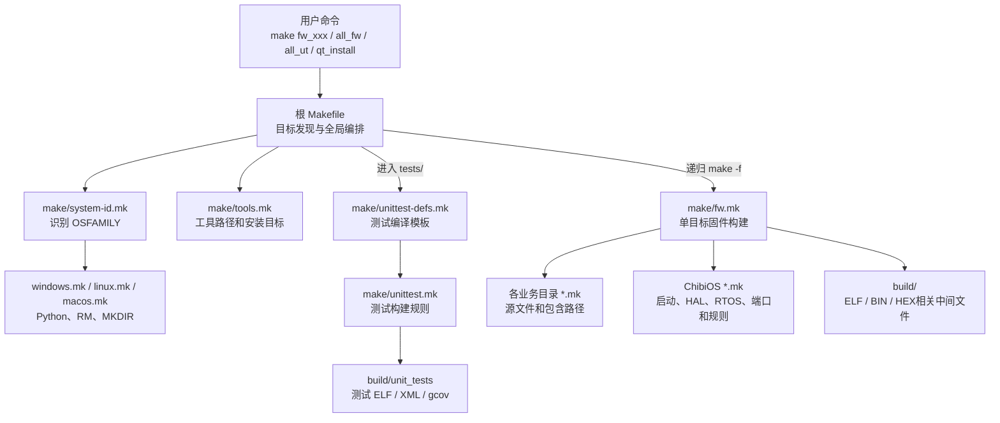

固件和单元测试是两条不同构建链：固件使用 ARM 交叉工具链与 ChibiOS `rules.mk`；单元测试使用宿主机 C/C++ 工具链、Google Test 和 gcov。

## 3. 根 Makefile 的编排角色

根 `Makefile` 完成以下工作：

1. 确定 `ROOT_DIR`、`TOOLS_DIR`、`BUILD_DIR` 和 `DL_DIR`；
2. 扫描 `hwconf` 下的 `hw_*.h`，生成支持的板卡名称；
3. 包含宿主环境和工具模块；
4. 清理可能干扰 GCC 的环境变量；
5. 用 `FW_TEMPLATE` 为每块板生成构建、清理和烧录目标；
6. 用 `UT_TEMPLATE` 为每个单元测试生成构建、运行、XML 和覆盖率目标。

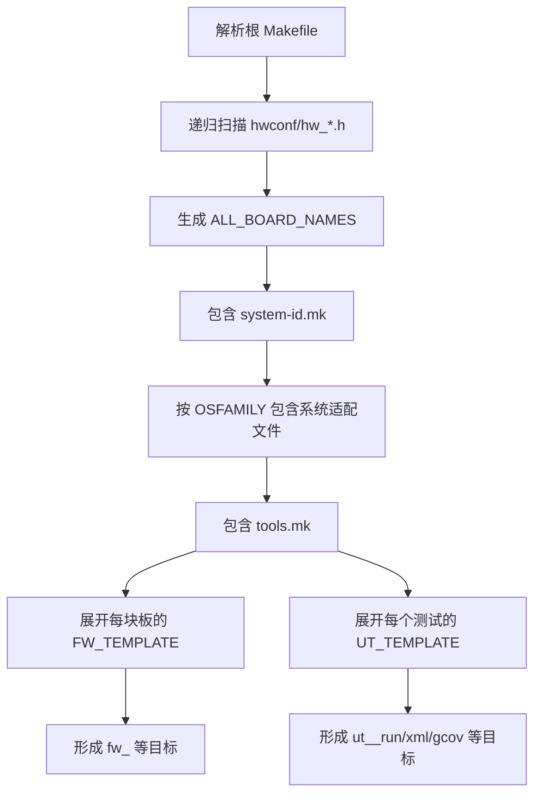

根 Makefile 使用递归 Make 隔离每个固件目标。这样不同板卡可拥有独立 `PROJECT`、`BUILDDIR`、硬件源文件和预处理宏。

## 4. system-id.mk：识别宿主操作系统

`system-id.mk` 根据 `OS=Windows_NT` 或 `uname` 设置：

- `OSFAMILY=windows/linux/macos`；
- `WINDOWS`、`LINUX` 或 `MACOS` 条件变量；
- `OSFLAG` 中的操作系统和 CPU 架构宏。

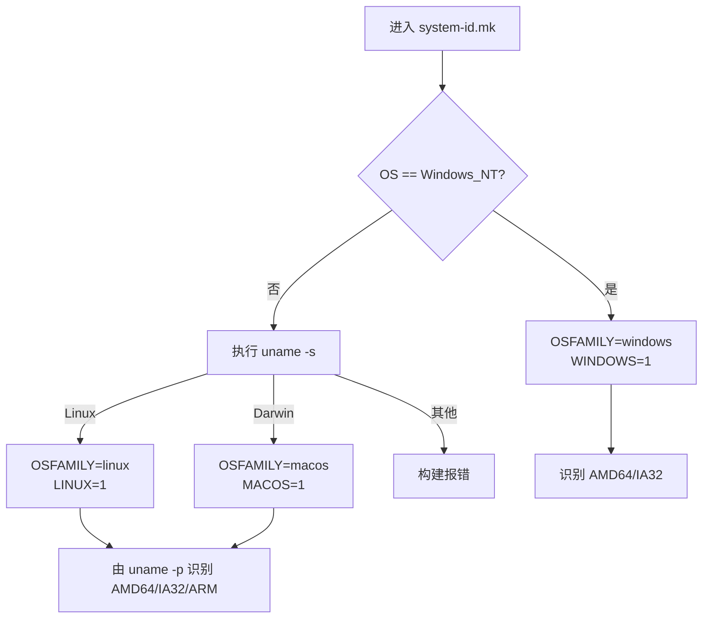

`OSFAMILY` 随后用于动态包含 `make/$(OSFAMILY).mk`，也被 `tools.mk` 用来选择下载包和命令语法。

## 5. windows/linux/macos.mk：宿主环境适配

三份文件职责相同，但命令实现不同：

| 功能 | Windows | Linux/macOS |
|---|---|---|
| Python 3 检测 | `python -V`，后备 `where python3` | `python -V`，后备 `which python3` |
| 删除命令 | `del` 或 PowerShell 清理分支 | `rm` |
| 创建目录 | PowerShell `New-Item` | `mkdir -p` |

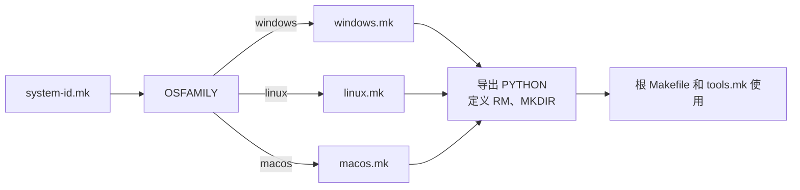

这些文件只适配执行构建的电脑，不决定固件目标 MCU。无论宿主机是什么系统，固件目标仍是 Cortex-M4。

## 6. tools.mk：工具安装与工具链选择

`tools.mk` 包含两类功能。

### 6.1 手动安装目标

| 目标 | 作用 |
|---|---|
| `arm_sdk_install/clean` | 下载并解压 GNU Arm Embedded Toolchain |
| `qt_sdk_install/clean` | 通过 `aqt` 安装 Qt 5.15.2 |
| `qt_creator_install/configure/clean` | 安装并配置 Qt Creator Kit |
| `qt_linuxdeployqt_install` | Linux 下安装 linuxdeployqt |
| `qt_install` | 聚合 Qt 相关安装目标 |
| `gtest_install/clean` | 下载 Google Test 1.11.0 |

这些目标不会自动成为默认构建依赖，需要用户显式调用。

### 6.2 工具路径与版本信息

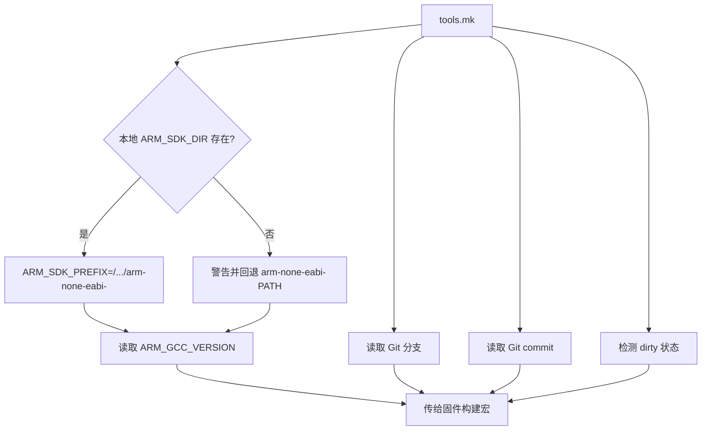

`GIT_BRANCH_NAME`、`GIT_COMMIT_HASH`、dirty 后缀和编译器版本会由根 Makefile 注入固件预处理宏，用于运行时版本信息。

## 7. 板卡目标如何生成

根 Makefile 从 `hwconf` 中发现板卡，再用 `FW_TEMPLATE` 生成规则。

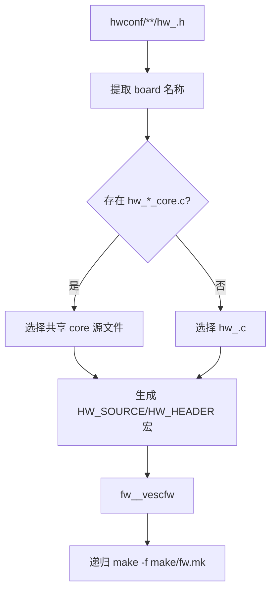

递归调用向 `fw.mk` 传入：

- `TCHAIN_PREFIX`：ARM 工具链前缀；
- `BUILDDIR`：该板卡独立输出目录；
- `PROJECT`：项目/板卡名称；
- `build_args`：硬件源、硬件头、Git 和 GCC 版本宏。

`fw_custom` 则允许调用者显式提供 `HW_SRC` 和 `HW_HEADER`，不依赖自动板卡发现。

## 8. fw.mk：固件构建主体

`fw.mk` 是单个板卡的递归 Makefile，主要分为：

1. 全局编译选项；
2. Cortex-M4、栈和 FPU 选项；
3. ChibiOS 与业务模块源文件聚合；
4. 工具链命令及告警选项；
5. 用户库和标准外设库；
6. ChibiOS `rules.mk` 通用编译规则；
7. ELF 到 BIN 的附加产物规则。

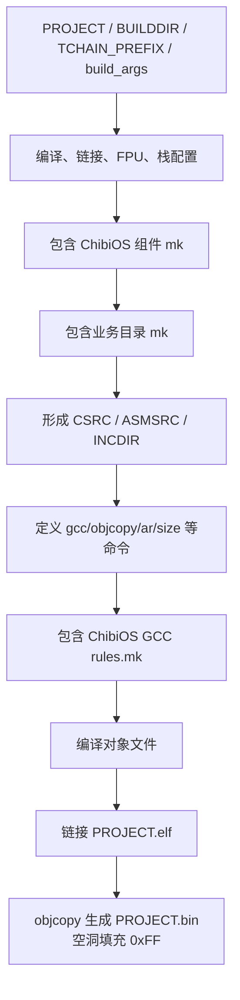

## 9. fw.mk 的主要构建选项

| 变量 | 默认值 | 含义 |
|---|---|---|
| `USE_OPT` | `-O2 -ggdb ... -std=gnu99` | C 编译优化、调试和语言选项 |
| `USE_LINK_GC` | `yes` | 链接时删除未使用节和数据 |
| `USE_LDOPT` | `--print-memory-usage` | 链接后显示 Flash/RAM 使用量 |
| `USE_LTO` | `no` | 是否启用链接时优化 |
| `USE_THUMB` | `yes` | 生成 Thumb 指令 |
| `USE_SMART_BUILD` | `yes` | 跳过配置未使用模块 |
| `USE_FPU` | `hard` | Cortex-M4 硬件浮点 ABI |
| `USE_FWLIB` | `yes` | 包含 STM32 标准外设库 |
| `USE_PROCESS_STACKSIZE` | `0x800` | main/进程栈大小 |
| `USE_EXCEPTIONS_STACKSIZE` | `0x800` | 中断与异常栈大小 |
| `USE_LISPBM` | `1` | 是否编译 LispBM |

变量大多使用 `?=` 或“为空才赋默认值”的模式，可从递归 Make 命令行覆盖。

`USE_OPT` 会加入 `build_args`，从而把选定板卡的 `HW_SOURCE` 和 `HW_HEADER` 作为字符串宏传给源码。它还默认启用若干 LispBM 功能宏和单精度浮点相关选项。

## 10. ChibiOS 模块汇聚

`fw.mk` 先包含 ChibiOS 自带构建片段：

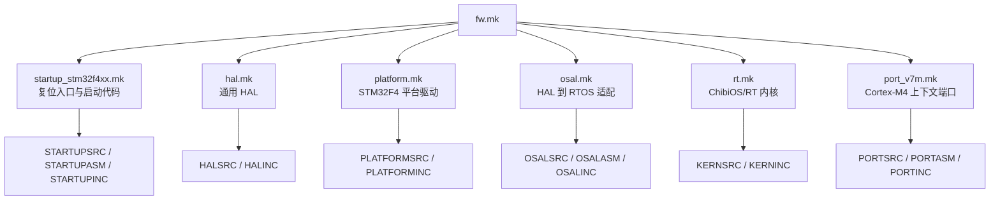

这些变量随后被拼入 `CSRC`、`ASMSRC` 和 `INCDIR`。这说明 `fw.mk` 不是逐个硬编码所有 ChibiOS 文件，而是消费各子系统导出的变量。

## 11. 业务模块汇聚

业务目录采用两种 `.mk` 风格：

- 先导出专用变量，再由 `fw.mk` 汇总，例如 `APPSRC`、`IMUSRC`、`ENCSRC`；
- 直接 `CSRC +=` 和 `INCDIR +=`，例如 `comm.mk`、`motor.mk`、`util.mk`、`driver.mk`。

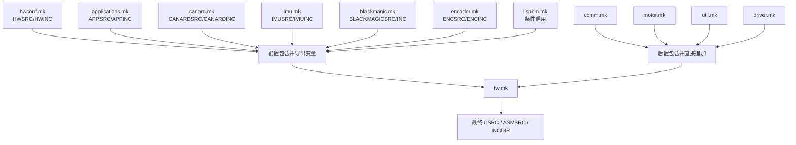

`app_custom_mkfile` 若由外部定义，会在基础业务模块之后被包含，可为定制应用追加源文件、包含路径或宏。

## 12. 源文件变量如何形成

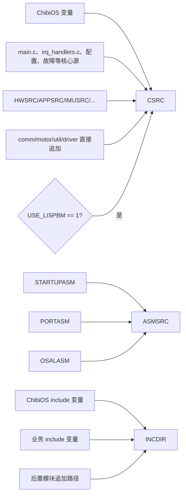

`CPPSRC` 当前为空，固件主体按 C99 构建；链接器仍使用 `gcc` 而不是 `g++`，避免引入 C++ 运行库开销。

## 13. 编译器、链接器与产物

`fw.mk` 将 `TRGT` 设为传入的 `TCHAIN_PREFIX`，再派生：

- `CC=$(TRGT)gcc`；
- `CPPC=$(TRGT)g++`；
- `LD=$(TRGT)gcc`；
- `CP=$(TRGT)objcopy`；
- `AS=$(TRGT)gcc -x assembler-with-cpp`；
- `AR`、`objdump`、`size` 等工具。

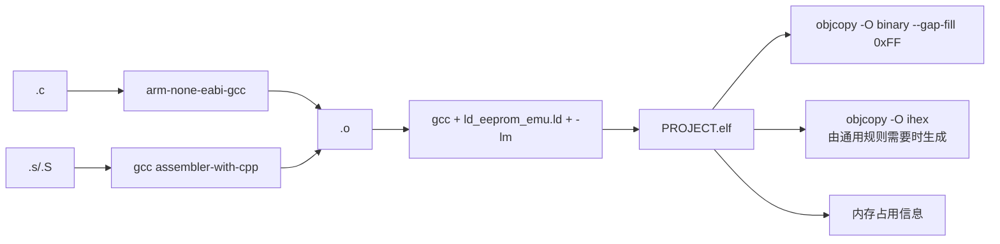

链接脚本固定为 `ld_eeprom_emu.ld`，负责 Flash/RAM 布局及 EEPROM 模拟区域。数学库通过 `ULIBS=-lm` 加入链接。

最终具体规则主要由 ChibiOS 的 `rules.mk` 提供；`fw.mk` 只追加了明确的 `.elf -> .bin` 规则。

## 14. 固件构建时序

以 `make fw_<board>` 为例：

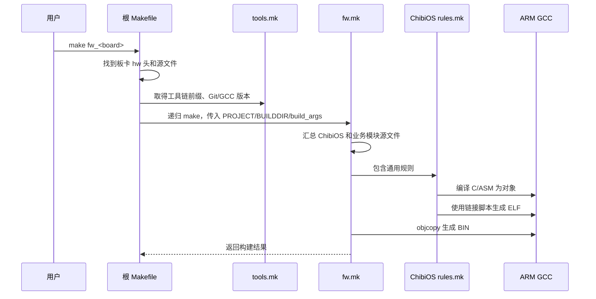

## 15. unittest-defs.mk：测试规则原语

`unittest-defs.mk` 定义宿主测试使用的基础工具和四个模板：

| 模板 | 作用 |
|---|---|
| `COMPILE_C_TEMPLATE` | 将指定 C 文件编译为测试对象，可传额外标志 |
| `COMPILE_CXX_TEMPLATE` | 将 C++/Google Test 文件编译为对象 |
| `LINK_CXX_TEMPLATE` | 用宿主 C++ 链接器生成测试 ELF |
| `GCOV_TEMPLATE` | 在输出目录运行 gcov 并生成 `.gcov` |

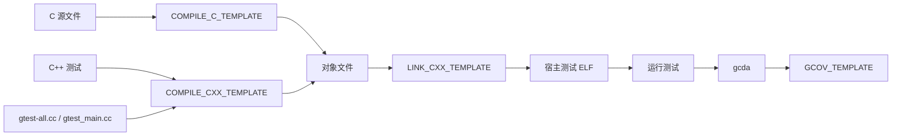

虽然文件定义了 `THUMB=-mthumb`，`unittest.mk` 会显式清空它，因为测试在宿主机运行而不是 Cortex-M4 上运行。

## 16. unittest.mk：单个测试构建模板

每个测试目录先包含 `unittest-defs.mk`，定义自己的 `SRC`、包含路径和标志，最后包含 `unittest.mk`。例如 `tests/utils_math/Makefile` 选择 `utils_math.c` 作为被测源，并加入本地 mock 头文件。

`unittest.mk` 完成：

- 自动收集测试目录的 `.c` mock 和 `.cpp` 测试；
- 为被测 C 文件添加 gcov 编译标志；
- 编译 Google Test 主函数和实现；
- 链接 `pthread` 与覆盖率运行时；
- 提供 `elf`、`run`、`xml` 和 `gcov` 目标。

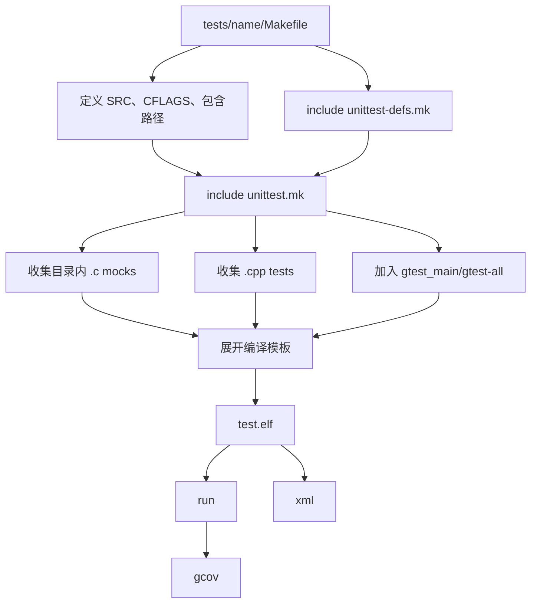

## 17. 根 Makefile 与单元测试模块的关系

根 Makefile 当前将 `ALL_UNITTESTS` 设为 `utils_math`。`UT_TEMPLATE` 切换到对应测试目录，再执行子 Make：

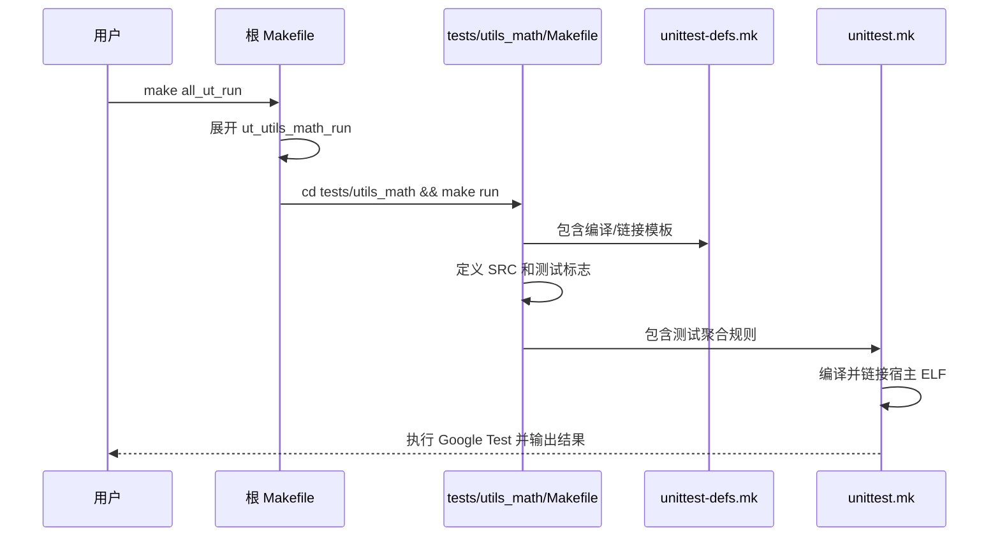

`all_ut_run` 会禁用并行 Make，避免多个测试的 TAP/XML 或控制台输出交错。

## 18. tools 与测试的关系

`gtest_install` 将 Google Test 安装到 `$(TOOLS_DIR)/gtest-1.11.0`，根 Makefile再把 `GTEST_DIR` 传给测试子 Make。

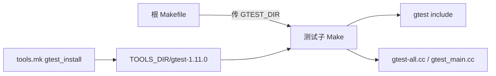

工具安装需要网络和宿主机解压命令，但正常固件构建只要工具链已经安装或位于 PATH 中，就不需要执行安装目标。

## 19. 变量作用域与追加顺序

GNU Make 的包含文件共享同一变量空间，因此顺序很重要：

- ChibiOS 和前置业务 `.mk` 先定义专用变量；
- `fw.mk` 用 `=` 建立基础 `CSRC` 和 `INCDIR`；
- `comm/motor/util/driver.mk` 随后用 `+=` 追加；
- 可选 LispBM 和自定义应用再条件追加；
- 最后包含 `rules.mk`，此时源文件和路径列表已经完整。

新增模块时，应确认它是导出专用变量还是直接追加全局变量，并把 include 放在对应阶段。若在 `CSRC = ...` 之前直接追加，后面的赋值可能覆盖结果。

## 20. 常用目标

| 目标 | 构建链 |
|---|---|
| `make fw_<board>` | 根 Makefile → `FW_TEMPLATE` → `fw.mk` → ARM 固件 |
| `make all_fw` | 为发现的全部板卡执行固件构建 |
| `make fw_custom HW_SRC=... HW_HEADER=...` | 使用显式硬件文件构建 custom 固件 |
| `make all_fw_package` | 构建全部目标并运行 `package_firmware.py` |
| `make fw_<board>_flash` | 构建后通过 OpenOCD 烧录 |
| `make all_ut` | 构建当前登记的全部单元测试 |
| `make all_ut_run` | 构建并运行测试 |
| `make all_ut_xml` | 生成 Google Test XML |
| `make all_ut_gcov` | 生成覆盖率文件 |
| `make arm_sdk_install` | 安装 ARM 工具链 |
| `make qt_install` | 安装 Qt、Qt Creator 和相关工具 |

## 21. 新增业务模块的方法

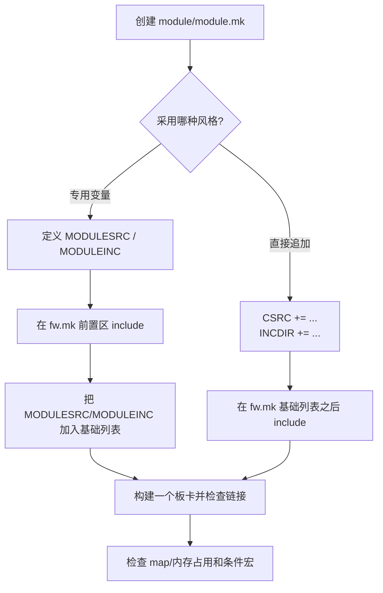

如果模块只在部分硬件或功能开关下使用，应使用配置宏或 Make 条件避免无条件拉入源文件。`USE_SMART_BUILD` 能帮助 ChibiOS 组件裁剪，但业务模块仍需自行设计条件。

## 22. 新增单元测试的方法

1. 新建 `tests/<name>/Makefile` 和测试 `.cpp`；
2. 先包含 `make/unittest-defs.mk`；
3. 设置 `SRC` 为被测 C 文件；
4. 添加测试所需 mock `.c/.h` 和包含路径；
5. 最后包含 `make/unittest.mk`；
6. 将名称加入根 Makefile 的 `ALL_UNITTESTS`。

测试模板按源文件 basename 生成对象名。若两个不同路径的源文件同名，会映射到同一输出对象，新增复杂测试时需避免名称冲突。

## 23. 修改与调试注意事项

1. **区分根编排和递归构建。** `fw.mk` 依赖根 Makefile传入 `PROJECT`、`BUILDDIR` 和工具链前缀。
2. **注意 include 顺序。** `CSRC =` 会覆盖之前的直接追加，`+=` 应放在基础赋值之后。
3. **不要混淆宿主和目标架构。** OS 适配文件处理构建电脑，`MCU=cortex-m4` 处理目标 MCU。
4. **命令行变量可能被清理。** 根 Makefile主动清除 `CFLAGS`、`CPATH` 等可能污染 GCC 的环境变量。
5. **`build_args` 是编译宏通道。** 引号和路径必须正确转义，否则 `HW_SOURCE/HW_HEADER` 宏会损坏。
6. **固件使用硬浮点 ABI。** 外部预编译库必须使用兼容的 Cortex-M4、Thumb 和 hard-float ABI。
7. **查看完整命令用 `V=1`。** 默认构建隐藏详细命令。
8. **链接裁剪可能隐藏遗漏。** 新增仅通过回调/注册表引用的节时，应确认 `--gc-sections` 不会移除它。
9. **工具安装目标会下载并清理目录。** 它们与普通编译目标不同，应在明确需要时执行。
10. **单元测试运行在宿主机。** 硬件寄存器、ChibiOS 和 HAL 依赖需要 mock，不能直接复用固件运行假设。
11. **当前 macOS 后备 Python 赋值值得复核。** `PYTHON:=python \` 与同一分支的 warning 写法可能把续行语义带入变量定义。
12. **Windows 的 `RM := del` 只适合部分规则。** 递归目录清理已通过 PowerShell 条件分支实现，不应直接套用 POSIX `rm -rf` 写法。

## 24. 推荐阅读顺序

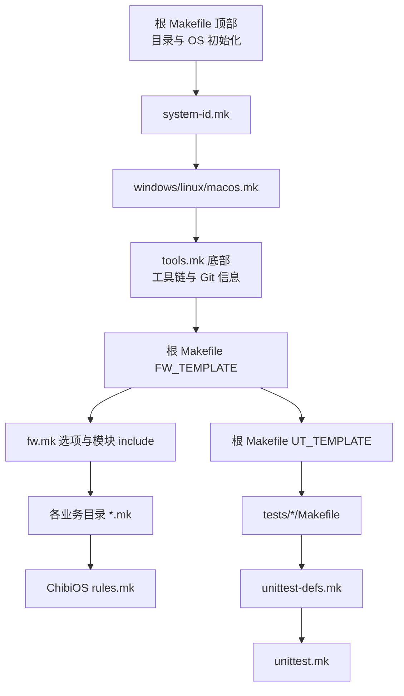

## 25. 小结

`bldc/make` 将构建系统拆为四层：宿主系统识别与命令适配、工具安装与路径发现、Cortex-M4 固件构建、宿主机单元测试。根 Makefile负责发现板卡和生成目标，`fw.mk` 负责单块板卡的完整固件，测试模块则以模板方式构建 Google Test。

理解该目录时应抓住三条数据流：板卡信息如何变成 `build_args`，各模块 `.mk` 如何汇聚为 `CSRC/ASMSRC/INCDIR`，最终变量如何被 ChibiOS `rules.mk` 消费并生成 ELF/BIN。单元测试链与这条固件链相互独立，只共享根目录的工具和目标编排。
