# make/fw.mk 解析

本文档解析 `bldc/make/fw.mk`。该文件是固件构建的真正核心：主 `Makefile` 负责生成板卡目标并递归调用它，而 `make/fw.mk` 负责汇总源码、设置编译选项、选择链接脚本、配置 ARM GCC 工具链，并把最终编译规则交给 ChibiOS 的 `rules.mk`。

## 调用入口

主 `Makefile` 中的板卡目标会以递归 make 的形式调用 `fw.mk`：

```makefile
$(MAKE) -f $(MAKE_DIR)/fw.mk \
  TCHAIN_PREFIX="$(ARM_SDK_PREFIX)" \
  BUILDDIR="$(BUILD_DIR)/<board>" \
  PROJECT="<board>" \
  build_args='<board build macros>' \
  USE_VERBOSE_COMPILE=no
```

传入变量含义：

```text
TCHAIN_PREFIX：交叉编译器前缀，如 arm-none-eabi-
BUILDDIR：当前板卡输出目录，如 build/100_250
PROJECT：固件名，如 100_250
build_args：主 Makefile 生成的板卡宏，如 HW_SOURCE/HW_HEADER/Git 信息
USE_VERBOSE_COMPILE：控制 ChibiOS rules.mk 的命令输出详细程度
```

整体承接关系：

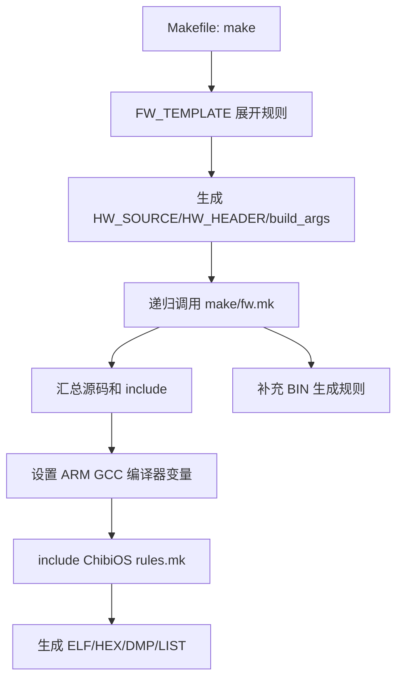

## 文件结构

`fw.mk` 可以分为 5 段：

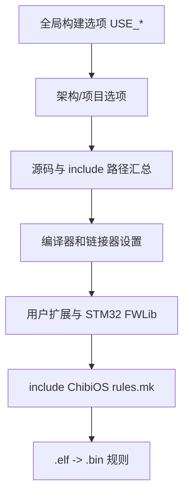

对应内容：

```text
Build global options：优化、链接 GC、LTO、Thumb、LispBM 等开关。
Architecture options：栈大小、FPU、STM32 FWLib。
Project sources and paths：包含 ChibiOS 和业务模块 mk，汇总 CSRC/ASMSRC/INCDIR。
Compiler settings：设置 ARM GCC、objcopy、size、warning 等变量。
User section：预留 UDEFS/UINCDIR/ULIBS。
Rules：引入 ChibiOS GCC rules.mk，并补充 .bin 规则。
```

## 全局构建选项

默认启用 LispBM：

```makefile
USE_LISPBM ?= 1
```

默认 C 编译选项：

```makefile
USE_OPT = -O2 -ggdb -fomit-frame-pointer -falign-functions=16 -std=gnu99 -D_GNU_SOURCE
USE_OPT += -DBOARD_OTG_NOVBUSSENS $(build_args)
USE_OPT += -DLBM_USE_DYN_FUNS -DLBM_USE_DYN_MACROS -DLBM_USE_DYN_LOOPS -DLBM_USE_TIME_QUOTA
USE_OPT += -DLBM_USE_ERROR_LINENO -DLBM_USE_MACRO_REST_ARGS
USE_OPT += -fsingle-precision-constant -Wdouble-promotion -specs=nosys.specs
```

关键点：

```text
build_args 从主 Makefile 注入，里面包含当前板卡的 HW_SOURCE/HW_HEADER。
-O2 用于优化。
-ggdb 保留调试信息。
-std=gnu99 使用 GNU C99。
-fsingle-precision-constant 和 -Wdouble-promotion 用于浮点行为和告警控制。
-specs=nosys.specs 面向裸机/半裸机环境。
```

其他默认开关：

```text
USE_COPT = 空
USE_CPPOPT = -fno-rtti
USE_LINK_GC = yes
USE_LDOPT = --print-memory-usage
USE_LTO = no
USE_THUMB = yes
USE_VERBOSE_COMPILE = no
USE_SMART_BUILD = yes
```

这些变量会被后续 ChibiOS `rules.mk` 消费。

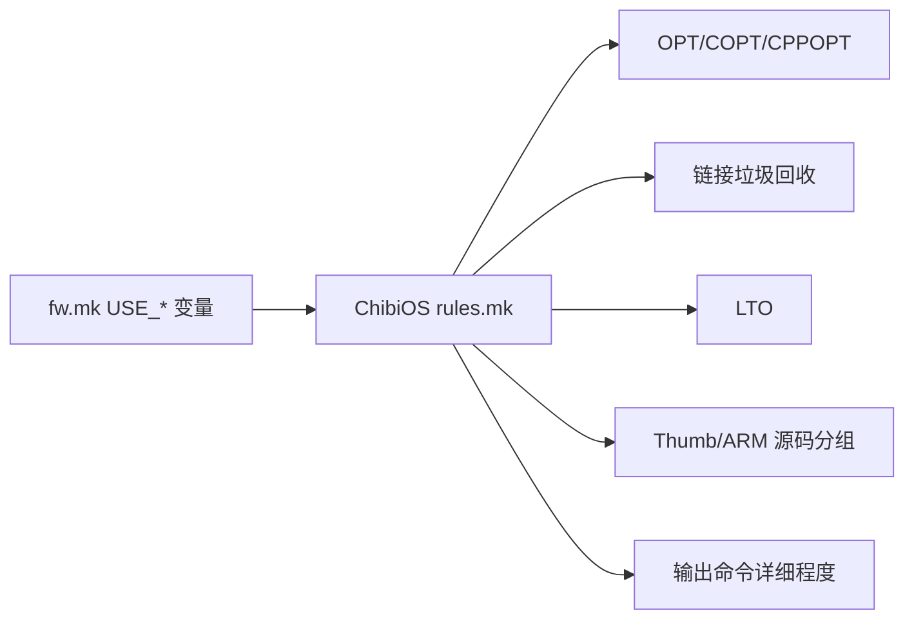

## 架构选项

`fw.mk` 针对 STM32F4/Cortex-M4 设置：

```makefile
USE_PROCESS_STACKSIZE = 0x800
USE_EXCEPTIONS_STACKSIZE = 0x800
USE_FPU = hard
USE_FWLIB = yes
```

含义：

```text
USE_PROCESS_STACKSIZE：main 线程/process stack 大小。
USE_EXCEPTIONS_STACKSIZE：异常/中断栈大小。
USE_FPU=hard：启用 Cortex-M4 硬件 FPU。
USE_FWLIB=yes：纳入 STM32 标准外设库。
```

后续 `rules.mk` 会把 FPU 转换为：

```text
-mfloat-abi=hard
-mfpu=fpv4-sp-d16
-DCORTEX_USE_FPU=TRUE
```

## ChibiOS 基础模块引入

`fw.mk` 首先设置：

```makefile
CHIBIOS = ChibiOS_3.0.5
```

然后引入启动代码、HAL、RTOS 和 Cortex-M4 端口：

```makefile
include $(CHIBIOS)/os/common/ports/ARMCMx/compilers/GCC/mk/startup_stm32f4xx.mk
include $(CHIBIOS)/os/hal/hal.mk
include $(CHIBIOS)/os/hal/ports/STM32/STM32F4xx/platform.mk
include $(CHIBIOS)/os/hal/osal/rt/osal.mk
include $(CHIBIOS)/os/rt/rt.mk
include $(CHIBIOS)/os/rt/ports/ARMCMx/compilers/GCC/mk/port_v7m.mk
```

这些文件提供：

```text
STARTUPSRC/STARTUPASM/STARTUPINC
HALSRC/HALINC
PLATFORMSRC/PLATFORMINC
KERNSRC/KERNINC
PORTSRC/PORTASM/PORTINC
OSALSRC/OSALASM/OSALINC
```

关系图：

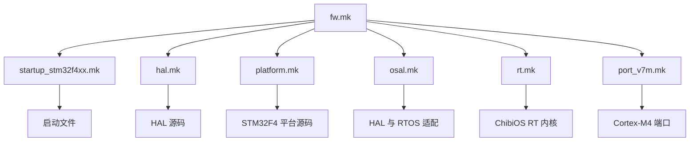

## 业务模块引入

第一批模块通过变量形式加入基础 `CSRC`：

```makefile
include hwconf/hwconf.mk
include applications/applications.mk
include libcanard/canard.mk
include imu/imu.mk
include blackmagic/blackmagic.mk
include encoder/encoder.mk
```

如果启用 LispBM：

```makefile
include lispBM/lispbm.mk
USE_OPT += -DUSE_LISPBM
```

第二批模块直接追加 `CSRC` 和 `INCDIR`：

```makefile
include comm/comm.mk
include motor/motor.mk
include util/util.mk
include driver/driver.mk
```

为什么分两批：

```text
第一批模块多通过 HWSRC/APPSRC/CANARDSRC/IMUSRC/BLACKMAGICSRC/ENCSRC/LISPBMSRC 变量被 CSRC 显式引用。
第二批模块的 *.mk 直接使用 CSRC += 和 INCDIR += 追加到总源码列表。
```

模块来源图：

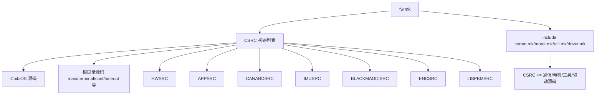

## 链接脚本

固件使用：

```makefile
LDSCRIPT = ld_eeprom_emu.ld
```

该链接脚本会传给 ChibiOS `rules.mk` 的链接参数：

```text
--script=$(LDSCRIPT)
```

它决定固件镜像的内存布局，包括 flash、RAM、EEPROM emulation 相关区域等。

## C 源码集合 CSRC

`fw.mk` 的 `CSRC` 汇总了 ChibiOS、根目录核心文件和模块文件：

```text
ChibiOS:
  STARTUPSRC / KERNSRC / PORTSRC / OSALSRC / HALSRC / PLATFORMSRC

ChibiOS 辅助:
  chprintf.c
  syscalls.c

根目录核心:
  main.c
  irq_handlers.c
  terminal.c
  conf_general.c
  timeout.c
  flash_helper.c
  confgenerator.c
  bms.c
  events.c
  conf_custom.c

模块变量:
  HWSRC
  APPSRC
  CANARDSRC
  IMUSRC
  BLACKMAGICSRC
  ENCSRC
  LISPBMSRC

固定源码:
  qmlui/qmlui.c

后续追加:
  comm/comm.mk
  motor/motor.mk
  util/util.mk
  driver/driver.mk
```

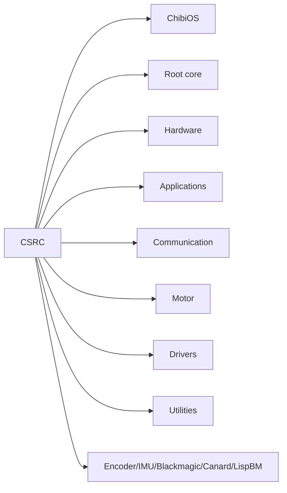

## 汇编和 C++ 源码

当前 `fw.mk` 中：

```makefile
CPPSRC =
ACSRC =
ACPPSRC =
TCSRC =
TCPPSRC =
ASMSRC = $(STARTUPASM) $(PORTASM) $(OSALASM)
```

含义：

```text
C++ 源码列表为空，但保留 CPPC/CPPFLAGS 机制。
普通 C 源码根据 USE_THUMB 决定进入 TCSRC 或 ACSRC。
汇编源码来自 ChibiOS startup/port/osal。
```

默认 `USE_THUMB=yes`，因此 `rules.mk` 会把：

```text
TCSRC += CSRC
TCPPSRC += CPPSRC
```

## include 路径集合 INCDIR

`INCDIR` 由 ChibiOS include、模块 include 和 qmlui 路径组成：

```text
STARTUPINC/KERNINC/PORTINC/OSALINC
HALINC/PLATFORMINC
ChibiOS/os/various
ChibiOS/os/hal/lib/streams
HWINC
APPINC
CANARDINC
IMUINC
BLACKMAGICINC
qmlui
qmlui/hw
qmlui/app
ENCINC
LISPBMINC
comm/motor/util/driver 追加路径
```

include 路径流向：

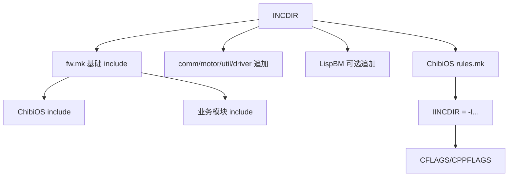

## 编译器设置

目标 MCU：

```makefile
MCU = cortex-m4
```

工具链前缀：

```makefile
TRGT = $(TCHAIN_PREFIX)
```

工具命令：

```makefile
CC   = $(TRGT)gcc
CPPC = $(TRGT)g++
LD   = $(TRGT)gcc
CP   = $(TRGT)objcopy
AS   = $(TRGT)gcc -x assembler-with-cpp
AR   = $(TRGT)ar
OD   = $(TRGT)objdump
SZ   = $(TRGT)size
HEX  = $(CP) -O ihex
BIN  = $(CP) -O binary
```

关系：

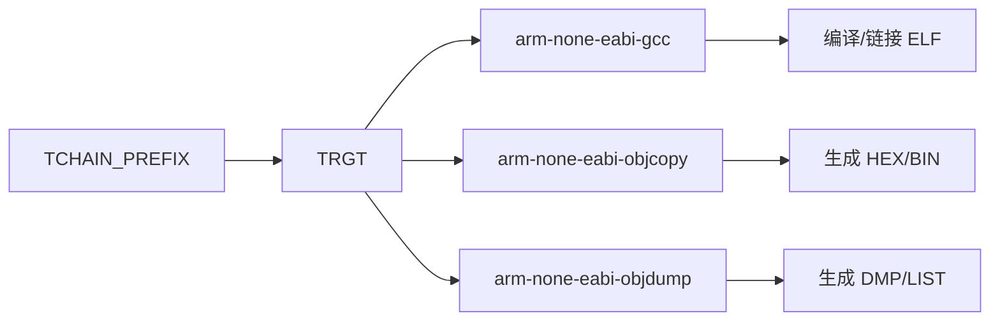

## 告警和 Thumb 设置

`fw.mk` 设置：

```makefile
TOPT = -mthumb -DTHUMB
CWARN = -Wall -Wextra -Wundef -Wstrict-prototypes -Wshadow
CPPWARN = -Wall -Wextra -Wundef
```

实际 `-mthumb`、`-mfloat-abi`、`-mfpu`、`-ffunction-sections` 等组合会在 ChibiOS `rules.mk` 中根据 `USE_*` 变量继续拼接。

## 用户扩展区

`fw.mk` 保留用户扩展变量：

```makefile
UDEFS =
UADEFS =
UINCDIR =
ULIBDIR =
ULIBS = -lm
```

用途：

```text
UDEFS：额外 C 宏
UADEFS：额外 ASM 宏
UINCDIR：额外 include 路径
ULIBDIR：额外库路径
ULIBS：额外库，默认链接 libm
```

ChibiOS `rules.mk` 会把它们纳入：

```text
DEFS = DDEFS + UDEFS
ADEFS = DADEFS + UADEFS
IINCDIR = INCDIR + DINCDIR + UINCDIR
LLIBDIR = DLIBDIR + ULIBDIR
LIBS = DLIBS + ULIBS
```

## STM32 标准外设库

默认：

```makefile
USE_FWLIB = yes
```

因此会执行：

```makefile
include $(CHIBIOS)/ext/stdperiph_stm32f4/stm32lib.mk
CSRC += $(STM32SRC)
INCDIR += $(STM32INC)
USE_OPT += -DUSE_STDPERIPH_DRIVER
```

这说明工程同时使用 ChibiOS HAL 和 STM32 StdPeriph 相关源码/头文件。

## ChibiOS rules.mk 承接

最后：

```makefile
RULESPATH = $(CHIBIOS)/os/common/ports/ARMCMx/compilers/GCC
include $(RULESPATH)/rules.mk
```

`rules.mk` 会消费 `fw.mk` 中准备好的变量：

```text
PROJECT
BUILDDIR
CSRC / CPPSRC / ASMSRC
INCDIR
LDSCRIPT
MCU
CC / LD / AS / CP / OD / AR
USE_OPT / USE_LINK_GC / USE_LTO / USE_THUMB / USE_FPU
USE_PROCESS_STACKSIZE / USE_EXCEPTIONS_STACKSIZE
CWARN / CPPWARN
UDEFS / UINCDIR / ULIBS
```

然后生成：

```text
$(BUILDDIR)/$(PROJECT).elf
$(BUILDDIR)/$(PROJECT).hex
$(BUILDDIR)/$(PROJECT).bin
$(BUILDDIR)/$(PROJECT).dmp
$(BUILDDIR)/$(PROJECT).list
$(BUILDDIR)/$(PROJECT).map
obj/
lst/
.dep/
```

ChibiOS 规则链路：

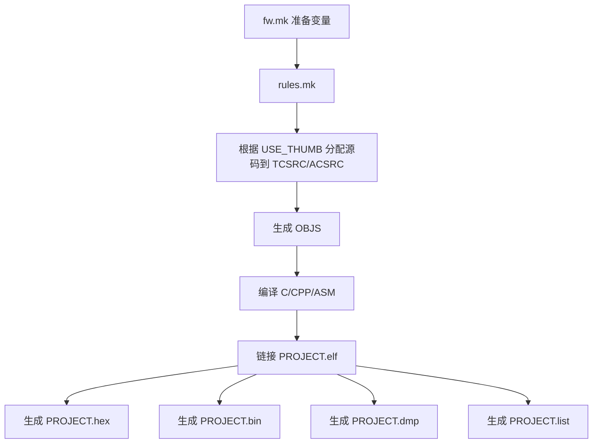

## BIN 输出规则

`fw.mk` 最后额外定义：

```makefile
build/$(PROJECT)/$(PROJECT).bin: build/$(PROJECT)/$(PROJECT).elf
	$(BIN) build/$(PROJECT)/$(PROJECT).elf build/$(PROJECT)/$(PROJECT).bin --gap-fill 0xFF
```

这条规则把 ELF 转成二进制固件：

```text
输入：build/<project>/<project>.elf
输出：build/<project>/<project>.bin
填充：空洞使用 0xFF
```

注意：ChibiOS `rules.mk` 中也有通用 `%.bin: %.elf` 规则。这里又写了一条具体路径规则，目的是确保 `build/$(PROJECT)/$(PROJECT).bin` 这个输出明确存在。

## 输出文件路径

当主 Makefile 调用：

```powershell
make 100_250
```

传入：

```text
PROJECT = 100_250
BUILDDIR = build/100_250
```

输出结果：

```text
build/100_250/100_250.elf
build/100_250/100_250.hex
build/100_250/100_250.bin
build/100_250/100_250.dmp
build/100_250/100_250.list
build/100_250/100_250.map
build/100_250/obj/
build/100_250/lst/
build/100_250/.dep/
```

输出关系：

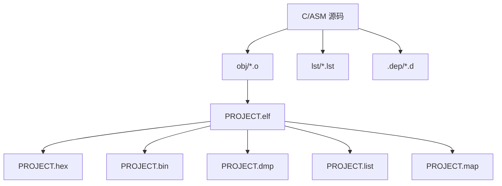

## 条件编译点

`fw.mk` 中几个重要条件：

```text
USE_LISPBM=1：包含 LispBM 源码并定义 USE_LISPBM。
USE_FWLIB=yes：包含 STM32 标准外设库并定义 USE_STDPERIPH_DRIVER。
app_custom_mkfile：如果外部传入，则 include 自定义应用 mk 文件。
USE_THUMB=yes：源码默认以 Thumb 模式编译。
USE_LINK_GC=yes：启用函数/数据段和链接垃圾回收。
USE_LTO=no：默认不启用 LTO。
```

条件关系：

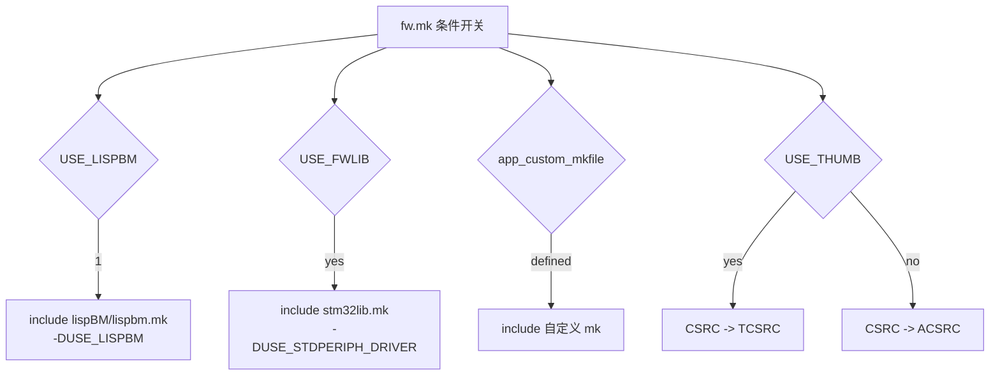

## 与板卡宏的关系

`fw.mk` 本身不扫描板卡，也不决定板卡名。板卡信息来自主 Makefile 的 `build_args`：

```text
-DHW_SOURCE="..."
-DHW_HEADER="..."
-DGIT_BRANCH_NAME="..."
-DGIT_COMMIT_HASH="..."
-DARM_GCC_VERSION="..."
```

然后 `hwconf/hw.c` 会根据这些宏包含具体板卡源文件：

```text
HW_SOURCE/HW_SOURCE_ALT -> 具体 hw_*.c 或 *_core.c
HW_HEADER -> 具体 hw_*.h
```


## 典型编译链路

以 `make 100_250` 为例：

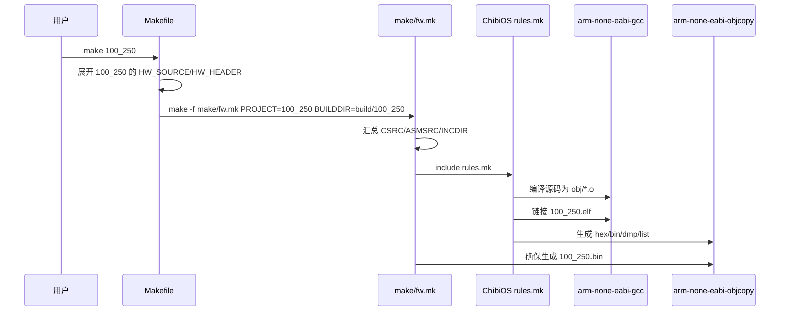

## 修改建议

按修改目的选择位置：

```text
新增源码模块：
  优先修改对应目录的 *.mk，例如 comm.mk、motor.mk、driver.mk。

新增全局根目录源码：
  修改 fw.mk 的 CSRC 列表。

新增 include 路径：
  优先修改模块 *.mk 的 INCDIR +=。

修改优化等级/调试信息：
  修改 USE_OPT，或在命令行覆盖 USE_OPT。

修改链接脚本：
  修改 LDSCRIPT。

启用/关闭 LispBM：
  覆盖 USE_LISPBM。

新增自定义应用 mk：
  通过 app_custom_mkfile 传入。

修改工具链路径：
  不改 fw.mk，改主 Makefile/tools.mk 传入的 TCHAIN_PREFIX。
```

风险点：

```text
CSRC 中文件名如果重名，ChibiOS rules.mk 使用 notdir 生成 obj 名，可能产生目标文件名冲突。
USE_OPT 中 build_args 的引号转义来自主 Makefile，随意修改容易导致 HW_SOURCE/HW_HEADER 失效。
默认 USE_FWLIB=yes，删除 STM32 标准外设库可能影响大量直接调用 StdPeriph API 的源码。
默认 USE_THUMB=yes，改成 ARM 模式会影响代码大小、性能和链接参数。
LDSCRIPT 改动会直接影响 flash/RAM 布局，风险高。
```

