# mc_interface 模块说明

本文说明 `bldc/motor/mc_interface.c` 与 `mc_interface.h` 的设计职责、内部状态、公开接口和运行机制。该模块是上层应用与具体电机控制算法之间的统一边界，同时承担安全准入、故障处理、动态限幅、测量统计及双电机上下文管理。

## 1. 模块定位

`mc_interface` 位于应用/通信层和电机控制后端之间。上层通常不直接调用 `mcpwm` 或 `mcpwm_foc`，而是通过 `mc_interface_*()` 使用统一语义的控制与查询接口。

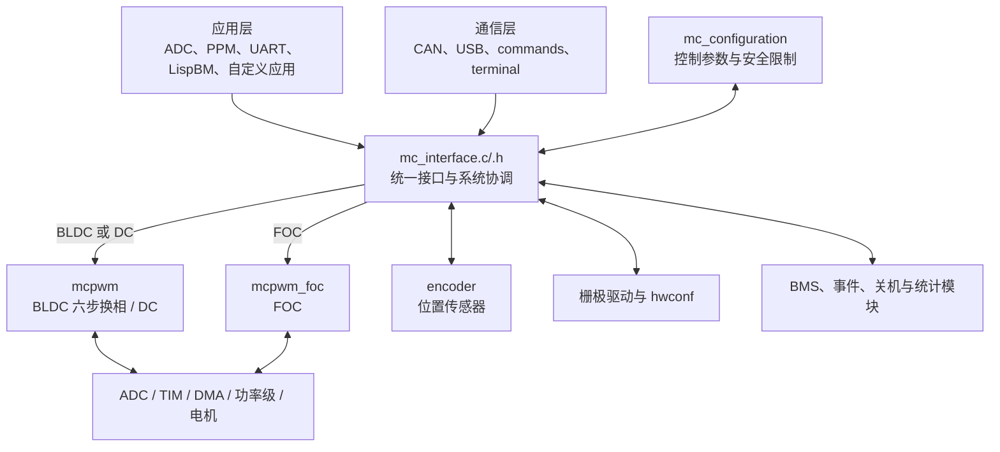

它的核心价值是让上层不依赖具体控制算法，并把所有控制命令先纳入同一套锁定、忽略窗口、方向和安全检查。

## 2. 文件分工

### 2.1 mc_interface.h

头文件定义模块的公开边界：

- 初始化、配置与双电机选择接口；
- 占空比、电流、制动、速度、位置和开环控制接口；
- 电流、电压、转速、能量、温度和里程查询接口；
- 故障、调试采样、统计和输入屏蔽接口；
- 供具体电机后端调用的公共 ISR/故障接口；
- `ADC_Value`、`ADC_curr_norm_value`、`ADC_curr_raw` 三组共享采样数组；
- `HW_DEAD_TIME_NSEC` 的通用默认值。

### 2.2 mc_interface.c

实现文件负责：

- 保存每台电机的接口层状态；
- 初始化配置、线程、编码器、栅极驱动和控制后端；
- 将统一 API 路由到 `mcpwm` 或 `mcpwm_foc`；
- 在实时中断中进行公共采样、计量、故障和限幅处理；
- 在线程中执行慢速监控、故障停机、波形发送和统计；
- 处理双电机选择及单线程的目标电机上下文。

## 3. 内部状态模型

每台电机对应一个私有 `motor_if_state_t`：

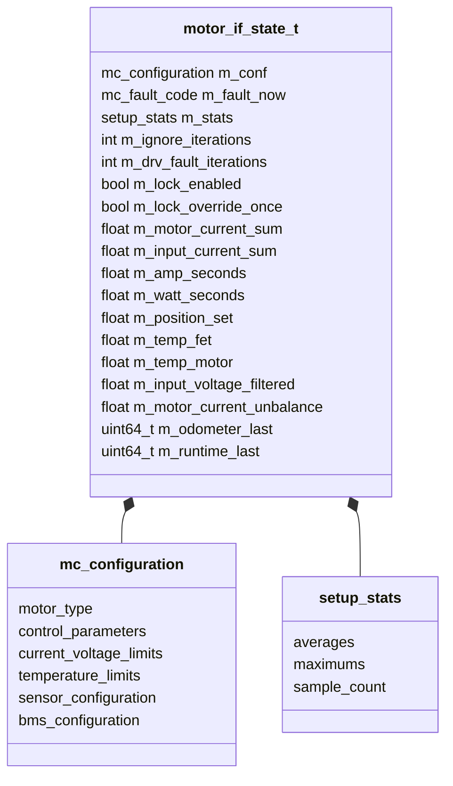

主要状态可分为五类：

| 类别 | 代表成员 | 用途 |
|---|---|---|
| 配置与故障 | `m_conf`、`m_fault_now` | 当前配置和统一故障状态 |
| 命令准入 | `m_ignore_iterations`、`m_lock_enabled`、`m_lock_override_once` | 控制命令屏蔽与一次性放行 |
| 测量累计 | 电流、电压、`Id/Iq`、`Vd/Vq` 累加器 | 提供平均测量和调试结果 |
| 能量与统计 | Ah、Wh、里程、运行时间、`m_stats` | 遥测和长期统计 |
| 慢速监控 | 温度、驱动故障计数、电流不平衡、滤波电压 | 动态限幅及故障判定 |

单电机硬件只存在 `m_motor_1`；定义 `HW_HAS_DUAL_MOTORS` 时还存在 `m_motor_2`。

## 4. 初始化流程

`mc_interface_init(reset_conf)` 建立接口层及具体电机后端：

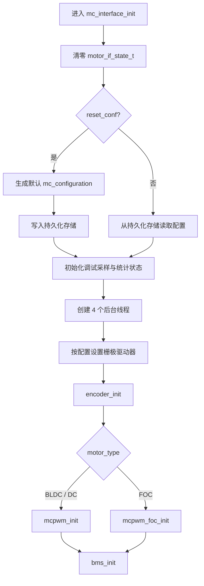

双电机硬件会读取两份配置，并分别设置两路驱动器。当前代码在 `HW_HAS_DUAL_MOTORS` 下强制两台电机使用 FOC，以满足共享定时/采样资源的实现约束。

初始化会创建：

| 线程名 | 优先级 | 职责 |
|---|---:|---|
| `mcif timer` | `NORMALPRIO` | 每 1 ms 运行慢速监控、动态限幅和故障检查 |
| `SampleSender` | `NORMALPRIO - 1` | 将中断采样缓冲区打包并通过回调发送 |
| `Fault Stop` | `HIGHPRIO - 3` | 将 ISR/线程发现的故障转化为完整停机处理 |
| 统计线程 | `NORMALPRIO` | 每 10 ms 更新功率、速度、电流和温度统计 |

## 5. 公开 API 分类

### 5.1 生命周期与配置

| API | 作用 |
|---|---|
| `mc_interface_init()` | 初始化接口层、配置、后台线程和控制后端 |
| `mc_interface_get_configuration()` | 返回当前所选电机配置的只读易失指针 |
| `mc_interface_set_configuration()` | 应用配置，必要时重启控制后端和编码器 |
| `mc_interface_calc_crc()` | 计算配置 CRC |
| `mc_interface_dccal_done()` | 查询当前控制后端的直流偏置校准状态 |
| `mc_interface_set_pwm_callback()` | 注册每个 PWM 周期结束时从中断调用的回调 |

### 5.2 控制命令

| 控制类别 | API |
|---|---|
| 占空比 | `set_duty()`、`set_duty_noramp()` |
| 速度/位置 | `set_pid_speed()`、`set_pid_pos()` |
| 电流/制动 | `set_current()`、`set_brake_current()`、相对值版本 |
| 手刹 | `set_handbrake()`、`set_handbrake_rel()` |
| FOC 开环 | `set_openloop_current/phase/duty()` 及组合版本 |
| 停止与释放 | `brake_now()`、`release_motor()`、`release_motor_override()` |
| 其他 | 设置转速计值、当前关闭延时、位置偏移 |

控制接口执行的是“设置控制目标”，并不等待电机达到目标。实际 PWM 更新由后端的 ADC/PWM 中断完成。

### 5.3 状态与测量

查询 API 覆盖：

- 运行状态、控制模式、故障码；
- 当前/目标占空比、采样频率和 RPM；
- 电机电流、输入电流及滤波/方向版本；
- Ah、Wh、充电累计值；
- FET/电机温度与输入电压；
- 转速计、速度、距离、里程和电池余量；
- `Id/Iq`、`Vd/Vq` 和 ADC ISR 执行时间等调试量；
- `setup_values` 聚合状态和 GNSS 数据。

### 5.4 安全、统计和内部协作

| API 组 | 作用 |
|---|---|
| `lock/unlock/lock_override_once` | 全局屏蔽当前电机控制命令或一次性放行 |
| `ignore_input*` | 在指定毫秒数内拒绝控制输入 |
| `fault_stop()` | 从 ISR 或线程侧提交统一故障 |
| `mc_timer_isr()` | 供具体控制后端在实时周期调用公共逻辑 |
| `adc_inj_int_handler()` | 将注入 ADC 中断路由给 BLDC/DC 后端 |
| `sample_print_data()` | 配置 ADC/PWM 调试采样 |
| `stat_*()` | 查询或清零运行统计 |

## 6. 控制命令的准入与分派

所有主要控制命令首先调用 `mc_interface_try_input()`：

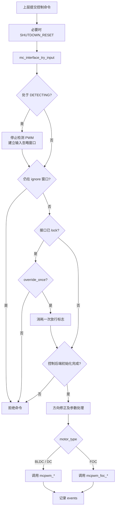

`DIR_MULT` 根据 `m_invert_direction` 将目标值乘以 `+1` 或 `-1`。位置控制还会处理位置偏移、编码器反向配置和角度归一化。

相对电流接口把 `[-1, 1]` 映射到当前动态电流上下限。动态上限并非只来自持久化配置，还可能被温度、输入电压、RPM、占空比、功率和 BMS 条件进一步收紧。

## 7. 配置更新与后端切换

`mc_interface_set_configuration()` 不只是复制结构体：

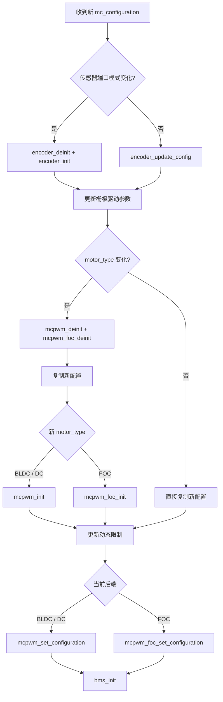

切换电机类型会重建底层定时器、ADC 和控制线程关系，不能视为普通参数写入。调用方应保证切换期间没有其他代码假定旧控制器仍在运行。

双电机 FOC 会同步两台电机的 `foc_f_zv` 和 `motor_type`，因为它们共享相关实时资源。

## 8. 双电机选择机制

大量 API 不带 `motor` 参数，目标电机由当前执行上下文确定：

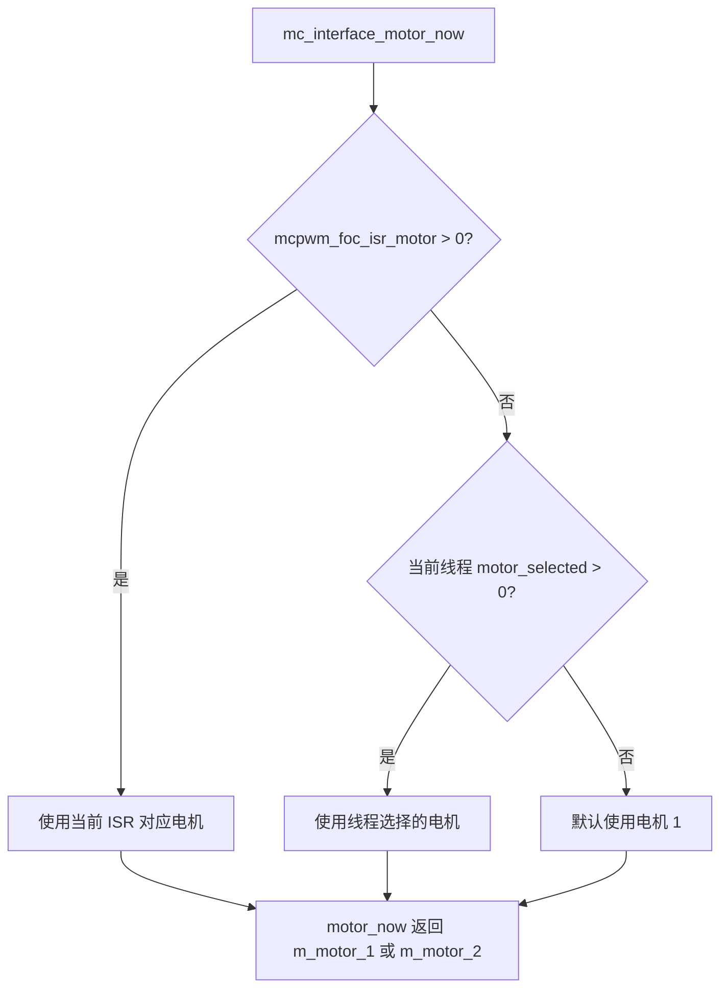

`mc_interface_select_motor_thread(1/2)` 把选择保存在线程控制块的 `motor_selected` 字段中，所以不同线程可以同时选择不同电机。调用临时切换电机的函数必须在返回前恢复原选择。

优先级顺序是“ISR 电机 > 当前线程选择 > 电机 1 默认值”。这样 ADC/PWM 中断不会错误继承被打断线程的目标电机。

## 9. 实时中断公共路径

具体后端在每个控制周期调用 `mc_interface_mc_timer_isr(is_second_motor, dt)`。它把与控制算法无关但需要实时更新的工作集中在接口层：

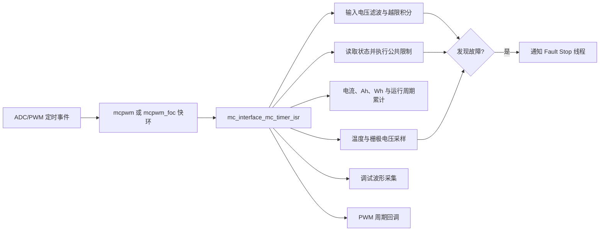

该函数运行在中断上下文，不能执行阻塞操作。`mc_interface_set_pwm_callback()` 注册的函数也在中断中调用，回调必须短小、确定且只能使用 ISR 安全的 API。

`mc_interface_adc_inj_int_handler()` 目前仅在 `MOTOR_TYPE_BLDC/DC` 时转发到 `mcpwm_adc_inj_int_handler()`；FOC 的主要 ADC 路径由 `mcpwm_foc` 自身处理。

## 10. 慢速监控与动态限幅

`mcif timer` 每 1 ms 对每台电机调用 `run_timer_tasks()`：

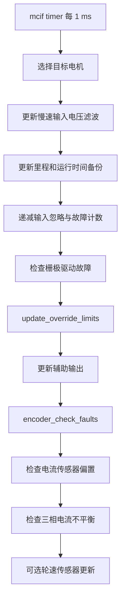

`update_override_limits()` 计算配置中的运行时覆盖上限 `lo_current_max/min` 等。其输入包括母线电压、温度、转速、占空比、功率、电池限制和硬件额定值。后端使用这些覆盖值，而不是无条件使用静态配置上限。

快速过流等必须在 PWM/ADC 中断处理；温升和偏置漂移等允许毫秒级响应的条件放在线程中处理。

## 11. 故障处理机制

`mc_interface_fault_stop()` 可以从中断或线程调用。中断侧只记录故障参数并用 I-Class 事件唤醒高优先级故障线程。

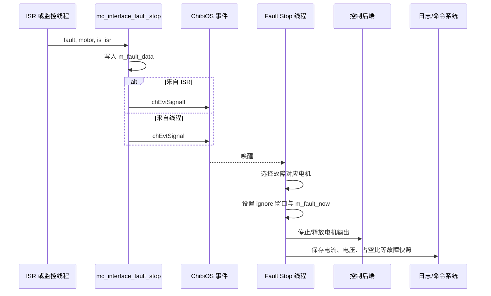

这种结构把“快速发现”与“完整处理”分离：ISR 立即提交停机事件，线程负责日志、状态整理及可能涉及非 ISR 安全 API 的后续工作。

`m_fault_data` 是单个共享槽位，不是故障队列。如果多个故障在故障线程处理前连续覆盖，线程处理的是最后复制到的内容；实时保护仍应由底层快速停机逻辑保证。

## 12. ADC/PWM 调试采样

模块在 `.ram4` 中保存多组固定长度采样数组，包括三相电流、三相电压、虚拟中点、滤波电流、开关频率、状态和相位。

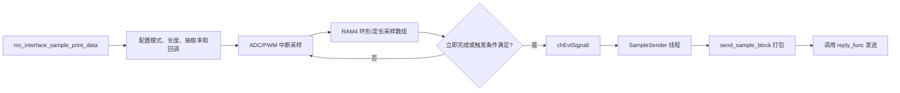

支持立即采样、启动触发、故障触发以及不自动发送等模式。中断只负责采集和通知，打包与通信在线程中执行，从而避免显著拉长控制中断。

## 13. 统计、计量与派生量

接口层将后端原始状态转换为上层更容易使用的量：

- 根据电流与 `dt` 累计放电/回充 Ah；
- 根据输入电压和输入电流累计 Wh；
- 根据转速计、电机极数、齿比和轮径计算速度与距离；
- 结合电池配置估算剩余电量；
- 汇总功率、速度、电流、MOSFET 温度和电机温度的平均值及最大值；
- 将当前配置和测量值聚合为 `setup_values`。

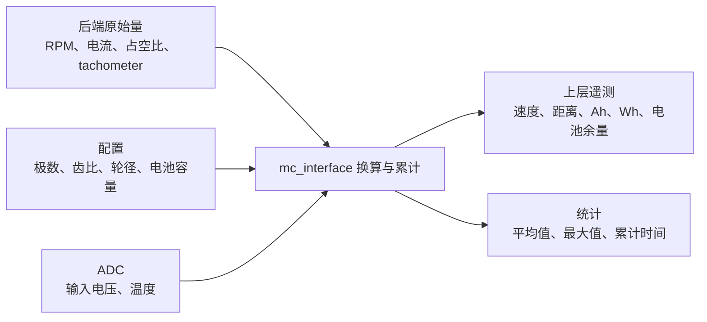

带 `reset` 参数的读取接口会在返回累计值后清零对应累加器。并发调用这些接口时，应明确数据的唯一消费者，避免某个调用者提前清零另一个调用者需要的数据。

## 14. 锁、忽略窗口与释放语义

三种机制容易混淆：

| 机制 | 含义 |
|---|---|
| `mc_interface_lock()` | 持续拒绝当前电机的大多数新控制命令 |
| `mc_interface_lock_override_once()` | 在锁定状态下允许下一条命令通过，然后自动清除 |
| `mc_interface_ignore_input(ms)` | 在约 `ms` 个 1 ms 维护周期内拒绝命令 |
| `release_motor()` | 受正常准入检查影响的释放请求 |
| `release_motor_override()` | 绕过普通输入锁定，用于必须确保关闭输出的路径 |

这些是业务控制锁，不是 ChibiOS 互斥量，也不提供对共享内存的并发互斥。需要保护数据结构时仍应使用正确的内核同步或临界区。

## 15. 依赖关系

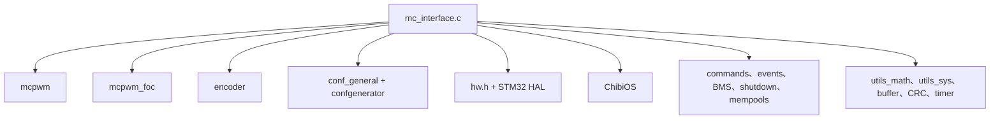

这种依赖广度说明 `mc_interface` 是协调层而不是纯算法库。修改它的初始化、故障或实时中断代码，可能同时影响控制、通信、配置存储和硬件安全。

## 16. 常见调用路径

### 16.1 电流控制

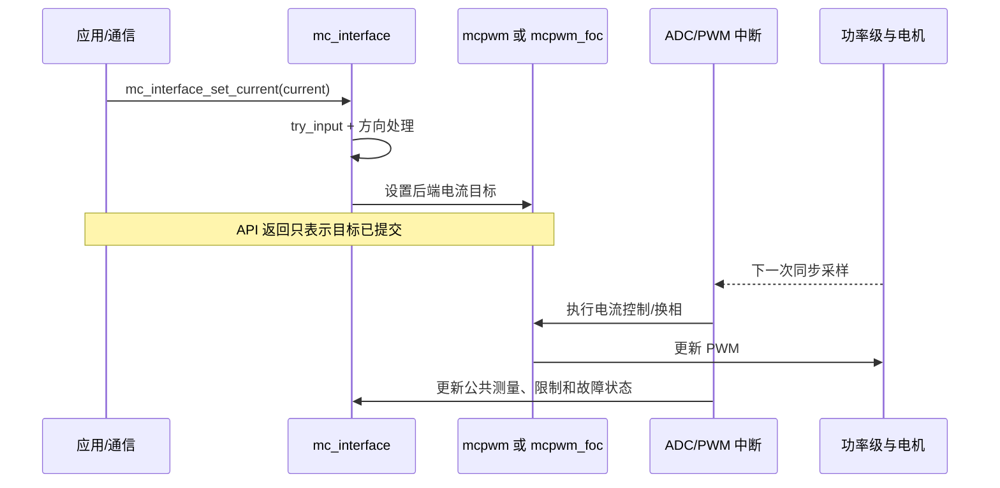

### 16.2 查询转速

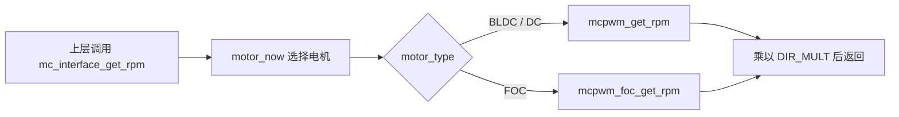

## 17. 修改与调试注意事项

1. **不要绕过统一接口。** 上层直接调用 `mcpwm_*` 或 `mcpwm_foc_*` 会跳过锁定、方向、事件记录和统一故障语义。
2. **区分 ISR 与线程 API。** `mc_interface_mc_timer_isr()`、PWM 回调和中断侧故障路径不能阻塞。
3. **保护快环预算。** 不要在实时中断路径加入日志打印、Flash 写入、动态内存或不定长循环。
4. **保留电机选择。** 临时选择另一台电机后必须恢复当前线程原来的 `motor_selected`。
5. **配置切换有副作用。** 传感器模式或电机类型改变会重初始化编码器和控制后端。
6. **动态限制与静态配置不同。** 排查“电流达不到配置值”时应检查 `lo_current_max/min`、温度、电压、功率、RPM 和 BMS 限制。
7. **回调上下文明确。** PWM 回调在中断执行，采样发送回调在 `SampleSender` 线程执行。
8. **故障信息槽不是队列。** 高频连续故障的日志顺序不能依赖 `m_fault_data` 保存全部事件。

## 18. 推荐阅读顺序

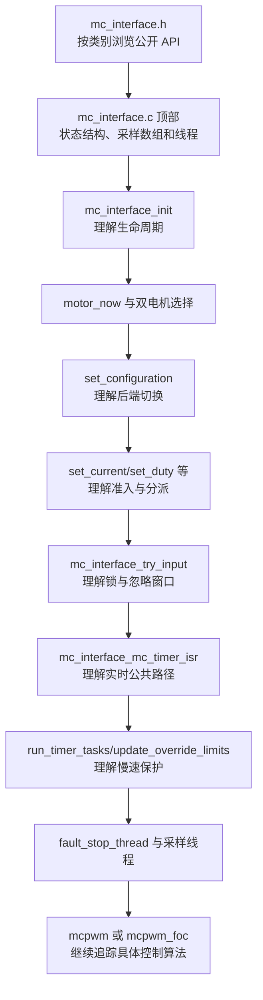

## 19. 小结

`mc_interface` 是电机子系统的统一门面和协调中心。它向上提供稳定的控制与遥测接口，向下按 `motor_type` 选择 BLDC/DC 或 FOC 后端，并横向协调配置、编码器、栅极驱动、BMS、故障、统计和调试采样。

理解该模块时应抓住四条主线：控制命令如何准入并路由、当前调用针对哪台电机、实时中断与后台线程如何分工、故障和动态限制如何覆盖普通控制目标。掌握这四条主线后，大多数电机控制行为都能从 `mc_interface` 继续追踪到明确的后端实现。
