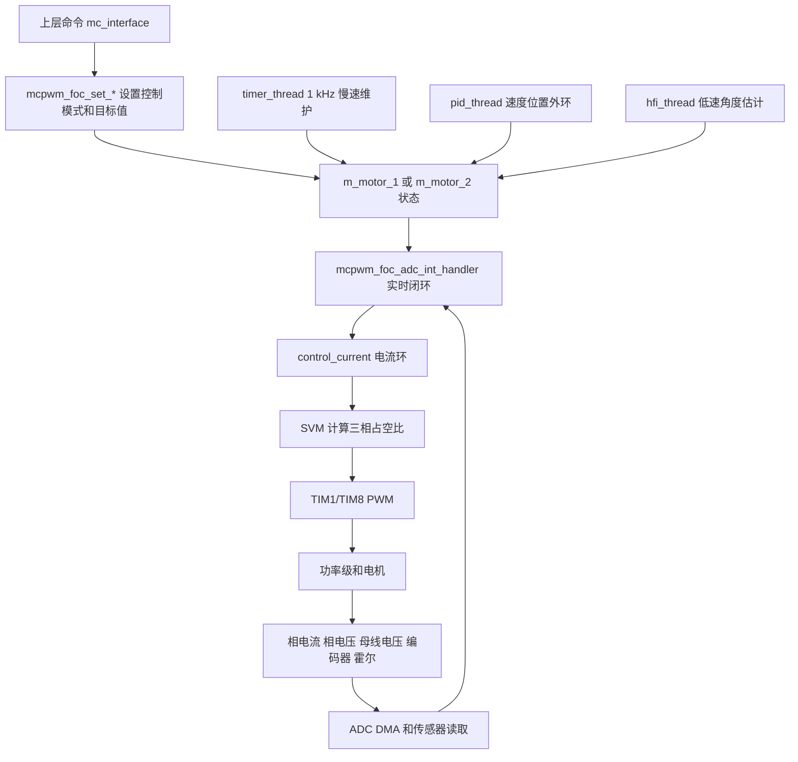
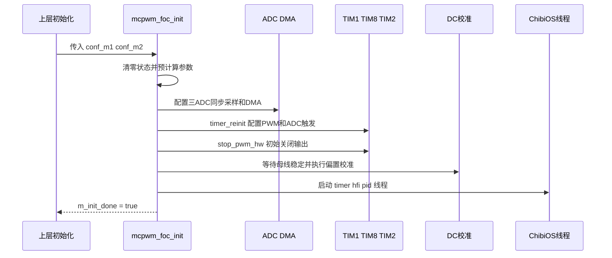
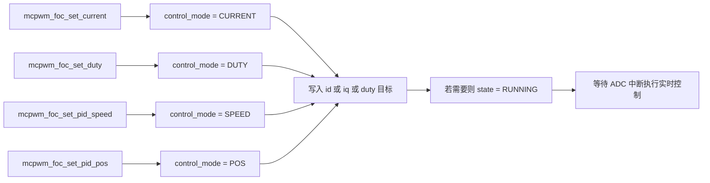
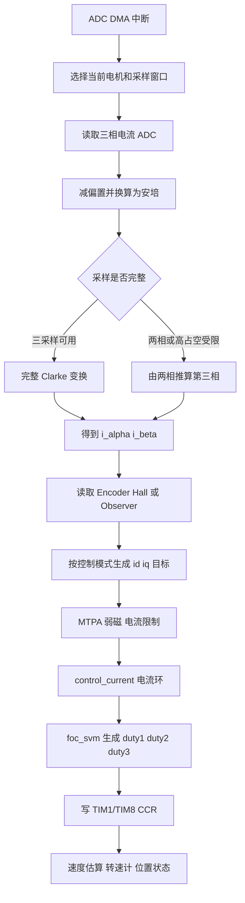
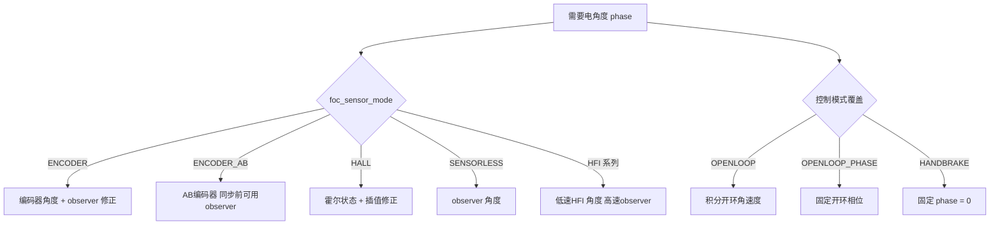
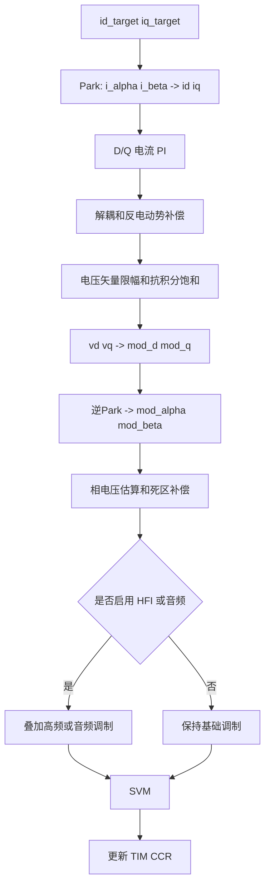
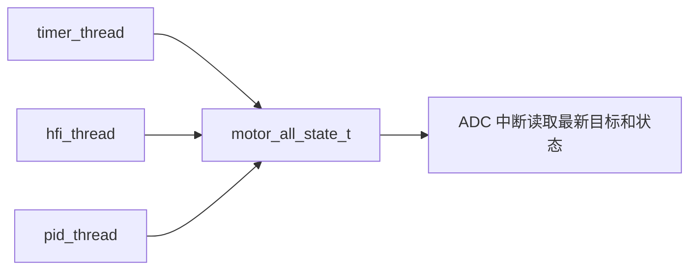
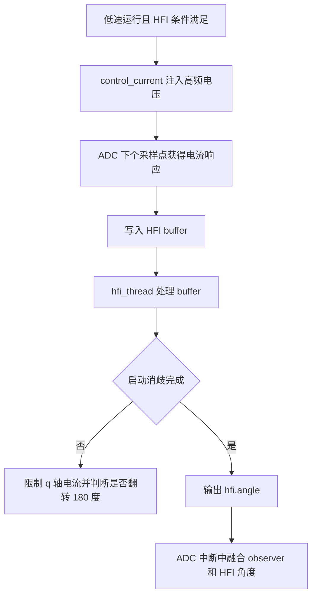
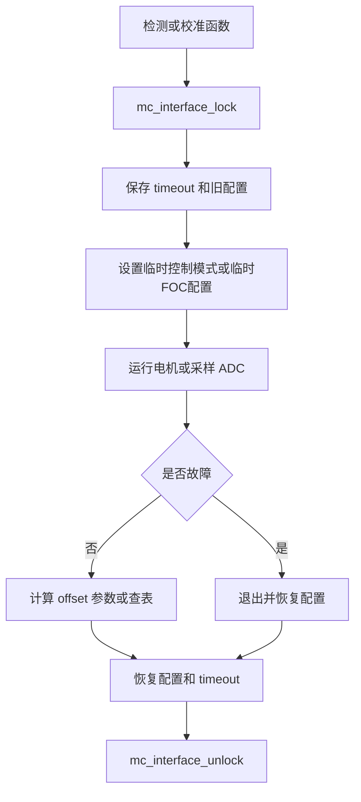
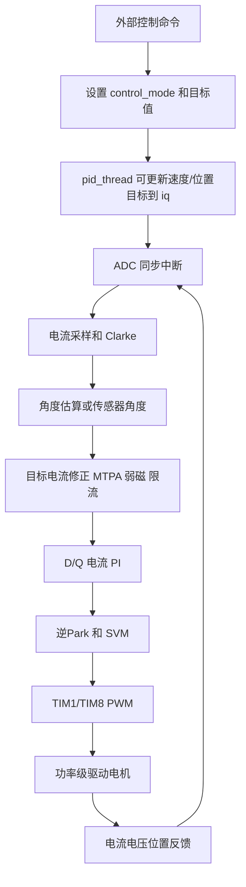

# motor/mcpwm_foc.c 功能描述

`motor/mcpwm_foc.c` 是 VESC 固件中 FOC（Field Oriented Control，磁场定向控制）的主实现文件。它把上层的占空比、电流、速度、位置、开环、刹车等控制命令转换为三相 PWM 输出，同时完成 ADC 同步采样、电流环闭环、转子角度估算、HFI 低速定位、参数检测、偏置校准和运行状态查询。

该文件位于电机控制链路的最底层之一，上层通常通过 `motor/mc_interface.c` 调用它，不直接操作定时器、ADC 或功率级。

## 总体职责

| 职责 | 主要实现 |
| --- | --- |
| FOC 硬件初始化 | `mcpwm_foc_init()`、`timer_reinit()` |
| PWM 输出控制 | `start_pwm_hw()`、`stop_pwm_hw()`、`full_brake_hw()`、`foc_svm()` 调用 |
| ADC 同步采样和实时闭环 | `mcpwm_foc_adc_int_handler()` |
| 电流 PI 控制 | `control_current()` |
| 转子角度来源选择 | Observer、Encoder、Hall、HFI、Open-loop |
| 速度/位置外环 | `pid_thread()` 调用 `foc_run_pid_control_*()` |
| 低速 HFI 位置估计 | `hfi_thread()`、`hfi_update()`、`control_current()` 中的 HFI 注入 |
| 参数检测 | 编码器、霍尔、阻抗、电感、HFI 相关测量函数 |
| 偏置校准 | `mcpwm_foc_dc_cal()` |
| 运行状态查询 | `mcpwm_foc_get_*()` 系列函数 |

## 核心状态

文件内部维护一个或两个 `motor_all_state_t` 实例：

| 变量 | 含义 |
| --- | --- |
| `m_motor_1` | 电机 1 的完整 FOC 状态、配置、采样、估算器和控制目标 |
| `m_motor_2` | 双电机场景下的电机 2 状态 |
| `m_init_done` | FOC 模块是否初始化完成 |
| `m_dccal_done` | 电流/电压偏置校准是否完成 |
| `m_isr_motor` | 当前正在 ADC 中断中处理的电机编号 |

编译宏 `HW_HAS_DUAL_MOTORS` 和 `HW_HAS_DUAL_PARALLEL` 会改变电机选择和 TIM1/TIM8 的使用方式。单电机时 `M_MOTOR(is_second_motor)` 始终映射到 `m_motor_1`；双电机时根据参数选择 `m_motor_1` 或 `m_motor_2`。

## 初始化流程

`mcpwm_foc_init()` 完成 FOC 运行所需的硬件和软件状态初始化：

1. 清零电机状态，绑定 `mc_configuration`。
2. 预计算 FOC 参数，例如电感、电阻、HFI 表参数等。
3. 初始化 virtual motor 和音频状态。
4. 配置 ADC1/ADC2/ADC3 三重同步采样、DMA2 Stream4 环形搬运。
5. 调用 `timer_reinit()` 配置 TIM1/TIM8 互补 PWM、TIM2 ADC 触发点、死区、BRK 保护。
6. 启用电流滤波、Gate Driver 和 DC 校准。
7. 根据配置执行 `mcpwm_foc_dc_cal(false)`。
8. 启动 `timer_thread`、`hfi_thread`、`pid_thread`。
9. 注册终端命令 `foc_plot_hfi_en`。

### 定时器和采样关系

`timer_reinit()` 建立 FOC 的硬件节拍：

| 定时器 | 作用 |
| --- | --- |
| `TIM1` | 电机 1 三相互补 PWM |
| `TIM8` | 电机 2 或双并联三相互补 PWM |
| `TIM2` | 生成 ADC 触发点，`CCR2` 控制采样偏移 |

PWM 使用中心对齐模式。ADC 由 TIM2 触发，并通过 DMA 把多路 ADC 结果写入 `ADC_Value`。中断可以使用 DMA half-transfer 或 transfer-complete，取决于电流采样通道是否位于前三个 ADC 转换位置。

## 控制命令入口

上层命令进入 FOC 后，通常只改写控制模式和目标值，真正闭环计算在 ADC 中断中执行。

| 函数 | 设置内容 | 典型用途 |
| --- | --- | --- |
| `mcpwm_foc_set_duty()` | `CONTROL_MODE_DUTY`、目标占空比 | 占空比控制 |
| `mcpwm_foc_set_pid_speed()` | `CONTROL_MODE_SPEED`、目标 ERPM | 速度闭环 |
| `mcpwm_foc_set_pid_pos()` | `CONTROL_MODE_POS`、目标角度 | 位置闭环 |
| `mcpwm_foc_set_current()` | `CONTROL_MODE_CURRENT`、`iq` 目标 | 转矩电流控制 |
| `mcpwm_foc_set_brake_current()` | `CONTROL_MODE_CURRENT_BRAKE` | 电流刹车 |
| `mcpwm_foc_set_handbrake()` | `CONTROL_MODE_HANDBRAKE` | 静态电流锁定 |
| `mcpwm_foc_set_openloop_current()` | `CONTROL_MODE_OPENLOOP` | 开环旋转电流 |
| `mcpwm_foc_set_openloop_phase()` | `CONTROL_MODE_OPENLOOP_PHASE` | 固定相位电流 |
| `mcpwm_foc_set_openloop_duty()` | `CONTROL_MODE_OPENLOOP_DUTY` | 开环旋转电压 |
| `mcpwm_foc_set_openloop_duty_phase()` | `CONTROL_MODE_OPENLOOP_DUTY_PHASE` | 固定相位电压 |

## ADC 中断实时闭环

`mcpwm_foc_adc_int_handler()` 是本文件最关键的实时路径。它在 PWM 同步采样点被触发，完成从采样到 PWM 更新的一整轮控制计算。

主要步骤如下：

1. 判断当前采样位于 V0/V7 或双电机交错周期。
2. 读取三相电流 ADC，减去偏置并换算成安培。
3. 根据硬件采样方式选择完整 Clarke 变换或由两相推算第三相。
4. 读取并修正编码器角度，或者准备使用 Observer/Hall/HFI。
5. 根据控制模式处理占空比模式、刹车模式、速度低限等特殊逻辑。
6. 更新无感 Observer，选择最终电角度 `state_now->phase`。
7. 应用 MTPA、弱磁和输入/电机电流限制。
8. 设置 `id_target`、`iq_target`。
9. 调用 `control_current()` 执行电流环和 SVM。
10. 更新速度估算、转速计、位置环当前角度。
11. 调用 `mc_interface_mc_timer_isr()` 让上层做同步维护。

### 角度来源选择

FOC 电流环需要转子电角度。该文件支持多种来源，并在 ADC 中断中统一选择：

| `foc_sensor_mode` | 角度来源 |
| --- | --- |
| `FOC_SENSOR_MODE_SENSORLESS` | Flux observer / PLL |
| `FOC_SENSOR_MODE_ENCODER` | 编码器角度，结合 observer 做修正 |
| `FOC_SENSOR_MODE_ENCODER_AB` | AB 编码器，无 index 时可先用 observer，同步后修正 |
| `FOC_SENSOR_MODE_HALL` | 霍尔表修正角度 |
| `FOC_SENSOR_MODE_HFI*` | 低速用 HFI，高速切换/融合 observer |
| 开环模式 | `m_openloop_angle` 或 `m_openloop_phase` |

## 电流环 control_current

`control_current()` 是 FOC 的内环控制器。进入该函数前，ADC 中断已经准备好：

| 输入状态 | 含义 |
| --- | --- |
| `id_target`、`iq_target` | D/Q 轴目标电流 |
| `i_alpha`、`i_beta` | Clarke 变换后的定子电流 |
| `phase_sin`、`phase_cos` | 当前电角度正余弦 |
| `v_bus` | 母线电压 |
| `max_duty` | 当前允许最大占空比 |

执行逻辑：

1. Park 变换，把 `i_alpha/i_beta` 转到转子坐标，得到 `id/iq`。
2. 对 `id/iq` 做低通滤波，用于非实时显示和慢速逻辑。
3. 计算 `id/iq` 误差，执行 PI 控制，得到 `vd/vq`。
4. 根据配置加入交叉耦合和反电动势前馈补偿。
5. 按母线电压、最大占空比、过调制系数限制电压矢量，并做积分抗饱和。
6. 归一化得到 `mod_d/mod_q`。
7. 估算母线电流、总电流和滤波电流。
8. 逆 Park 变换得到 `mod_alpha_raw/mod_beta_raw`。
9. `update_valpha_vbeta()` 更新实际电压估算和相电压滤波。
10. 可选注入音频电压或 HFI 高频电压。
11. 调用 `foc_svm()` 得到三相 PWM 比较值。
12. 写入 TIM1/TIM8，必要时切换为低边全刹车或正常 PWM。

## 慢速线程

除了 ADC 中断中的硬实时电流环，文件还启动三个 ChibiOS 线程处理慢速任务。

| 线程 | 周期 | 作用 |
| --- | --- | --- |
| `timer_thread` | 1 ms | 温度补偿、自动停 PWM、无感开环启动辅助、采样统计、observer gain、阻值估算、静止偏置微调 |
| `hfi_thread` | 约 500 us sleep | 处理 HFI 采样缓冲、FFT/角度估计、HFI 启动消歧、HFI plot 数据 |
| `pid_thread` | 由 `sp_pid_loop_rate` 决定 | 运行位置 PID 和速度 PID，更新电流目标 |

## HFI 低速定位

HFI（High Frequency Injection）用于低速或静止时估算转子位置，弥补反电动势 observer 在低速下信号弱的问题。

实现分两部分：

| 位置 | 功能 |
| --- | --- |
| `control_current()` | 在电流环输出上叠加高频电压，收集响应电流差分 |
| `hfi_update()` | 从 HFI 缓冲计算角度，处理 180 度歧义和启动阶段 |

HFI 支持多个版本：`FOC_SENSOR_MODE_HFI`、`HFI_V2`、`HFI_V3`、`HFI_V4`、`HFI_V5`、`HFI_START`。不同版本的注入方向、采样点和角度调整方式不同，但目标相同：根据电机 D/Q 轴电感差异推断转子方向。

## 参数检测和校准

该文件包含多种面向调试和自动配置的检测函数。它们一般会锁定 `mc_interface`、临时覆盖配置、禁用 timeout，完成后恢复原配置。

| 函数 | 功能 |
| --- | --- |
| `mcpwm_foc_encoder_detect()` | 旋转开环电流矢量，检测编码器 offset、ratio 和方向 |
| `mcpwm_foc_hall_detect()` | 扫描电角度，生成霍尔状态到电角度的查表 |
| `mcpwm_foc_measure_resistance()` | 锁定电机并用平均电压/电流估算相电阻 |
| `mcpwm_foc_measure_inductance()` | 用 HFI/短脉冲估算电感和 D/Q 轴电感差 |
| `mcpwm_foc_measure_inductance_current()` | 先寻找合适 duty，再按目标电流测电感 |
| `mcpwm_foc_measure_res_ind()` | 自动测量电阻、电感和 D/Q 电感差 |
| `mcpwm_foc_dc_cal()` | 校准电流 offset、驱动/未驱动相电压 offset |

## PWM 输出状态

底层 PWM 有三种典型状态：

| 状态 | 函数 | 含义 |
| --- | --- | --- |
| `FOC_PWM_DISABLED` | `stop_pwm_hw()` | 关闭互补输出，电机不驱动 |
| `FOC_PWM_ENABLED` | `start_pwm_hw()` | 启用三相互补 PWM |
| `FOC_PWM_FULL_BRAKE` | `full_brake_hw()` | 下桥导通短接三相，用于零占空比刹车 |

`control_current()` 在 SVM 后根据 duty 和配置决定是否启动正常 PWM，或者在三相 duty 相等且允许低边短接时切换到 full brake。

## 电压和相电压估算

`update_valpha_vbeta()` 负责把 ADC 相电压和当前调制量转换为 observer 需要的 `v_alpha/v_beta`：

1. 读取三相相电压 ADC，并减去 driven 或 undriven offset。
2. 根据电流方向估计死区补偿量。
3. Clarke 变换得到测量 `v_alpha/v_beta`。
4. 非运行状态下直接使用测量相电压跟踪反电动势。
5. 运行状态下优先使用调制量和母线电压估算电压；若硬件有相滤波器且配置允许，则用相滤波电压幅值修正。

这部分对无感 observer 很关键，因为 observer 的输入就是电压、电流和电机参数。

## 对外状态查询

文件提供大量 `mcpwm_foc_get_*()` 函数，供上层状态上报、终端命令和 VESC Tool 使用。查询内容包括：

| 类型 | 示例 |
| --- | --- |
| 控制目标 | `mcpwm_foc_get_duty_cycle_set()`、`mcpwm_foc_get_pid_speed_set()` |
| 电流 | `mcpwm_foc_get_id()`、`mcpwm_foc_get_iq()`、`mcpwm_foc_get_tot_current()` |
| 速度和位置 | `mcpwm_foc_get_rpm()`、`mcpwm_foc_get_phase()`、`mcpwm_foc_get_tachometer_value()` |
| 电压和调制 | `mcpwm_foc_get_vd()`、`mcpwm_foc_get_vq()`、`mcpwm_foc_get_mod_alpha_raw()` |
| observer | `mcpwm_foc_get_observer_state()`、`mcpwm_foc_get_est_lambda()` |
| 硬件采样 | `mcpwm_foc_get_current_offsets()`、`mcpwm_foc_get_currents_adc()` |

## 运行时数据流总结

一句话概括：`mcpwm_foc.c` 是 FOC 模式下“采样、估角、限流、电流闭环、空间矢量调制、PWM 输出”的实时核心，同时承载了与 FOC 密切相关的低速 HFI、参数测量、校准和状态查询能力。
