# mcpwm_foc 模块说明

本文说明 `bldc/motor/mcpwm_foc.c` 与 `mcpwm_foc.h` 的职责、数据结构、初始化过程、控制模式、ADC/PWM 快环、转子角度来源、HFI、双电机和参数检测机制。该模块是 `MOTOR_TYPE_FOC` 的具体控制后端，与 `mcpwm` 的 BLDC/DC 六步换相后端并列。

## 1. 模块定位

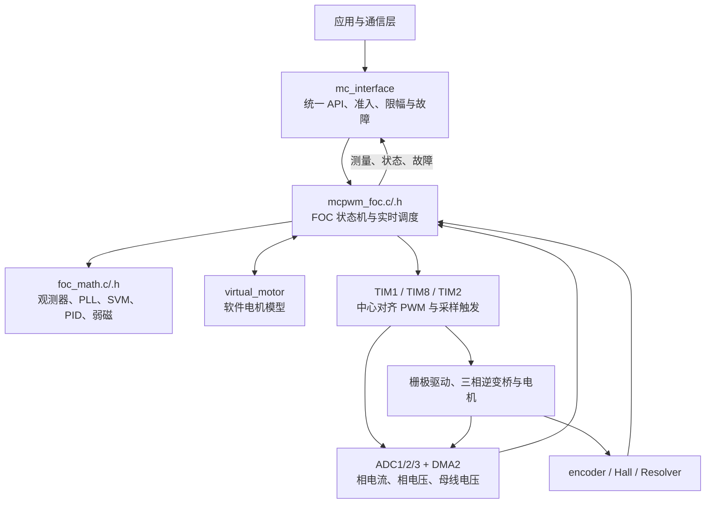

`mcpwm_foc` 负责决定何时采样、使用哪种角度、如何生成 `Id/Iq` 目标以及何时调用数学算法；`foc_math` 负责较独立的计算函数。上层应通过 `mc_interface_*()` 使用它，避免绕过统一安全逻辑。

## 2. 文件分工

### 2.1 mcpwm_foc.h

头文件公开：

- 初始化、反初始化、配置与运行状态接口；
- 占空比、电流、速度、位置、制动、手刹和开环控制；
- 电流、电压、转速、角度、调制量和观测器状态查询；
- 电阻、电感、磁阻差、编码器、Hall 和 ADC 偏置检测；
- FOC 音频接口；
- 双电机显式选择查询接口；
- TIM 采样中断和 ADC DMA 中断入口。

### 2.2 mcpwm_foc.c

实现文件同时承担：

1. TIM、ADC、DMA 和 PWM 功率级配置；
2. 每台电机的完整 FOC 状态管理；
3. ADC 快环中的采样重构、角度估计、电流 PI 和 SVM；
4. HFI、速度/位置 PID、无感启动和弱磁协调；
5. 参数检测、校准、音频调制和虚拟电机接入。

## 3. 核心状态结构

`mcpwm_foc` 的主要状态类型定义在 `foc_math.h`。每台电机对应一个 `motor_all_state_t`。

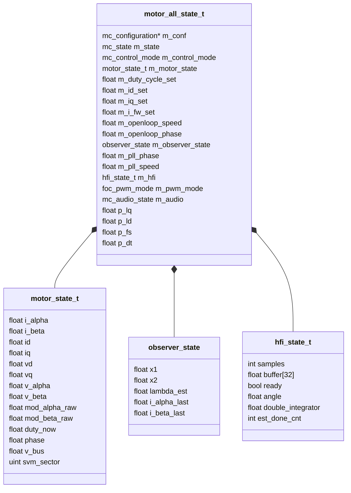

`motor_state_t` 主要保存单次快环中的电气量；`motor_all_state_t` 还保存慢环积分器、控制模式、传感器选择、HFI、音频和预计算参数。

单电机使用 `m_motor_1`；定义 `HW_HAS_DUAL_MOTORS` 后还存在 `m_motor_2`。`m_isr_motor` 标识当前 ADC 中断正在处理哪台电机，供 `mc_interface_motor_now()` 在 ISR 中正确选择状态。

## 4. 状态和 PWM 模式

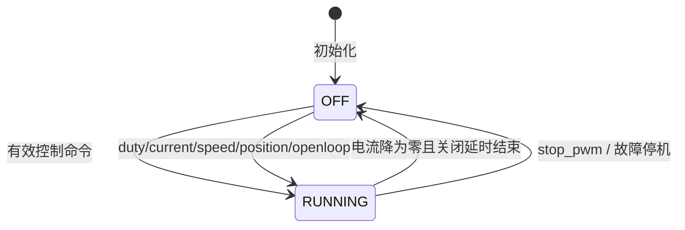

功率级还有独立的 `foc_pwm_mode`：

| 模式 | 含义 |
|---|---|
| `FOC_PWM_DISABLED` | 高侧关闭、互补低侧禁止，电机无驱动 |
| `FOC_PWM_ENABLED` | 三相中心对齐互补 PWM 正常运行 |
| `FOC_PWM_FULL_BRAKE` | 三相低侧导通形成静态短路制动 |

`m_state == MC_STATE_RUNNING` 是控制状态，`m_pwm_mode` 是当前硬件桥臂状态。零调制时若启用 `foc_short_ls_on_zero_duty`，代码可进入低侧全制动而不退出 FOC 运行状态。

## 5. 初始化流程

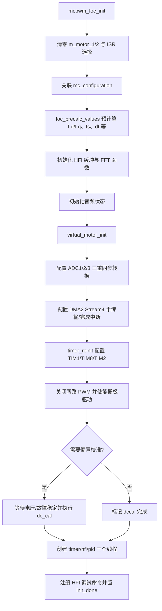

### 5.1 定时器关系

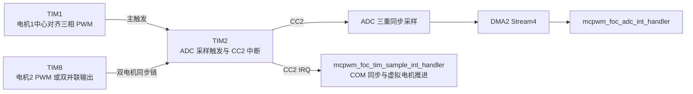

TIM1/TIM8 使用中心对齐计数。TIM2 在零矢量附近触发 ADC，并在采样中断中产生 COM 事件，使 PWM 通道模式切换与采样同步。

DMA 在前三个通道已经包含全部电流样本时可使用半传输中断，以更早进入控制计算，为高 `foc_f_zv` 留出更多执行时间。

## 6. 配置更新

`mcpwm_foc_set_configuration()` 更新当前电机配置指针并重新计算派生参数。只有影响硬件时序或 HFI 布局的变化会强制停机。

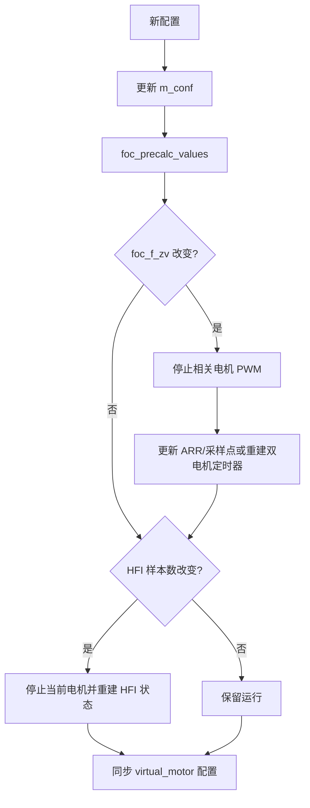

与 `mcpwm_set_configuration()` 的无条件停机不同，FOC 配置更新会检查是否真的需要停止。但修改控制频率或 HFI 样本布局仍有明显副作用。

## 7. 公开控制模式

| 控制模式 | API | 快环目标 |
|---|---|---|
| 占空比 | `set_duty()` | 调节 `Iq` 使实际占空比跟随目标 |
| 电流 | `set_current()` | `Iq = current`，`Id = 0`，再叠加弱磁等修正 |
| 制动电流 | `set_brake_current()` | `Iq` 方向与转速相反 |
| 手刹 | `set_handbrake()` | 固定相位上的静态电流矢量 |
| 速度 | `set_pid_speed()` | PID 生成 `Iq` 目标 |
| 位置 | `set_pid_pos()` | 位置 PID 生成速度/电流目标 |
| 开环电流 | `set_openloop_current/phase()` | 指定旋转或固定角度及电流 |
| 开环电压 | `set_openloop_duty/phase()` | 指定旋转或固定角度及调制幅值 |

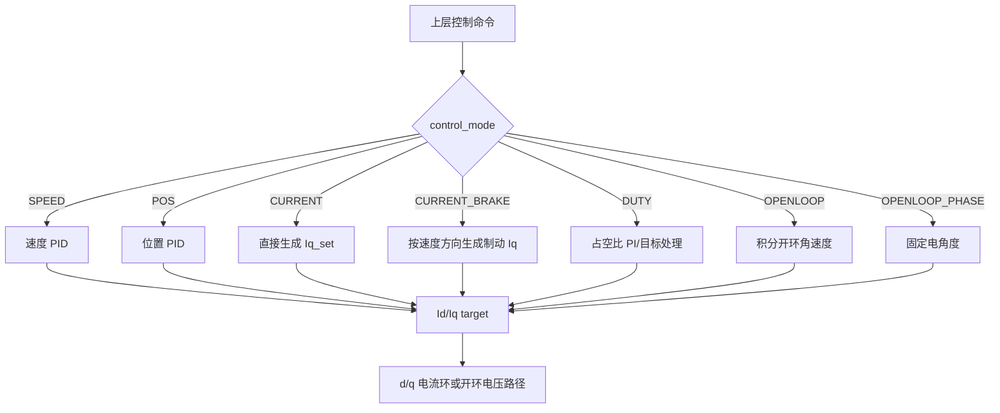

`mcpwm_foc_set_duty_noramp()` 当前只是调用 `mcpwm_foc_set_duty()`，源码带有“实际实现无斜坡”的 TODO，因此它目前并不提供真正不同的无斜坡行为。

`release_motor()` 将控制模式设为电流模式、清零 `Id/Iq` 并标记 `m_motor_released`。1 ms 维护逻辑在电流低于阈值且关闭延时结束后才真正关闭 PWM。

## 8. FOC 快环总览

`mcpwm_foc_adc_int_handler()` 是核心实时入口：

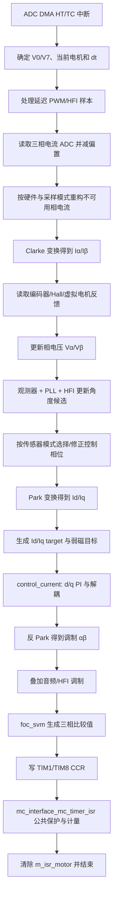

部分采样模式会在 V0 和 V7 都进入中断，另一些模式只在其中一个零矢量执行完整控制。`FOC_CONTROL_LOOP_FREQ_DIVIDER` 还能对快环降频，此时 `dt` 会相应放大。

## 9. 电流采样与重构

采样先保存原始 ADC 值，再减去 `foc_offsets_current[]` 并乘以硬件通道比例因子。两分流硬件直接用 `Ia + Ib + Ic = 0` 重构第三相；三分流硬件也可能因某相采样窗口过短而重构该相。

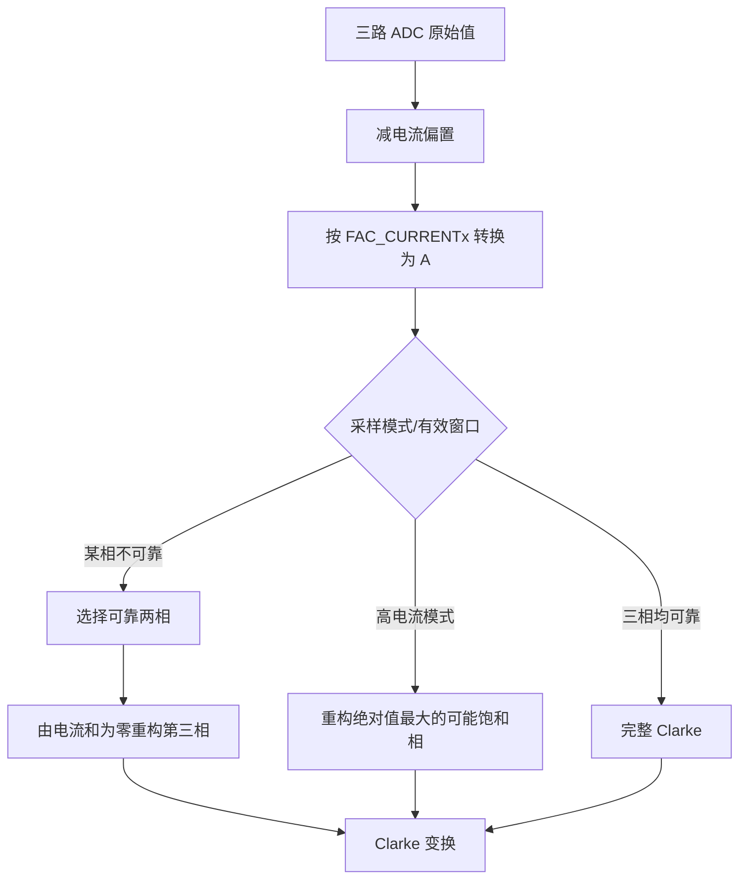

代码支持 `HIGH_CURRENT`、`LONGEST_ZERO`、`BEST_SENSOR` 等采样策略，并结合 PWM CCR、V0/V7 和相分流结构选择样本。错误的采样模式可能表现为电流畸变、噪声或三相不平衡故障。

## 10. 坐标变换与电流环

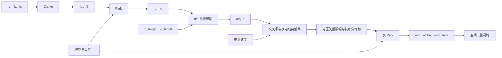

`control_current()` 的主要计算为：

- Park 变换并滤波 `Id/Iq`；
- 计算电流误差并更新 `Vd/Vq` PI 积分项；
- 可按温度补偿电阻和 `Ki`；
- 可加入交叉耦合和反电动势前馈；
- 根据母线电压、最大占空比和过调制系数限制电压矢量；
- 优先保证 d 轴电压，再将剩余电压能力分配给 q 轴；
- 计算母线电流、绝对电流和反 Park 调制量。

## 11. SVM 与 PWM 输出

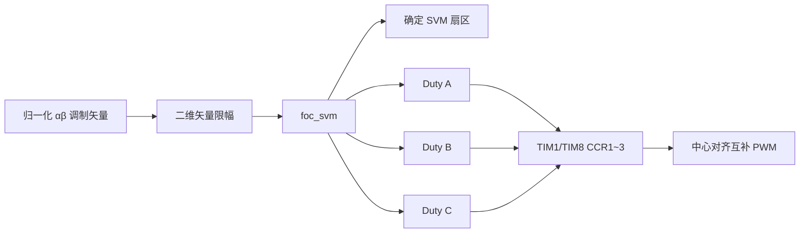

SVM 会注入零序分量以提高母线电压利用率。单电机写 TIM1；双电机的另一台写 TIM8；`HW_HAS_DUAL_PARALLEL` 下两组定时器输出同一组比较值。

当三相比较值相等且允许零占空比低侧短路时，模块使用 `FOC_PWM_FULL_BRAKE` 代替持续调制，减少死区畸变和开关损耗。

## 12. 转子角度来源

FOC 必须获得电角度。当前模块可组合以下来源：

- 无感磁链/反电动势观测器；
- 编码器或 AB 编码器；
- Hall 传感器；
- HFI 高频注入；
- 开环积分角度或固定相位；
- 虚拟电机角度。

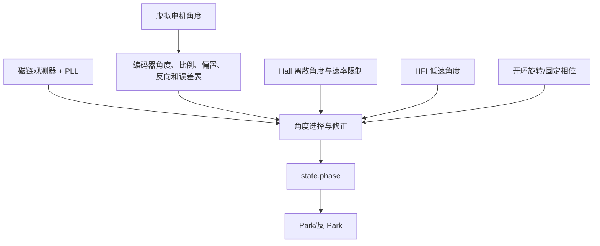

编码器角度先处理反向、极对数比例、偏置和可选 360 点误差修正。`foc_correct_encoder()` 与 `foc_correct_hall()` 用于在传感角度和观测器角度之间平滑修正。

## 13. 无感观测器、PLL 与启动

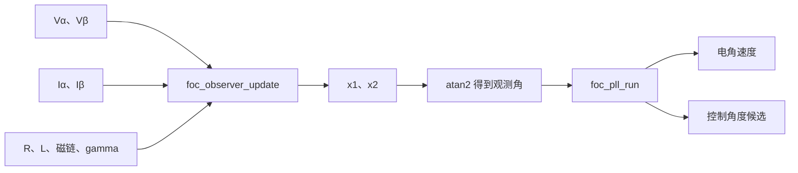

低速时反电动势不足，纯观测器角度可能不可靠。`timer_update()` 可执行开环启动：先锁定角度，再按配置斜坡增加开环速度，最后将观测器状态放到接近当前开环角的位置并交回闭环。

观测器增益会依据母线电压和占空比缩放；模块还包含在线电阻估计器，用于监视或补偿电机参数变化。

## 14. HFI 高频注入

HFI 利用凸极电机 d/q 电感差，在低速或静止时估计转子方向。

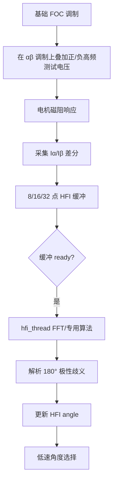

快环负责注入电压和采集响应；`hfi_thread` 约每 500 μs 处理完成的缓冲。不同 `FOC_SENSOR_MODE_HFI_*` 使用不同注入方向和处理方法，V2~V5 的部分角度更新直接在中断中完成。

`update_hfi_samples()` 根据配置选择 8、16 或 32 点 FFT 函数。改变样本数会清零 HFI 状态并停机重建缓冲。

## 15. 速度、位置和弱磁

`pid_thread` 根据 `sp_pid_loop_rate` 以 25 Hz 至 10 kHz 的配置频率运行：

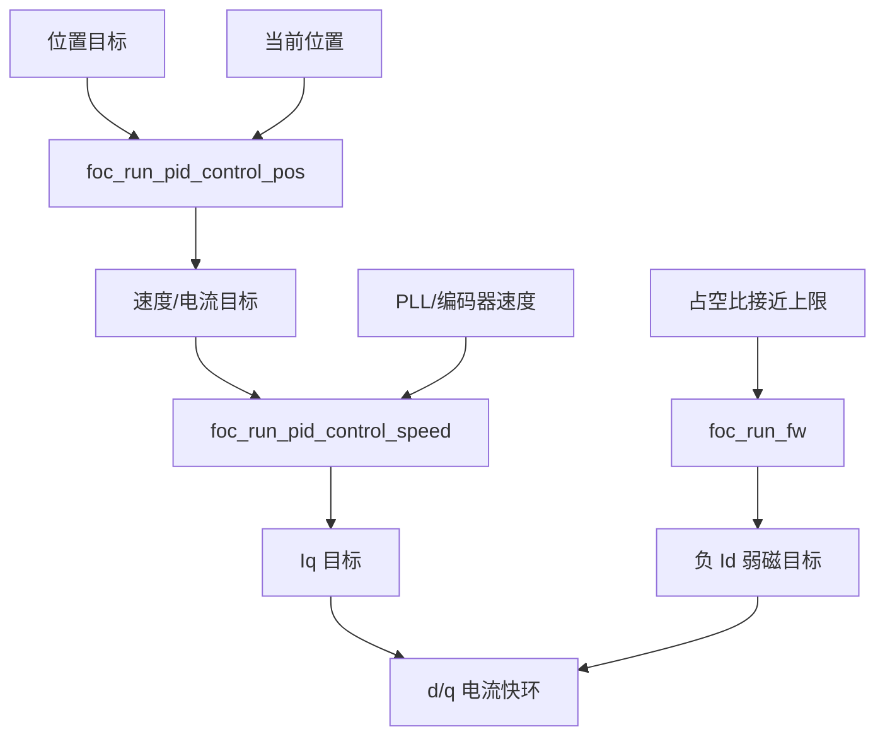

速度命令可按 `s_pid_ramp_erpms_s` 进行斜坡处理。位置 PID 和速度 PID 的具体实现位于 `foc_math.c`。

弱磁通过负 d 轴电流降低等效磁链，使电机在母线电压限制下继续升速。`m_i_fw_override` 可从外部覆盖弱磁电流，但最终仍受电流与电压能力限制。

## 16. 三个后台线程

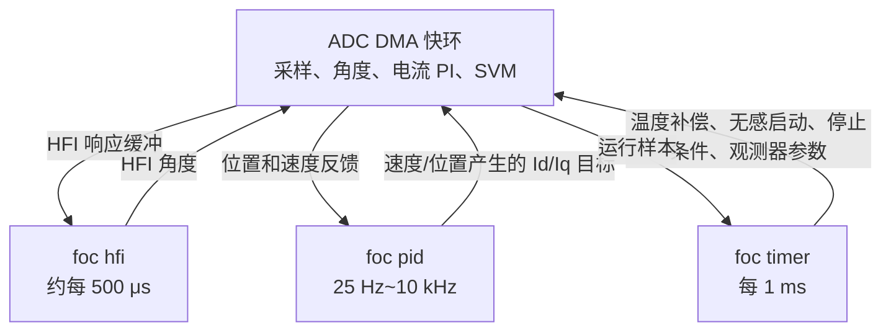

`timer_thread` 还负责：

- 电阻和电流 `Ki` 温度补偿；
- 零电流关闭延时及真正停 PWM；
- 无感开环启动和观测器接管；
- 平均电流/电压采样；
- 观测器增益和在线电阻估计；
- 电机关闭时缓慢跟踪电流偏置。

## 17. 双电机与双并联

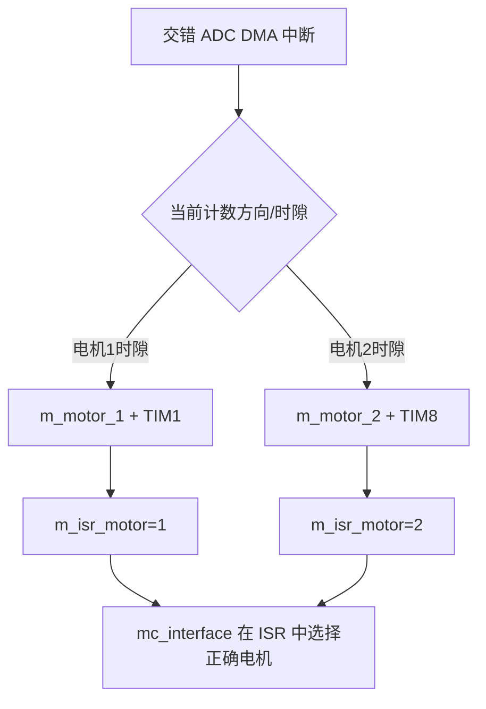

`HW_HAS_DUAL_MOTORS` 表示两台独立电机，各有 `motor_all_state_t` 和 PWM 定时器，ADC 中断交错处理。两台电机共享 FOC 频率等时序约束。

`HW_HAS_DUAL_PARALLEL` 表示两组功率级并联驱动同一台电机，TIM1 和 TIM8 写入相同占空比，部分电流样本相加后参与控制。它不是两台独立电机。

`get_motor_now()` 通过 `mc_interface_motor_now()` 选择线程或 ISR 对应电机；显式带 `is_second_motor` 的查询接口用于公共 ISR，避免依赖线程上下文。

## 18. 电压重建与相位滤波

`update_valpha_vbeta()` 从相电压 ADC 计算 `Vα/Vβ`，并处理：

- 驱动/未驱动状态对应的不同电压偏置；
- 两相分流或三相分流的通道排列；
- 死区补偿；
- 调制量低通和电压幅值滤波；
- 可选相位滤波硬件；
- 线电压测量时的 30° 旋转与幅值补偿。

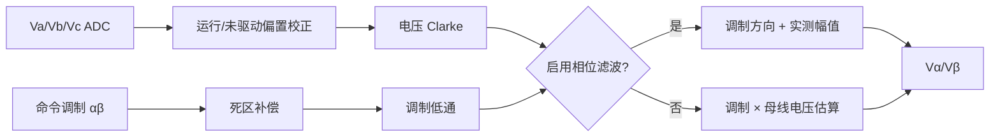

相位滤波实测幅值与调制估算差异过大时可触发 `FAULT_CODE_PHASE_FILTER`。

## 19. 功率级启停与制动

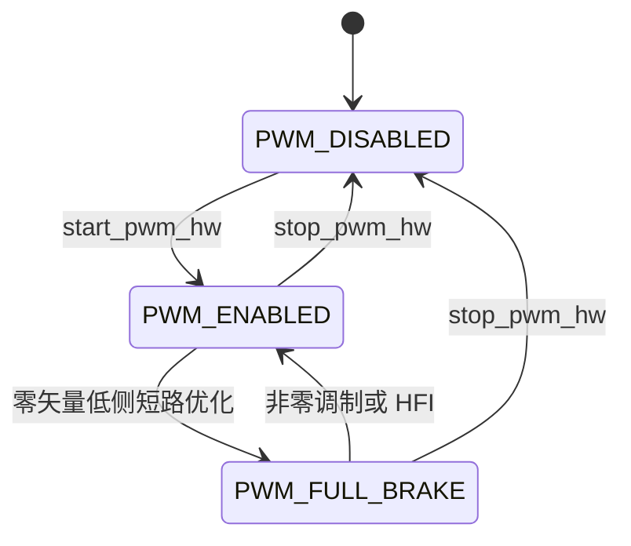

`stop_pwm_hw()` 清零 `Id/Iq` 设定，关闭高侧和互补低侧；`start_pwm_hw()` 恢复三相互补 PWM；`full_brake_hw()` 使三相低侧导通。硬件支持 `HW_USE_BRK` 时，TIM Break 输入可异步关闭 PWM，软件随后报告故障。

## 20. 参数检测与校准

头文件公开多种阻塞式检测流程：

| API | 目的 |
|---|---|
| `mcpwm_foc_dc_cal()` | 电流和相电压 ADC 偏置校准 |
| `mcpwm_foc_measure_resistance()` | 测量定子电阻 |
| `mcpwm_foc_measure_inductance*()` | 测量平均电感与 `Ld-Lq` 差 |
| `mcpwm_foc_measure_res_ind()` | 组合测量 R/L |
| `mcpwm_foc_encoder_detect()` | 检测编码器偏置、极对数比例和方向 |
| `mcpwm_foc_hall_detect()` | 生成 Hall 状态到电角度映射 |

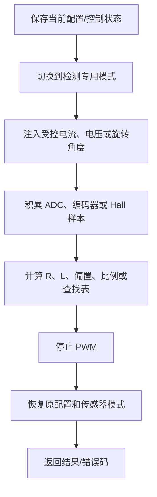

这些函数会临时修改配置、采样模式和控制状态，通常包含 sleep 与等待，不得从 ISR 调用。运行期间不应并发提交普通电机命令。

## 21. 虚拟电机接口

```mermaid
flowchart LR
    FOC[FOC 计算 Vα/Vβ] --> VM[virtual_motor_int_handler]
    VM --> MODEL[电气 + 机械模型]
    MODEL --> ANG[模拟编码器角度]
    MODEL --> CURR[模拟电流/ADC 反馈]
    ANG --> FOC
    CURR --> FOC
```

`mcpwm_foc_tim_sample_int_handler()` 每个采样周期推进虚拟模型。连接虚拟电机后，编码器模式可读取模拟角度，模型还会临时接管部分 ADC/偏置数据；断开时恢复保存的偏置。

虚拟电机连接时，代码不会按真实硬件路径切换 PWM 输出状态，因此调试结果必须和真实功率级测试区分。

## 22. 音频调制

FOC 可把波形叠加到 q 轴电压调制上，使电机发声：

- 四通道查表音频；
- 双缓冲采样音频；
- 单音/蜂鸣接口；
- 输出最终经过 αβ 矢量限幅。

```mermaid
flowchart LR
    TABLE[正弦表/用户波形] --> AUDIO[音频状态机]
    SAMPLE[双缓冲 PCM] --> AUDIO
    AUDIO --> Q[生成 q 轴附加电压]
    BASE[基础 FOC αβ 调制] --> ADD[矢量叠加]
    Q --> ADD
    ADD --> SAT[二维限幅]
    SAT --> SVM
```

音频调制仍占用母线电压裕量，可能影响转矩、电流纹波和 HFI，不适合在高负载工况下无条件使用。

## 23. 测量与诊断接口

公开查询大致分为：

| 类别 | 代表接口 |
|---|---|
| 状态 | `get_state()`、`control_mode()`、`is_dccal_done()` |
| 速度/位置 | `get_rpm*()`、`get_phase*()`、转速计 |
| 电流 | 总电流、绝对电流、`Id/Iq`、目标值和滤波值 |
| 电压/调制 | `Vd/Vq`、`Vα/Vβ`、原始/实测调制量 |
| 观测器 | 磁链估计、电阻估计、电感估计、x1/x2 |
| HFI | `get_hfi_state()` |
| ADC 校准 | 电流/电压偏置及原始 ADC 值 |
| 频率 | 开关频率、采样频率和 `Ts` |

`get_rpm()`、`get_rpm_fast()` 和 `get_rpm_faster()` 使用不同速度估计状态，滤波程度与延迟不同。控制或保护代码选择接口时应明确需要稳定值还是快速响应值。

## 24. 与 mc_interface 的边界

```mermaid
sequenceDiagram
    participant APP as 应用/通信
    participant IF as mc_interface
    participant FOC as mcpwm_foc
    participant ISR as ADC DMA 中断
    participant HW as 逆变桥与电机

    APP->>IF: set_current / speed / position
    IF->>IF: 命令准入、方向与公共限制
    IF->>FOC: 设置控制模式和目标
    HW-->>ISR: PWM 同步 ADC 样本
    ISR->>FOC: 角度估计、Id/Iq PI、SVM
    FOC->>IF: mc_interface_mc_timer_isr(dt)
    IF->>IF: 公共故障、计量和调试采样
    FOC->>HW: 写下一周期 PWM
```

`mc_interface` 计算动态 `lo_*` 限制；`mcpwm_foc` 在生成 `Id/Iq` 目标和电压调制时应用这些限制。故障可由 FOC 快环通过 `mc_interface_fault_stop(..., is_isr=true)` 提交给高优先级故障线程。

## 25. 修改与调试注意事项

1. **保护 ISR 时间预算。** ADC 中断已包含采样重构、观测器、电流环、HFI、音频和 SVM。
2. **区分采样频率与开关频率。** `V0_V7` 可每个 PWM 周期执行两次控制，其他模式可能只执行一次。
3. **不要直接改变 TIM ARR。** 控制频率变化需要同步预计算 `dt/fs`、ADC 触发和双电机定时关系。
4. **注意两分流采样窗口。** 高调制率下某些相不可测，需要正确重构。
5. **角度切换必须连续。** 编码器、Hall、HFI、开环和观测器之间的突变会直接变成电流冲击。
6. **参数单位必须一致。** 内部相位多为弧度，公开相位接口常为角度；速度多为电气 RPM 或 rad/s。
7. **双电机共享时序。** 两台电机不能独立选择互不兼容的 `foc_f_zv`。
8. **检测函数是侵入式流程。** 执行检测前应确保普通控制停止且配置能够恢复。
9. **PWM 回调和故障提交处于 ISR。** 不得调用阻塞式 API。
10. **`set_duty_noramp()` 名称与当前实现不一致。** 它目前仍走普通 duty 路径。
11. **HFI 依赖磁阻凸极性。** `Ld/Lq` 差很小时角度可观测性有限。
12. **弱磁降低安全裕量。** 需要同时检查电流、电压、转速和电机机械限制。

## 26. 推荐阅读顺序

```mermaid
flowchart TB
    A[mcpwm_foc.h<br/>浏览控制与诊断接口] --> B[foc_math.h<br/>理解 motor_all_state_t]
    B --> C[mcpwm_foc.c 顶部<br/>双电机状态、线程与定时宏]
    C --> D[mcpwm_foc_init / timer_reinit<br/>理解硬件时序]
    D --> E[set_current/speed/position/openloop<br/>理解目标状态]
    E --> F[mcpwm_foc_adc_int_handler<br/>追踪完整快环]
    F --> G[control_current<br/>理解 d/q PI 与解耦]
    G --> H[foc_math.c<br/>观测器、SVM、PID、弱磁]
    H --> I[timer_update<br/>无感启动与慢速维护]
    I --> J[hfi_update / hfi_thread]
    J --> K[参数检测、虚拟电机和音频]
```

## 27. 小结

`mcpwm_foc` 是本工程 FOC 电机控制的实时核心。它把相电流和相电压采样转换为 αβ/dq 状态，根据编码器、Hall、HFI、开环或无感观测器选择转子角度，通过 d/q 电流 PI 和解耦生成电压目标，再由 SVM 写入三相中心对齐 PWM。

理解该模块应抓住五条主线：采样窗口如何保证电流可测、角度候选如何选择和过渡、控制模式如何生成 `Id/Iq` 目标、电流环如何受母线电压与动态限制约束、快环与三个后台线程如何分工。双电机、HFI、参数检测、虚拟电机和音频功能都建立在这五条主线上。
