# mcpwm 模块说明

本文说明 `bldc/motor/mcpwm.c` 与 `mcpwm.h` 的职责、内部状态、初始化过程、控制模式、六步换相、ADC/PWM 同步采样及线程协作。`mcpwm` 是本工程中 `MOTOR_TYPE_BLDC` 和 `MOTOR_TYPE_DC` 的具体控制后端，不负责 FOC；FOC 由并列的 `mcpwm_foc` 实现。

## 1. 模块定位

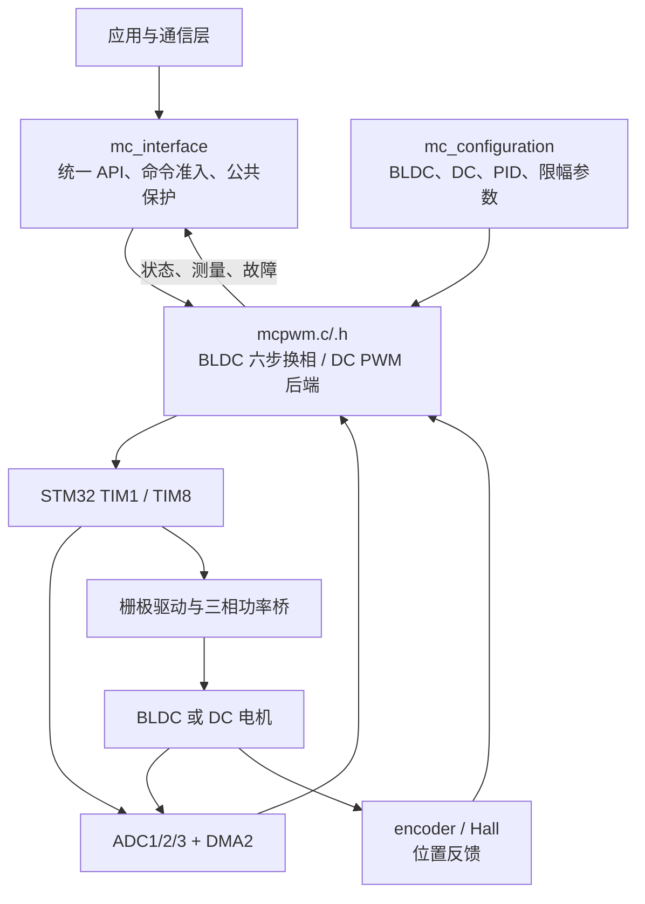

上层通过 `mc_interface_*()` 提交目标，`mc_interface` 根据 `motor_type` 将 BLDC/DC 请求路由到 `mcpwm_*()`。`mcpwm` 保存控制状态，并在硬件同步中断中形成换相和电流/占空比闭环。

## 2. 文件分工

### 2.1 mcpwm.h

头文件公开以下能力：

- 初始化、反初始化、配置更新和初始化状态查询；
- 占空比、速度、位置、电流和制动控制；
- 停止 PWM、释放电机及制动相关接口；
- 状态、RPM、占空比、电流、KV 和转速计查询；
- Hall 表初始化、检测和读取；
- 无感换相模式设置与切换；
- ADC ISR 入口及 ISR 执行时间查询；
- 电机检测过程的电流、电压和虚拟中点共享数据；
- RPM 计时频率、命令停止窗口和检测停止窗口常量。

`mcpwm.h` 中 `mcpwm_release_motor()` 当前重复声明了一次，语义不受影响，但维护时可以清理重复项。头文件还声明了 `mcpwm_brake_now()`，当前 `mcpwm.c` 中没有对应定义；在补齐实现前，外部代码不应调用该符号。上层的 `mc_interface_brake_now()` 使用的是自身现有处理路径，不能据此推断底层同名接口已实现。

### 2.2 mcpwm.c

实现文件同时包含四类逻辑：

1. STM32 TIM、ADC、DMA 和中断初始化；
2. BLDC 六步换相、DC 桥臂控制及 PWM 采样点计算；
3. 占空比、电流、速度、位置和制动控制；
4. 无感反电动势检测、Hall 换相、RPM 估算和参数检测。

因此它既是控制算法模块，也是紧贴硬件的实时驱动模块。

## 3. 主要内部状态

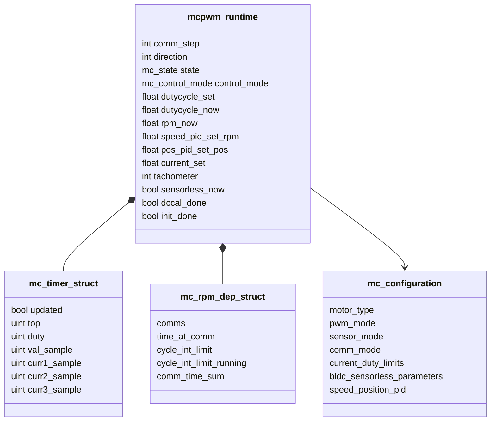

状态大致分为：

| 类别 | 代表变量 | 作用 |
|---|---|---|
| 状态机 | `state`、`control_mode` | 当前功率级状态和控制目标类型 |
| 换相 | `comm_step`、`direction`、`sensorless_now` | 当前六步位置、方向和传感器策略 |
| 控制目标 | `dutycycle_set`、`current_set`、速度/位置目标 | 上层命令落地后的目标值 |
| 测量 | `rpm_now`、电流样本、KV、转速计 | 闭环反馈和遥测 |
| 硬件时序 | `timer_struct`、`switching_frequency_now` | PWM 周期、比较值和 ADC 采样位置 |
| 无感参数 | `rpm_dep`、周期积分器、换相周期累计 | 随 RPM 调整反电动势换相阈值 |
| 校准/检测 | 电流偏置、Hall 检测表、检测数组 | 上电校准和电机/传感器检测 |

模块通过全局 `conf` 指针引用当前 `mc_configuration`，配置的存储期必须覆盖 `mcpwm` 的整个运行期。

## 4. 状态机与控制模式

`mc_state` 表示功率级运行状态，`mc_control_mode` 表示运行时如何生成占空比。二者相互关联但不是同一个概念。

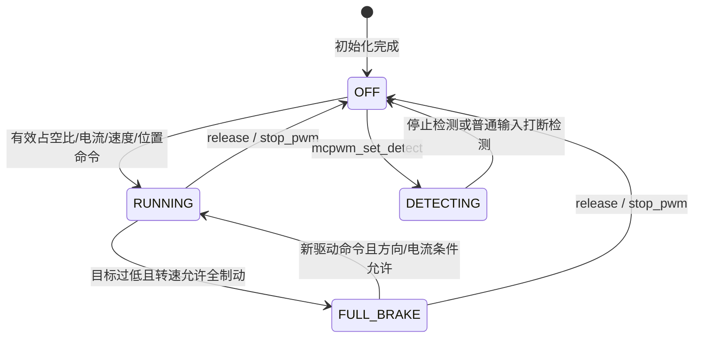

主要控制模式为：

| 控制模式 | 设置入口 | 最终作用 |
|---|---|---|
| `CONTROL_MODE_DUTY` | `mcpwm_set_duty*()` | 目标直接形成占空比，通常带斜坡 |
| `CONTROL_MODE_CURRENT` | `mcpwm_set_current()` | ADC 中断根据电流误差调整占空比 |
| `CONTROL_MODE_CURRENT_BRAKE` | `mcpwm_set_brake_current()` | 调整占空比以获得指定制动电流 |
| `CONTROL_MODE_SPEED` | `mcpwm_set_pid_speed()` | 1 ms 速度 PID 生成电流或占空比目标 |
| `CONTROL_MODE_POS` | `mcpwm_set_pid_pos()` | 编码器位置 PID 生成电流目标 |
| `CONTROL_MODE_NONE` | release/stop | 不接受普通控制闭环输出 |

状态为 `RUNNING` 并不表示一定处于占空比控制；它只说明功率输出正在活动。

## 5. 初始化流程

`mcpwm_init()` 对控制状态和 STM32 外设进行完整初始化：

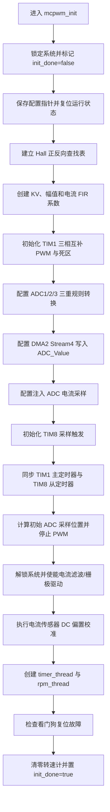

### 5.1 TIM1 与 TIM8 分工

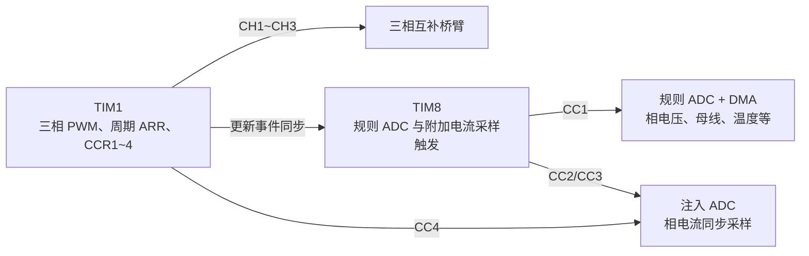

`TIM1` 的 ARR 决定开关频率，CCR1~CCR3 决定 PWM 占空比，CCR4 及 `TIM8` 比较通道决定 ADC 采样时刻。采样点会随占空比、换相步、PWM 模式和分流电阻数量变化。

### 5.2 电流偏置校准

`do_dc_cal()` 打开硬件 DC 校准路径，等待驱动故障释放，积累至少 4000 个注入 ADC 样本，再计算每个电流通道的零点偏置。`dccal_done` 置位后，接口层才将校准视为完成。

校准样本由 ADC 注入中断持续累加，因此该函数中的等待依赖中断正常运行。校准超时只覆盖驱动故障等待，样本计数等待本身没有独立超时。

## 6. 反初始化与配置更新

`mcpwm_deinit()`：

1. 清除 `init_done`；
2. 请求两个后台线程退出并等待确认；
3. 反初始化 TIM1、TIM8、ADC 和 DMA；
4. 禁用 ADC 中断并释放 DMA 流。

`mcpwm_set_configuration()` 会先将控制模式设为 `NONE` 并关闭 PWM，再替换配置指针、重建 Hall 表和更新传感器模式。普通参数更新也会使电机停止，这是安全优先的设计。


## 7. 控制命令路径

### 7.1 占空比控制

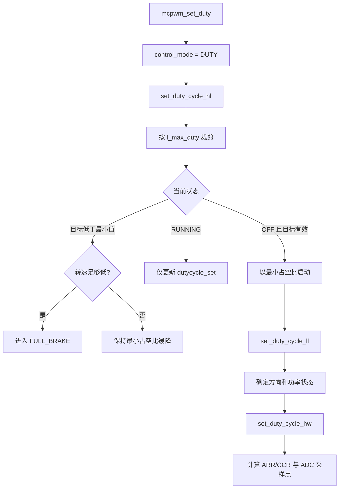

`mcpwm_set_duty_noramp()` 在已经运行时直接修改 `dutycycle_now`，跳过正常斜坡。源码明确警告，大电机上的大幅阶跃可能损坏硬件。

### 7.2 电流控制

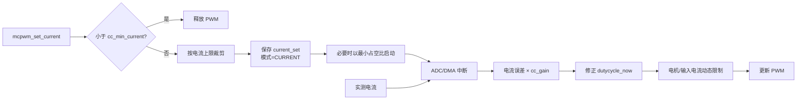

它不是 FOC 的 `Id/Iq` 电流环，而是基于六步换相总电流误差调节占空比。`lo_current_max/min` 和 `lo_in_current_max/min` 来自 `mc_interface` 的运行时动态限制。

### 7.3 速度与位置控制

速度 PID 在 `rpm_thread` 中约每 1 ms 运行。根据编译选项 `BLDC_SPEED_CONTROL_CURRENT`，PID 输出可形成电流目标或占空比目标。

位置 PID 需要编码器，在 DMA ADC 中断末尾按当前开关周期 `dt` 运行，并形成 `current_set`。因此位置控制计算频率与当前开关频率相关，而速度环固定在约 1 kHz。

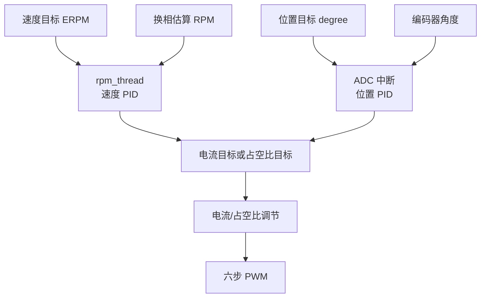

## 8. 六步换相关系

正转时的桥臂逻辑为：

| 换相步 | 相 1 | 相 2 | 相 3 |
|---:|:---:|:---:|:---:|
| 1 | 悬空 | 正 | 负 |
| 2 | 正 | 悬空 | 负 |
| 3 | 正 | 负 | 悬空 |
| 4 | 悬空 | 负 | 正 |
| 5 | 负 | 悬空 | 正 |
| 6 | 负 | 正 | 悬空 |

反转通过交换相 2 与相 3 的作用得到相反序列。`set_next_comm_step()` 根据方向、换相步和 PWM 模式设置 TIM1 三个通道的高低侧输出模式，再由 `commutate()` 产生 COM 事件使预装载配置同步生效。

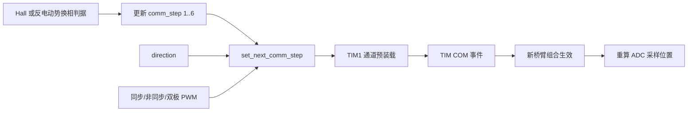

### 8.1 PWM 模式

- `PWM_MODE_NONSYNCHRONOUS_HISW`：正向桥臂不启用同步低侧导通；
- `PWM_MODE_SYNCHRONOUS`：使用互补输出进行同步整流；
- `PWM_MODE_BIPOLAR`：负向桥臂使用 PWM2，形成双极调制。

不同 PWM 模式不仅改变桥臂输出，也改变电流可观测窗口，因此 `update_adc_sample_pos()` 包含针对模式、换相步、方向和双采样的分支。

## 9. 传感器模式

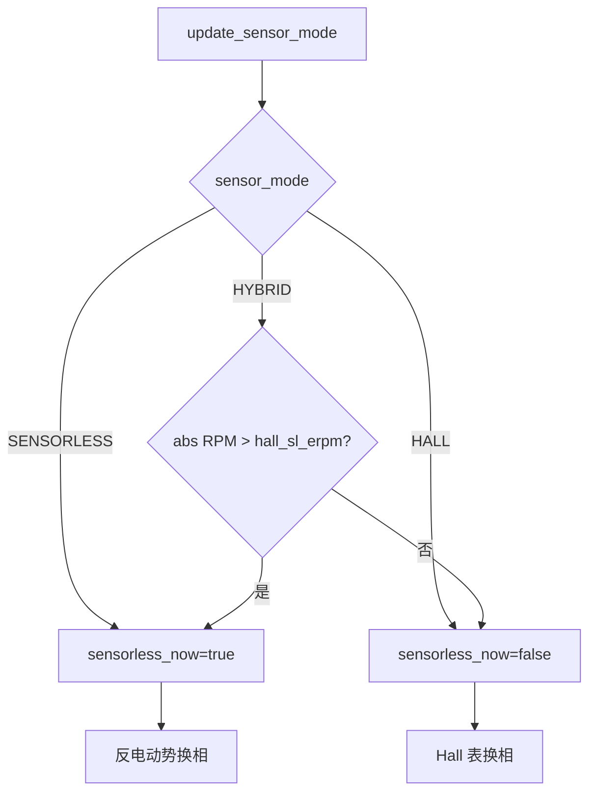

混合模式在低速使用 Hall，高速切换到无感反电动势。传感器模式会在初始化、配置更新和每次换相后重新评估。

编码器主要服务位置 PID 和位置 PLL；BLDC 换相本身在本模块中仍由 Hall 或无感逻辑完成。

## 10. 无感反电动势换相

规则 ADC + DMA 完成中断 `mcpwm_adc_int_handler()` 读取三相电压，构造虚拟中点并观察当前悬空相。无感模式支持两种换相判据：

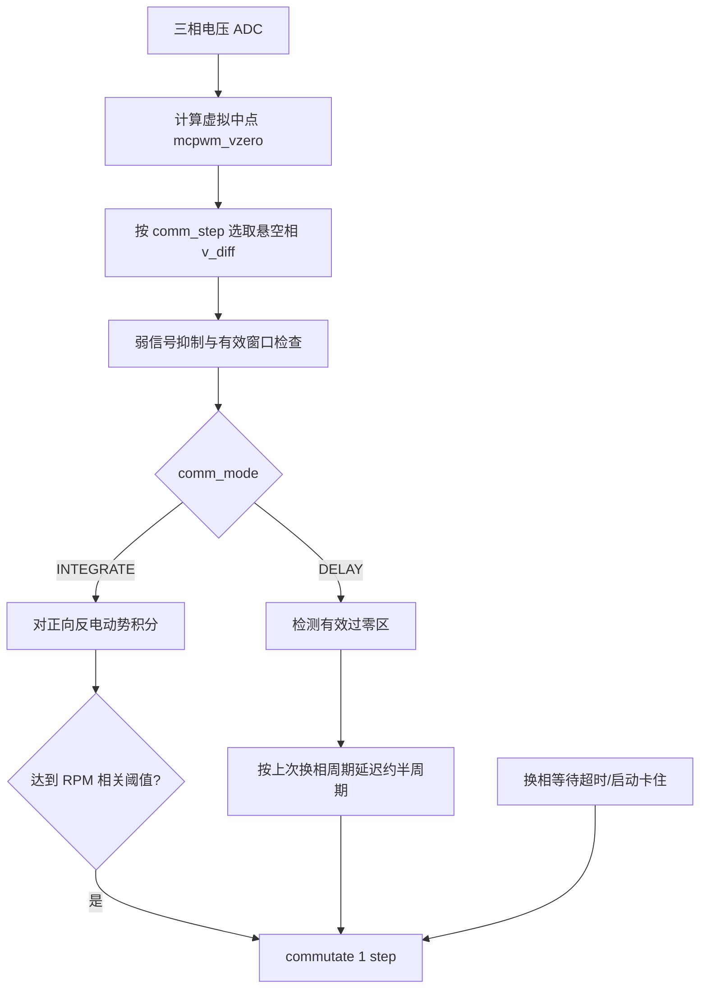

### 10.1 积分模式

`COMM_MODE_INTEGRATE` 对悬空相相对虚拟中点的正向电压进行时间积分。`rpm_thread` 根据 RPM、输入电压、反电动势耦合参数和相位超前配置动态计算积分阈值。积分达到阈值后进入下一换相步。

该模式参数较多，但低速启动和扰动下通常更稳健。

### 10.2 延时模式

`COMM_MODE_DELAY` 在识别到有效反电动势区后，依据上次换相周期估算下一次换相延时，行为接近常见无感 ESC 的过零后延时换相。参数较少，但源码注释指出启动和鲁棒性较差。

`mcpwm_switch_comm_mode()` 只更新 `comm_mode_next`，实际 `conf->comm_mode` 在下一次 `commutate()` 末尾切换，避免在当前换相周期中途改变判据。

## 11. Hall 换相与检测

`mcpwm_init_hall_table()` 从配置中的 8 项 Hall 表生成正反向映射。运行时读取三个 Hall GPIO 形成 0~7 编码，再映射为 1~6 换相步。

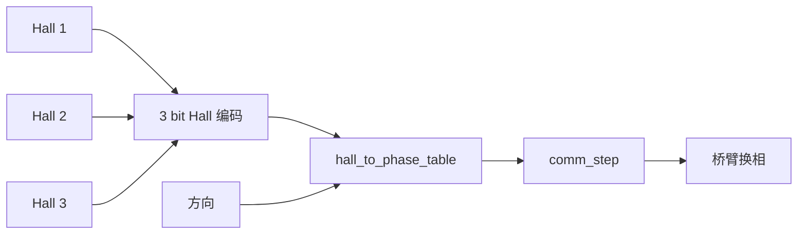

无感运行期间，代码还在合适的换相区间统计 Hall 编码与换相步的对应关系。`mcpwm_get_hall_detect_result()` 要求 6 个有效换相位置和 2 个无效 Hall 编码，才能返回有效检测表。

## 12. DC 电机模式

`MOTOR_TYPE_DC` 复用相同的 TIM/ADC 基础设施，但不执行六步轮转：一相保持不活动，另外两相根据方向形成 PWM 正端和负端。

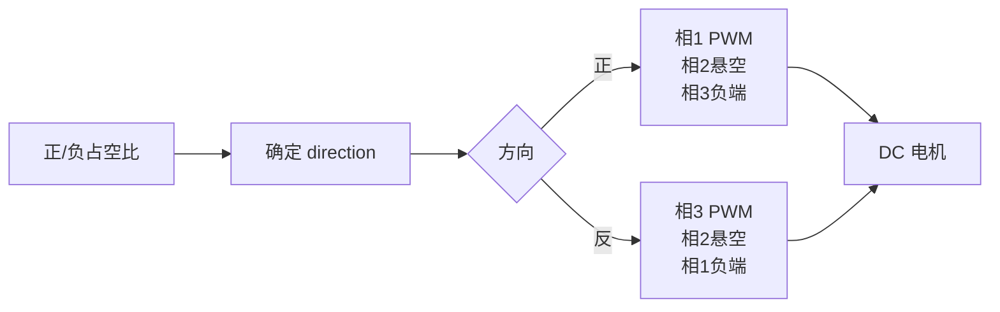

DC 模式使用固定 `m_dc_f_sw` 开关频率，并采用不同的电流选取与 ADC 采样点逻辑。不要将其 RPM 与换相步估算完全按 BLDC 解释。

## 13. ADC 与 DMA 两条中断路径

### 13.1 注入 ADC：电流采样

`mcpwm_adc_inj_int_handler()` 的主要流程：

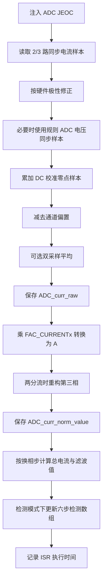

原始样本、归一化电流和检测数组通过头文件暴露给调试采样及其他底层模块。

### 13.2 DMA 完成：换相与控制

`mcpwm_adc_int_handler()` 的主要流程：

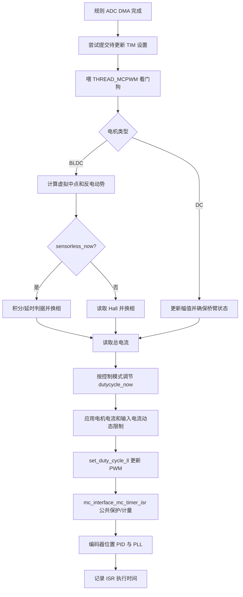

DMA 中断包含无感换相、控制和公共保护，是 `mcpwm` 最关键的实时路径。新增代码必须评估最坏执行时间。

## 14. PWM 与 ADC 采样点同步

占空比变化会改变电流采样可用窗口。`set_duty_cycle_hw()` 先计算开关周期和比较值，再调用 `update_adc_sample_pos()` 选择规则电压采样和各电流通道的触发位置。

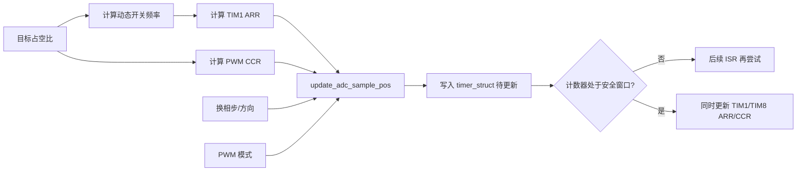

`update_timer_attempt()` 只在计数器离周期边界足够远时写入新设置，并临时禁止预装载更新，降低 PWM 周期和 ADC 触发不同步的风险。

BLDC 非双极模式下，开关频率会在 `m_bldc_f_sw_min` 和 `m_bldc_f_sw_max` 之间随占空比插值；DC、检测和双极 PWM 使用对应固定/最大频率。

## 15. 电流和输入电流限制

DMA 中断按以下优先级施加限制：

1. 电机电流超过 `lo_current_max`；
2. 电机再生电流低于 `lo_current_min`；
3. 输入电流超过 `lo_in_current_max`；
4. 输入再生电流低于 `lo_in_current_min`。

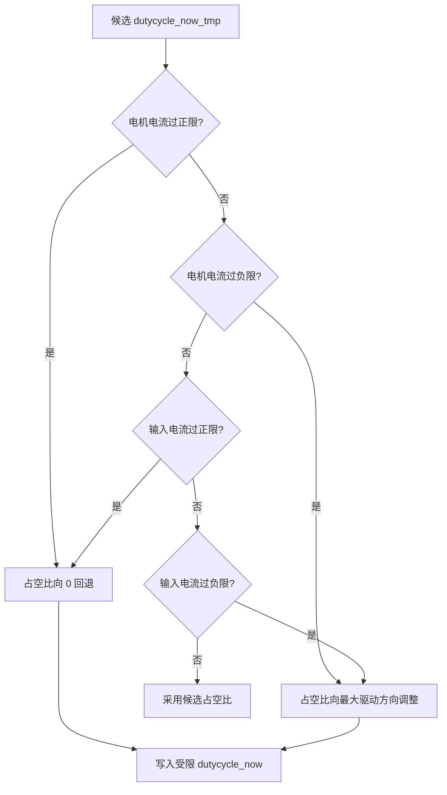

限制值由 `mc_interface` 根据温度、电压、RPM、功率等条件动态生成。即使控制目标未变化，环境条件也可能使允许占空比逐步下降。

## 16. 制动、停止与方向切换

### 16.1 停止 PWM

`stop_pwm_hw()` 将三相高侧强制为不活动并禁用互补低侧，随后恢复最大开关频率。`stop_pwm_ll()` 还会把状态设为 `OFF`。

### 16.2 全制动

`full_brake_hw()` 将三相配置为低侧导通状态，使相线短接制动；`full_brake_ll()` 把状态设为 `FULL_BRAKE`。

### 16.3 高速反向保护

当新目标方向与当前 RPM 相反且转速过高时，控制器不会直接反向驱动，而是保持当前方向的最小占空比逐步降速。只有转速下降到允许阈值后才进入全制动或重新启动相反方向。

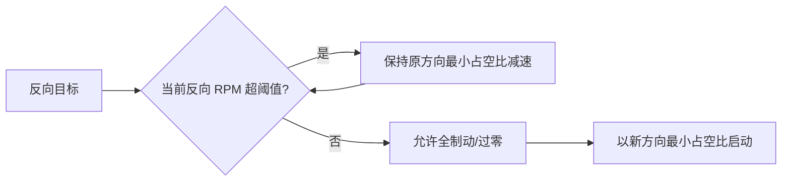

## 17. 后台线程

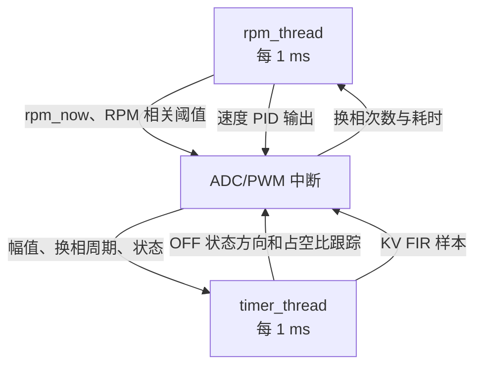

`rpm_thread` 负责：

- 根据换相次数和累计时间计算 ERPM；
- 无新换相时使 RPM 估计随时间下降；
- 低通滤波 RPM；
- 更新反电动势积分阈值和预期换相时间；
- 运行速度 PID。

`timer_thread` 负责：

- 电机关闭时根据反电动势跟踪转速方向和等效占空比；
- 判断无感方向是否可能错误并翻转方向估计；
- 周期更新 KV FIR 样本。

## 18. 转速、转速计与 KV

每次换相时 `update_rpm_tacho()` 根据新旧换相步计算有符号步差：

- 累计 `rpm_dep.comms` 和换相耗时，供 `rpm_thread` 计算 ERPM；
- 更新有符号 `tachometer`；
- 更新绝对 `tachometer_abs`；
- 更新方向判定用计数器。

```mermaid
flowchart LR
    STEP[comm_step 变化] --> DIFF[计算环形步差 -2..3]
    DIFF --> TIME[累计换相数与时间]
    TIME --> RPM[ERPM 估算与低通]
    DIFF --> TACH[有符号转速计]
    DIFF --> ABS[绝对转速计]
    RPM --> KV[电压、占空比和 RPM 推导 KV]
```

KV 使用 FIR 滤波提供更稳定的估计。低速、快速负载变化或换相不稳时，瞬时 KV 可信度较低。

## 19. 检测功能

`mcpwm_set_detect()` 停止普通控制，清零六步检测数组并进入 `MC_STATE_DETECTING`。注入 ADC 中断在不同检测步记录电流与电压，供以下接口读取：

- `mcpwm_get_detect_pos()`：根据六步平均响应估算电角度；
- `mcpwm_detect_currents[]`：各检测步电流；
- `mcpwm_detect_voltages[]`：各检测步电压；
- `mcpwm_detect_currents_diff[]`：相邻检测步电流差；
- Hall 检测表接口：统计并返回 Hall 编码与换相步对应关系。

普通输入通过 `mc_interface_try_input()` 发现 `DETECTING` 状态后会停止检测，并设置 `MCPWM_DETECT_STOP_TIME = 500 ms` 输入屏蔽窗口，避免检测刚结束就立即驱动电机。

## 20. 与 mc_interface 的边界

```mermaid
sequenceDiagram
    participant APP as 上层应用
    participant IF as mc_interface
    participant MC as mcpwm
    participant ISR as ADC/PWM 中断
    participant HW as 功率级

    APP->>IF: set_current / set_duty / set_pid_speed
    IF->>IF: 锁定、忽略窗口、方向处理
    IF->>MC: 对应 mcpwm_* 命令
    MC->>MC: 更新控制模式和目标
    HW-->>ISR: ADC/DMA 同步事件
    ISR->>MC: 换相、调节占空比、更新测量
    MC->>IF: mc_interface_mc_timer_isr(dt)
    IF->>IF: 公共故障、计量、动态限制和采样
    MC->>HW: 提交下一 PWM/采样配置
```

职责划分如下：

| mc_interface | mcpwm |
|---|---|
| 面向上层的统一 API | BLDC/DC 具体实现 |
| 控制命令准入和方向统一 | 六步方向、换相步和桥臂状态 |
| 温度、电压、功率等动态限制计算 | 在实时环中执行动态电流限制 |
| 公共故障记录与线程化停机 | 快速停止 PWM、报告实时测量 |
| Ah/Wh、统计和调试采样 | 电流、RPM、KV 和换相状态 |

## 21. 公开 API 分类

| 类别 | 主要 API |
|---|---|
| 生命周期 | `init`、`deinit`、`init_done`、`set_configuration` |
| 控制 | `set_duty*`、`set_current`、`set_brake_current`、`set_pid_speed/pos` |
| 停止 | `release_motor`、`stop_pwm`；`brake_now` 仅有声明、当前无实现 |
| 状态 | `get_state`、`get_comm_step`、`get_duty_cycle_*`、`get_rpm` |
| 电流 | `get_tot_current*`、`get_tot_current_in*` |
| 计数 | `get/set_tachometer_value`、`get_tachometer_abs_value` |
| 无感换相 | `set/get_comm_mode`、`switch_comm_mode`、`get_rpm_dep` |
| 检测 | `set_detect`、`get_detect_pos`、Hall 检测接口 |
| 调试 | KV、平均周期积分、ISR 执行时间查询 |
| ISR | `adc_inj_int_handler`、`adc_int_handler` |

直接使用这些 API 会绕过 `mc_interface` 的命令准入和统一方向处理。除控制后端内部或明确的诊断流程外，上层应优先调用 `mc_interface_*()`。

## 22. 修改与调试注意事项

1. **不要增加中断中的无界工作。** DMA ADC 中断已承担换相、控制、限制、位置 PID 和公共接口更新。
2. **采样点必须与 PWM 同步修改。** 只改占空比或 ARR 而不更新 ADC 触发位置会产生错误电流样本。
3. **明确当前电机类型。** DC 与 BLDC 复用函数但桥臂、频率和采样逻辑不同。
4. **区分电气 RPM 与机械 RPM。** `mcpwm_get_rpm()` 返回的是电气 RPM，上层换算机械速度时还需电机极数。
5. **关注配置的动态覆盖值。** `lo_*` 限制由 `mc_interface` 实时更新，不等于静态 `l_*` 配置。
6. **无感参数相互耦合。** 积分阈值、最小 ERPM、耦合系数、相位超前和开关频率共同影响换相。
7. **配置更新会停机。** `mcpwm_set_configuration()` 不是无扰切换接口。
8. **线程退出依赖调度。** `deinit()` 等待两个线程退出，不能在不允许睡眠的中断上下文调用。
9. **检查 ISR 时长。** 使用 `get_last_adc_isr_duration()` 和 `get_last_inj_adc_isr_duration()` 评估修改成本。
10. **无斜坡接口风险高。** `set_duty_noramp()` 只应在明确掌握电机和功率级瞬态能力时使用。

## 23. 推荐阅读顺序

```mermaid
flowchart TB
    A[mcpwm.h<br/>了解公开接口] --> B[mcpwm.c 顶部<br/>状态变量与辅助结构]
    B --> C[mcpwm_init<br/>TIM、ADC、DMA 关系]
    C --> D[set_duty/current/speed/pos<br/>理解控制目标]
    D --> E[set_duty_cycle_hl/ll/hw<br/>理解目标到硬件]
    E --> F[set_next_comm_step<br/>理解六步桥臂表]
    F --> G[mcpwm_adc_inj_int_handler<br/>理解电流采样]
    G --> H[mcpwm_adc_int_handler<br/>理解换相与实时调节]
    H --> I[commutate 与无感积分/延时逻辑]
    I --> J[rpm_thread / timer_thread]
    J --> K[mc_interface_mc_timer_isr<br/>继续追踪公共保护]
```

## 24. 小结

`mcpwm` 是 BLDC 六步换相和 DC PWM 控制的硬实时后端。它把上层的占空比、电流、速度和位置目标转化为 TIM1 三相桥臂状态，并借助 TIM8、ADC 和 DMA 在合适的 PWM 时刻采集相电压与相电流。

理解该模块应抓住四个核心关系：换相步如何决定桥臂组合、PWM 占空比如何决定 ADC 采样窗口、Hall/反电动势如何触发下一次换相、控制模式如何在 DMA ADC 中断中修正占空比。线程负责 RPM 估算和慢速跟踪，中断负责确定性的采样、换相和控制，两者共同形成完整闭环。
