# motor 目录模块关系说明

本文说明 `bldc/motor` 目录中各模块的职责、依赖关系和主要运行链路。分析基于当前仓库源码；这里的“模块”既包括 `.c/.h` 实现单元，也包括控制配置和构建清单。

## 1. 目录组成

`motor/motor.mk` 将五个 C 源文件加入固件，并把 `motor` 加入头文件搜索路径：

| 模块 | 主要职责 |
|---|---|
| `mc_interface.c/.h` | 对上提供统一电机控制 API，保存接口层状态，执行限幅、故障保护、统计和具体控制器路由 |
| `mcpwm.c/.h` | BLDC 六步换相和 DC 电机控制实现，管理换相、PWM、转速/位置控制及 ADC 中断处理 |
| `mcpwm_foc.c/.h` | FOC 控制实现，管理电流环、调制、观测器、传感器融合、HFI、参数检测及双电机状态 |
| `foc_math.c/.h` | FOC 可复用数学与控制算法，包括观测器、PLL、SVM、速度/位置 PID、弱磁和角度修正 |
| `virtual_motor.c/.h` | 软件电机模型，用于在 FOC 链路中模拟电气和机械响应，支持调试和算法验证 |
| `mcconf_default.h` | 电机配置的编译期默认值；板级配置可通过同名宏覆盖这些默认值 |
| `motor.mk` | 声明本目录参与编译的源文件和包含路径 |

需要注意：`mcpwm.c` 和 `mcpwm_foc.c` 都被编译进固件，但运行时由 `mc_configuration.motor_type` 选择具体实现。它们是并列后端，不是前后串联的两级控制器。

## 2. 总体模块关系

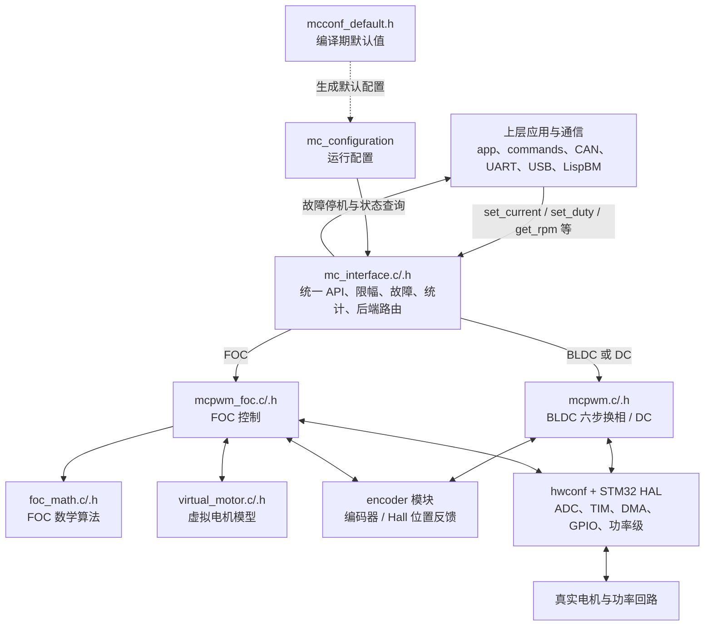

从调用方向看，上层通常只依赖 `mc_interface.h`。具体 PWM 控制器、硬件寄存器和中断细节被隐藏在接口层之后。

## 3. mc_interface：统一入口与系统协调层

`mc_interface` 是 `motor` 目录对外的主要门面。应用层不需要知道当前电机使用六步换相还是 FOC，统一调用：

- `mc_interface_set_duty()`：占空比控制；
- `mc_interface_set_current()`：驱动电流控制；
- `mc_interface_set_brake_current()`：制动电流控制；
- `mc_interface_set_pid_speed()`：速度闭环；
- `mc_interface_set_pid_pos()`：位置闭环；
- `mc_interface_release_motor()`：释放输出；
- `mc_interface_get_rpm()`、`mc_interface_get_tot_current()` 等：读取运行状态。

### 3.1 后端路由

接口层依据 `motor_type` 把同一语义的 API 路由到不同实现：

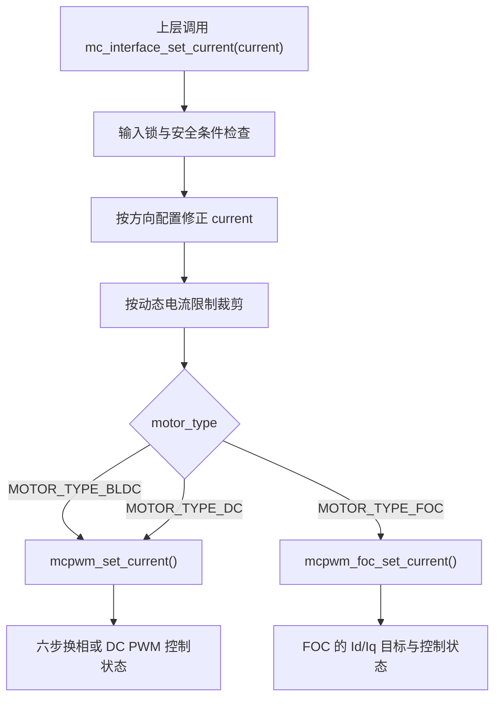

读取类接口采用相同模式。例如 `mc_interface_get_rpm()` 分别调用 `mcpwm_get_rpm()` 或 `mcpwm_foc_get_rpm()`，从而让命令、遥测和应用代码保持算法无关。

### 3.2 初始化职责

`mc_interface_init()` 的主要顺序为：

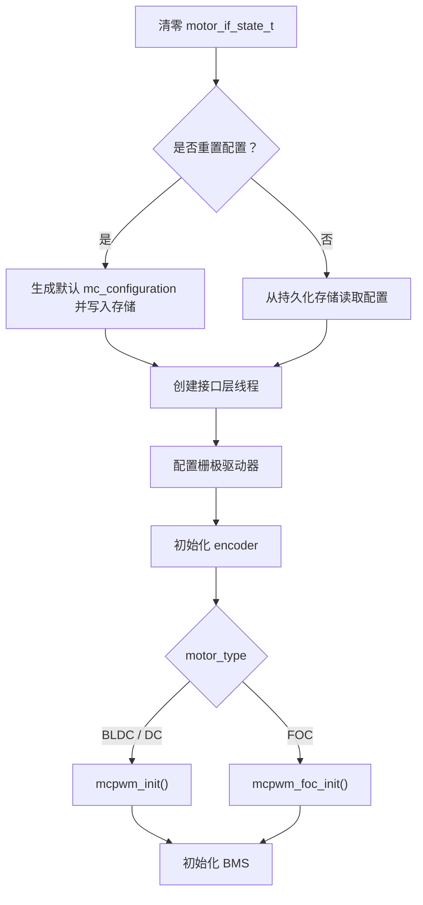

接口层会创建以下后台线程：

| 线程 | 作用 |
|---|---|
| `mcif timer` | 每 1 ms 更新输入电压滤波、动态限制、驱动故障、编码器故障和电流传感器偏置检查 |
| `sample_send_thread` | 将中断中采集的调试波形异步发送，避免在实时中断中发送通信数据 |
| `fault_stop_thread` | 接收中断侧故障事件，在高优先级线程上下文中执行停机和故障处理 |
| `stat_thread` | 汇总功率、速度、电流和温度统计量 |

### 3.3 双电机上下文

接口层保存 `m_motor_1`，在 `HW_HAS_DUAL_MOTORS` 下还保存 `m_motor_2`。`mc_interface_select_motor_thread()` 选择当前线程所操作的电机，使大量不带 motor 参数的统一 API 仍能服务双电机硬件。

中断中的电机选择不依赖普通线程选择状态，而是通过 `is_second_motor` 或 FOC ISR 当前电机编号访问明确的状态对象。新增双电机代码时，应区分“线程当前电机”和“当前 ADC/PWM 中断对应电机”。

## 4. mcpwm：BLDC 六步换相与 DC 后端

`mcpwm.c` 面向 `MOTOR_TYPE_BLDC` 和 `MOTOR_TYPE_DC`。其核心职责包括：

- 初始化定时器、ADC、DMA、中断和 PWM 输出；
- 根据转子位置或反电动势执行六步换相；
- 支持有感、无感和混合换相策略；
- 实现占空比、电流、速度和位置控制模式；
- 估算 RPM、换相周期和转子位置；
- 维护转速计、能量相关采样和控制状态；
- 执行直流偏置校准、Hall 检测和换相参数更新。

### 4.1 典型六步控制链路

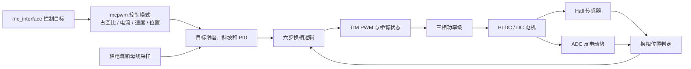

`mcpwm_adc_int_handler()` 和 `mcpwm_adc_inj_int_handler()` 处于实时采样路径；`timer_thread`、`rpm_thread` 处理较慢的周期任务。换相和采样时刻由硬件定时器/ADC 中断驱动，不能把这些硬实时逻辑等同于普通 RTOS 线程循环。

### 4.2 与其他 motor 模块的关系

`mcpwm` 由 `mc_interface` 初始化和调用，也会把故障与测量结果报告回接口层。它使用 `encoder` 模块，但不依赖 `foc_math` 或 `virtual_motor`；后两者属于 FOC 路径。

## 5. mcpwm_foc：FOC 实时控制后端

`mcpwm_foc.c` 是本目录规模最大的模块，负责把电流、速度、位置或开环目标转化为三相 PWM。它不仅实现电流环，还协调以下功能：

- Clarke/Park 坐标变换和空间矢量调制；
- `Id/Iq` 电流控制；
- 无感观测器和 PLL；
- 编码器、Hall、HFI 与观测角度的选择和融合；
- 速度、位置控制与弱磁；
- 双电机 FOC 状态管理；
- 电阻、电感、编码器、Hall 和偏置检测；
- HFI 线程、PID 线程和慢速维护线程；
- 电机音频和调试采样功能；
- 虚拟电机接入。

### 5.1 FOC 中断闭环

FOC 的关键闭环在 ADC/PWM 同步中断中运行，其概念数据流如下：

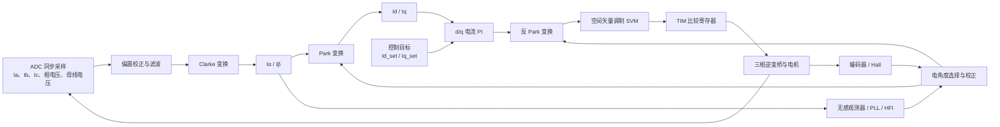

`mcpwm_foc_adc_int_handler()` 是主要 ADC 回调入口。它读取采样，更新控制状态，调用 FOC 数学算法，计算下一周期调制量，并与 `mc_interface_mc_timer_isr()` 协作完成公共故障、限制和统计逻辑。

### 5.2 快慢环分工

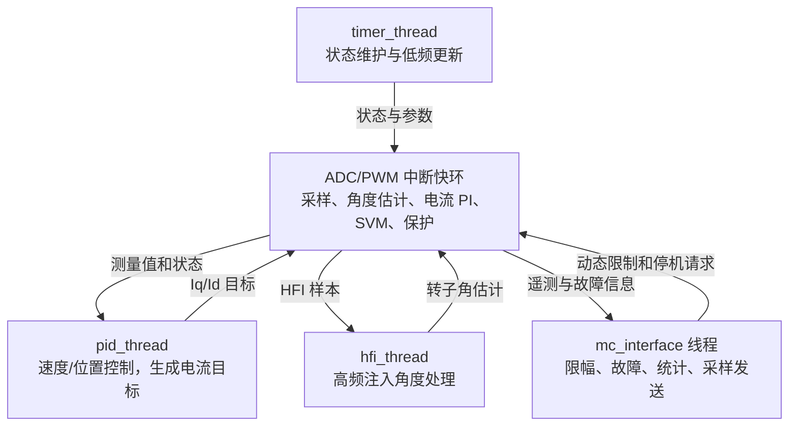

快环只承担确定性要求高的计算。参数检测、通信发送和较慢的状态管理由线程完成，以减少 ADC 中断的最坏执行时间。

## 6. foc_math：FOC 算法公共层

`foc_math` 保存 FOC 使用的核心状态结构定义和可复用算法。主要公开函数包括：

- `foc_observer_update()`：更新无感磁链/反电动势观测状态；
- `foc_pll_run()`：从观测角度得到平滑相位和速度；
- `foc_svm()`：将 αβ 调制量转换为三相 PWM 比较值；
- `foc_run_pid_control_speed()`：速度环；
- `foc_run_pid_control_pos()`：位置环；
- `foc_correct_encoder()`、`foc_correct_hall()`：传感器角度修正；
- `foc_run_fw()`：弱磁控制；
- `foc_hfi_adjust_angle()`：HFI 角度调整；
- `foc_precalc_values()`：依据配置预计算控制系数。

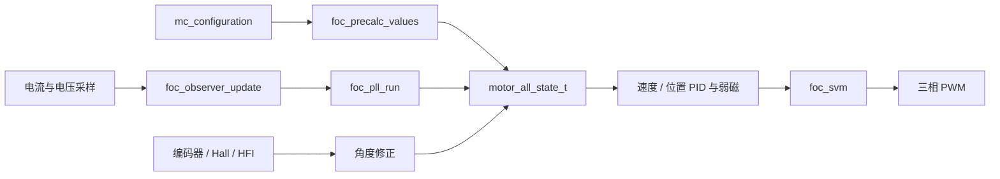

`foc_math` 不直接初始化 STM32 外设，也不决定何时进入中断。`mcpwm_foc` 负责调度这些算法并把结果写入硬件，因此算法层可以相对独立地阅读和测试。

## 7. virtual_motor：FOC 链路中的软件对象

`virtual_motor` 根据电机电阻、电感、磁链和机械参数，在软件中计算电气与机械响应。它通过终端命令连接或断开，不是正常驱动真实功率级所必需的模块。

其主要接口为：

- `virtual_motor_init()`：使用电机配置初始化模型；
- `virtual_motor_set_configuration()`：配置变化时同步模型参数；
- `virtual_motor_int_handler(v_alpha, v_beta)`：在 FOC 实时路径中推进模型；
- `virtual_motor_is_connected()`：判断模型是否接管反馈；
- `virtual_motor_get_angle_deg()`：向 FOC 提供模拟转子角度。

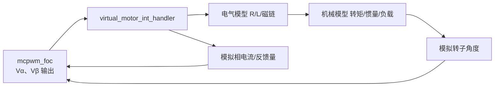

在虚拟电机未连接时，FOC 使用真实 ADC 和位置传感器数据；连接后，部分输出与反馈路径改由模型提供。调试时必须明确当前是否连接虚拟电机，避免把模拟反馈误认为硬件测量。

## 8. mcconf_default：配置基线而非运行控制器

`mcconf_default.h` 用大量 `#ifndef MCCONF_*` 宏提供默认配置，例如默认电机类型、PWM 模式、电流/电压/温度限制、速度和位置 PID、FOC 参数及故障阈值。

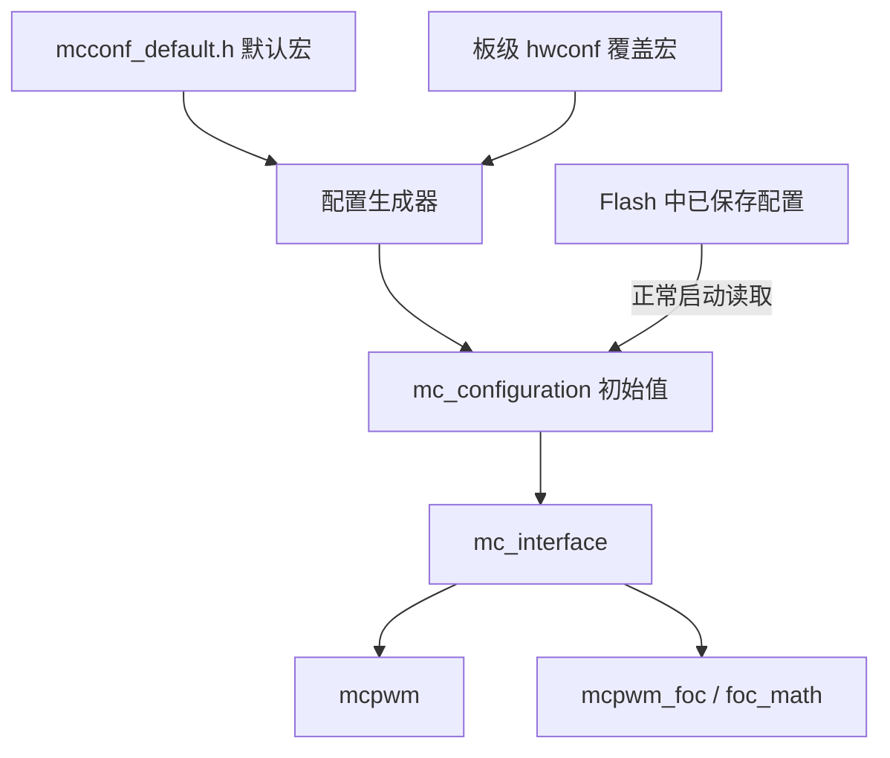

它不在运行时执行控制计算。正常启动通常优先读取持久化配置；恢复默认值或首次生成配置时，默认宏才形成配置基线。板级 `hwconf` 可以在包含此文件前定义同名宏，以适配不同功率板和电机能力。

## 9. 中断、线程与模块边界

电机控制同时运行在硬件中断和 ChibiOS 线程中：

| 执行环境 | 典型工作 | 相关模块 |
|---|---|---|
| ADC/PWM 中断 | 同步采样、换相、电流环、SVM、快速保护 | `mcpwm`、`mcpwm_foc`、`foc_math`、`mc_interface` |
| 高优先级故障线程 | 将中断检测到的故障转换为完整停机处理 | `mc_interface` |
| 控制线程 | 速度/位置环、HFI 处理和慢速状态更新 | `mcpwm`、`mcpwm_foc` |
| 1 ms 接口线程 | 动态限幅、驱动故障、编码器检查、偏置监控 | `mc_interface` |
| 低优先级通信线程 | 调试采样发送和遥测 | `mc_interface` 与 `commands` |

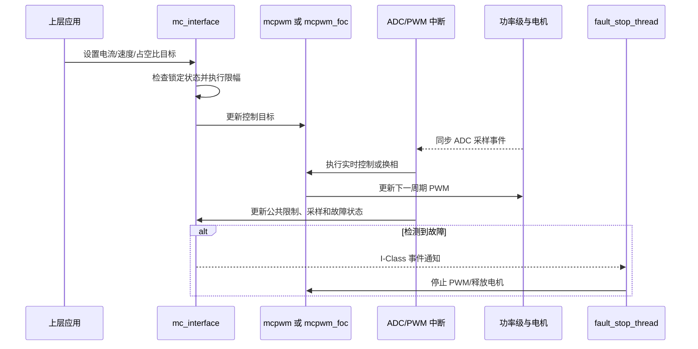

中断函数只能调用满足中断上下文要求的接口。耗时计算、Flash 操作和通信发送不得直接加入 ADC/PWM 中断路径。

## 10. 典型控制命令的完整路径

以应用请求电流控制为例：

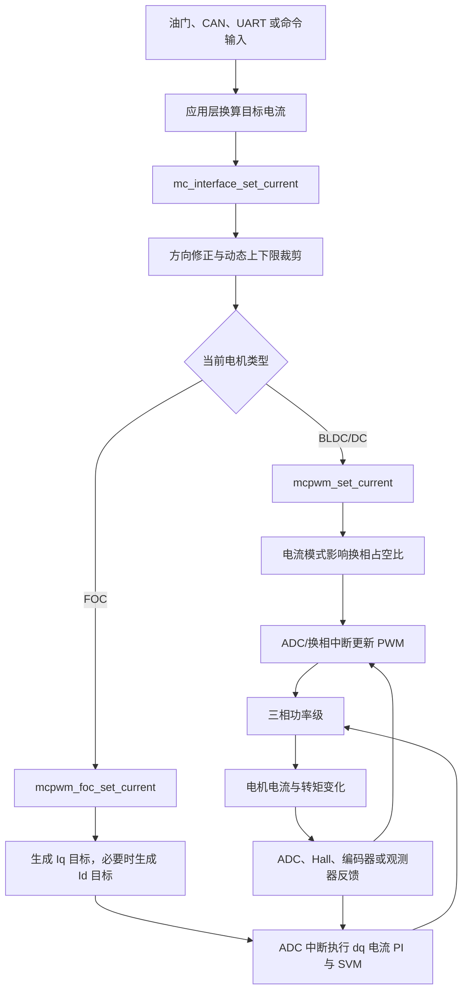

上层的调用只修改目标和状态；PWM 波形通常由后续硬件中断计算和更新。因此 API 返回不代表电机已经瞬间达到目标值。

## 11. 故障保护关系

保护逻辑跨越接口层和具体控制器：

- `mcpwm`/`mcpwm_foc` 最接近电流采样和 PWM，可快速发现并停止危险输出；
- `mc_interface_mc_timer_isr()` 检查输入电压、电流、温度等公共条件；
- `mc_interface_fault_stop()` 记录故障，并从 ISR 或线程侧通知 `fault_stop_thread`；
- 接口层的 1 ms 线程持续检查驱动器故障、编码器状态、电流传感器偏置和动态限制；
- 上层通过 `mc_interface_get_fault()` 获取统一故障状态。

这种分工兼顾快速硬件响应和较完整的线程级清理。新增保护时，应先判断它需要在单个 PWM 周期内动作，还是可以放在 1 ms 维护线程中处理。

## 12. 阅读建议

建议按以下顺序理解 `motor` 目录：

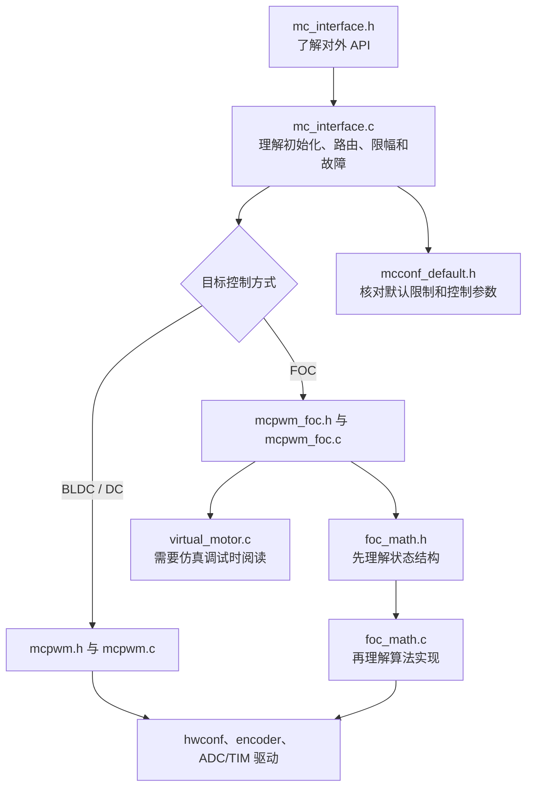

定位具体问题时可以按现象选择入口：

- 命令被拒绝、限幅异常或故障停机：先看 `mc_interface.c`；
- BLDC 不换相、Hall 表或反电动势异常：看 `mcpwm.c`；
- FOC 电流振荡、角度跳变或观测器异常：看 `mcpwm_foc.c` 和 `foc_math.c`；
- 默认参数与板型不符：看 `mcconf_default.h` 及对应 `hwconf` 覆盖；
- 只在模拟连接时出现异常：看 `virtual_motor.c`。

## 13. 小结

`motor` 目录采用“统一接口 + 可选控制后端 + FOC 算法库 + 配置/仿真辅助”的结构。`mc_interface` 是系统协调中心；`mcpwm` 与 `mcpwm_foc` 分别实现 BLDC/DC 和 FOC；`foc_math` 为 FOC 提供算法；`virtual_motor` 提供软件反馈对象；`mcconf_default` 提供配置基线。

理解模块关系时，应始终区分三条路径：上层命令如何到达控制目标、ADC/PWM 中断如何形成实时闭环、故障与慢速维护如何通过线程处理。三条路径共同决定电机控制行为。
