# `imu/mpu9150.c` 功能描述及流程图

## 1. 模块定位

`mpu9150.c` 是 VESC IMU 子系统中的 MPU9x50 芯片适配驱动。文件名虽然是 MPU9150，但源码也兼容 MPU9250。它负责：

- 初始化软件 I²C 和 MPU9x50；
- 自动尝试 `0x68`、`0x69` 两个主芯片地址；
- 配置加速度计、陀螺仪和磁力计旁路；
- 创建 ChibiOS 周期采样线程；
- 读取并解包三轴加速度、三轴角速度和三轴磁场；
- 扣除运行时采样得到的陀螺仪零偏；
- 将原始值换算为 g、deg/s 和磁场单位；
- 通过回调把样本送入 `imu.c`；
- 检测通信失败和连续相同数据，并尝试重新初始化；
- 提供状态查询和寄存器读取终端命令。

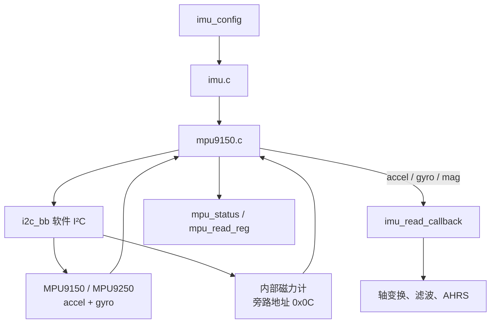

## 2. 相关文件及边界

| 文件 | 功能 |
|---|---|
| `imu/mpu9150.c` | 线程、寄存器配置、采样、换算和恢复策略 |
| `imu/mpu9150.h` | 公共 API、寄存器地址和位定义 |
| `imu/imu.c` | 驱动选择、回调消费、坐标变换、滤波和姿态融合 |
| `i2c_bb.*` | 软件 I²C GPIO 时序和总线恢复 |
| `terminal.*` / `commands.*` | 终端命令注册和输出 |

本驱动不进行最终安装方向旋转、软件低通和 AHRS 解算，这些工作位于 `imu_read_callback`。

## 3. 主要状态

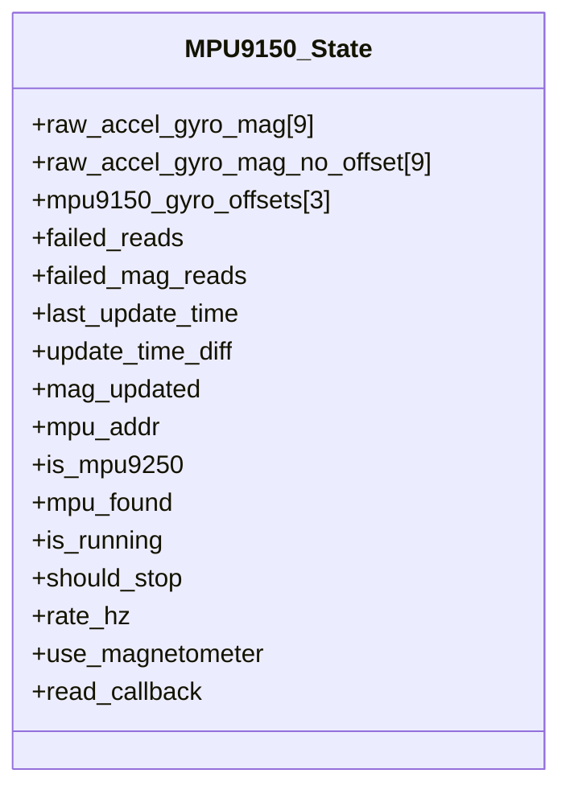

九个原始通道的排列是：

```text
[0..2]  accel X/Y/Z
[3..5]  gyro  X/Y/Z
[6..8]  mag   X/Y/Z
```

`raw_accel_gyro_mag_no_offset` 保存扣除陀螺零偏前的数据，既用于零偏采样，也用于连续相同读数检测；`raw_accel_gyro_mag` 保存对外提供的、已扣除陀螺零偏的数据。

## 4. 初始化入口

`imu.c` 在选择 MPU9x50 类型时调用：

```text
imu_init_mpu9x50(...)
  ├─ imu_stop()
  ├─ mpu9150_init(...)
  └─ mpu9150_set_read_callback(imu_read_callback)
```

在更上层的 `imu_init` 中还会预先设置：

- `mpu9150_set_rate_hz(MIN(sample_rate_hz, 1000))`；
- `mpu9150_set_mag_enabled(use_magnetometer)`。

驱动默认采样率为 200 Hz，软件 I²C 固定配置为 400 kHz。

### 4.1 初始化总流程

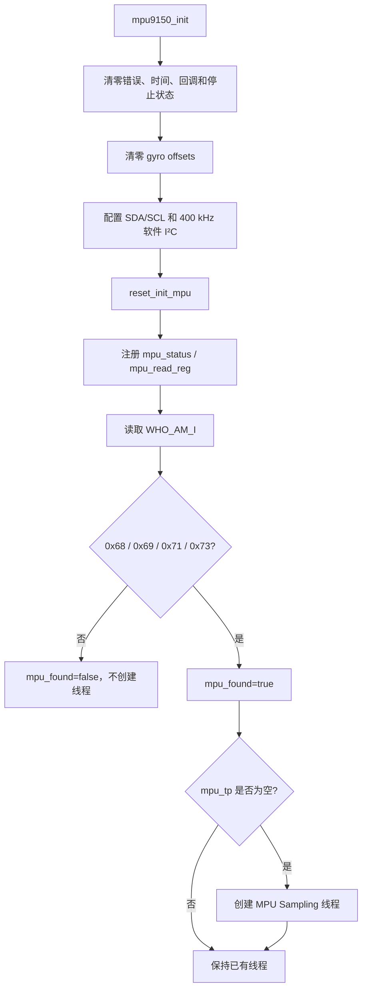

`reset_init_mpu()` 的返回值在首次初始化时没有被检查，最终是否启动线程由随后的 `WHO_AM_I` 读取决定。

## 5. 地址探测与芯片识别

主芯片支持两个 I²C 地址：

| AD0 状态 | 地址 |
|---|---:|
| 低 | `0x68` |
| 高 | `0x69` |

`reset_init_mpu` 先使用当前 `mpu_addr` 写电源管理寄存器；失败时切换到另一个地址再试一次。

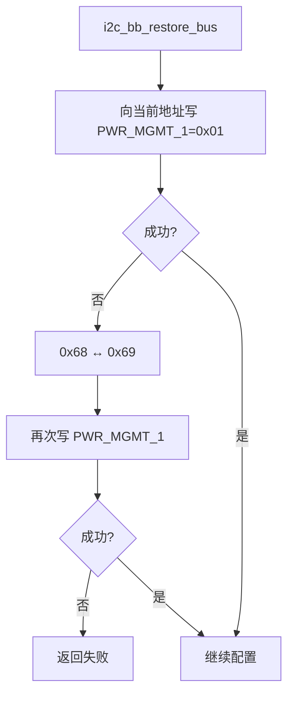

首次启动接受的 `WHO_AM_I` 为 `0x68`、`0x69`、`0x71` 或 `0x73`。但 `is_mpu9250` 只在值严格等于 `0x71` 时置真，因此返回 `0x73` 的兼容器件会通过启动检查，却不会被报告为 MPU9250。

## 6. 寄存器配置

地址探测成功后依次写入：

| 配置 | 寄存器 | 写入含义 |
|---|---|---|
| 时钟源 | `PWR_MGMT_1` | `0x01`，使用 X 轴陀螺 PLL |
| 加速度量程 | `ACCEL_CONFIG` | ±16 g |
| 陀螺量程 | `GYRO_CONFIG` | ±2000 deg/s |
| 数字低通 | `CONFIG` | 256 Hz，注释标称约 1 ms 延迟 |
| I²C 旁路 | `INT_PIN_CFG` | 磁力计启用时写 `0x02` |

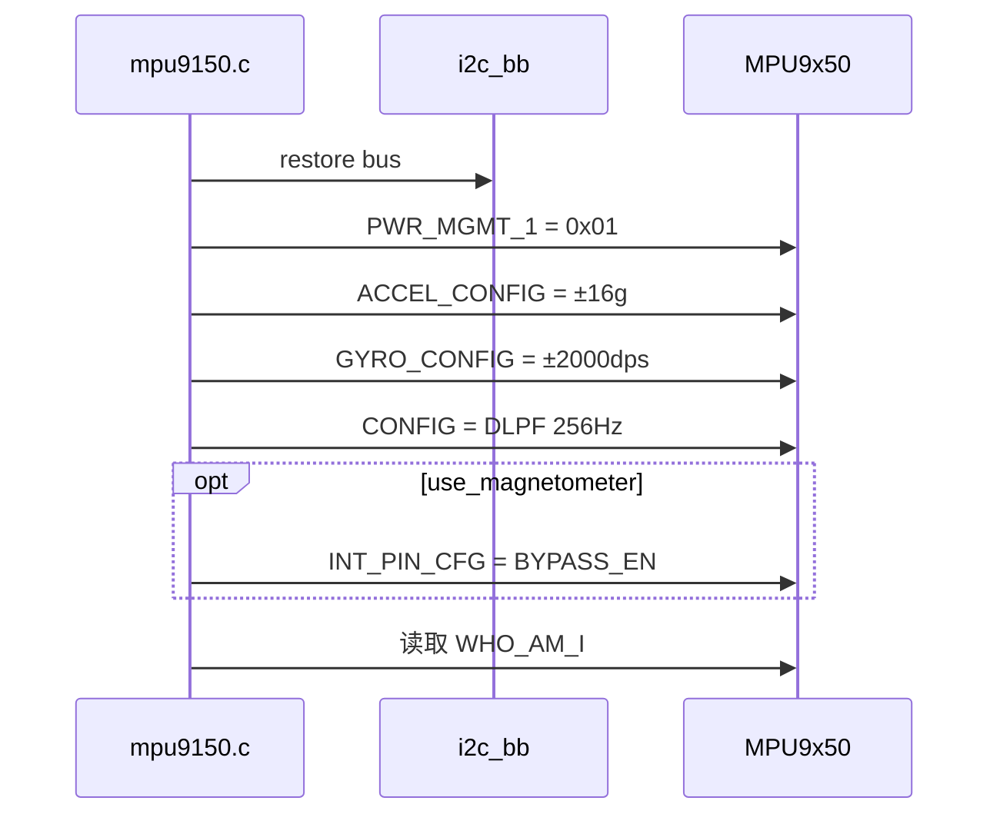

驱动没有配置 `SMPLRT_DIV`、data-ready 中断或 FIFO。芯片数据寄存器按照自身配置持续更新，软件线程按 `rate_hz` 轮询最新值。

## 7. 加速度和陀螺仪读取

`get_raw_accel_gyro` 从 `ACCEL_XOUT_H` 开始连续读取 14 字节：

```text
Accel X/Y/Z：6 字节
Temperature ：2 字节（读取但跳过）
Gyro X/Y/Z ：6 字节
```

主芯片数据采用高字节在前。每轴合成为：

$$
raw=(int16\_t)((MSB\ll8)+LSB)
$$

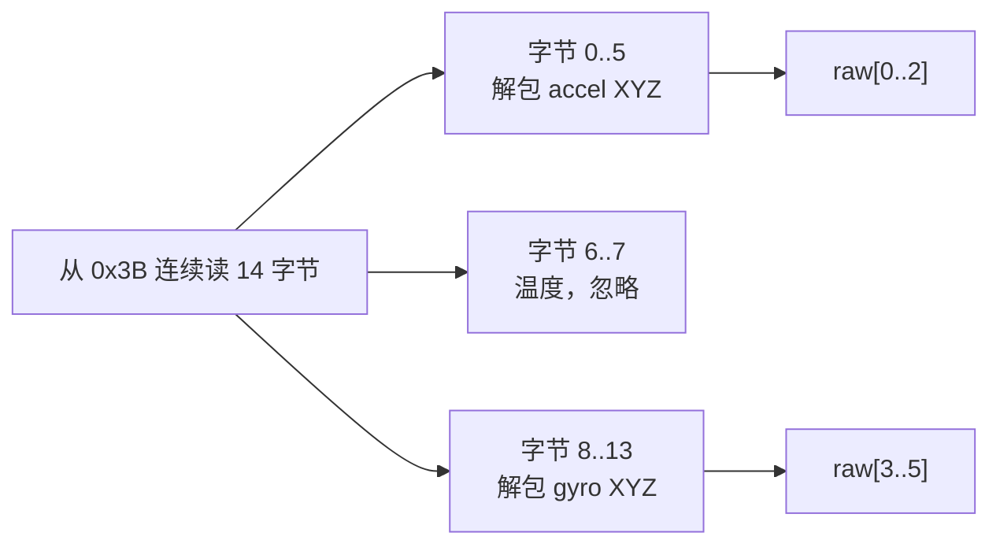

一次连续事务可使六个运动通道来自同一次寄存器快照附近，避免逐轴独立读取造成更大的时间偏差。

## 8. 物理量换算

量程固定后，换算也固定为：

$$
a_i=raw_{a,i}\frac{16}{32768}\quad[g]
$$

$$
\omega_i=raw_{g,i}\frac{2000}{32768}\quad[^\circ/s]
$$

对应每 LSB：

$$
k_a=0.00048828125g/LSB=0.48828125mg/LSB
$$

$$
k_g=0.06103515625\ ^\circ/s/LSB
$$

磁力计使用固定比例：

$$
m_i=raw_{m,i}\frac{1200}{4096}
$$

即约 $0.29297$ 磁场单位/LSB。源码没有读取磁力计灵敏度调整寄存器 `ASA`，也没有区分不同内置磁力计的分辨率模式，因此该比例是驱动固定模型，不是运行时从器件配置推导出来的。

## 9. 磁力计读取

磁力计通过 MPU 的 I²C bypass 暴露在地址 `0x0C`。`get_raw_mag`：

1. 从 `HXL` 开始读取 6 字节；
2. 以低字节在前的顺序解包 X/Y/Z；
3. 向 `CNTL` 写 `0x01`，启动下一次单次测量。

$$
raw_m=(int16\_t)((MSB\ll8)+LSB)
$$

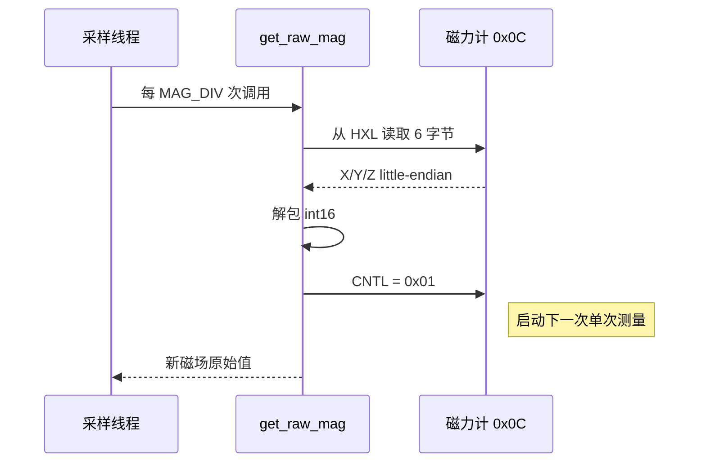

当前实现未读取 `ST1` 判断 data-ready，也未读取 `ST2` 检查溢出/完成状态；初始化时也没有先触发首个单次测量。因此首轮磁场值可能是旧值或无效值，可靠性取决于具体内置磁力计行为。

## 10. 采样线程主流程

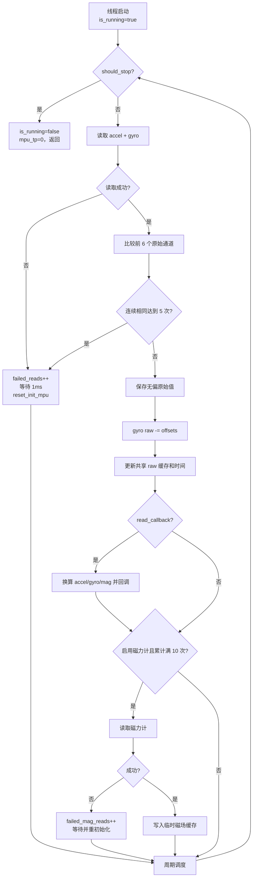

回调发生在本轮磁力计读取之前。因此回调中的磁场是此前缓存值；本轮刚读到的磁场先写入临时数组，在下一次成功的 accel/gyro 周期复制到公共缓存并上报。

## 11. 磁力计降采样

`MAG_DIV` 固定为 10。若主线程频率为 $f_s$，理论磁力计读取频率为：

$$
f_m=\frac{f_s}{10}
$$

例如主线程 200 Hz 时，磁力计约 20 Hz；主线程 1000 Hz 时约 100 Hz。通信错误和线程超期会降低实际频率。

`mag_updated` 只表示最近一次循环是否执行了磁力计更新，并不表示本次回调恰好携带刚读到的磁场。由于读取位于回调之后，两者存在一个主循环周期的缓存延迟。

## 12. 连续相同样本检测与自动恢复

线程比较当前和上一次的六个 accel/gyro 原始值。若六轴完全相同，则 `identical_reads` 加一；任一轴变化则清零。连续达到 5 次时认为传感器或总线可能冻结：

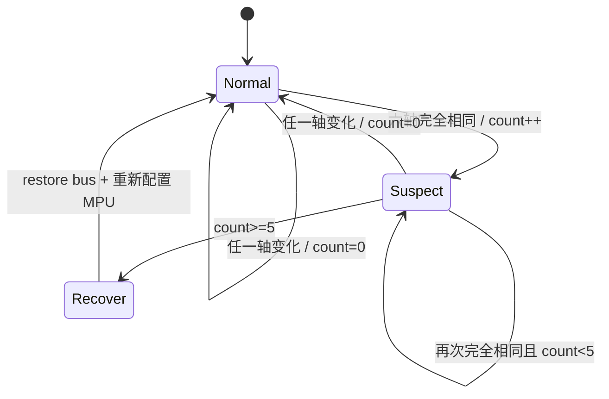

恢复过程包括：

- `failed_reads++`；
- 延时 1 ms；
- 恢复软件 I²C 总线；
- 重新探测地址并写全部配置；
- 重置调度时间基准。

该策略能发现“通信返回成功但寄存器数据冻结”的故障。不过设备完全静止、输出噪声很低或软件读取率远高于芯片数据更新率时，也可能合法地连续读到相同码值，从而触发误恢复。

## 13. 陀螺仪零偏采样

`mpu9150_sample_gyro_offsets(N)` 每 10 ms 读取一次共享的无偏原始缓存，共累加 $N$ 次：

$$
\hat b_i=\frac{1}{N}\sum_{k=1}^{N}raw_{g,i}[k]
$$

随后每个样本执行：

$$
raw_{g,i}^{corrected}=raw_{g,i}-\hat b_i
$$


采样期间设备必须静止，否则真实角速度会被误认为零偏。函数没有检查 $N=0$，零次调用会发生除零；累加器为 `int32_t`，极大的 $N$ 还可能溢出。该函数与采样线程并发读取/写入共享状态，没有创建严格一致的原子快照。

## 14. 周期调度

每轮目标周期为：

$$
T=\frac{1}{rate\_hz}
$$

源码维护绝对迭代时刻：

$$
t_{k+1}=t_k+T
$$

若处理完成时仍早于 $t_{k+1}$，线程睡眠剩余时间；若已经超期，则至少等待 `MIN_ITERATION_DELAY_US = 500 us`，并把时间基准重置为当前时刻。

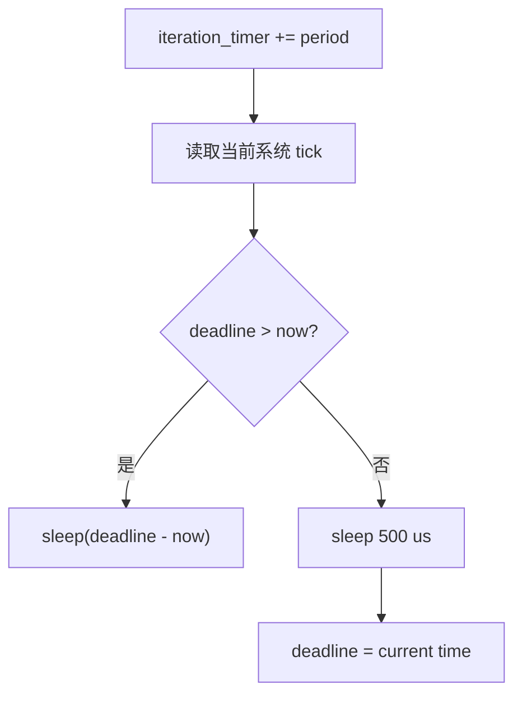

绝对期限方式可以补偿读取和回调耗时，降低长期周期漂移。`rate_hz` 没有在本文件中验证为正数；若被设置为 0，`1000000 / rate_hz` 会除零。

## 15. 回调后的数据链路


这里存在两级陀螺偏置：本驱动的 `mpu9150_gyro_offsets` 在原始 LSB 域扣除，`imu.c` 的 `m_settings.gyro_offsets` 在 deg/s 域扣除。配置和标定时应避免对同一偏置重复补偿。

## 16. 停止流程

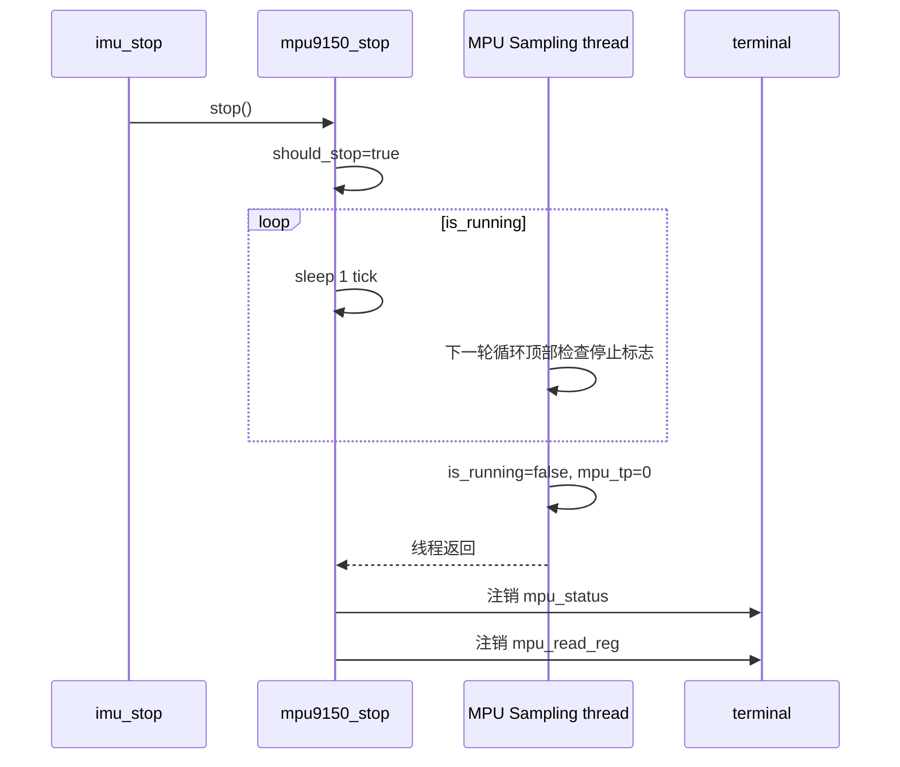

与某些驱动不同，MPU 线程在循环顶部检查停止标志，因此即使上一轮读失败，下一轮仍能退出。停止延迟仍受当前 I²C 事务、失败等待、重初始化和回调耗时影响。

## 17. 状态与诊断接口

### 17.1 `mpu_status`

终端输出：

- 识别类型：MPU9150 或 MPU9250；
- accel/gyro 读取错误及冻结检测累计次数；
- 磁力计读取错误累计次数。

### 17.2 `mpu_read_reg [reg]`

读取指定十进制寄存器地址，并同时输出二进制和十六进制值，适合检查配置是否写入。

### 17.3 运行状态 API

| API | 含义 |
|---|---|
| `mpu9150_get_time_since_update` | 距离最近成功 accel/gyro 更新的毫秒数 |
| `mpu9150_get_last_sample_duration` | 相邻成功更新之间的时间，名称并非单次 I²C 事务耗时 |
| `mpu9150_get_failed_reads` | 主传感器失败/冻结累计次数 |
| `mpu9150_get_failed_mag_reads` | 磁力计读取失败累计次数 |
| `mpu9150_mag_updated` | 最近循环是否执行了磁场更新 |
| `mpu9150_is_mpu9250` | `WHO_AM_I == 0x71` 时为真 |

`get_last_sample_duration` 使用 `update_time_diff = current_update - previous_update`，所以它实际更接近成功样本周期，而不是注释所说的“读取一个样本耗时”。

## 18. 并发与数据一致性

采样线程写九个 `int16_t`，getter 和零偏采样可能同时读取。`volatile` 能阻止访问被优化掉，但不能保证九元素数组是一致快照。因此调用 `mpu9150_get_raw_accel_gyro_mag` 时，理论上可能混合两个采样周期的数据。

回调在采样线程上下文同步执行。回调执行期间不会有下一轮驱动更新，但长时间回调会直接增加采样抖动并可能造成调度超期。

## 19. 当前实现的注意事项

1. `reset_init_mpu` 初次调用返回值未直接处理；
2. 采样率没有零值和负值检查；
3. `mpu9150_sample_gyro_offsets(0)` 会除零；
4. `WHO_AM_I=0x73` 被接受，但类型标志不会识别为 MPU9250；
5. 磁力计读取不检查 data-ready、overflow 和状态寄存器；
6. 初始化时没有显式触发首个磁力计单次测量；
7. MPU9150 与 MPU9250 的磁场比例、分辨率和灵敏度调整没有分别处理；
8. 没有使用 data-ready 中断、FIFO 或传感器时间戳；
9. 连续相同数据检测在低噪声或重复采样情况下可能误判；
10. 共享数组和偏置缺少一致快照或锁；
11. `MPU_I2C_TIMEOUT` 宏在当前文件中没有被使用；
12. 头文件声明的 `mpu9150_cmd_print`、`mpu9150_cmd_sample_offsets` 在当前源文件中没有对应实现。

## 20. 故障定位流程

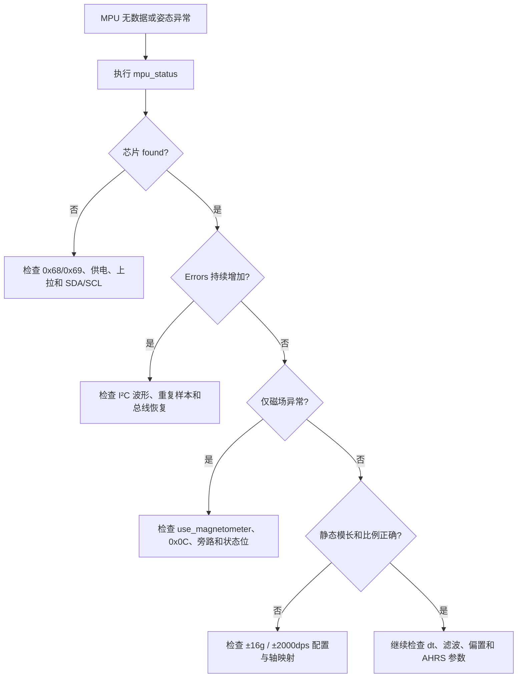

推荐基础检查：

- 水平静止时加速度模长约为 1 g；
- 静止角速度接近 0 deg/s；
- `get_time_since_update` 不应持续增长；
- 实际回调周期应接近 $1/rate\_hz$；
- 启用磁力计后，`mag_updated` 应每 10 个主循环置位一次；
- `failed_reads` 和 `failed_mag_reads` 在稳定总线上不应持续增加。

## 21. 总结

`mpu9150.c` 将 MPU9150/MPU9250 包装成一个带自恢复能力的周期数据源：软件 I²C负责寄存器访问，采样线程负责读取和调度，固定比例完成单位换算，回调把数据送入统一 IMU 管理层。其突出特点是双地址探测、连续相同样本检测、通信失败后总线恢复和自动重配置。

使用时需要特别理解磁力计是低频、延后一轮上报的缓存数据；当前主 AHRS 路径也未必实际融合它。对于严格时间同步或高可靠应用，还应补充磁力计状态检查、data-ready/FIFO、错误返回传播、参数边界检查和共享数据快照机制。
