# terminal.c 模块详细说明

本文说明 `bldc/terminal.c` 与 `terminal.h` 的职责、命令解析流程、内置命令、动态命令扩展、故障历史及其与通信层和电机控制层的关系。本文依据当前工程源码整理；命令可能随硬件宏、编译选项和后续版本发生变化。

> 安全提示：`terminal.c` 不只是查询工具。部分命令会启动电机、注入电流、执行参数辨识、锁定转子或主动触发看门狗复位。执行这些命令前应固定设备、断开机械负载或按测试要求连接负载，设置可靠的限流和急停措施，并保证人员远离旋转部件。

## 1. 模块定位

`terminal.c` 是固件中的文本命令解释器和诊断功能汇聚点，主要负责：

- 把可修改的命令字符串拆分为命令名与参数；
- 优先查找各模块注册的动态命令；
- 分发固件内置诊断、测量和控制命令；
- 通过 `commands_printf()` 返回文本结果；
- 保存并显示有限数量的电机故障现场；
- 为应用、编码器、IMU、栅极驱动和硬件专用代码提供命令扩展接口。

它不直接拥有 UART、USB 或 CAN 传输。通信协议的接收、封包和回复通道由 `comm/commands.c` 及其上层通信驱动负责。

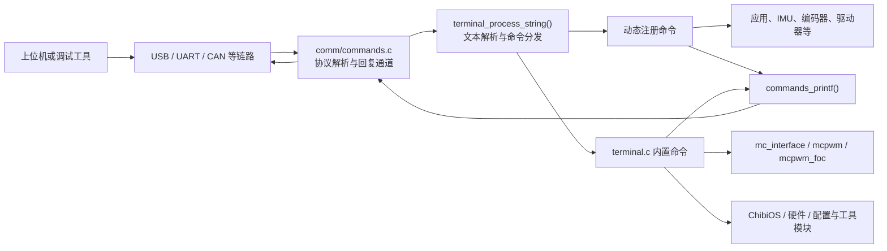

## 2. 文件与依赖关系

| 文件或模块 | 与 `terminal.c` 的关系 |
|---|---|
| `terminal.h` | 声明命令处理、故障记录和动态回调接口 |
| `comm/commands.c` | 将收到的终端数据交给 `terminal_process_string()`，并提供 `commands_printf()` |
| `motor/mc_interface` | 电机选择、状态读取、停机、测量和控制入口 |
| `motor/mcpwm`、`motor/mcpwm_foc` | BLDC/FOC 运行状态、采样、辨识和开环控制 |
| ChibiOS | 线程遍历、系统时间、线程锁定和内存统计 |
| `timeout` | 测试期间刷新控制超时，以及看门狗复位相关操作 |
| `conf_general` | 配置保存、硬件和固件信息、部分故障来源 |
| `encoder`、`imu`、硬件驱动 | 注册专用终端命令 |
| CRC、CAN、USB、NRF、mempools 等 | 为相应内置命令提供数据或操作接口 |

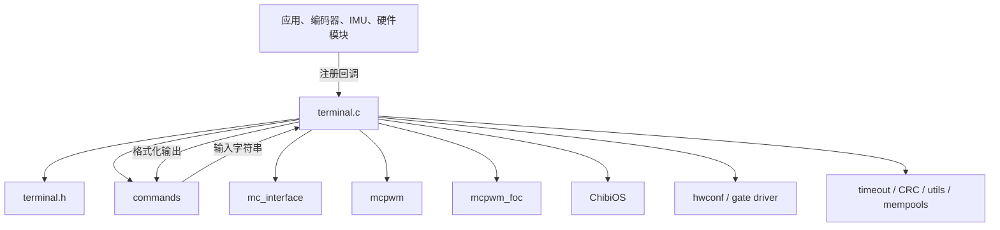

## 3. 公开接口

| 接口 | 作用 | 使用注意 |
|---|---|---|
| `terminal_process_string(char *str)` | 解析并执行一行终端命令 | 会原地修改字符串，传入缓冲区必须可写 |
| `terminal_add_fault_data(fault_data *data)` | 复制一条故障现场到内部数组 | 当前实现无并发锁，且写指针回绕后的显示语义有限 |
| `terminal_get_first_fault(void)` | 返回数组首项的故障码 | 它并非严格意义的环形队列“最老故障”查询 |
| `terminal_register_command_callback(...)` | 注册或替换动态命令 | 字符串仅保存指针，生命周期必须覆盖注册期 |
| `terminal_unregister_callback(cbf)` | 按函数指针注销动态命令 | 注销后槽位可被后续注册复用 |

动态命令条目的结构为：

```c
typedef struct {
    const char *command;
    const char *help;
    const char *arg_names;
    void (*cbf)(int argc, const char **argv);
} terminal_callback_struct;
```

其中 `command` 是命令名，`help` 是说明文字，`arg_names` 是帮助中显示的参数格式，`cbf` 是实际处理函数。

## 4. 命令输入与解析

`terminal_process_string()` 被放入 `.text2` 段。该段的实际存储位置由链接脚本决定，阅读固件空间布局时应同时检查对应 linker script。

解析步骤如下：

1. 使用 `commands_printf("-> %s \n", str)` 回显原始输入；
2. 使用 `strtok(str, " ")` 按空格原地切分参数；
3. 最多接受 64 个参数项；
4. 只把命令名 `argv[0]` 转为小写，参数内容保持原样；
5. 先遍历动态回调表，命中后调用并立即返回；
6. 未命中动态命令时，再进入内置命令的 `strcmp` 分支；
7. 最终通过 `commands_printf()` 输出结果。

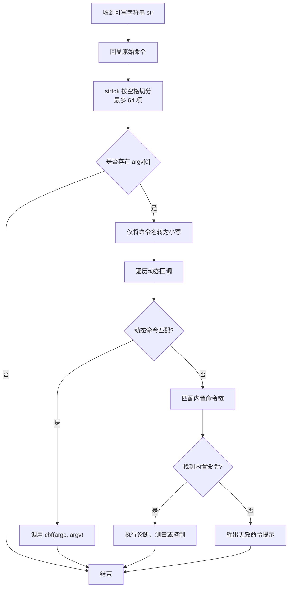

### 4.1 解析规则的直接影响

- `str` 不能是字符串常量或只读存储区，因为 `strtok()` 和命令名小写转换都会写入缓冲区；
- 只有普通空格是分隔符，制表符不会按当前代码自动分隔；
- 不支持引号、反斜杠转义或带空格的单个参数；
- 命令名大小写不敏感，但参数大小写敏感；
- 超过 64 项的多余参数不会进入参数数组；
- 动态回调先于内置命令匹配，因此同名动态命令可以覆盖内置命令；
- 回调在调用 `terminal_process_string()` 的当前通信处理上下文中执行，耗时回调会阻塞该路径的后续处理。

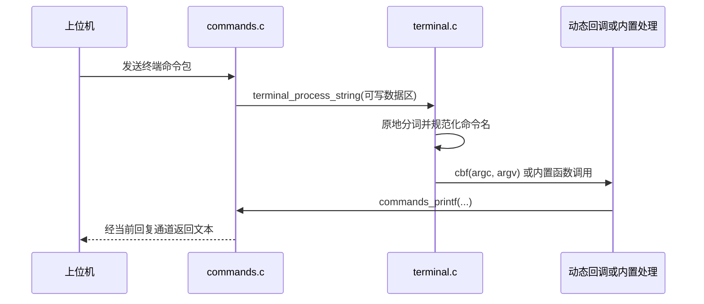

## 5. 动态命令注册机制

动态表容量由 `CALLBACK_LEN` 决定，默认是 40。工程中实际使用者包括应用模块、编码器、IMU、BlackMagic、CANard、虚拟电机、FOC 和不同硬件驱动，因此该接口是固件诊断能力的重要扩展点。

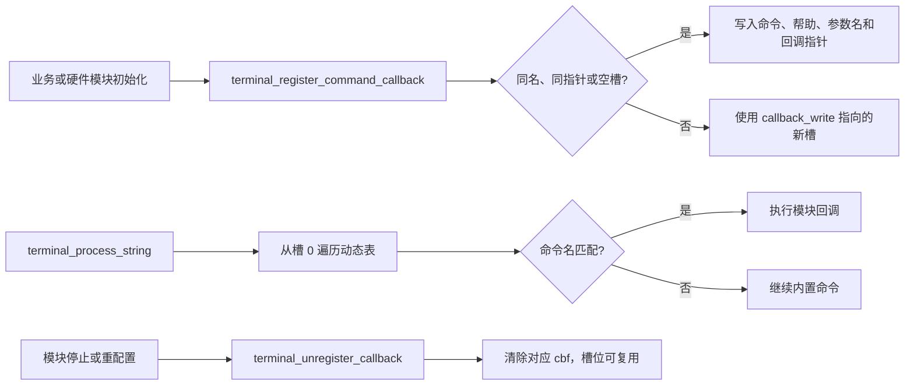

### 5.1 生命周期和并发约束

注册函数直接保存 `command`、`help` 和 `arg_names` 指针，并不复制字符串。因此推荐使用静态字符串常量；不能注册指向栈变量或即将释放缓冲区的指针。

当前实现未对注册、注销、分发和 `help` 遍历加锁。若不同线程同时修改回调表，可能读到不一致条目。比较稳妥的使用方式是在模块初始化或停止阶段完成注册/注销，避免与命令执行并发。

### 5.2 容量回绕特征

当 `callback_write` 增长到 `CALLBACK_LEN` 时，当前代码会把它置零。由于分发和帮助显示只遍历到 `callback_write`，表填满瞬间可能表现为“没有动态命令”，后续注册还会从头覆盖。它不等同于有明确满表处理的固定数组。

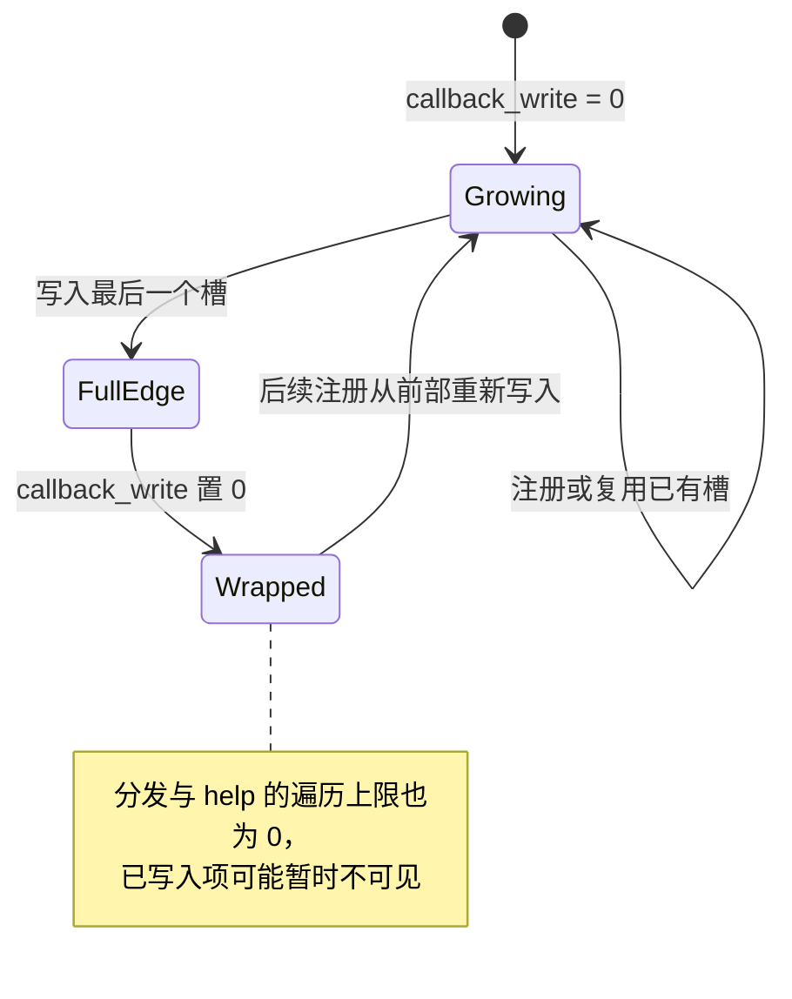

## 6. 内置命令分类

### 6.1 系统与运行状态

| 命令 | 主要作用 |
|---|---|
| `mem` | 显示内存、堆或内存池相关统计 |
| `threads` | 遍历 ChibiOS 线程并显示状态、优先级、栈余量和运行时间 |
| `uptime` | 显示系统运行时间 |
| `fw_info` | 显示固件和硬件相关信息 |
| `crc` | 计算或检查指定数据的 CRC |
| `help` | 输出内置命令及已注册动态命令的帮助 |

`threads` 并非完全只读：它会把每个线程的 `p_time` 统计值清零，并使用静态时间点计算区间占比。第一次执行时，其统计窗口可能接近系统启动以来的时间。

### 6.2 故障与安全

| 命令 | 主要作用 |
|---|---|
| `stop` | 忽略双电机输入一段时间并释放电机 override，快速停止当前终端测试影响 |
| `fault` | 显示当前或首个故障信息 |
| `faults` | 输出保存的故障现场列表 |
| `drv_reset_faults` | 请求栅极驱动器复位故障状态 |
| `rebootwdt` | 锁住系统并等待独立看门狗复位 MCU |

### 6.3 PWM、电气与硬件诊断

| 命令 | 主要作用 |
|---|---|
| `last_adc_duration` | 显示最近 ADC/控制中断执行时间 |
| `kv` | 根据运行数据估算电机 KV 等信息 |
| `tim` | 查看定时器或 PWM 时序相关状态 |
| `volt` | 查看电压采样相关信息 |
| `rpm_dep` | 查看转速相关依赖或计算结果 |
| `hw_status` | 输出硬件状态和驱动器信息 |
| `foc_state` | 输出 FOC 内部状态 |

### 6.4 电机参数测量与传感器检测

| 命令 | 主要作用 |
|---|---|
| `param_detect` | 执行电机参数检测流程 |
| `foc_encoder_detect` | 检测编码器参数 |
| `measure_res` | 测量相电阻 |
| `measure_ind` | 测量相电感 |
| `measure_res_ind` | 组合测量电阻和电感 |
| `measure_linkage` | 测量磁链 |
| `measure_linkage_foc` | 使用 FOC 流程测量磁链 |
| `measure_linkage_openloop` | 使用开环流程测量磁链 |
| `foc_dc_cal` | 执行 FOC 直流偏置校准 |
| `foc_sensors_detect_apply` | 检测传感器并应用结果 |
| `foc_detect_apply_all` | 本机执行完整 FOC 检测并应用 |
| `foc_detect_apply_all_can` | 通过 CAN 面向多节点执行检测和应用 |
| `hall_analyze` | 分析霍尔传感器状态 |

### 6.5 主动运行与辅助配置

| 命令 | 主要作用 |
|---|---|
| `foc_openloop` | 以指定参数进入 FOC 开环运行 |
| `foc_openloop_duty` | 以占空比相关参数执行开环运行 |
| `rotor_lock_openloop` | 施加开环电流锁定转子 |
| `nrf_ext_set_enabled` | 控制外部 NRF 相关功能 |
| `update_pid_pos_offset` | 更新位置 PID 偏移 |

命令的确切参数应以设备上 `help` 输出和当前源码为准。硬件宏可能使某些命令不可用或改变输出内容。

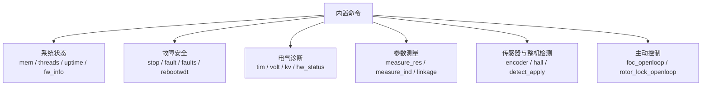

## 7. 故障历史机制

故障数组默认长度为 25：

```c
static volatile fault_data fault_vec[FAULT_VEC_LEN];
static volatile int fault_vec_write = 0;
```

`terminal_add_fault_data()` 把整个 `fault_data` 结构复制到当前写入位置，然后递增索引；索引到达数组末尾后回到零。

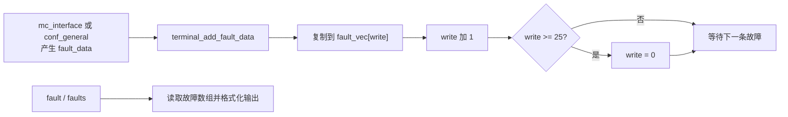

### 7.1 当前实现并非完整环形队列

显示逻辑只读取索引 `0` 到 `fault_vec_write - 1`，因此存在以下特征：

- 恰好写入第 25 条后，写索引为零，`faults` 可能显示为没有历史；
- 回绕后只能看到索引零到当前写索引之前的内容；
- 无法按环形顺序恢复完整的时间先后关系；
- `terminal_get_first_fault()` 在写索引为零时返回 `FAULT_CODE_NONE`；
- 写索引非零时固定返回 `fault_vec[0].fault`，不一定是当前保留记录中真正最早的一条。

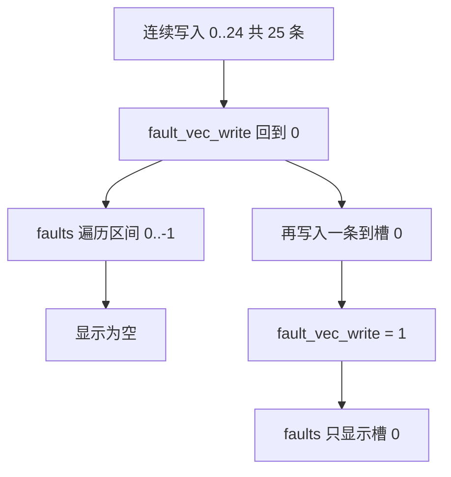

### 7.2 故障信息字符串风险

故障详情输出会把 `info_str` 拼入固定 100 字节临时数组，并把组合后的字符串作为 `commands_printf()` 格式串。需要注意：

- 无界 `strcpy()` 可能因过长字符串造成缓冲区越界；
- `info_str` 中的格式符必须与 `info_argn` 和参数数量一致；
- 当前只处理有限数量的信息参数；
- `fault_data` 内若保存的是字符串指针，该字符串在稍后查询故障时仍必须有效。

## 8. 线程、并发与实时性

`volatile` 只限制编译器优化，不会让整个结构复制或回调表操作具备原子性。当前模块没有专用互斥锁，主要并发关注点如下：

| 场景 | 可能影响 | 建议 |
|---|---|---|
| 注册/注销与命令分发同时发生 | 回调条目部分更新或使用失效指针 | 在初始化/停机阶段操作，或增加锁与快照 |
| 故障写入与 `faults` 读取同时发生 | 读取到不一致的 `fault_data` | 用临界区保护复制，显示前生成稳定快照 |
| 动态回调执行时间过长 | 阻塞当前通信命令处理路径 | 把长任务交给工作线程，回调只做参数校验和投递 |
| 测量命令反复调用 `timeout_reset()` | 正常控制超时暂时不生效 | 只在受控调试环境执行，保留硬件急停 |
| `rebootwdt` 锁住内核 | 所有调度停止，等待 IWDG 复位 | 仅用于明确的复位测试 |

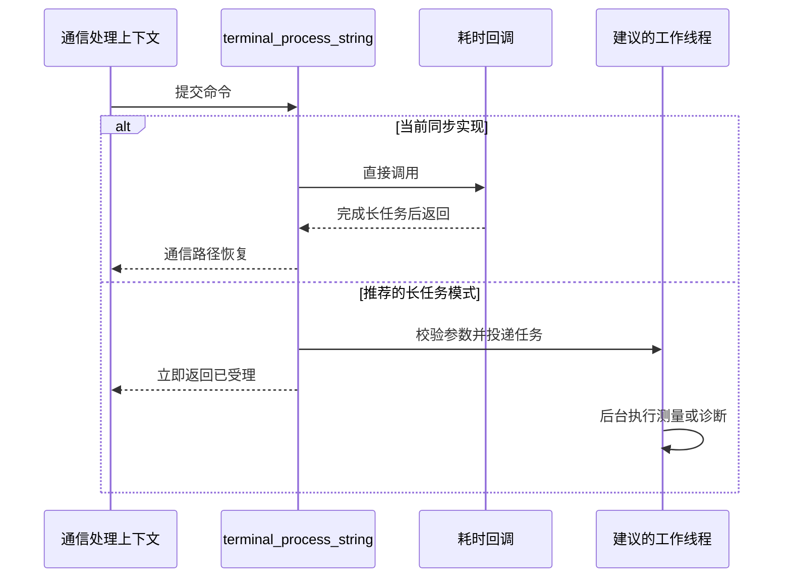

## 9. 高风险命令的典型执行关系

部分检测和开环命令会直接进入电机控制模块，并在循环中刷新 `timeout`，避免普通命令超时中断测试。普通超时保护因此不能替代硬件急停。

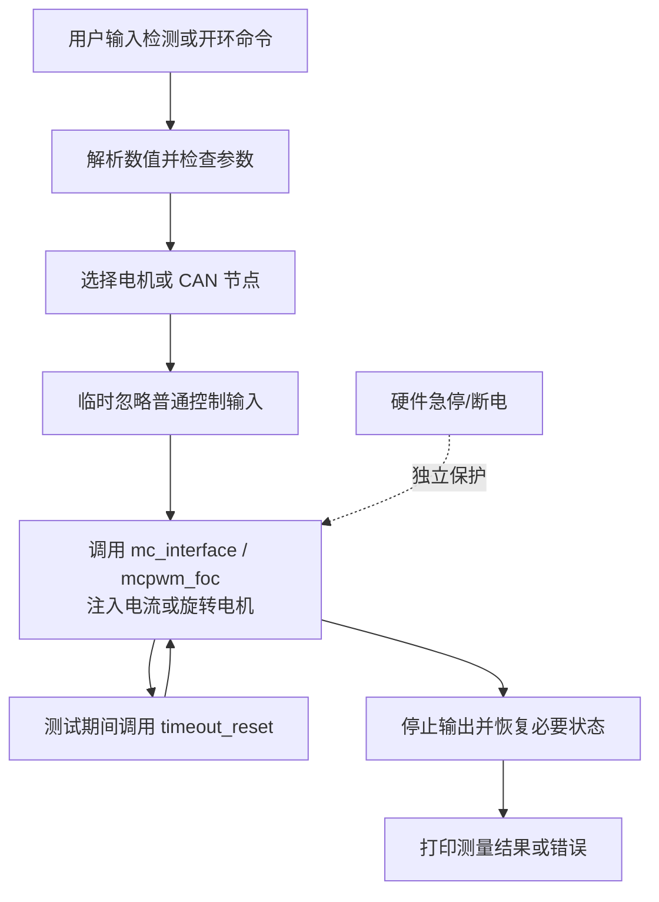

执行前建议至少确认：

1. 电机、负载和控制器已牢固固定；
2. 电源具有限流，电流和占空比参数在硬件允许范围内；
3. 编码器、霍尔和相线接法符合测试要求；
4. 操作者能够立即断电或触发独立急停；
5. CAN 全网检测不会误控制其他节点；
6. 不在无人值守或远程不可观察的环境运行主动控制命令。

## 10. `help` 的形成方式

帮助输出由两部分组成：源码中固定的内置命令说明，以及动态表中每个有效回调的 `command`、`arg_names` 和 `help`。

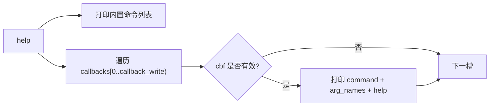

因此设备实际 `help` 输出比单独阅读 `terminal.c` 更能反映当前硬件和已启用应用的扩展命令。不过，前述回调表回绕问题也会影响动态帮助项的可见性。

## 11. 新增动态命令的推荐方式

处理函数应先验证 `argc`，再解析参数；错误时给出明确用法，并避免在回调中长时间阻塞。

```c
static void terminal_example(int argc, const char **argv) {
    if (argc != 2) {
        commands_printf("Usage: example value\n");
        return;
    }

    // 校验并处理 argv[1]
}

void example_init(void) {
    terminal_register_command_callback(
            "example",
            "Run the example command",
            "[value]",
            terminal_example);
}

void example_stop(void) {
    terminal_unregister_callback(terminal_example);
}
```

推荐检查清单：

- 命令名使用稳定的静态字符串，避免与现有命令重名；
- 所有参数先做数量、格式、范围和单位检查；
- 对会转动电机或写配置的命令给出醒目的帮助和确认条件；
- 注销前保证没有命令正在使用该模块资源；
- 耗时工作交给独立线程或状态机；
- 输出统一通过 `commands_printf()`，不要假设固定物理传输通道。

## 12. 常见问题定位

### 12.1 输入命令没有反应

依次检查：通信包是否进入 `commands.c`、输入缓冲区是否可写、命令是否被正确以空格分隔、动态回调是否已注册，以及当前硬件编译宏是否包含该命令。

### 12.2 命令帮助存在但执行后通信卡顿

回调是同步执行的。检查回调内部是否存在长循环、阻塞等待、长时间测量或未满足退出条件的电机测试。

### 12.3 动态命令突然全部消失

检查注册数量和 `callback_write`。默认容量为 40，达到末尾后的回绕行为可能令分发和帮助遍历范围变为零。

### 12.4 故障历史数量异常

检查 `fault_vec_write` 是否刚好回绕。当前实现不维护有效条目数，也未按完整环形队列顺序显示。

### 12.5 执行测量命令后电机仍有动作

立即使用独立急停或断电保障安全，再检查命令的退出和清理路径、通信是否中断、测试循环条件以及控制模式是否恢复。不要仅依赖通信链路中的 `stop` 命令。

## 13. 实现层面的改进建议

以下是基于当前代码的维护建议，不代表现有接口行为：

1. 用明确的 `callback_count` 和满表错误替代 `callback_write` 回绕；
2. 注册时返回成功/失败状态，并对命令名冲突制定明确策略；
3. 对回调表和故障记录使用互斥锁、临界区或读侧快照；
4. 将故障历史改成“写位置 + 有效数量”的标准环形队列；
5. 使用 `snprintf()` 等有界格式化函数输出故障附加信息；
6. 避免将外部字符串直接作为格式串；
7. 对 `tolower()` 的输入先转换为 `unsigned char`；
8. 为高风险命令增加统一的参数范围校验、运行锁和退出清理框架；
9. 为耗时命令提供异步任务、进度查询和取消机制；
10. 给命令元数据增加风险等级、适用控制模式和是否会写配置等属性。

## 14. 推荐阅读顺序


建议先理解 `terminal.c` 的同步执行模型，再追踪具体命令调用的 `mc_interface`、`mcpwm_foc` 或硬件驱动实现。这样可以区分“终端负责解析和调度”与“底层模块负责实际电机动作”。

## 15. 总结

`terminal.c` 是固件调试和产线检测的重要入口：向上连接统一命令协议，向下汇聚 RTOS、硬件、电机控制、故障和配置能力。其动态注册机制让不同硬件与应用能够扩展命令，但当前固定数组回绕、无锁访问和字符串生命周期约束需要特别留意。故障数组采用了回绕写入，却没有完整环形队列的有效计数和显示顺序。维护或新增命令时，应把参数校验、同步执行造成的阻塞以及电机主动动作的安全风险放在首位。
