# timeout.c 详细说明

本文详细说明 `bldc/timeout.c` 与 `timeout.h` 的命令超时、Kill Switch、独立硬件看门狗（IWDG）和关键线程存活监测机制。

该模块同时处理两类不同故障：

1. **控制输入超时或 Kill Switch 激活**：软件仍正常运行，主动给两台电机施加配置的制动电流；
2. **关键线程停止运行**：停止喂 IWDG，由硬件复位 MCU。

二者触发条件、动作和恢复方式不同，分析问题时不能混为一谈。

## 1. 模块定位

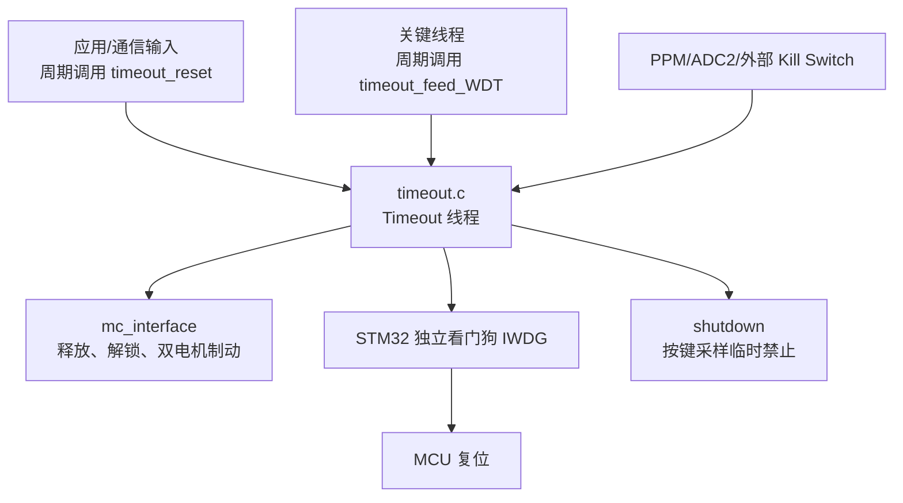

## 2. timeout.h 公开接口

| 接口 | 作用 |
|---|---|
| `timeout_init()` | 初始化软件状态、配置并启动 IWDG、创建 Timeout 线程 |
| `timeout_configure()` | 设置命令超时时间、超时制动电流和 Kill Switch 模式 |
| `timeout_reset()` | 记录最后一次有效控制输入的时间 |
| `timeout_has_timeout()` | 查询是否处于普通命令超时状态 |
| `timeout_secs_since_update()` | 查询距上次 `timeout_reset()` 的秒数 |
| `timeout_kill_sw_active()` | 查询 Kill Switch 当前是否激活 |
| `timeout_get_timeout_msec()` | 返回配置的超时毫秒数 |
| `timeout_get_brake_current()` | 返回超时制动电流 |
| `timeout_get_kill_sw_mode()` | 返回 Kill Switch 模式 |
| `timeout_set_kill_sw_ext()` | 设置软件外部 Kill Switch 请求 |
| `timeout_feed_WDT()` | 指定线程报告一次存活迭代 |
| `timeout_configure_IWDT_slowest()` | 临时把 IWDG 改为很长超时 |
| `timeout_configure_IWDT()` | 恢复正常快速 IWDG 配置 |
| `timeout_had_IWDG_reset()` | 查询上次复位是否由 IWDG 引起 |

## 3. 被监测线程编号

```c
typedef enum {
    THREAD_MCPWM = 0,
    THREAD_CANBUS,
    THREAD_USB,
    THREAD_APP
} WWDT_THREAD_TYPES;
```

`feed_counter` 实际有 10 个槽位：

```c
#define MAX_THREADS_MONITOR 10
#define MIN_THREAD_ITERATIONS 1
```

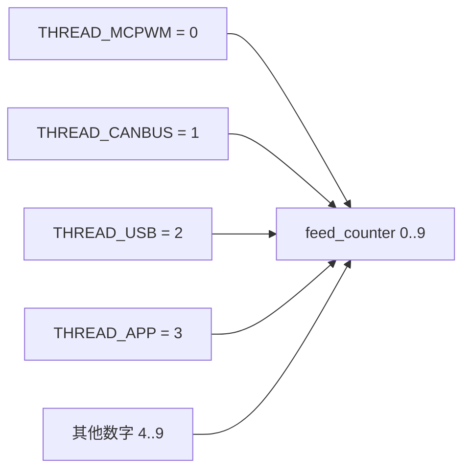

当前 Timeout 线程只检查：

- `THREAD_MCPWM`：始终检查；
- `THREAD_CANBUS`：仅 `CAN_ENABLE` 为真时检查。

虽然枚举包含 USB 和 APP，当前代码没有检查它们。`MAX_THREADS_MONITOR=10` 也不表示 10 个线程都已被监控。

## 4. 私有状态

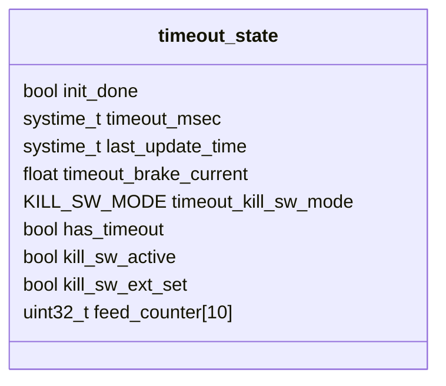

| 变量 | 含义 |
|---|---|
| `timeout_msec` | 命令输入最大允许静默时间；0 表示禁用普通超时 |
| `last_update_time` | 最近一次 `timeout_reset()` 的系统 tick |
| `timeout_brake_current` | 超时/Kill Switch 时向电机提交的制动电流 |
| `timeout_kill_sw_mode` | Kill Switch 输入源和有效电平 |
| `has_timeout` | 普通命令超时状态，不包含 Kill Switch |
| `kill_sw_active` | 当前采样周期的 Kill Switch 状态 |
| `kill_sw_ext_set` | 软件强制 Kill Switch 标志 |
| `feed_counter[]` | 每个监控窗口内各线程报告的迭代次数 |

这些变量使用 `volatile`，保证编译器每次读取，但不构成完整的多线程同步协议。

## 5. 初始化流程

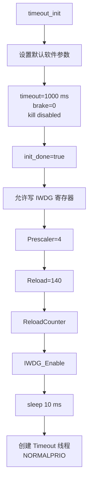

IWDG 一旦通过硬件启用，通常不能在软件中完全关闭，只能复位 MCU 后重新开始。后续接口只能改变预分频和重装值。

## 6. main.c 中的初始化顺序

`main.c` 在电机、通信和本地线程创建之后调用：

```text
timeout_init();
timeout_configure(appconf->timeout_msec,
                  appconf->timeout_brake_current,
                  appconf->kill_sw_mode);
```

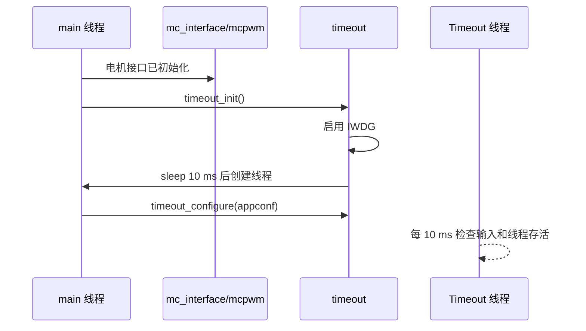

`last_update_time` 初始化为 0，而不是当前时间。系统启动已超过默认 1000 ms 时，Timeout 线程可能立即判定普通超时，直到某个有效输入调用 `timeout_reset()`。这是安全默认行为。

## 7. 普通控制超时

普通超时条件：

```text
timeout_msec != 0
且
chVTTimeElapsedSinceX(last_update_time) > MS2ST(timeout_msec)
```

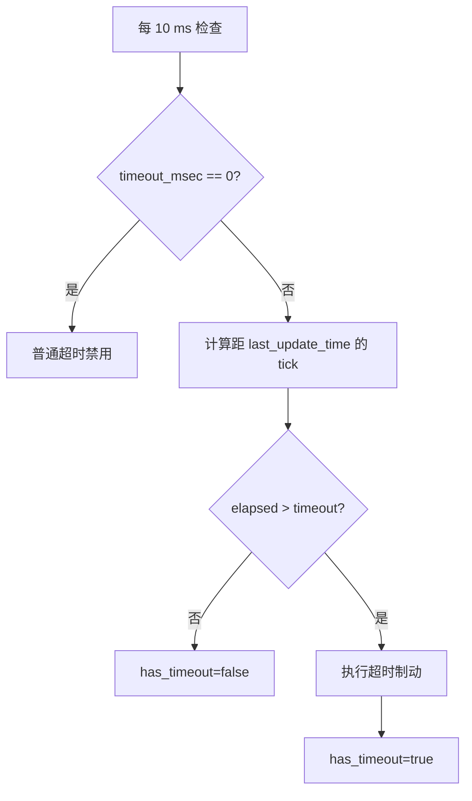

判断使用严格大于 `>`，因此在精确等于阈值的那次检查不会触发，要到后续检查周期才触发。实际响应延迟约为配置值加 0~10 ms 调度周期及可能的调度抖动。

## 8. timeout_reset() 的作用

```c
void timeout_reset(void) {
    last_update_time = chVTGetSystemTimeX();
}
```

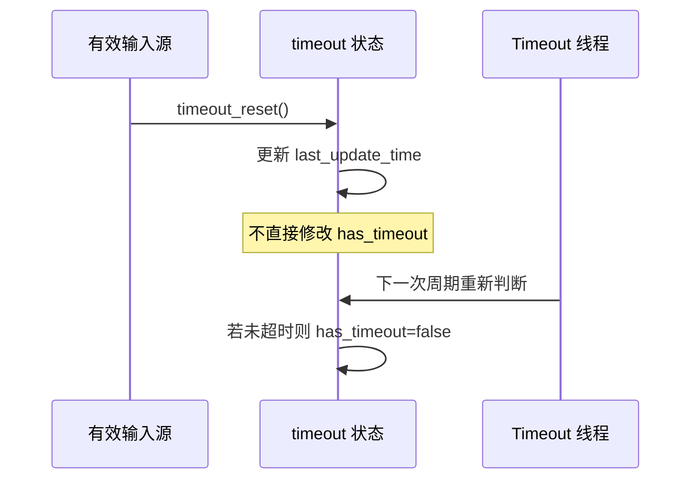

调用 `timeout_reset()` 不会立即清除 `has_timeout`，状态最迟在 Timeout 线程下一次运行时更新。它也不会恢复超时前的电机命令；输入源需要重新发送控制目标。

## 9. 超时动作

普通超时或 Kill Switch 激活时执行共同动作：

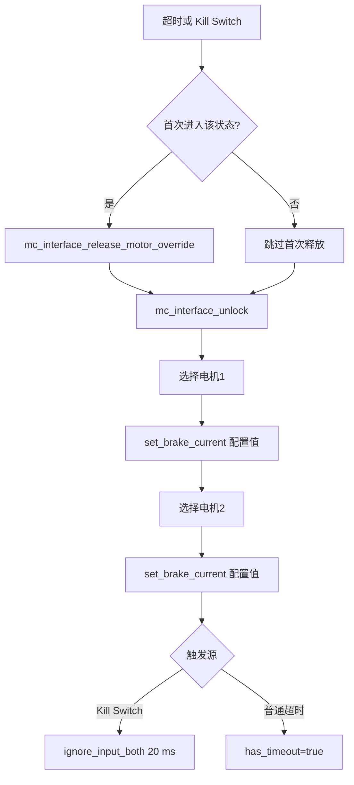

该动作每 10 ms 重复提交制动电流，确保其他普通控制输入难以覆盖安全动作。

如果 `timeout_brake_current=0`，具体后端通常会释放电机或关闭调制，而不是产生制动力。

## 10. 首次释放判定

仅当以下两个状态都为 false 时调用一次 `release_motor_override()`：

```text
!has_timeout && !kill_sw_active
```

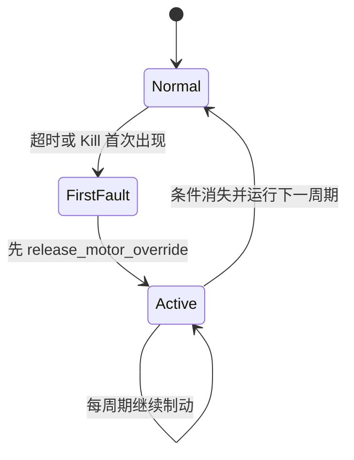

`kill_sw_active` 在当前循环末尾才更新，因此它代表上一个采样周期的 Kill Switch 状态。该设计用于识别边沿式首次进入。

## 11. 双电机选择行为

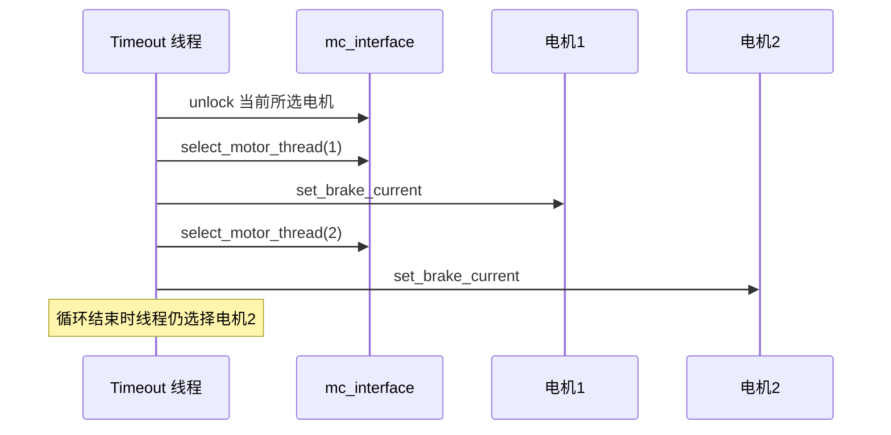

首次进入 Timeout 线程时，线程默认选择通常回退到电机1，所以第一次 `unlock()` 作用于电机1；循环末尾选择停留在电机2，后续 `unlock()` 作用于电机2。结果是持续故障期间两台电机最终都会被解锁并持续接收制动命令，但流程依赖线程选择状态，语义不如显式分别解锁直观。

单电机硬件中选择电机2会回退到电机1。

## 12. Kill Switch 输入模式

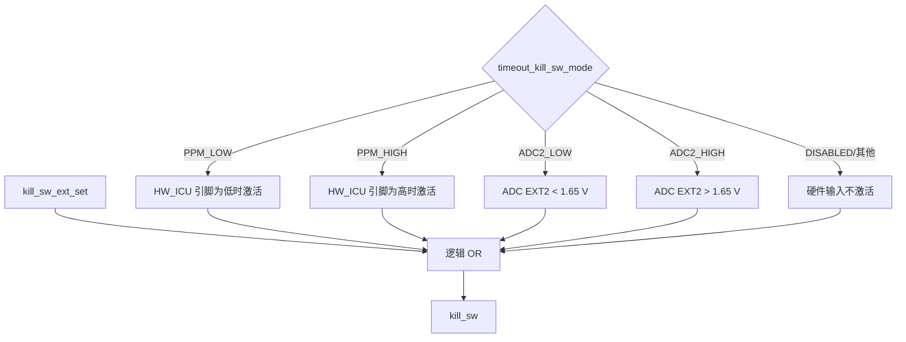

1.65 V 是 ADC2 高低判定的固定阈值，没有迟滞或滤波。输入在阈值附近抖动时，Kill Switch 可能反复切换。

PPM 模式直接读取 `HW_ICU_GPIO/HW_ICU_PIN`，要求板级宏和引脚模式已正确配置。

## 13. 外部软件 Kill Switch

`timeout_set_kill_sw_ext(true)` 会无条件覆盖硬件模式，使 `kill_sw=true`。清为 false 后，硬件输入仍可能保持 Kill Switch 激活。

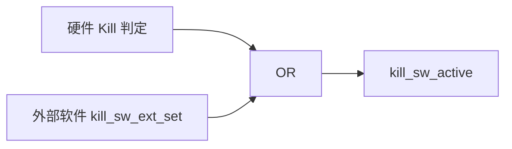

该接口只保存布尔值，没有来源计数。如果多个软件模块共享它，一个模块清 false 可能撤销另一个模块的请求，上层需要自行协调所有权。

## 14. Kill Switch 与普通超时的差异

| 行为 | 普通超时 | Kill Switch |
|---|---|---|
| 状态标志 | `has_timeout=true` | `kill_sw_active=true` |
| 输入保护 | 依靠每周期重新制动 | 每周期 `ignore_input_both(20)` |
| 触发源 | 距上次 reset 的时间 | GPIO、ADC 或外部软件标志 |
| 清除条件 | 再次 `timeout_reset()` 后时间恢复正常 | Kill 输入解除 |
| 自动恢复旧命令 | 否 | 否 |

Kill Switch 激活时不把 `has_timeout` 设为 true。只查询 `timeout_has_timeout()` 无法判断 Kill Switch 状态，必须同时查询 `timeout_kill_sw_active()`。

## 15. Timeout 线程完整状态机

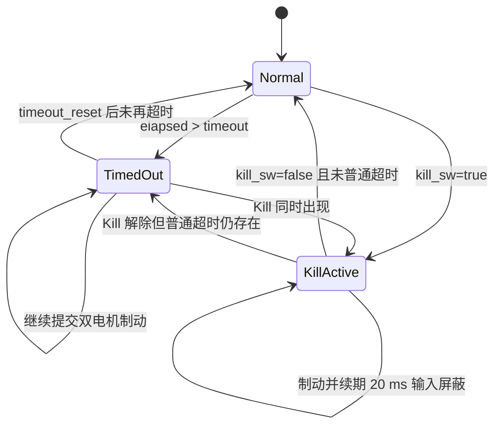

每个状态周期结束后还会执行线程存活检查和 IWDG 喂狗判定。

## 16. 软件线程看门狗

关键线程调用：

```c
timeout_feed_WDT(THREAD_MCPWM);
timeout_feed_WDT(THREAD_CANBUS);
```

该函数只是递增计数器：

```c
++feed_counter[index];
```

Timeout 线程每 10 ms 检查计数是否至少为 1，随后清零全部 10 个槽位。

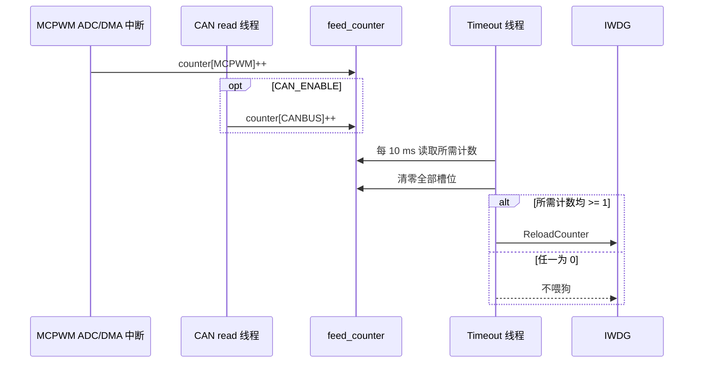

## 17. 实际监控范围

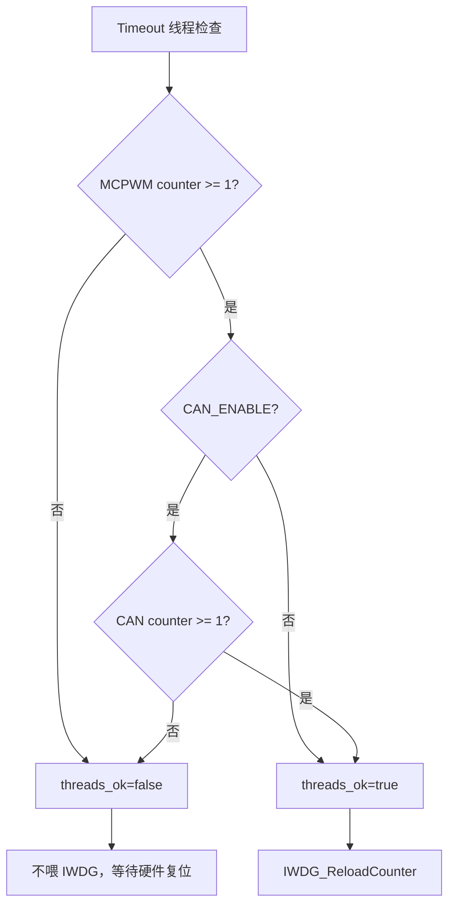

USB、APP、Timeout 线程自身和其他业务线程没有独立存活计数检查。Timeout 线程自身若卡死，也会因为没人喂 IWDG 而复位，这是隐式自监控。

## 18. timeout_feed_WDT() 的边界要求

当前函数没有验证 `index < MAX_THREADS_MONITOR`。大于 9 的索引会越界写静态内存。

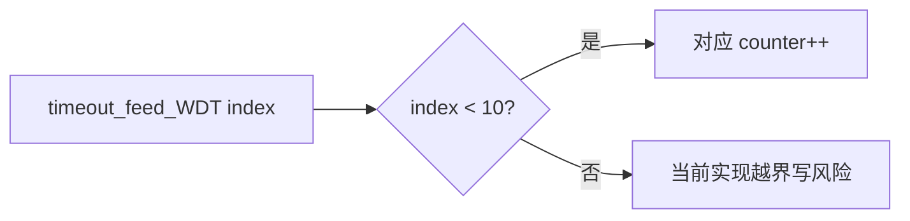

调用方应只使用头文件定义的枚举值。若后续增加枚举，必须同时检查数组大小和 Timeout 线程检查逻辑。

## 19. 喂狗计数的并发特点

`feed_counter[]` 是 `volatile uint32_t`，Cortex-M4 对齐的 32 位读写通常是单指令，但“读取判断 → 全部清零”与其他线程的 `++` 没有锁保护。

可能出现边界竞态：

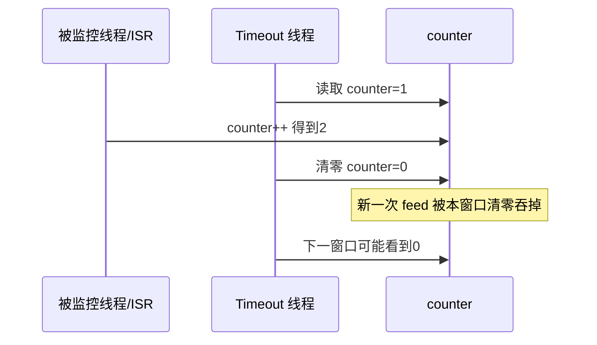

高频 MCPWM 通常会很快再次喂狗，因此风险较小；低频或调度边界附近的监控源可能产生误复位。更严格的实现可采用原子交换、临界区或每线程时间戳。

## 20. IWDG 正常配置

初始化和 `timeout_configure_IWDT()` 使用：

```text
Prescaler = 4
Reload    = 140
```

IWDG 超时近似为：

```text
t = (Reload + 1) × Prescaler / f_LSI
```

LSI 数据手册范围约 17~47 kHz：

| LSI | 估算超时 |
|---:|---:|
| 47 kHz | 约 12.0 ms |
| 32 kHz 典型 | 约 17.6 ms |
| 17 kHz | 约 33.2 ms |

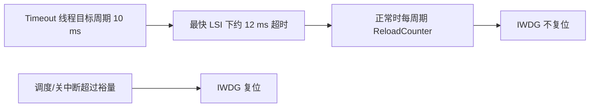

在最坏 47 kHz LSI 下，10 ms 线程周期只有约 2 ms 裕量。长时间关中断、系统锁或高优先级线程持续运行都可能触发复位。

## 21. IWDG 最慢配置

Flash 擦写等长临界操作调用 `timeout_configure_IWDT_slowest()`：

```text
Prescaler = 256
Reload    = 4000
```

估算范围：

| LSI | 估算超时 |
|---:|---:|
| 47 kHz | 约 21.8 s |
| 32 kHz | 约 32.0 s |
| 17 kHz | 约 60.2 s |

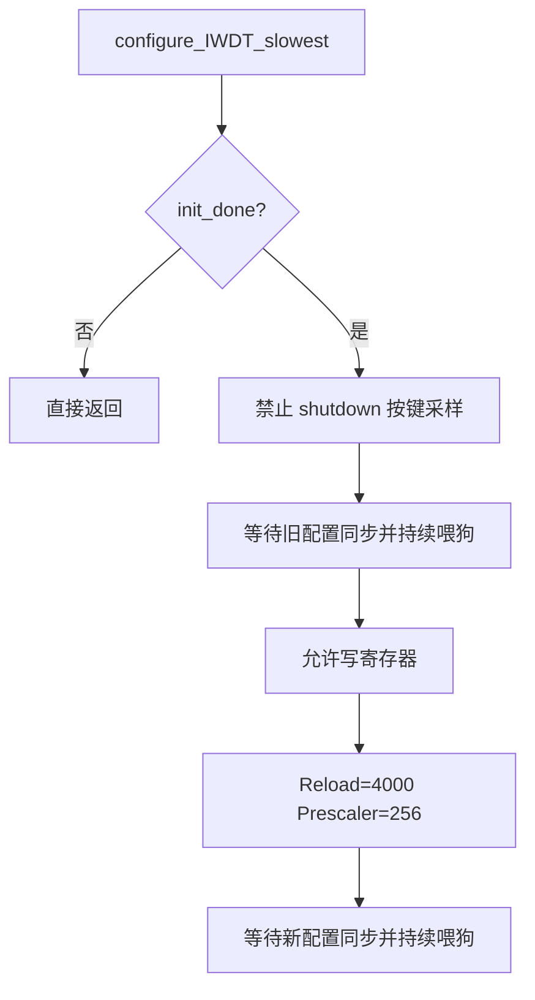

源码注释写“锁 CPU 几毫秒”，但该配置实际提供数十秒量级余量。

## 22. 恢复正常 IWDG

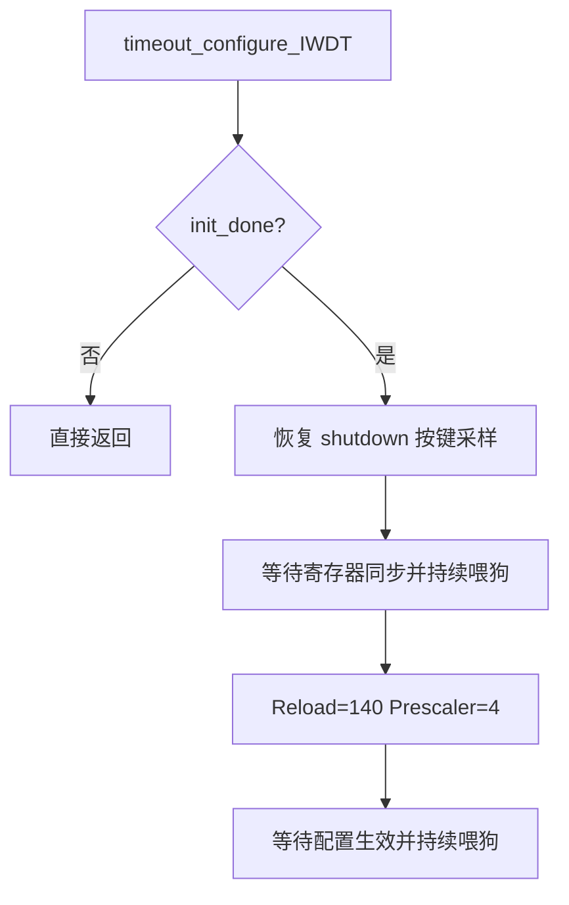

两个配置函数在等待 `RVU/PVU` 清零时不断重装计数器，避免因寄存器同步延迟发生复位。

若调用最慢配置后没有调用恢复函数，IWDG 将长期保持数十秒超时，shutdown 按键采样也会保持禁用。

## 23. shutdown 采样联动

```mermaid
stateDiagram-v2
    [*] --> NormalSampling
    NormalSampling --> SamplingDisabled: configure_IWDT_slowest
    SamplingDisabled --> NormalSampling: configure_IWDT
```

长时间锁 CPU 时，shutdown 模块可能错误采样按键并触发关机，所以最慢配置先调用 `SHUTDOWN_SET_SAMPLING_DISABLED(true)`。这是 IWDG 配置接口带来的额外系统副作用。

## 24. IWDG 复位原因检测

```mermaid
flowchart TD
    A[timeout_had_IWDG_reset] --> B{RCC_FLAG_IWDGRST set?}
    B -->|否| C[返回 false]
    B -->|是| D[RCC_ClearFlag]
    D --> E[返回 true]
```

`mcpwm` 和 `mcpwm_foc` 初始化后会调用此接口，并通过 `mc_interface_fault_stop()` 生成 `FAULT_CODE_BOOTING_FROM_WATCHDOG_RESET`。

`RCC_ClearFlag()` 会清除 RCC 的复位标志集合，不只清 IWDG 标志。第一个调用者检查后，其他模块再查询可能看不到原复位原因；当前两个电机后端是运行时择一初始化，因此通常只有一个调用。

## 25. 普通超时与 IWDG 的完整关系

```mermaid
flowchart TB
    subgraph CONTROL[软件控制安全]
        RESETIN[有效输入 timeout_reset] --> AGE[输入年龄]
        AGE --> SWTO{超过 timeout_msec?}
        KILL[Kill Switch] --> SWTO
        SWTO -->|是| BRAKE[双电机制动]
    end

    subgraph HEALTH[执行健康监控]
        FEEDS[关键线程 feed_counter] --> CHECK[每 10 ms 检查]
        CHECK -->|正常| KICK[喂 IWDG]
        CHECK -->|异常| NOKICK[停止喂狗]
        NOKICK --> MCU[硬件复位]
    end
```

即使已经发生普通控制超时，只要关键线程仍正常迭代，Timeout 线程仍会喂 IWDG，不会因为“没有控制命令”而复位 MCU。

## 26. 典型应用交互

```mermaid
sequenceDiagram
    participant APP as PPM/ADC/UART/CAN 应用
    participant TO as timeout
    participant MC as mc_interface
    participant TT as Timeout 线程

    loop 每次有效控制帧
        APP->>TO: timeout_reset()
        APP->>MC: 设置电流/占空比
    end
    Note over APP: 输入停止
    TT->>TO: 发现 elapsed > timeout
    TT->>MC: release + 双电机制动
    Note over APP: 输入恢复
    APP->>TO: timeout_reset()
    APP->>MC: 重新提交控制目标
    TT->>TO: 下一周期 has_timeout=false
```

输入模块应只在数据有效且通过自身完整性/范围检查后调用 `timeout_reset()`。无条件周期 reset 会让失效输入绕过安全超时。

## 27. 配置更新

`timeout_configure()` 只是直接写入三个共享变量：

```mermaid
flowchart LR
    CFG[app_configuration] --> TO[timeout_configure]
    TO --> MS[timeout_msec]
    TO --> BRAKE[timeout_brake_current]
    TO --> MODE[timeout_kill_sw_mode]
```

没有锁、范围验证或原子快照。Cortex-M4 上单个对齐标量写通常直接生效，但 Timeout 线程可能在三项更新之间观察到新旧混合配置。配置更新频率低时影响有限；严格一致性可使用临界区或配置结构双缓冲。

## 28. 时间单位与回绕

`timeout_msec` 类型是 `systime_t`，接口名称和用法将其解释为毫秒，再通过 `MS2ST()` 转换为系统 tick。

`last_update_time` 使用 ChibiOS 系统时间，`chVTTimeElapsedSinceX()` 和 `UTILS_AGE_S()` 按模运算处理计数器回绕。调用方不应自行用简单的 `now > last + timeout` 替代。

## 29. 已识别的实现约束与风险

### 29.1 feed 索引无边界检查

非法 `index` 会越界写 `feed_counter`。

### 29.2 只监控 MCPWM 和可选 CAN

USB/APP 枚举存在但未参与复位判定。

### 29.3 feed 清零竞态

读取后清零可能吞掉刚发生的下一窗口 feed。

### 29.4 最坏 IWDG 调度裕量较小

47 kHz LSI 下约 12 ms，而 Timeout 线程 sleep 10 ms，仅余约 2 ms。

### 29.5 Kill Switch ADC 无迟滞

1.65 V 附近噪声可能导致状态抖动。

### 29.6 外部 Kill 标志没有多来源所有权

一个调用者清 false 会覆盖其他调用者的意图。

### 29.7 双电机 unlock 依赖线程当前选择

代码不是在同一周期显式解锁两台电机。

### 29.8 IWDG 最慢配置副作用需要成对恢复

未恢复会同时保留长看门狗周期和 shutdown 采样禁用。

### 29.9 配置写入不是一致快照

Timeout 线程可能短暂读取混合的新旧配置。

这些是当前实现特征，本文未修改代码。

## 30. 常见问题定位

### 30.1 电机启动后立即进入制动

检查是否有输入模块调用 `timeout_reset()`。`last_update_time` 初始为 0，启动后可能立即满足超时条件。

### 30.2 timeout_has_timeout() 为 false，但仍在制动

检查 `timeout_kill_sw_active()`。Kill Switch 不会设置 `has_timeout`。

### 30.3 周期性看门狗复位

检查：

- MCPWM ADC/DMA 中断是否持续调用 `timeout_feed_WDT(THREAD_MCPWM)`；
- 启用 CAN 时 CAN read 线程是否持续喂对应计数；
- Timeout 线程是否被更高优先级任务阻塞超过最坏 12 ms；
- 是否存在长时间关中断或系统锁；
- feed 清零边界是否导致低频线程漏报。

### 30.4 Kill Switch 输入抖动

测量 PPM GPIO 或 ADC2 电压，确认有效电平和 1.65 V 阈值。必要时在输入侧增加硬件/软件迟滞和滤波。

### 30.5 Flash 操作后 shutdown 按键失效

确认所有调用 `timeout_configure_IWDT_slowest()` 的路径最终都调用了 `timeout_configure_IWDT()`，尤其检查错误返回路径。

### 30.6 GUI 显示从 IWDG 复位启动

说明上次复位时 `RCC_FLAG_IWDGRST` 被置位，常见原因是关键线程未喂狗或 Timeout 线程调度延迟，并不等同于普通命令超时。

## 31. 修改建议的判断流程

```mermaid
flowchart TD
    A[计划新增监控线程] --> B[分配固定 enum index]
    B --> C[确保 index < MAX_THREADS_MONITOR]
    C --> D[在真实工作迭代点 feed]
    D --> E[Timeout 线程加入对应检查]
    E --> F[确认最坏迭代周期 < 监控窗口]
    F --> G[评估调度抖动与清零竞态]
    G --> H[故障注入验证 MCU 能按预期复位]
```

不要在一个与真实业务无关的辅助定时器中代替目标线程喂狗，否则目标线程卡死时仍会被误判为健康。

## 32. 推荐阅读顺序

```mermaid
flowchart TB
    A[timeout.h<br/>接口、枚举和常量] --> B[timeout.c 私有状态]
    B --> C[timeout_init<br/>正常 IWDG 参数]
    C --> D[timeout_thread 前半<br/>Kill 与普通超时]
    D --> E[timeout_thread 后半<br/>线程监控和喂狗]
    E --> F[configure_IWDT_slowest/normal]
    F --> G[mc_interface 制动与双电机选择]
    G --> H[mcpwm/mcpwm_foc 的 feed 调用]
    H --> I[comm_can 的 feed 调用]
    I --> J[flash_helper 的临时慢 IWDG 路径]
```

## 33. 小结

`timeout` 模块构成两层安全网：控制输入长时间不更新或 Kill Switch 激活时，软件持续向两台电机提交安全制动；MCPWM 或 CAN 等关键执行路径停止迭代时，Timeout 线程拒绝喂 IWDG，由独立硬件看门狗复位 MCU。

理解该模块应始终分别回答三个问题：谁负责调用 `timeout_reset()`、哪些线程实际参与 `feed_counter` 健康判定、当前 IWDG 使用正常还是最慢配置。普通超时只制动不复位，IWDG 复位只反映执行健康异常，两者虽然在同一线程处理，但语义完全不同。
