# 当前工程软件调用流程图

## 1. 文档目的与范围

本文从软件调用关系角度描述当前 `bldc` 固件工程，重点回答：

- MCU 从复位到可接收控制命令经历哪些初始化；
- USB、UART、CAN、NRF 和本地应用如何进入统一命令处理；
- PPM、ADC、Nunchuk、PAS 等输入如何形成电机控制目标；
- `mc_interface` 如何把统一控制目标分派到 BLDC/DC 或 FOC 实现；
- 高频电机控制中断如何完成采样、估算、控制和 PWM 更新；
- 编码器、IMU、BMS、超时和故障线程如何参与系统；
- 主循环、RTOS 线程和硬件中断之间如何协作。

文档以当前源码为准。大量功能受硬件配置宏控制，并非每个固件目标都会编译或启用所有模块。

## 2. 软件总体分层

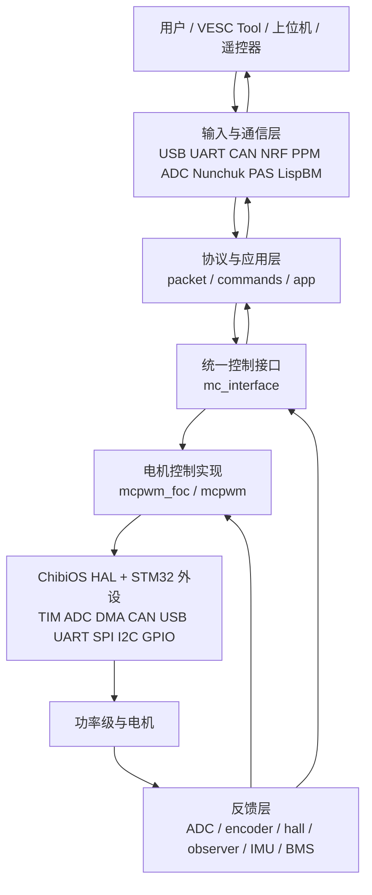

### 2.1 核心目录

| 目录/文件 | 主要职责 |
|---|---|
| `main.c` | 系统启动、全局模块初始化和后台线程创建 |
| `applications/` | 本地输入应用及其输出策略 |
| `comm/` | 包协议、命令分发、USB 和 CAN |
| `motor/mc_interface.c` | 电机控制统一门面、限制、统计和故障 |
| `motor/mcpwm_foc.c` | FOC 高频控制、估算、SVM 和 PWM |
| `motor/mcpwm.c` | BLDC/DC 换相控制 |
| `encoder/` | 多种位置传感器统一接口 |
| `imu/` | IMU 驱动、姿态融合和统一姿态接口 |
| `timeout.c` | 控制超时、kill switch 和独立看门狗 |
| `conf_general.c` | 配置读取、保存和默认值管理 |
| `lispBM/` | LispBM 运行环境和固件接口扩展 |
| `hwconf/` | 板级 GPIO、ADC、定时器、驱动器和功能宏 |

## 3. 执行上下文

固件不是由 `main()` 顺序循环完成业务，而是事件驱动系统。

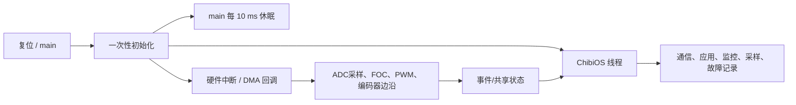

主要上下文可分为：

- 启动上下文：`main()`；
- 普通线程：USB/UART/CAN、应用输入、IMU、统计、LED、timeout 等；
- 高频中断：ADC/DMA、PWM 定时器和编码器边沿；
- 事件唤醒线程：故障处理、采样数据发送等。

高频闭环位于中断上下文，不能调用可能阻塞的通信或存储函数；这类工作通过事件转交线程。

## 4. 启动总流程

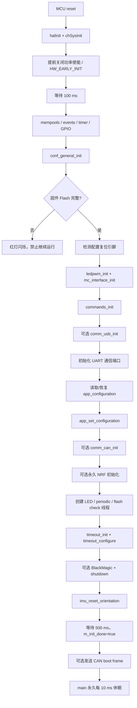

## 5. 启动时序

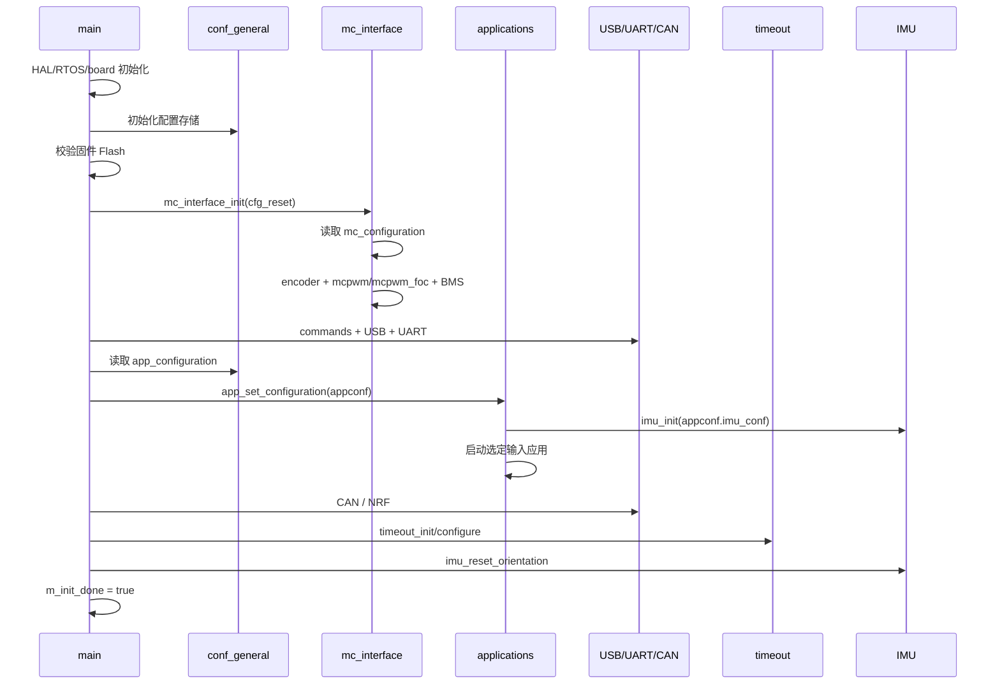

## 6. 配置加载与复位

启动时 `should_reset_config()` 检测 HALL2 与 SWCLK 引脚是否按板级设计连通。检测成立时：

- 电机配置恢复默认并写入存储；
- 应用配置恢复默认并写入存储；
- LispBM 常量、LispBM 程序和 QML 数据区域被擦除。

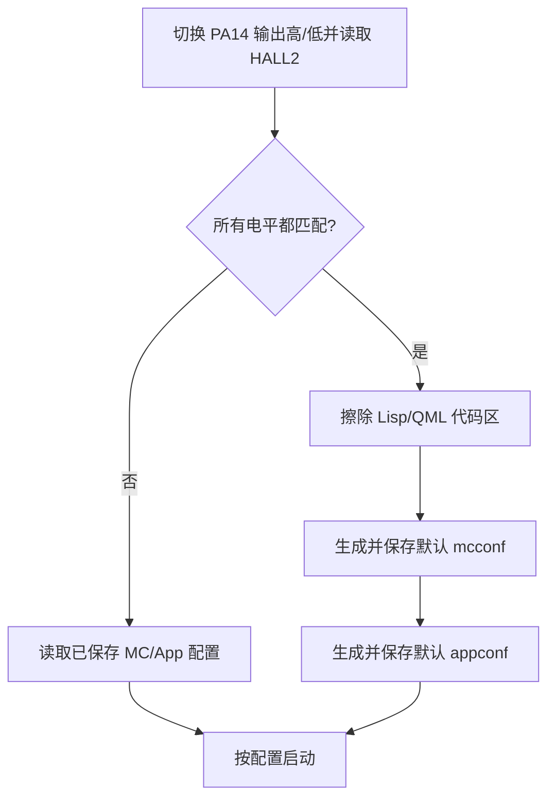

Flash 固件完整性校验失败属于启动致命错误，系统不会初始化功率控制。启动完成后另有低优先级线程分块持续校验 Flash，发现损坏时执行系统复位。

## 7. `mc_interface` 初始化

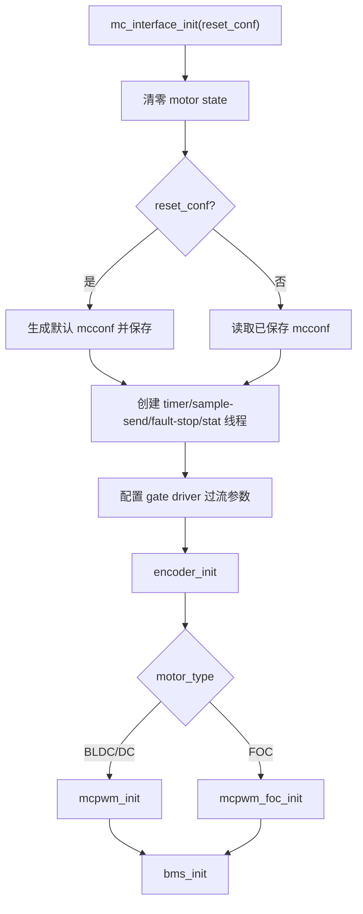

在双电机或双并联硬件分支中，当前源码会强制相关 `motor_type` 为 FOC。单电机目标仍按配置选择 BLDC/DC 或 FOC，除非板级宏另有约束。

## 8. 应用选择流程

`app_set_configuration` 是运行期应用重配置入口。

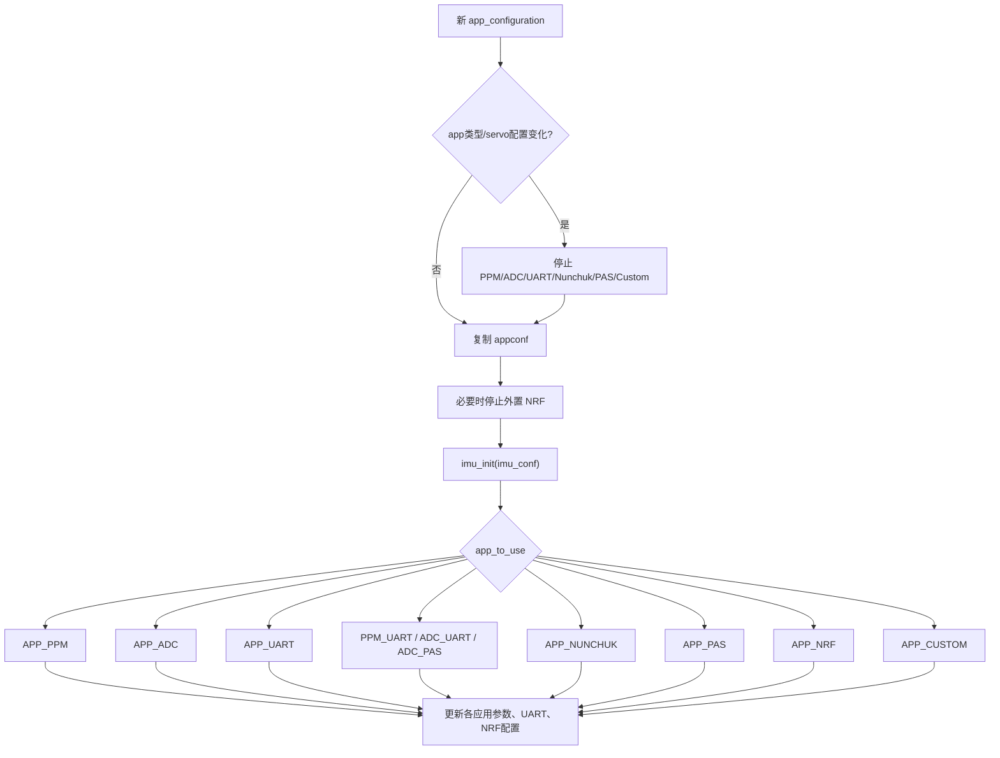

应用类型决定输入来源，但最终均调用 `mc_interface_set_*`。`app_disable_output` 可通过虚拟定时器临时或永久屏蔽应用输出。

## 9. 本地输入到电机控制

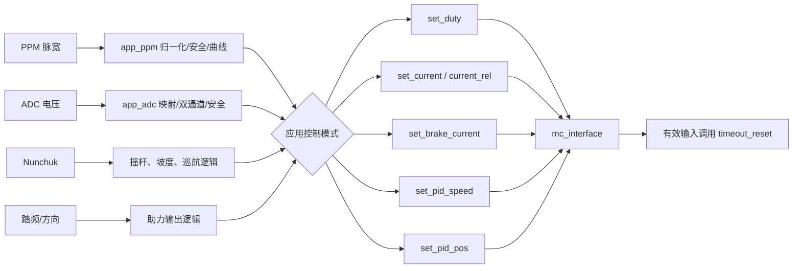

应用通常先检查输出禁用、输入有效性、安全启动、反向和刹车逻辑，再更新电机目标。具体输入曲线和限制由 `app_configuration` 与 `mc_configuration` 决定。

## 10. 通信接收总链路

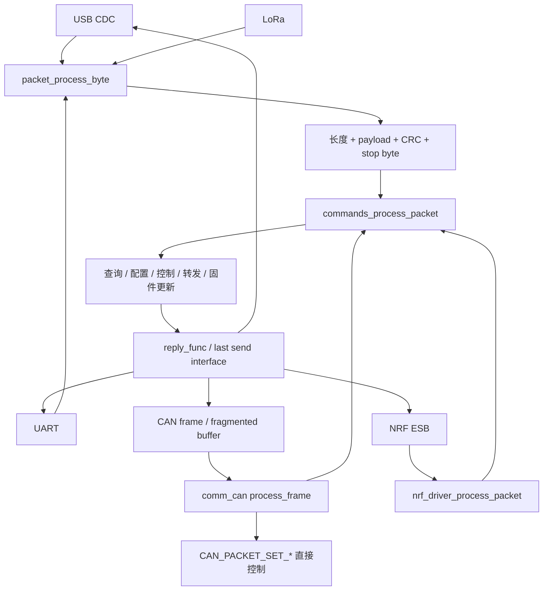

`packet.c` 负责字节流成帧和 CRC；`commands.c` 负责解释 `COMM_PACKET_ID`。CAN 自身具有帧边界，既支持短控制帧直接处理，也支持分片重组后送入 `commands_process_packet`。

## 11. USB/UART 命令时序

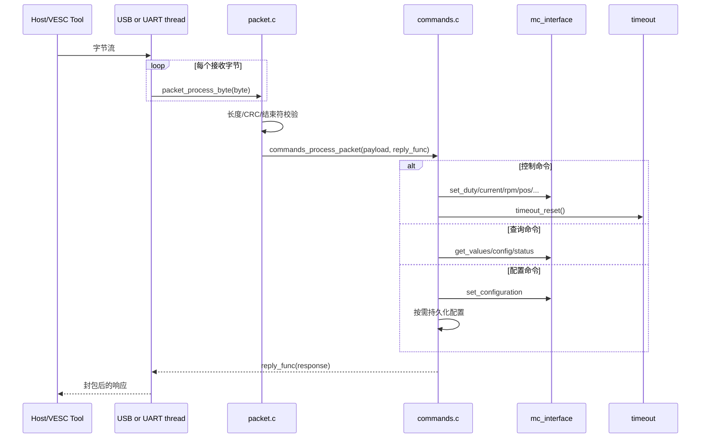

## 12. CAN 调用流程

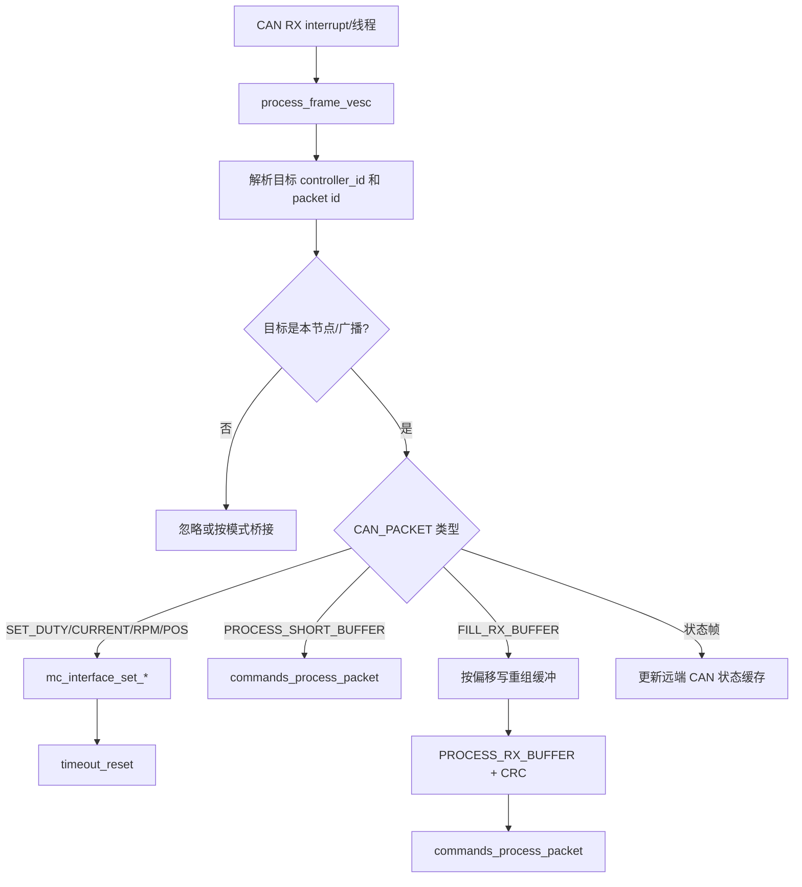

CAN 控制帧绕过通用 packet 字节流，但仍使用统一 `mc_interface` 和 timeout 机制。

## 13. `commands_process_packet` 的角色

`commands_process_packet` 是外部协议的中心分发器。主要命令族包括：

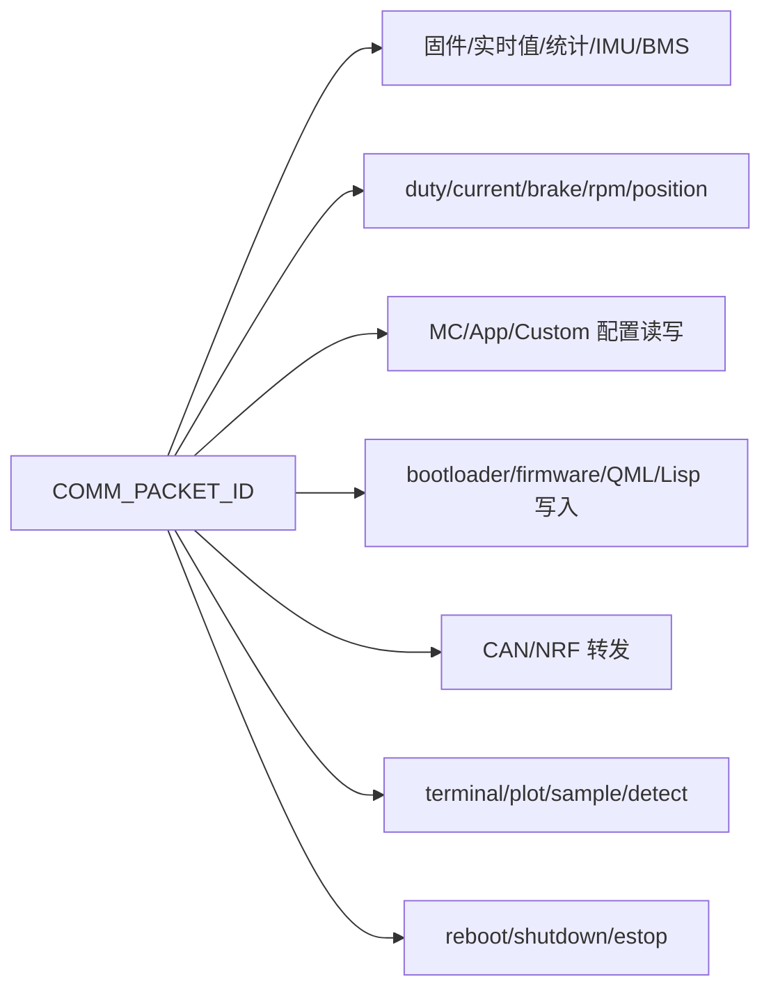

控制类命令在成功设置目标后调用 `timeout_reset()`，表明控制源仍在线；仅查询数据通常不会维持电机输出许可，`COMM_ALIVE` 可单独喂控制超时。

## 14. 统一电机控制接口

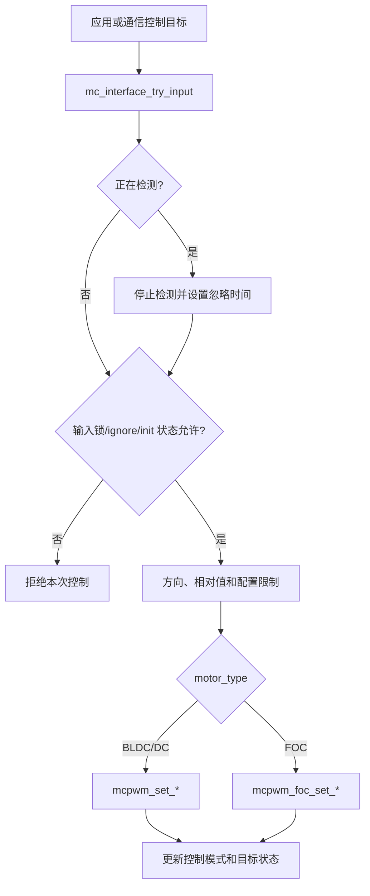

`mc_interface` 同时负责：

- 双电机线程/中断上下文选择；
- 输入锁、一次性覆盖和检测状态保护；
- 电流、占空比、转速和温度限制；
- 运行统计、能量和里程累计；
- 故障触发和日志数据；
- 对底层 BLDC/DC 与 FOC 实现隐藏差异。

## 15. FOC 高频闭环

当前工程的核心实时链路位于 `mcpwm_foc_adc_int_handler`。

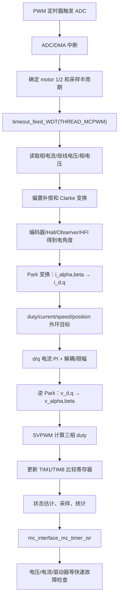

这一调用链在 PWM/ADC 频率上运行，优先级和时限远高于普通通信线程。任何增加到该路径的代码都必须评估最坏执行时间。

## 16. FOC 控制时序

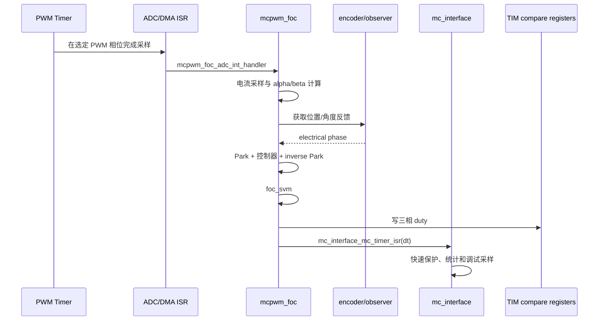

## 17. BLDC/DC 路径

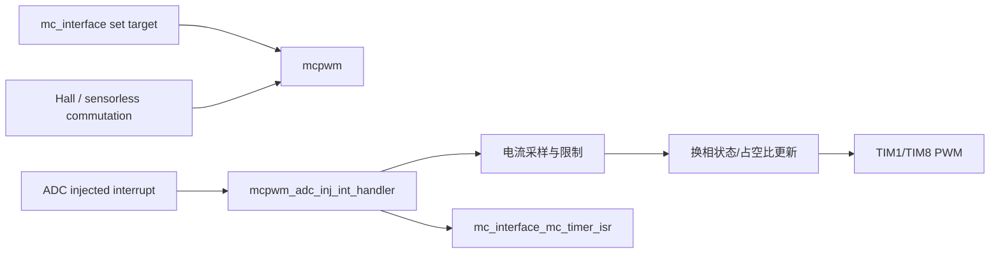

单电机目标可按配置选择该路径。双电机相关编译分支在当前源码中通常强制 FOC。

## 18. 编码器反馈链

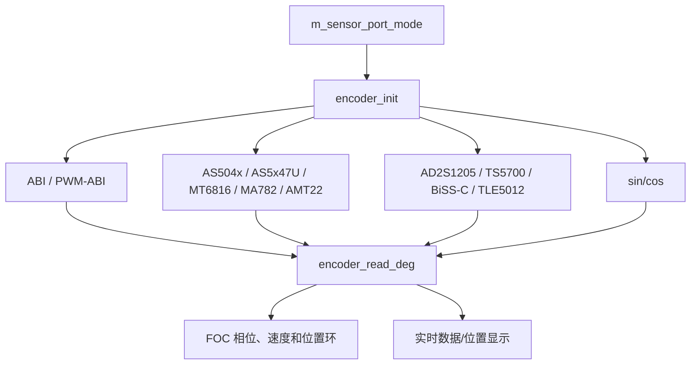

部分编码器由 GPIO/定时器中断更新，部分在 FOC 中断或后台线程中通过 SPI/采样读取。`encoder.c` 对上层统一提供角度、索引和故障状态。

## 19. IMU 调用链

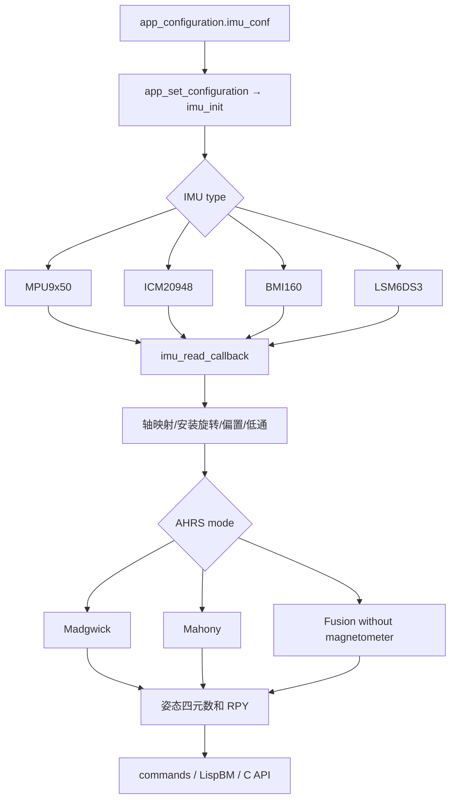

IMU 运行在独立传感器线程中，不在电机 PWM 中断中。当前三个主姿态模式均没有周期使用磁力计约束 yaw。

## 20. Timeout、kill switch 与看门狗

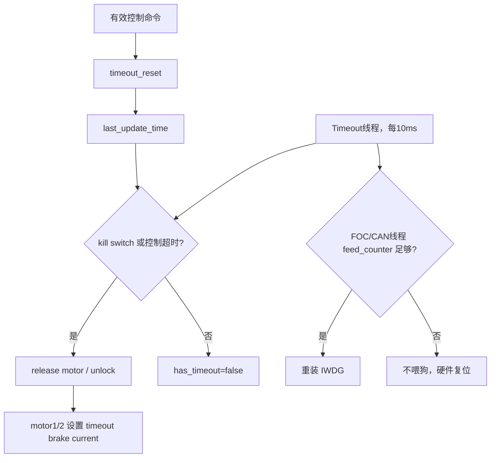

控制超时与独立看门狗是两套机制：

- 控制超时处理“控制源失联”，主动释放或施加配置的制动电流；
- IWDG 处理“关键线程不再运行”，通过不喂狗触发 MCU 复位。

FOC 中断调用 `timeout_feed_WDT(THREAD_MCPWM)`，CAN 线程在启用时也必须周期上报。timeout 线程每 10 ms 清零计数并决定是否喂硬件看门狗。

## 21. 故障处理链

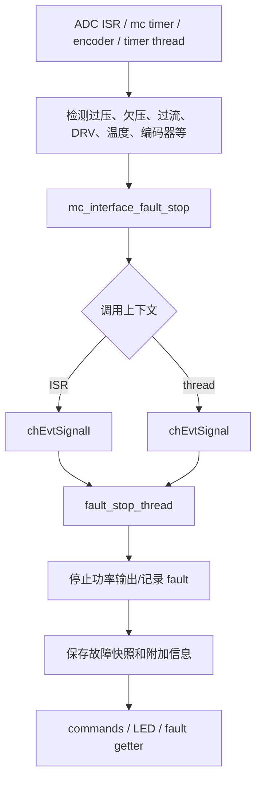

快速检测只在 ISR 中写最小状态并发送事件，耗时的停止、日志和驱动器状态读取由高优先级故障线程完成。

## 22. 后台线程关系

```mermaid
flowchart TB
    MAIN["main idle"]
    LED["Main LED<br/>运行/故障灯"]
    PERIODIC["Main periodic<br/>转子位置显示 + HSI校准"]
    FLASH["Flash check<br/>分块完整性校验"]
    TIMEOUT["Timeout<br/>控制超时 + IWDG"]
    MCT["MC timer<br/>温度/限制/统计"]
    FAULT["Fault stop<br/>安全停止和日志"]
    SAMPLE["Sample send<br/>调试波形发送"]
    CAN["CAN RX/TX/status"]
    APP["选定应用线程"]
    IMU["选定 IMU 采样线程"]
    UART["UART packet threads"]
    USB["USB packet processing"]
    MAIN -. "RTOS调度" .-> LED
    MAIN -.-> PERIODIC
    MAIN -.-> FLASH
    MAIN -.-> TIMEOUT
    MAIN -.-> MCT
    MAIN -.-> FAULT
    MAIN -.-> SAMPLE
    MAIN -.-> CAN
    MAIN -.-> APP
    MAIN -.-> IMU
    MAIN -.-> UART
    MAIN -.-> USB
```

线程集合随板级宏和应用配置变化。主线程不轮询这些模块，只保持 RTOS 存活。

## 23. 双电机选择机制

```mermaid
flowchart TD
    CALL["mc_interface API"] --> CTX{"当前上下文"}
    CTX -->|FOC ISR| ISR["mcpwm_foc_isr_motor()"]
    CTX -->|普通线程| THD["thread.motor_selected"]
    ISR --> VALID{"选择值 > 0?"}
    THD --> VALID
    VALID -->|motor 1| M1["m_motor_1"]
    VALID -->|motor 2| M2["m_motor_2"]
    VALID -->|未选择| DEF["默认 motor 1"]
```

普通线程用 `mc_interface_select_motor_thread(1/2)` 设置线程局部电机选择；FOC ISR 使用当前 ISR 电机标识。调用跨电机 API 时必须恢复先前选择，避免后续 getter 或 setter 操作错误电机。

## 24. 配置更新流程

```mermaid
flowchart TD
    HOST["COMM_SET_MCCONF / APP config"] --> DECODE["commands 解码并校验"]
    DECODE --> STORE{"是否要求持久化?"}
    STORE -->|是| FLASH["conf_general_store_* configuration"]
    STORE -->|否| APPLY
    FLASH --> APPLY["mc_interface_set_configuration / app_set_configuration"]
    APPLY --> CHANGE{"实现/外设类型变化?"}
    CHANGE -->|是| STOP["deinit旧模块"]
    STOP --> START["init新模块"]
    CHANGE -->|否| UPDATE["原位更新参数"]
    START --> ACK["返回配置/确认"]
    UPDATE --> ACK
```

电机类型或传感器端口变化可能导致 PWM、FOC 和编码器重新初始化；应用类型变化会停止旧输入线程并启动新线程。配置更新并非简单结构体赋值。

## 25. 调试采样数据流

```mermaid
flowchart LR
    CMD["COMM_SAMPLE_PRINT"] --> SET["mc_interface_sample_print_data"]
    SET --> MODE["设置采样模式/长度/抽取率/触发"]
    ISR["mc_interface_mc_timer_isr"] --> BUF["ISR写电流、电压、相位、状态环形缓存"]
    MODE --> BUF
    BUF --> EVENT["完成/触发后发送事件"]
    EVENT --> THREAD["sample_send_thread"]
    THREAD --> PACKET["commands_send_packet"]
    PACKET --> HOST["VESC Tool 绘图"]
```

ISR 只采样和发事件，数据封包及通信在线程中执行，避免把通信延迟带入控制环。

## 26. 关机、复位与紧急路径

```mermaid
flowchart TD
    REQ["COMM_REBOOT / shutdown / assertion / estop"] --> TYPE{"请求类型"}
    TYPE -->|正常 shutdown| SHUT["shutdown 模块管理电源保持"]
    TYPE -->|motor estop| ESTOP["锁止/释放电机输出"]
    TYPE -->|assert_failed| ASSERT["release_motor 后永久等待"]
    TYPE -->|stop motor and reset| FORCE["强制 TIM 输出 inactive"]
    FORCE --> RESET["NVIC_SystemReset"]
    WATCHDOG["关键线程失活"] --> RESET
    FLASH["运行期 Flash 损坏"] --> RESET
```

`main_stop_motor_and_reset()` 先直接把 TIM1（以及双电机时的 TIM8）三相输出强制为无效，再执行系统复位，减少复位窗口内的功率级风险。

## 27. 测试目录与运行固件的关系

`tests/angles`、`tests/float_serialization`、`tests/packet_recovery` 等是独立宿主机/单元测试目标，不进入嵌入式 `main()` 的运行调用链。

```mermaid
flowchart LR
    SOURCE["共享 util/packet/math 源码"] --> FW["嵌入式固件 Makefile"]
    SOURCE --> TEST["tests/* 独立 Makefile"]
    FW --> MCU["STM32 + ChibiOS"]
    TEST --> HOST["宿主机测试可执行文件"]
```

分析某个 `tests/*/main.c` 时应把它视为该功能的独立验证入口，而不是固件启动入口。

## 28. 典型“设置电流”端到端流程

```mermaid
sequenceDiagram
    participant H as VESC Tool
    participant U as USB/UART
    participant P as packet
    participant C as commands
    participant M as mc_interface
    participant F as mcpwm_foc
    participant A as ADC ISR
    participant T as PWM Timer

    H->>U: COMM_SET_CURRENT + scaled current
    U->>P: 逐字节输入
    P->>C: CRC正确的 payload
    C->>M: mc_interface_set_current(A)
    M->>M: try_input + 方向/限制
    M->>F: mcpwm_foc_set_current(A)
    F->>F: 更新 control_mode 与 iq target
    C->>C: timeout_reset()
    loop 每个控制周期
        T->>A: 触发 ADC/DMA
        A->>F: 实际电流和转子角度
        F->>F: d/q PI + SVM
        F->>T: 新三相 duty
    end
```

设置函数通常不直接执行一次完整控制算法，而是更新目标和控制模式；真正的闭环计算由后续每个 ADC/PWM 中断完成。

## 29. 典型“PPM 电流控制”流程

```mermaid
sequenceDiagram
    participant R as RC receiver
    participant ICU as Timer/servo decoder
    participant P as app_ppm thread
    participant M as mc_interface
    participant F as mcpwm_foc
    participant TO as timeout

    R->>ICU: PPM pulse
    ICU-->>P: decoded normalized value
    P->>P: safe-start / deadband / ramp / reverse
    P->>P: app_is_output_disabled 检查
    P->>M: set_current / set_brake_current
    P->>TO: timeout_reset
    M->>F: 更新 FOC 目标
```

## 30. 阅读源码的推荐顺序

```mermaid
flowchart LR
    MAIN["main.c"] --> APP["applications/app.c"]
    APP --> INPUT["目标 app_ppm/app_adc/..."]
    MAIN --> COMM["comm_usb/app_uartcomm/comm_can"]
    COMM --> PACKET["packet.c"]
    PACKET --> COMMANDS["commands.c"]
    INPUT --> MCI["mc_interface.c"]
    COMMANDS --> MCI
    MCI --> PWM{"motor_type"}
    PWM --> FOC["mcpwm_foc.c"]
    PWM --> BLDC["mcpwm.c"]
    FOC --> ENC["encoder.c + target driver"]
    MCI --> SAFE["timeout.c + fault threads"]
    APP --> IMU["imu.c + target driver + ahrs"]
```

## 31. 关键设计结论

1. `main()` 主要负责装配系统，启动完成后几乎不参与业务；
2. 外部通信和本地输入最终统一进入 `mc_interface`，避免各输入源直接操作 PWM；
3. setter 更新控制目标，高频中断才执行实际闭环；
4. FOC 的实时核心在 ADC/DMA 中断，普通线程不得阻塞该路径；
5. `mc_interface` 是电机选择、限制、统计和故障的中心边界；
6. 控制 timeout 与硬件 IWDG 分别处理控制源失联和关键执行上下文失活；
7. ISR 通过事件把故障记录和调试发送等耗时工作转移到线程；
8. 大量功能由板级宏裁剪，阅读时必须同时查看目标 `hwconf`；
9. 双电机目标依赖线程局部/ISR 电机选择，跨电机调用需谨慎；
10. 测试目录是独立入口，不属于 MCU 固件运行时调用链。

## 32. 总结

当前工程是一个典型的 RTOS 驱动型电机控制固件：启动阶段装配硬件、配置、通信、应用和控制模块；运行阶段由通信线程、本地输入线程和传感器线程产生事件或目标，由 `mc_interface` 统一仲裁，再由 PWM/ADC 中断中的 `mcpwm_foc` 或 `mcpwm` 完成实时控制。安全链路横跨输入超时、关键线程看门狗、快速 ISR 故障检测和故障处理线程。

理解完整软件调用流程时，最重要的边界是“线程设置目标，中断执行闭环；ISR 发现问题，线程完成耗时处置”。围绕这一边界阅读调用关系，可以避免把配置、通信、保护与高频控制混为一体。
