# 控制策略

本文从代码实现角度梳理 VESC 固件的电机控制策略。重点关注控制命令如何进入固件、如何选择 FOC/BLDC/DC 控制路径、FOC 控制环如何闭环、六步 BLDC 如何换相，以及运行时限流和故障保护如何介入。

相关核心文件：

| 文件 | 作用 |
| --- | --- |
| `comm/commands.c` | USB/串口命令入口，例如设置电流、转速、占空比。 |
| `comm/comm_can.c` | CAN 命令入口，最终也调用 `mc_interface_set_*`。 |
| `applications/app_*.c` | ADC、PPM、Nunchuk 等应用输入，最终也调用 `mc_interface_set_*`。 |
| `motor/mc_interface.c` | 电机控制统一接口、模式分发、运行时限流、故障保护。 |
| `motor/mcpwm_foc.c` | FOC 控制主实现，包含 ADC 中断、电流环、PWM 更新。 |
| `motor/foc_math.c` | FOC 速度/位置外环、弱磁、角度修正等数学逻辑。 |
| `motor/mcpwm.c` | 传统 BLDC/DC PWM 控制、六步换相、反电动势检测。 |
| `timeout.c` | 通信超时、刹车电流、急停输入、看门狗喂狗。 |
| `hwconf/hw.h` 和 `hwconf/<board>/...` | 硬件宏、ADC 通道、采样电阻、PWM 引脚、硬件限值。 |

## 总体架构

控制策略整体是“应用输入 + 统一接口 + 电机控制器 + 硬件输出”的分层结构。

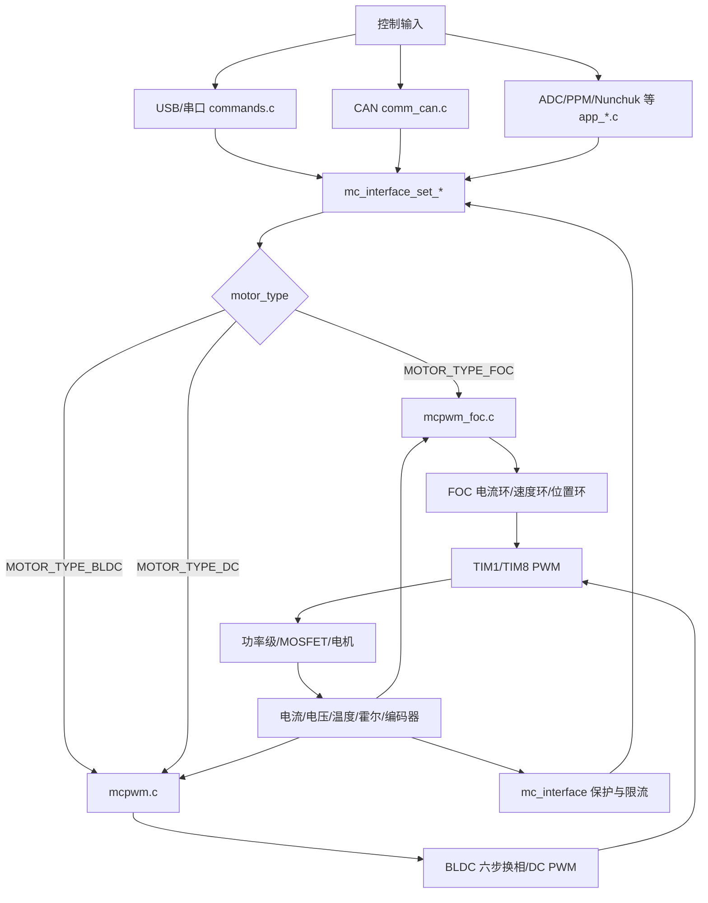

`mc_interface.c` 是分界点。上层不用关心当前是 FOC 还是 BLDC，只调用统一接口；下层根据 `motor_type` 选择具体控制实现。

## 控制命令入口

常见控制命令在 `comm/commands.c` 中解析：

| 命令 | 解析后调用 |
| --- | --- |
| `COMM_SET_DUTY` | `mc_interface_set_duty()` |
| `COMM_SET_CURRENT` | `mc_interface_set_current()` |
| `COMM_SET_CURRENT_BRAKE` | `mc_interface_set_brake_current()` |
| `COMM_SET_RPM` | `mc_interface_set_pid_speed()` |
| `COMM_SET_POS` | `mc_interface_set_pid_pos()` |
| `COMM_SET_CURRENT_REL` | `mc_interface_set_current_rel()` |

CAN 和本地应用也走同一套接口。例如 `comm/comm_can.c` 收到 CAN 电流/转速命令后同样调用 `mc_interface_set_current()`、`mc_interface_set_pid_speed()`；`app_adc.c`、`app_ppm.c` 等把油门、摇杆或 ADC 输入转换成电流、占空比或转速命令。

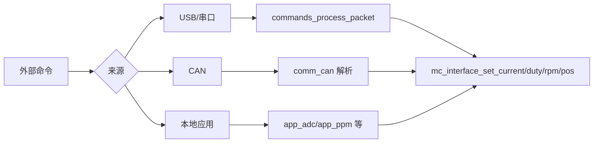

## mc_interface 分发策略

`mc_interface_set_*` 系列函数先做公共处理：

- 非零命令会 `SHUTDOWN_RESET()`，避免进入关机流程。
- `mc_interface_try_input()` 判断当前输入是否被锁定或忽略。
- 根据 `motor_type` 分发到 FOC 或 BLDC/DC。
- 记录事件，例如 `events_add("set_current", current)`。

分发关系：

| 统一接口 | FOC 路径 | BLDC/DC 路径 |
| --- | --- | --- |
| `mc_interface_set_duty()` | `mcpwm_foc_set_duty()` | `mcpwm_set_duty()` |
| `mc_interface_set_pid_speed()` | `mcpwm_foc_set_pid_speed()` | `mcpwm_set_pid_speed()` |
| `mc_interface_set_pid_pos()` | `mcpwm_foc_set_pid_pos()` | `mcpwm_set_pid_pos()` |
| `mc_interface_set_current()` | `mcpwm_foc_set_current()` | `mcpwm_set_current()` |
| `mc_interface_set_brake_current()` | `mcpwm_foc_set_brake_current()` | `mcpwm_set_brake_current()` |

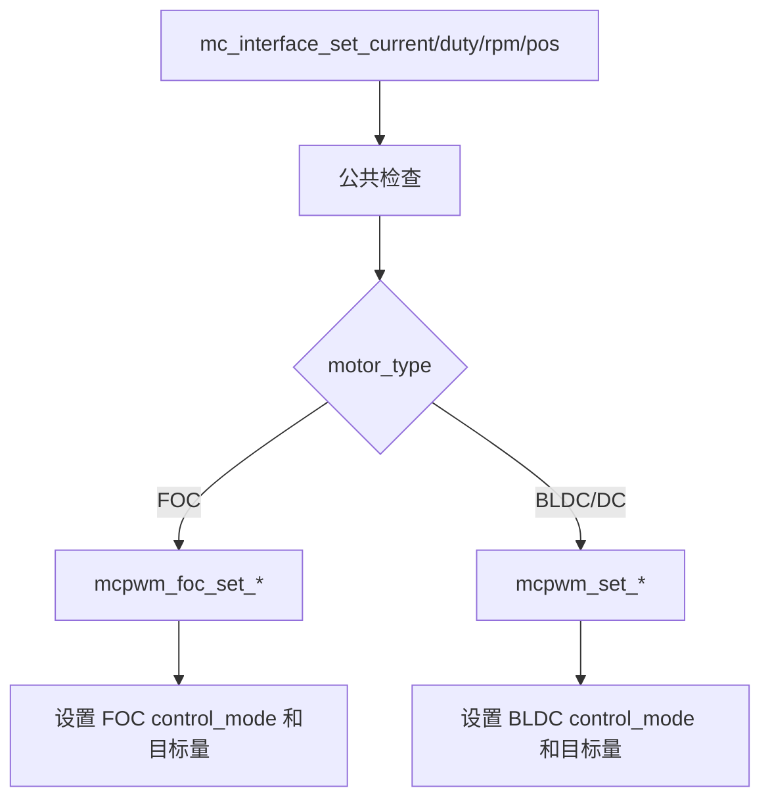

## 控制模式

固件内部用 `mc_control_mode` 表示当前控制目标。不同模式最后都会转化成底层 PWM 输出。

| 模式 | 目标量 | FOC 中的核心含义 |
| --- | --- | --- |
| `CONTROL_MODE_DUTY` | 占空比 | 直接跟踪目标占空比，必要时用 PI 缓慢降占空比。 |
| `CONTROL_MODE_CURRENT` | 电机电流 | 设置 `iq` 目标，`id` 通常为 0。 |
| `CONTROL_MODE_CURRENT_BRAKE` | 刹车电流 | 以电流方式制动，低速或换向时可能短接三相。 |
| `CONTROL_MODE_SPEED` | 电气转速 ERPM | 速度 PID 输出 `iq` 目标。 |
| `CONTROL_MODE_POS` | 角度位置 | 位置 PID 输出 `iq` 目标。 |
| `CONTROL_MODE_HANDBRAKE` | 静态刹车电流 | 固定电流矢量保持转子。 |
| `CONTROL_MODE_OPENLOOP*` | 开环相位/转速/占空比 | 用于检测、启动、特殊调试或音频等功能。 |

FOC 的核心思想是：除占空比模式和开环模式外，大部分控制最终都转换为 `id_target` 和 `iq_target`。其中 `iq` 控制转矩，`id` 通常用于弱磁或 MTPA。

## FOC 控制主线

FOC 默认是当前 `basic` 目标的默认电机类型。`mcpwm_foc.c` 的核心闭环在 ADC 中断中运行，也就是 `mcpwm_foc_adc_int_handler()`。

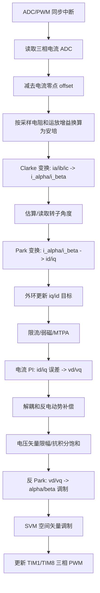

### 采样和坐标变换

ADC 中断中先读三相电流：

```text
GET_CURRENT1/2/3 -> 减 offset -> 乘 FAC_CURRENT -> curr0/curr1/curr2
```

如果硬件是三采样电阻，代码可以做完整 Clarke 变换：

```text
i_alpha = 2/3*ia - 1/3*ib - 1/3*ic
i_beta  = 1/sqrt(3)*ib - 1/sqrt(3)*ic
```

如果不是三采样电阻，则假设三相电流平衡，用两相推第三相。

随后根据当前相位做 Park 变换：

```text
id = cos(theta)*i_alpha + sin(theta)*i_beta
iq = cos(theta)*i_beta  - sin(theta)*i_alpha
```

`id/iq` 是 FOC 的关键反馈量。

### 转子角度来源

FOC 可以从多种来源获得相位：

| 模式 | 角度来源 |
| --- | --- |
| `FOC_SENSOR_MODE_SENSORLESS` | 观测器估算。 |
| `FOC_SENSOR_MODE_ENCODER` / `ENCODER_AB` | 编码器角度，结合 offset、ratio、inverted 修正。 |
| `FOC_SENSOR_MODE_HALL` | 霍尔状态修正。 |
| `FOC_SENSOR_MODE_HFI*` | 低速高频注入估算，速度升高后可切换到观测器。 |

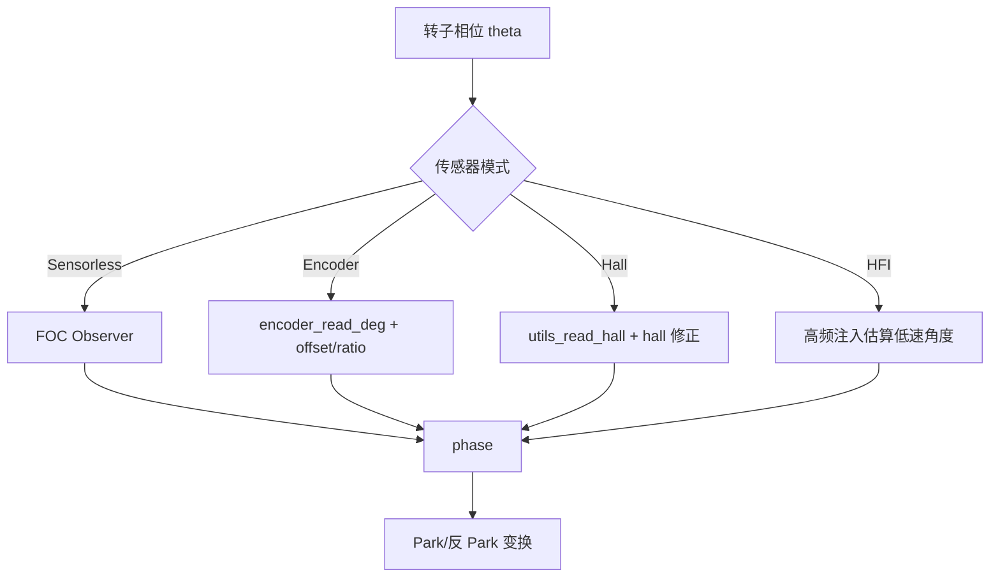

### 外环：位置/速度到电流

FOC 的外环在 `foc_math.c` 中实现。策略是外环输出归一化控制量，再映射到电流目标。

位置环：

```text
目标角度 - 当前角度 -> PID -> output[-1,1] -> iq_set
```

速度环：

```text
目标 ERPM - 当前 ERPM -> PID -> output[-1,1] -> iq_set
```

速度 PID 还支持目标转速斜坡 `s_pid_ramp_erpms_s`，可以把阶跃转速命令变成渐变命令。

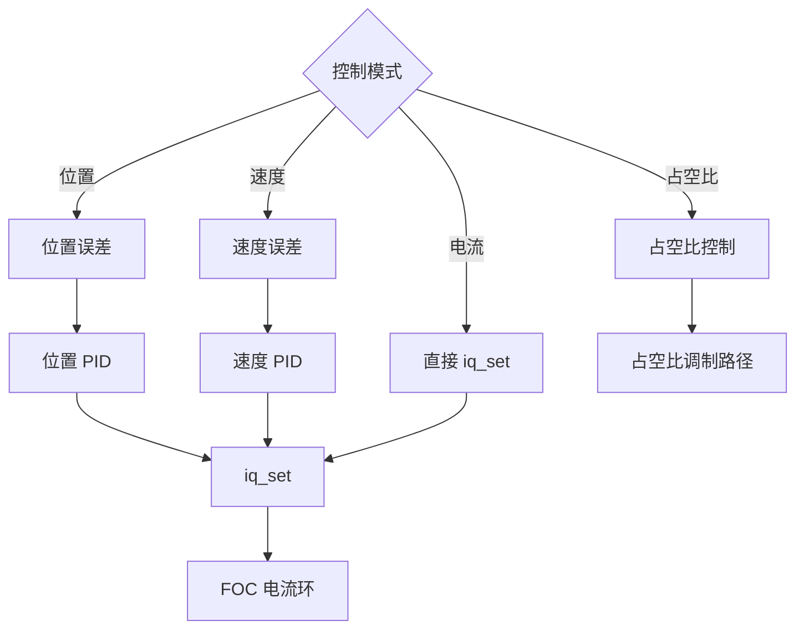

`CONTROL_MODE_CURRENT` 最直接：`mcpwm_foc_set_current()` 将目标电流写入 `m_iq_set`，`m_id_set` 置为 0。

### 电流环：id/iq 到 vd/vq

电流环在 `control_current()` 中实现。

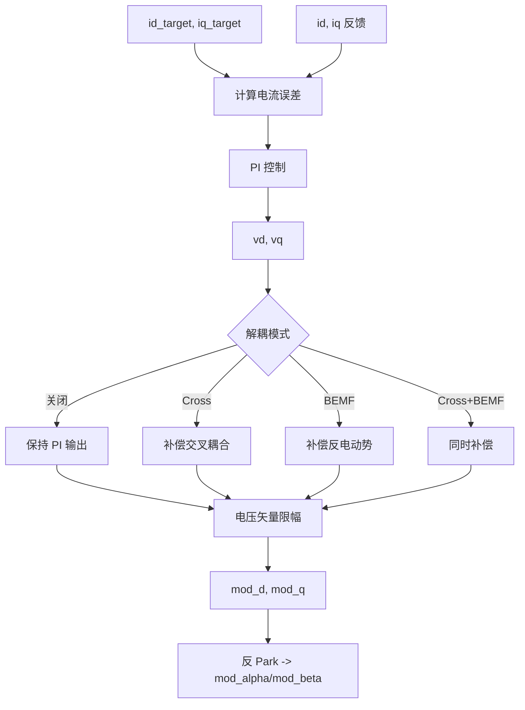

电流 PI 控制结构：

```text
Ierr_d = id_target - id
Ierr_q = iq_target - iq

vd_int += Ierr_d * Ki * dt
vq_int += Ierr_q * Ki * dt

vd = vd_int + Ierr_d * Kp
vq = vq_int + Ierr_q * Kp
```

随后根据配置执行解耦：

| 解耦模式 | 作用 |
| --- | --- |
| `FOC_CC_DECOUPLING_DISABLED` | 不补偿。 |
| `FOC_CC_DECOUPLING_CROSS` | 补偿 d/q 轴交叉耦合。 |
| `FOC_CC_DECOUPLING_BEMF` | 补偿反电动势。 |
| `FOC_CC_DECOUPLING_CROSS_BEMF` | 同时补偿交叉耦合和反电动势。 |

电压输出会被限制到母线电压可实现范围内，避免过调制和积分饱和。代码里 d 轴优先，因为 d 轴常用于弱磁和效率相关控制。

### 弱磁策略

弱磁在 `foc_run_fw()` 中实现。它主要在电流模式和速度模式下工作。当占空比接近上限时，固件逐渐加入负 d 轴电流，降低等效磁链，让电机在高转速区仍能提升速度。

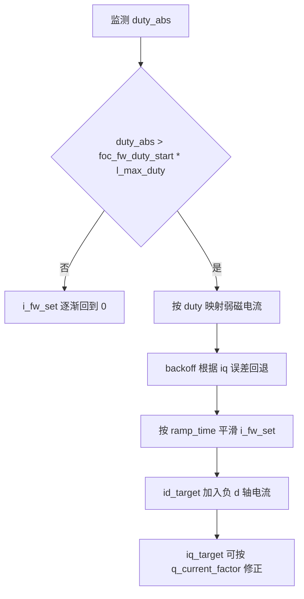

弱磁不是独立控制模式，而是叠加在 FOC 电流目标上的策略。

## FOC 占空比模式

`CONTROL_MODE_DUTY` 与电流/速度/位置模式不同，它目标是占空比而不是电流。代码在 ADC 中断中判断 `control_duty`：

- `CONTROL_MODE_DUTY`
- `CONTROL_MODE_OPENLOOP_DUTY`
- `CONTROL_MODE_OPENLOOP_DUTY_PHASE`
- 某些刹车场景下临时使用 `duty=0`

当目标占空比低于当前占空比时，代码可能使用 PI 方式平滑降占空比，避免突然截断造成危险。占空比模式最终仍要通过 SVM 更新 PWM。

## BLDC/DC 控制策略

`mcpwm.c` 实现传统 BLDC 和 DC 控制。它不是 d/q 轴 FOC，而是基于 PWM、反电动势、霍尔或编码器的换相控制。

### BLDC 设定函数

| 函数 | 行为 |
| --- | --- |
| `mcpwm_set_duty()` | 设置 `CONTROL_MODE_DUTY`，目标是占空比。 |
| `mcpwm_set_pid_speed()` | 设置 `CONTROL_MODE_SPEED`，目标是 ERPM。 |
| `mcpwm_set_pid_pos()` | 设置 `CONTROL_MODE_POS`，目标是位置。 |
| `mcpwm_set_current()` | 设置 `CONTROL_MODE_CURRENT`，目标是电机电流。 |
| `mcpwm_set_brake_current()` | 设置 `CONTROL_MODE_CURRENT_BRAKE`，目标是刹车电流。 |

### 六步换相主线

`mcpwm_adc_int_handler()` 是 BLDC 的关键中断。它读取相电压、计算虚拟中点、检测反电动势过零，然后按策略换相。

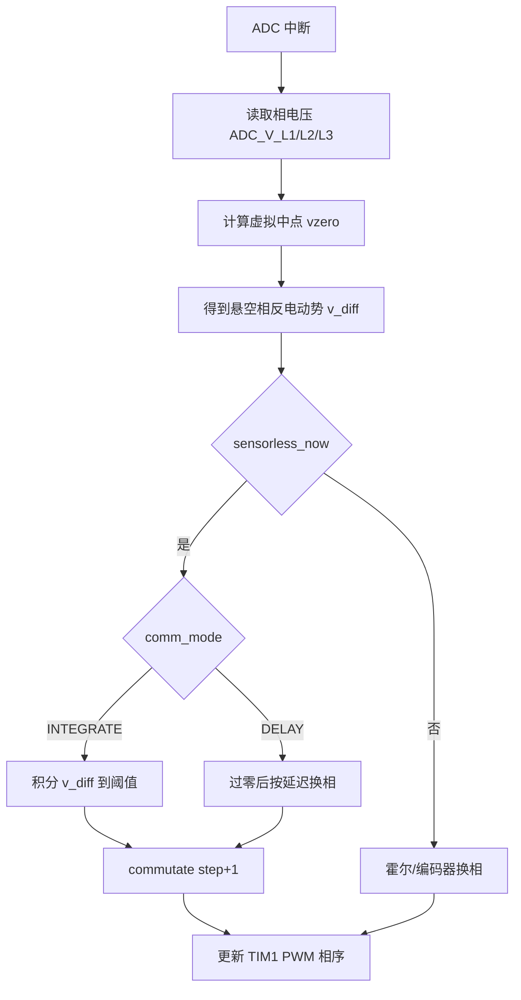

与 FOC 相比，BLDC 更像“状态机 + 换相时序控制”：它关心当前在六步中的哪一步、悬空相电压是否过零、是否达到换相阈值或延迟。

## 运行时限流策略

配置写入时有 `HW_LIM_*` 硬件上限，运行时还有 `update_override_limits()` 动态计算 `lo_current_max`、`lo_current_min`、`lo_in_current_max`、`lo_in_current_min`。控制环实际使用的是这些动态限值。

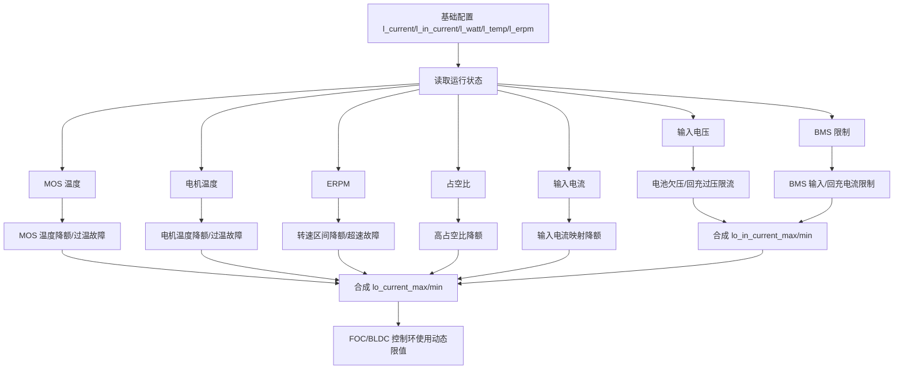

动态限流来源：

| 限流来源 | 作用 |
| --- | --- |
| MOS 温度 | 接近 `l_temp_fet_end` 时逐步降低电机电流，超过后故障停机。 |
| 电机温度 | 接近 `l_temp_motor_end` 时逐步降低电机电流，超过后故障停机。 |
| ERPM | 接近最大/最小 ERPM 时降低加速方向电流。 |
| 占空比 | 接近最大占空比时降低电流，避免控制余量不足。 |
| 电池电压 | 欠压时降低放电电流，回充过压时降低回充电流。 |
| 功率限制 | 根据 `l_watt_max/min` 和当前电压换算输入电流限制。 |
| BMS | 由 BMS 更新输入/回充电流限制。 |
| 输入电流映射 | 输入电流接近上限时反向压低电机电流目标。 |

FOC ADC 中断中还会对 `iq_set_tmp` 做二次裁剪：

- 根据 `lo_in_current_max/min` 限制输入电流。
- 根据 `lo_current_max/min` 限制电机电流。
- 根据 `id` 占用的电流余量限制 `iq`，保证 `sqrt(id^2 + iq^2)` 不超过当前允许电流。

## 故障保护策略

故障保护分成两类：快速中断级故障和线程级/周期级状态处理。

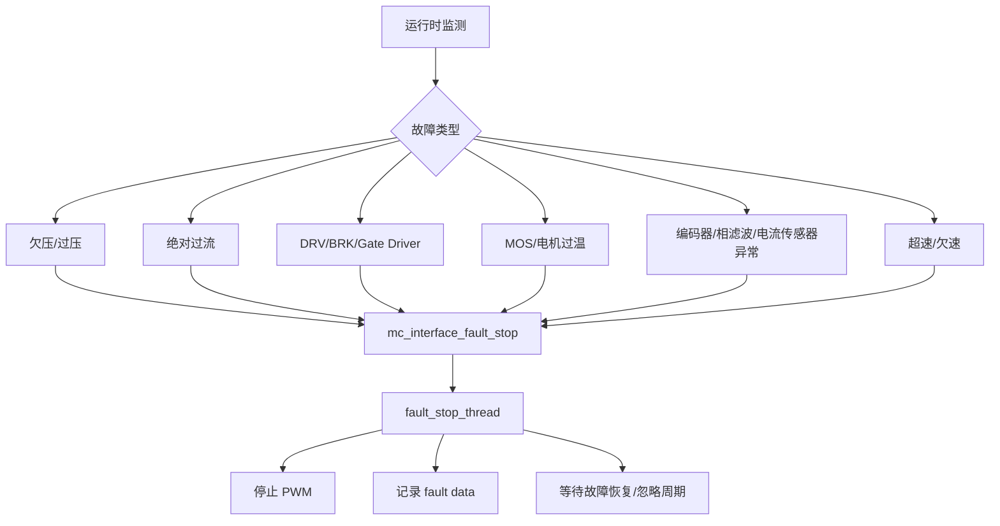

`mc_interface_mc_timer_isr()` 中会周期检查：

- 输入电压是否低于 `l_min_vin` 或高于 `l_max_vin`。
- 绝对电流是否超过 `l_abs_current_max`。
- DRV、BRK、Gate Driver、低压输出保护等硬件故障。
- 温度降额和过温故障。
- ERPM 超速/欠速故障。
- 电流传感器 offset 过大或三相电流不平衡。

一旦触发 `mc_interface_fault_stop()`，它会通知 `fault_stop_thread`，由线程完成停机和故障数据记录。

## 超时和急停策略

`timeout.c` 负责命令超时、急停输入和线程看门狗。若长时间没有上层输入刷新，或者 kill switch 触发，固件会释放输入锁并给两个电机都设置刹车电流。

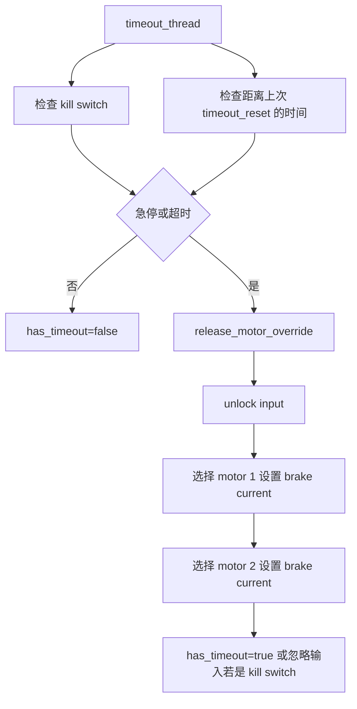

这意味着上层控制命令需要周期性刷新，否则固件不会一直保持旧油门命令。

## 配置写入时的硬件限值

控制策略不只在运行时限流，配置写入时也会被硬件目标限制。例如 `basic` 中的 `HW_LIM_CURRENT`、`HW_LIM_VIN`、`HW_LIM_TEMP_FET` 会通过 `commands_apply_mcconf_hw_limits()` 裁剪 VESC Tool 写入的配置。

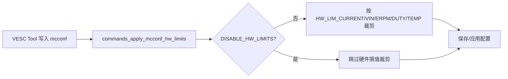

`no_limits` 固件目标通常就是通过定义 `DISABLE_HW_LIMITS` 跳过这一步。它不会改变控制算法，只是取消配置写入时的硬件上限保护。

## FOC 与 BLDC 的策略差异

| 项目 | FOC | BLDC/DC |
| --- | --- | --- |
| 控制核心 | d/q 轴电流闭环 | PWM 占空比、电流和六步换相 |
| 主要反馈 | 三相电流、转子角度、母线电压 | 相电压反电动势、霍尔/编码器、电流 |
| PWM 生成 | SVM 空间矢量调制 | 六步换相对应的相桥状态 |
| 转矩控制 | `iq` 直接对应转矩 | 通过电流和换相时序间接控制 |
| 高速扩展 | 支持弱磁 | 依赖换相策略和相位提前 |
| 适用 | 默认主流策略，控制精细 | 兼容传统 BLDC/DC 控制 |

## 关键数据流

从一个“设置电流”的命令看完整数据流：

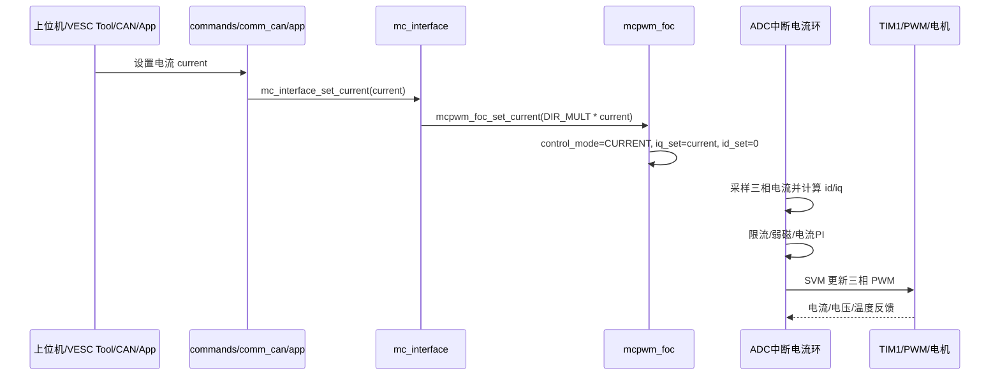

## 分析结论

这套固件的控制策略可以概括为：

```text
上层只表达目标：占空比、电流、刹车电流、速度、位置
mc_interface 统一分发，并叠加输入锁、事件记录、运行时限流和故障保护
FOC 把速度/位置外环转成 iq，再用 id/iq 电流环控制三相 PWM
BLDC/DC 走六步换相或 DC PWM，依赖反电动势/霍尔/编码器反馈
硬件配置文件决定采样、电压换算、PWM 引脚和硬件安全边界
timeout 和 fault_stop 保证失联、超限或硬件异常时进入刹车/停机路径
```

继续深入时，建议按这条代码路线阅读：

```text
comm/commands.c 或 comm/comm_can.c
  -> motor/mc_interface.c: mc_interface_set_*
  -> motor/mcpwm_foc.c: mcpwm_foc_set_* / mcpwm_foc_adc_int_handler
  -> motor/foc_math.c: foc_run_pid_control_speed / foc_run_pid_control_pos / foc_run_fw
  -> motor/mcpwm_foc.c: control_current / foc_svm / TIMER_UPDATE_DUTY
  -> motor/mc_interface.c: update_override_limits / mc_interface_mc_timer_isr
  -> timeout.c: timeout_thread
```
