# 架构解析

本文档用于说明当前 VESC 固件工程如何逐层剥离解析。分析对象为 `bldc` 工程，核心入口包括 `Makefile`、`make/fw.mk`、`main.c` 以及各模块目录下的 `*.mk` 和 `*.c` 文件。

## 解析方法

逐层剥离时不要从单个源文件硬读到底，而是按“构建入口 -> 编译模块 -> 运行入口 -> 业务链路 -> 底层硬件”的方向拆。

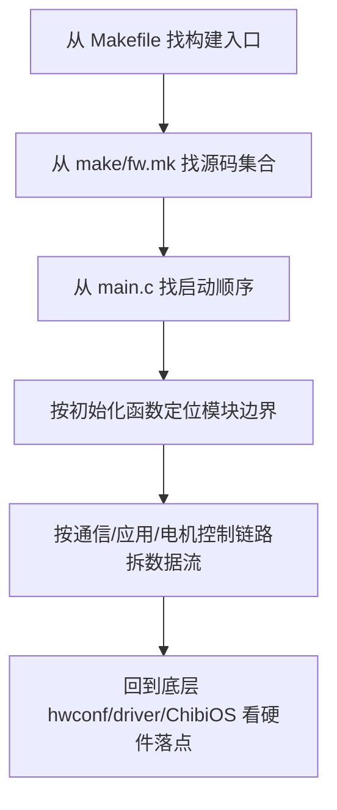

建议阅读顺序：

```text
Makefile
make/fw.mk
main.c
hwconf/hwconf.mk
comm/comm.mk
motor/motor.mk
applications/applications.mk
driver/driver.mk
encoder/encoder.mk
util/util.mk
```

## 总体分层

当前工程可以按 6 层理解：

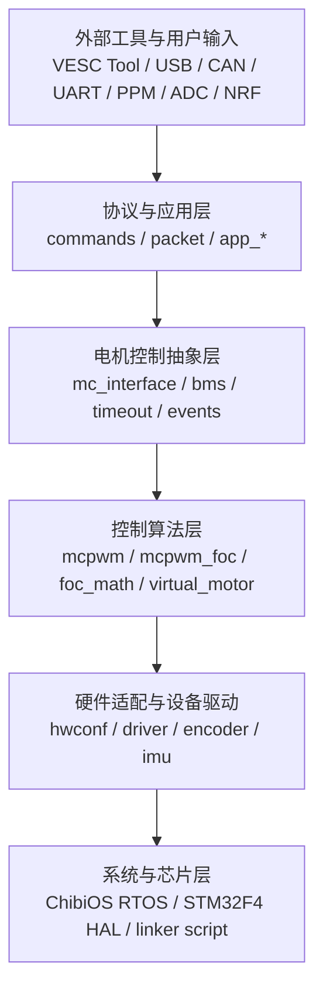

各层职责：

```text
系统与芯片层：提供 RTOS、HAL、启动代码、链接脚本、STM32F4 外设能力。
硬件适配层：把不同板卡的 GPIO、ADC、驱动芯片、CAN、编码器、IMU 差异封装起来。
控制算法层：实现 BLDC/DC/FOC 控制，负责 PWM、采样、观测器、PID、HFI 等实时控制。
电机控制抽象层：对外提供统一 mc_interface API，管理配置、故障、统计、采样和双电机选择。
协议与应用层：解析 VESC 通信协议，处理 VESC Tool 命令，管理 PPM/ADC/UART/Nunchuk/PAS 等输入应用。
外部输入层：来自 USB、CAN、UART、遥控、模拟量、无线等接口的控制与配置请求。
```

## 构建层解析

根 Makefile 负责发现板卡、安装工具链、生成固件目标。`make/fw.mk` 负责真正汇总源码、包含 ChibiOS、设置编译器并输出 `.elf` 和 `.bin`。

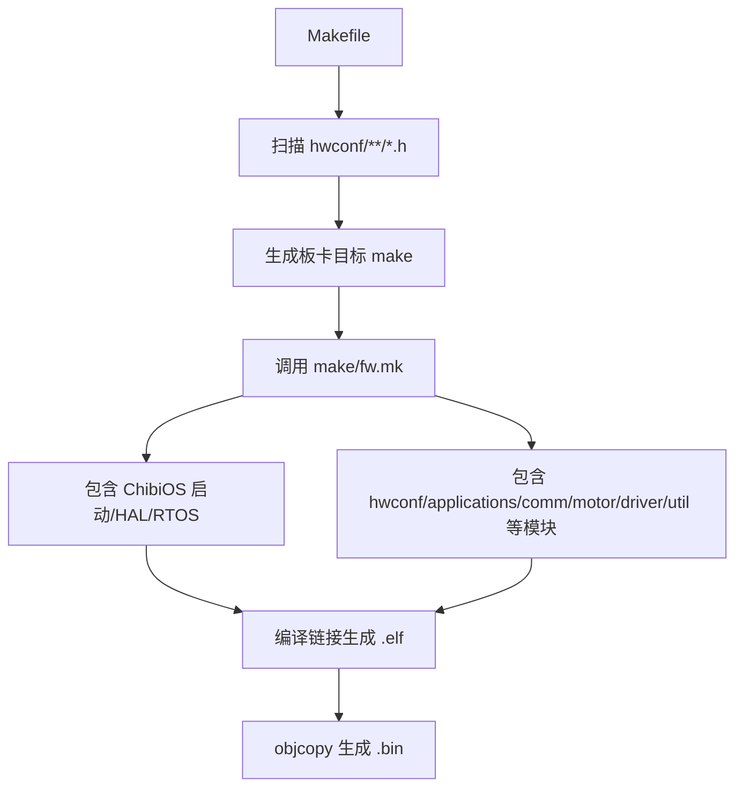

`make/fw.mk` 中的主要模块来源：

```text
ChibiOS_3.0.5：RTOS、HAL、启动文件、ARM Cortex-M GCC 规则
hwconf：板卡硬件配置和驱动芯片适配
applications：PPM、ADC、UART、Nunchuk、PAS、自定义应用
comm：USB、CAN、packet、commands
motor：mc_interface、mcpwm、mcpwm_foc、foc_math
driver：EEPROM、LED PWM、软件 SPI/I2C、NRF、LoRa、Timer
encoder：ABI、SPI、BiSS-C、SinCos、PWM 等编码器
imu：MPU、ICM、BMI160、LSM6DS3、Fusion AHRS
util：buffer、crc、mempools、math、worker、LZO
lispBM：可选 LispBM 运行时和 VESC 扩展
```

## 目录职责

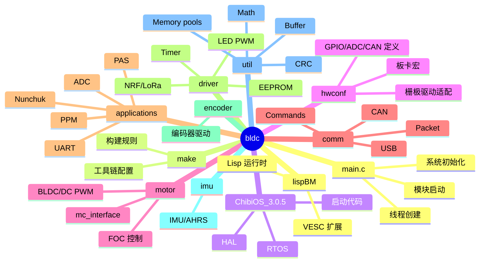

## 启动链路

`main.c` 是运行时的第一主线。启动顺序可以剥离为：系统初始化、早期硬件初始化、配置加载、控制模块初始化、通信初始化、应用初始化、线程启动。

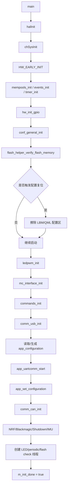

启动时创建的关键线程：

```text
main.c:
  led_thread：根据电机运行状态和故障状态控制 LED。
  periodic_thread：周期发送转子位置、补偿 HSI。
  flash_integrity_check_thread：周期校验 flash，异常则复位。

mc_interface.c:
  timer_thread：电机接口周期任务。
  sample_send_thread：调试采样数据发送。
  fault_stop_thread：故障停机处理。
  stat_thread：统计数据更新。

comm_usb.c:
  serial_read_thread：USB 字节接收。
  serial_process_thread：USB packet 解码。

comm_can.c:
  cancom_read_thread：CAN 帧接收。
  cancom_process_thread：CAN 帧解析。
  cancom_status_thread/status_thread_2：周期广播状态。

mcpwm_foc.c:
  timer_thread：FOC 周期任务。
  hfi_thread：高频注入相关任务。
  pid_thread：速度/位置 PID。
```

## 硬件配置剥离

硬件目标由 `hwconf/**/*.h` 派生。Makefile 过滤 `*_core.h` 后，把 `hw_100_250.h` 这样的文件转换成 `100_250` 编译目标。

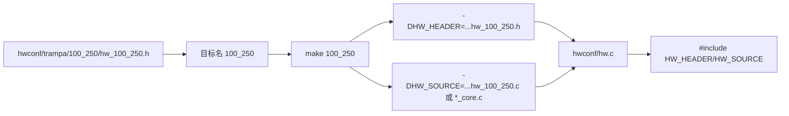

硬件层主要提供：

```text
HW_NAME：硬件名称
GPIO/ADC/CAN/UART/SPI/I2C 引脚
栅极驱动芯片类型和配置
电压、电流、温度采样参数
电机限制默认值
硬件专属初始化 hw_init_gpio
硬件专属宏，如 LED、DRV、CAN、NRF、IMU、shutdown
```

这一层的关键点是：上层大多数代码不直接知道具体板卡，而是通过 `HW_*` 宏和 `hw_*` 函数间接访问硬件差异。

## 配置链路

配置分为电机配置 `mc_configuration`、应用配置 `app_configuration`、硬件/自定义变量和备份数据。核心结构定义在 `datatypes.h`，读写逻辑集中在 `conf_general.c`。

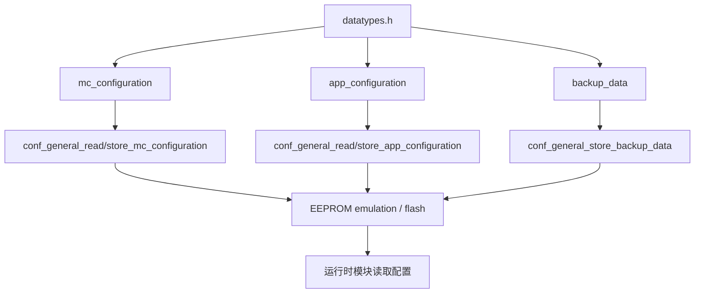

配置流向：

```text
启动时：
  conf_general_init -> 读取 EEPROM/备份数据
  mc_interface_init -> 读取或生成 mc_configuration
  main -> 读取或生成 app_configuration
  app_set_configuration -> 按 app_to_use 启停应用

运行时：
  VESC Tool/USB/CAN 命令 -> commands_process_packet
  写入 mc/app 配置 -> conf_general_store_*
  立即应用 -> mc_interface_set_configuration / app_set_configuration
```

## 通信链路

通信层分两段：传输层负责收字节或收 CAN 帧，`packet` 负责帧格式和 CRC，`commands` 负责命令分发。

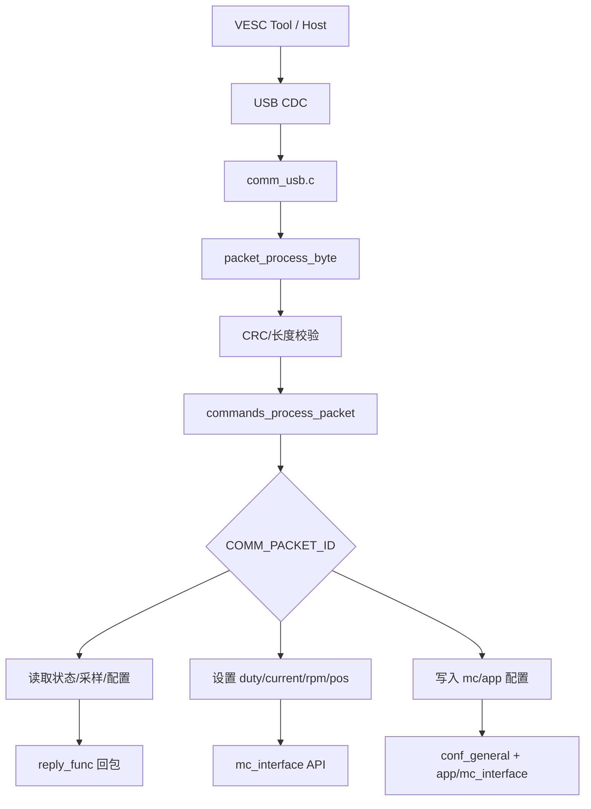

CAN 链路既可以承载 VESC CAN 控制帧，也可以转发完整命令包：

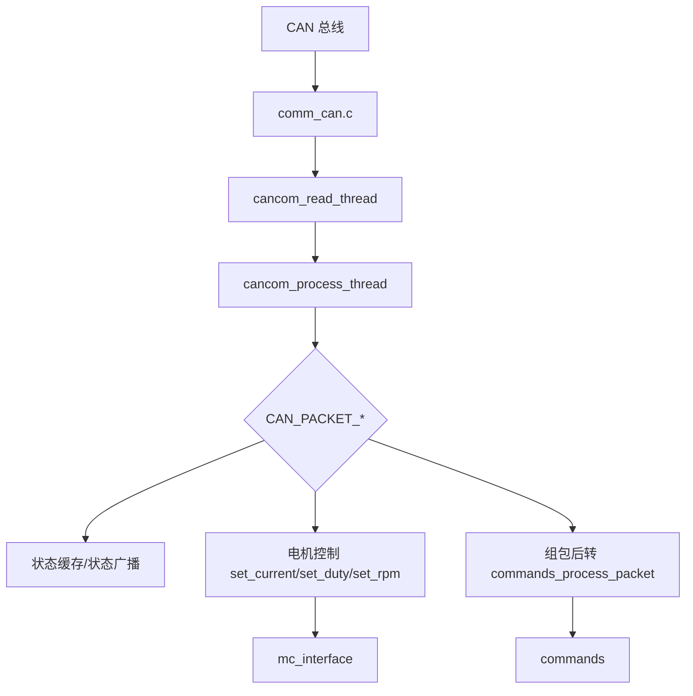

`commands.c` 是协议层核心，常见命令会落到：

```text
mc_interface_set_duty
mc_interface_set_current
mc_interface_set_brake_current
mc_interface_set_pid_speed
mc_interface_set_pid_pos
conf_general_store_mc_configuration
conf_general_store_app_configuration
app_set_configuration
timeout_reset
```

## 应用输入链路

`applications/app.c` 根据 `app_configuration.app_to_use` 启停不同输入应用。应用模块把外部输入转换为统一的电机控制 API。

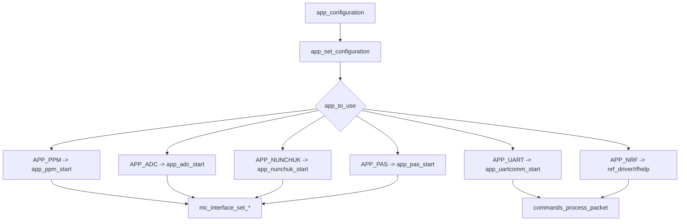

可以把应用层理解为“非 VESC Tool 的控制入口”。例如 PPM/ADC/PAS 会根据采样值和配置计算电流、占空比、速度或位置，然后调用 `mc_interface_set_*`。

## 电机控制链路

`mc_interface.c` 是上层到电机控制算法的统一门面。上层不直接调用 `mcpwm_foc` 或 `mcpwm`，而是调用 `mc_interface_set_current`、`mc_interface_set_duty` 等 API。

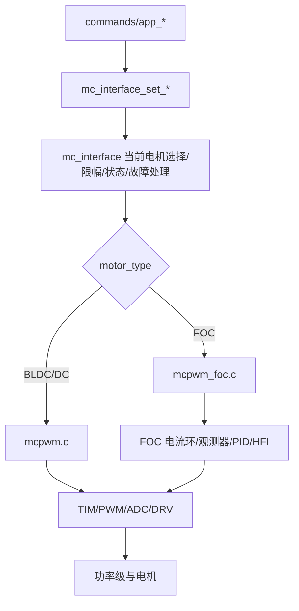

`mc_interface_init` 的核心动作：

```text
读取或生成 mc_configuration
创建统计、采样、故障处理线程
配置栅极驱动芯片
初始化编码器
根据 motor_type 选择 mcpwm 或 mcpwm_foc
初始化 BMS
```

FOC 控制层主要职责：

```text
ADC 电流/电压采样
Clark/Park 变换和反变换
电流环控制
速度/位置 PID
传感器/编码器/霍尔/无感观测器融合
HFI 高频注入
PWM 定时器更新
故障检测与保护
```

## 数据流总览

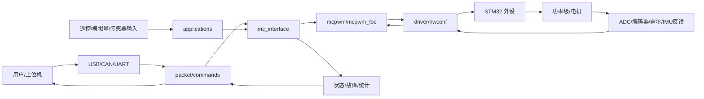

## 依赖方向

理想阅读和修改时应保持依赖方向向下：

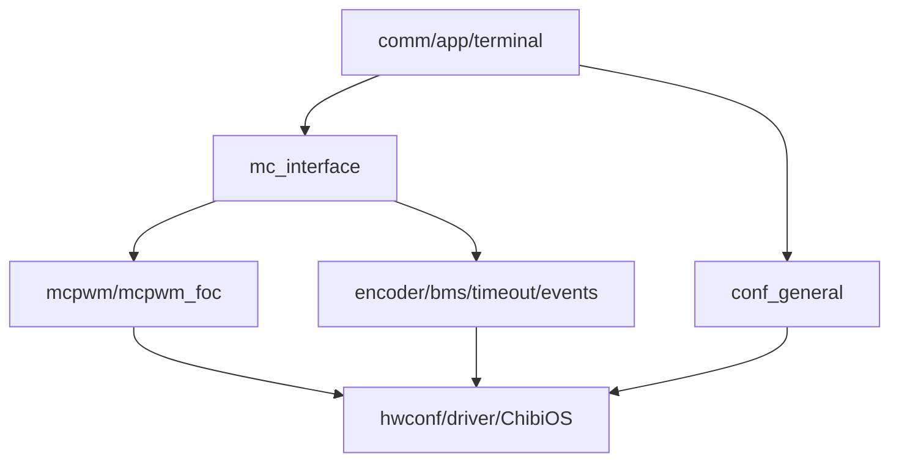

需要特别注意的耦合点：

```text
commands.c 既处理通信命令，也会直接调用配置、电机、应用、flash、BMS、IMU 等模块，是协议枢纽。
mc_interface.c 既是控制 API，也是状态、故障、统计、采样和双电机上下文的中心。
hwconf 通过宏影响大量编译条件，换板卡时很多行为在预处理阶段就已经变化。
main.c 的初始化顺序很重要，尤其是 timer、hw_init_gpio、conf_general、mc_interface、app_set_configuration、comm_can 的先后。
```

## 修改定位指南

按需求类型快速定位：

```text
新增或修改板卡：
  hwconf/<vendor>/<board>/hw_<board>.h
  hwconf/<vendor>/<board>/hw_<board>.c 或 *_core.c

修改编译目标或模块纳入：
  Makefile
  make/fw.mk
  对应目录的 *.mk

修改 USB/VESC Tool 命令：
  comm/packet.c
  comm/commands.c
  datatypes.h 中的 COMM_PACKET_ID

修改 CAN 控制或状态广播：
  comm/comm_can.c
  documentation/comm_can.md

修改 PPM/ADC/UART/Nunchuk/PAS 输入逻辑：
  applications/app.c
  applications/app_ppm.c
  applications/app_adc.c
  applications/app_uartcomm.c
  applications/app_nunchuk.c
  applications/app_pas.c

修改电机控制接口或保护：
  motor/mc_interface.c
  motor/mc_interface.h

修改 FOC 算法：
  motor/mcpwm_foc.c
  motor/foc_math.c

修改编码器支持：
  encoder/encoder.c
  encoder/encoder_cfg.c
  encoder/enc_*.c

修改配置结构：
  datatypes.h
  conf_general.c
  confgenerator.c
```

## 推荐的逐层调试路径

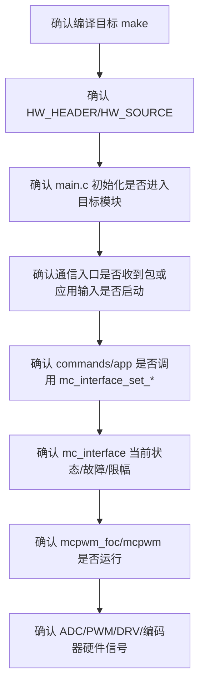

实操时可以按下面顺序收敛问题：

```text
1. 构建层：目标是否正确，是否编译了预期 hwconf。
2. 启动层：main 初始化是否完成，m_init_done 是否为 true。
3. 配置层：mc_configuration/app_configuration 是否被正确读取或写入。
4. 输入层：USB/CAN/UART/PPM/ADC 是否进入对应处理函数。
5. 控制层：是否调用 mc_interface_set_*，timeout 是否被 reset。
6. 算法层：mcpwm_foc 或 mcpwm 是否初始化完成。
7. 硬件层：PWM、ADC、DRV、编码器、CAN 引脚是否与板卡宏一致。
```

