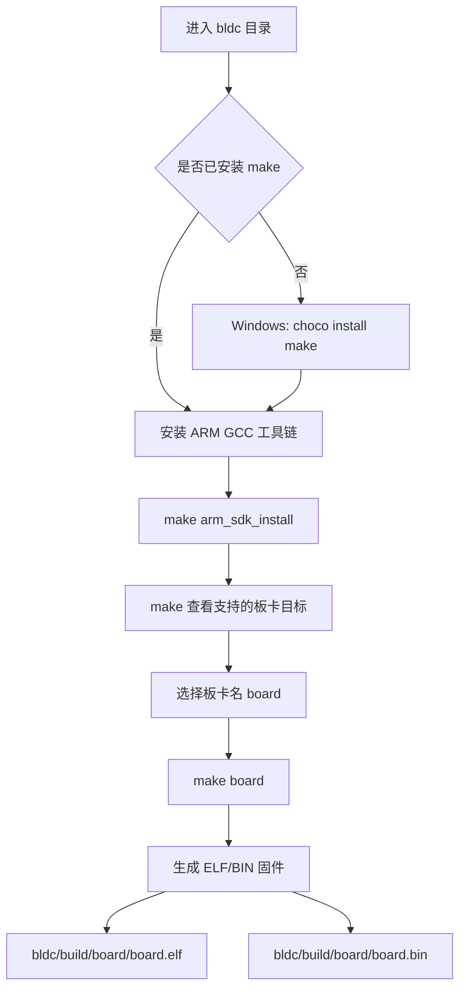
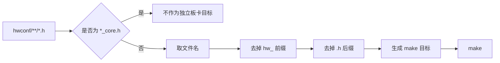
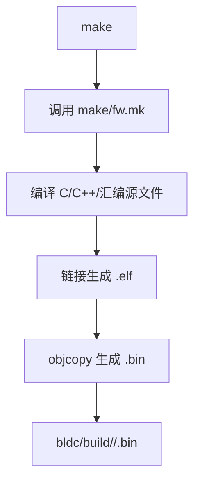
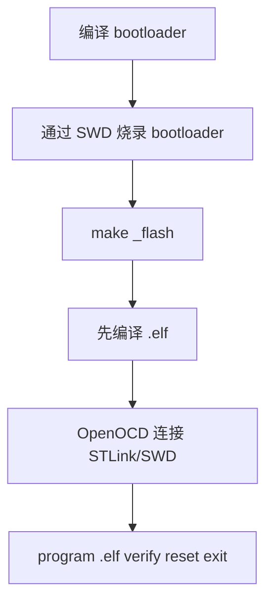
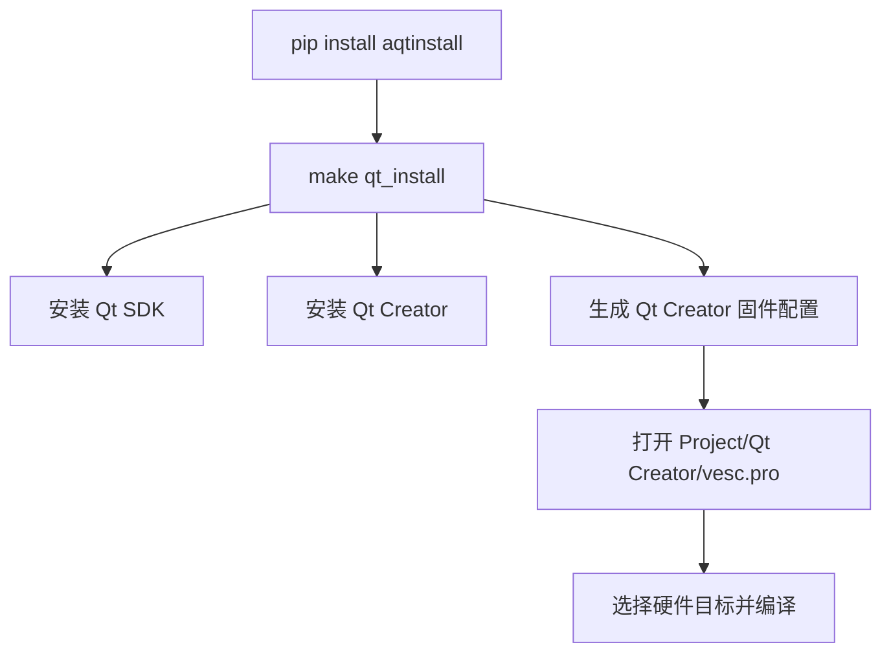

# 编译说明

本文档根据仓库根目录的 `README.md`、`Makefile` 和 `make/` 下的构建脚本整理。当前固件工程入口位于 `bldc` 目录，使用 `make` 编译 VESC 固件。

## 编译入口

工程主 Makefile：

```text
bldc/Makefile
```

主要路径由 Makefile 定义：

```text
TOOLS_DIR = bldc/tools
MAKE_DIR  = bldc/make
BUILD_DIR = bldc/build
DL_DIR    = bldc/downloads
```

`README.md` 中提到的 `bldc/builds/<board>/` 与 Makefile 不一致，实际输出目录以 Makefile 为准，即：

```text
bldc/build/<board>/
```

## 编译流程



## Windows 编译步骤

在 PowerShell 中执行：

```powershell
cd c:\WorkSpace\vedderb_bldc\Lee_fork\bldc
```

首次编译前安装工具链：

```powershell
make arm_sdk_install
```

查看支持的板卡目标：

```powershell
make
```

编译指定板卡，例如 `100_250`：

```powershell
make 100_250
```

输出文件：

```text
bldc/build/100_250/100_250.elf
bldc/build/100_250/100_250.bin
```

## Linux/macOS 编译步骤

安装基础工具：

```bash
sudo apt install git build-essential libgl-dev libxcb-xinerama0 wget git-gui
```

macOS 可额外安装烧录相关工具：

```bash
brew install stlink
brew install openocd
```

进入工程目录后：

```bash
cd bldc
make arm_sdk_install
make
make 100_250
```

## 板卡目标如何生成

Makefile 会递归扫描：

```text
bldc/hwconf/**/*.h
```

然后过滤掉 `*_core.h`，将文件名中的 `hw_` 前缀和 `.h` 后缀去掉，作为可编译目标。

示例：

```text
hwconf/trampa/100_250/hw_100_250.h
```

对应编译命令：

```powershell
make 100_250
```

目标生成关系：



常见目标示例：

```text
100_250
100_250_no_limits
100_500
75_300
60
```

完整列表以 `make` 输出为准。

## 常用命令

```powershell
make
```

显示帮助和支持的板卡目标。

```powershell
make arm_sdk_install
```

安装 GNU ARM GCC 工具链。脚本会下载 `gcc-arm-none-eabi-7-2018-q2-update` 并放入 `bldc/tools/`。

```powershell
make 100_250
```

编译 `100_250` 板卡固件。

```powershell
make 100_250 V=1
```

显示详细编译命令，适合排查编译参数或源文件路径。

```powershell
make 100_250_clean
```

清理指定板卡的构建产物。

```powershell
make all_fw
```

编译全部板卡，耗时较长。

```powershell
make all_fw_package
```

编译并打包固件。

## 输出文件

单板卡编译后输出在：

```text
bldc/build/<board>/
```

主要文件：

```text
<board>.elf
<board>.bin
```

其中：

```text
.elf 用于调试或 SWD/OpenOCD 烧录
.bin 用于 VESC Tool 自定义固件上传
```

输出关系：



## 烧录方式

### 使用 STLink/SWD 烧录

文档要求先编译并烧录 bootloader，然后执行目标板卡的 `_flash` 目标：

```powershell
make 100_250_flash
```

该目标会调用 OpenOCD，并使用生成的：

```text
bldc/build/100_250/100_250.elf
```

烧录流程：



### 使用 VESC Tool 通过 USB 上传

先编译出 `.bin` 文件：

```powershell
make 100_250
```

然后在 VESC Tool 中选择：

```text
Firmware -> Custom file -> 选择 bldc/build/100_250/100_250.bin -> Upload
```

上传过程中设备断开属于正常现象。上传完成后建议等待约 10 秒再断电或拔线。

## Qt Creator IDE

如果希望通过 Qt Creator 打开工程：

```powershell
pip install aqtinstall
make qt_install
```

Qt Creator 工程文件：

```text
bldc/Project/Qt Creator/vesc.pro
```

IDE 默认配置为编译 `100_250`，可在 Qt Creator 左侧底部切换硬件目标。

IDE 安装和使用关系：



## 自定义硬件配置编译

Makefile 支持 `fw_custom`，需要同时指定硬件 C 文件和硬件头文件：

```powershell
make fw_custom HW_SRC=<硬件源文件路径> HW_HEADER=<硬件头文件路径>
```

示例结构：

```text
HW_SRC    = hwconf/example/hw_example_core.c
HW_HEADER = hwconf/example/hw_example.h
```

## 常见问题

### 1. `make` 不存在

Windows 按 README 建议安装 Chocolatey 后执行：

```powershell
choco install make
```

安装 Git 时需要将 Git 加入 PATH。

如果 PowerShell 提示：

```text
choco : 无法将“choco”项识别为 cmdlet、函数、脚本文件或可运行程序的名称
```

说明当前机器还没有安装 Chocolatey，或者 Chocolatey 没有加入 PATH。可以先用管理员 PowerShell 安装 Chocolatey：

```powershell
Set-ExecutionPolicy Bypass -Scope Process -Force
[System.Net.ServicePointManager]::SecurityProtocol = [System.Net.ServicePointManager]::SecurityProtocol -bor 3072
iwr https://community.chocolatey.org/install.ps1 -UseBasicParsing | iex
```

安装完成后关闭当前 PowerShell，重新打开管理员 PowerShell，再执行：

```powershell
choco install make
```

也可以不用 Chocolatey，改用 Git Bash 或 MSYS2 环境编译。若使用 Git Bash，工程路径写法示例：

```bash
cd /c/WorkSpace/vedderb_bldc/Lee_fork/bldc
make arm_sdk_install
make 100_250
```

注意不要在 `C:\WINDOWS\system32` 目录下执行编译命令。编译前应先切换到固件工程目录：

```powershell
cd c:\WorkSpace\vedderb_bldc\Lee_fork\bldc
```

### 2. ARM 工具链不存在

执行：

```powershell
make arm_sdk_install
```

如果未安装，Makefile 会提示：

```text
ARM-SDK not in bldc/tools/gcc-arm-none-eabi-7-2018-q2-update
Please run 'make arm_sdk_install'
```

### 3. 不知道板卡名

执行：

```powershell
make
```

查看 `[Firmware]` 下的 supported boards 列表。

### 4. 编译路径以哪个为准

以 Makefile 为准：

```text
bldc/build/<board>/
```

README 中的 `bldc/builds/<board>/` 与实际 Makefile 不一致。
